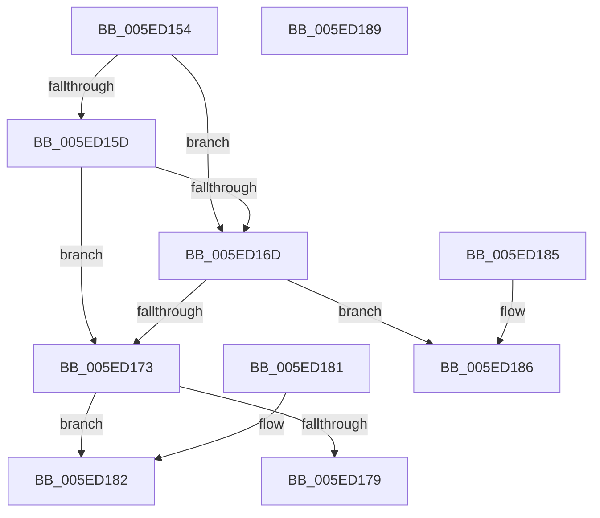

# ValidateStd3Range

- RVA: `0x005ED154`–`0x005ED18A` (길이 `54` bytes)
- VA: `0x00000001405ED154`
- 실행 섹션: `.text`
- PDB 이름 있음: `예`; PDB Function 태그: `아니요`
- unwind 정보 RVA: `0x000DB714`
- 디코드: `20`개 명령, `54/54` bytes 표시
- 미해석 바이트: `0` (있으면 어셈블리에 `.byte`로 보존)

> 이 문서는 커널 이미지의 기계어와 PDB 기호를 분석해 생성했습니다. 4번과 5번은 함수 원형과 자료형을 바이너리 사용 방식에서 추정한 C 해석이며 원본 소스 복구 결과는 아닙니다.

## 1. Dependencies

- 직접 호출 지점: **0**; 고유 호출 대상: **0**
- 직접 호출자로 확인된 함수: **3**
- RIP 상대 이미지 참조: **0**

### Outgoing calls
- 직접 디코드된 call 명령이 없습니다.

### Direct callers
- [RtlpValidateAsciiStd3AndLength](../../page/79/RtlpValidateAsciiStd3AndLength_function_00791F68.md) at `0x0079206C`
- [punycode_decode](../../page/79/punycode_decode_function_007920EC.md) at `0x00792291`
- [punycode_decode](../../page/79/punycode_decode_function_007920EC.md) at `0x00792593`
- [punycode_encode](../../page/79/punycode_encode_function_007926F4.md) at `0x0079283D`

### Static image references
- 디코드된 RIP-relative 메모리 참조가 없습니다.

## 2. Other-region calls and transfers

- 다른 실행 섹션으로 향하는 call: **0**
- 별도 외부 분기/꼬리 이동을 확인하지 못했습니다.

## 3. Assembly (complete function range)

```asm
005ED154  8D 41 D3                        lea eax, [rcx - 0x2d]
005ED157  66 83 F8 2D                     cmp ax, 0x2d
005ED15B  77 10                           ja 0x1405ed16d
005ED15D  48 BA FB 1F F0 FF FF 3F 00 00   movabs rdx, 0x3ffffff01ffb
005ED167  48 0F A3 C2                     bt rdx, rax
005ED16B  72 06                           jb 0x1405ed173
005ED16D  66 83 F9 61                     cmp cx, 0x61
005ED171  72 13                           jb 0x1405ed186
005ED173  66 83 F9 7B                     cmp cx, 0x7b
005ED177  72 09                           jb 0x1405ed182
005ED179  66 83 F9 7F                     cmp cx, 0x7f
005ED17D  0F 97 C0                        seta al
005ED180  C3                              ret
005ED181  CC                              int3
005ED182  B0 01                           mov al, 1
005ED184  C3                              ret
005ED185  CC                              int3
005ED186  32 C0                           xor al, al
005ED188  C3                              ret
005ED189  CC                              int3
```

## 4. C-style interpretation (structured pseudocode)

```c
__int64 __fastcall ValidateStd3Range(__int64 a1)
{
    __int64 result;

    if (((unsigned __int16)(a1 - 45)) > 45) goto loc_005ED16D;
    if (((unsigned __int16)(a1 - 45)) < 45) goto loc_005ED173;
loc_005ED16D:
    if (((unsigned __int16)(a1)) < 97) goto loc_005ED186;
loc_005ED173:
    if (((unsigned __int16)(a1)) < 123) goto loc_005ED182;
    result = (((unsigned __int16)(a1)) > 127) ? 1 : 0;
    return result;
loc_005ED182:
    return 1;
loc_005ED186:
    result = 0;
    return result;
}
```

## 5. (Beta) C Style

```c
int64_t ValidateStd3Range(void *Arg1)
{
    uint8_t *arg1 = (uint8_t *)Arg1;

    int64_t result;

    if (((uint16_t)(Arg1 - 45)) > 45) goto loc_005ED16D;
    if (((uint16_t)(Arg1 - 45)) < 45) goto loc_005ED173;
loc_005ED16D:
    if (((uint16_t)(Arg1)) < 97) goto loc_005ED186;
loc_005ED173:
    if (((uint16_t)(Arg1)) < 123) goto loc_005ED182;
    result = (((uint16_t)(Arg1)) > 127) ? 1 : 0;
    return result;
loc_005ED182:
    return 1;
loc_005ED186:
    result = 0;
    return result;
}
```

### 관측된 메모리 오프셋

구조체 형식이 확인되지 않은 접근은 인자 기준의 오프셋으로만 기록했습니다.

| 기준 인자 | 오프셋 표현 | 폭 (bit) | 접근 |
|---|---:|---:|---|
| `Arg1` | `- 0x2D` | `32` | `R` |

## 6. Execution-region graph

[열기: 2D/3D 그래프와 함수 탐색 컨트롤 패널](../../../control-panel.html?section=text&rva=0x005ED154&view=graph)

- 2D 그래프는 위에서 아래로 흐르고, 3D 그래프는 빈 공간을 드래그해 회전합니다. Shift+드래그는 이동, 휠은 확대·축소, 함수 노드 선택은 대상 보고서 이동입니다.

### Static fallback


