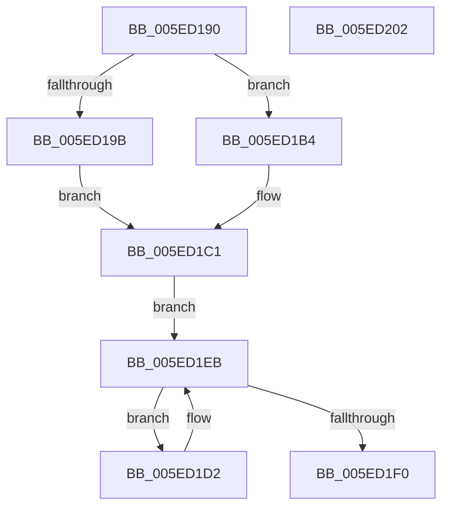

# adapt

- RVA: `0x005ED190`–`0x005ED203` (길이 `115` bytes)
- VA: `0x00000001405ED190`
- 실행 섹션: `.text`
- PDB 이름 있음: `예`; PDB Function 태그: `아니요`
- unwind 정보 RVA: `0x000DB714`
- 디코드: `40`개 명령, `115/115` bytes 표시
- 미해석 바이트: `0` (있으면 어셈블리에 `.byte`로 보존)

> 이 문서는 커널 이미지의 기계어와 PDB 기호를 분석해 생성했습니다. 4번과 5번은 함수 원형과 자료형을 바이너리 사용 방식에서 추정한 C 해석이며 원본 소스 복구 결과는 아닙니다.

## 1. Dependencies

- 직접 호출 지점: **0**; 고유 호출 대상: **0**
- 직접 호출자로 확인된 함수: **2**
- RIP 상대 이미지 참조: **0**

### Outgoing calls
- 직접 디코드된 call 명령이 없습니다.

### Direct callers
- [punycode_decode](../../page/79/punycode_decode_function_007920EC.md) at `0x00792413`
- [punycode_encode](../../page/79/punycode_encode_function_007926F4.md) at `0x00792AC8`

### Static image references
- 디코드된 RIP-relative 메모리 참조가 없습니다.

## 2. Other-region calls and transfers

- 다른 실행 섹션으로 향하는 call: **0**
- 별도 외부 분기/꼬리 이동을 확인하지 못했습니다.

## 3. Assembly (complete function range)

```asm
005ED190  45 33 C9                        xor r9d, r9d
005ED193  44 8B D2                        mov r10d, edx
005ED196  45 84 C0                        test r8b, r8b
005ED199  74 19                           je 0x1405ed1b4
005ED19B  B8 91 73 9F 5D                  mov eax, 0x5d9f7391
005ED1A0  F7 E9                           imul ecx
005ED1A2  44 8B C2                        mov r8d, edx
005ED1A5  41 C1 F8 08                     sar r8d, 8
005ED1A9  41 8B C0                        mov eax, r8d
005ED1AC  C1 E8 1F                        shr eax, 0x1f
005ED1AF  44 03 C0                        add r8d, eax
005ED1B2  EB 0D                           jmp 0x1405ed1c1
005ED1B4  8B C1                           mov eax, ecx
005ED1B6  B9 02 00 00 00                  mov ecx, 2
005ED1BB  99                              cdq
005ED1BC  F7 F9                           idiv ecx
005ED1BE  44 8B C0                        mov r8d, eax
005ED1C1  41 8B C0                        mov eax, r8d
005ED1C4  B9 C7 01 00 00                  mov ecx, 0x1c7
005ED1C9  99                              cdq
005ED1CA  41 F7 FA                        idiv r10d
005ED1CD  44 03 C0                        add r8d, eax
005ED1D0  EB 19                           jmp 0x1405ed1eb
005ED1D2  B8 D5 41 1D D4                  mov eax, 0xd41d41d5
005ED1D7  41 F7 E0                        mul r8d
005ED1DA  44 2B C2                        sub r8d, edx
005ED1DD  41 D1 E8                        shr r8d, 1
005ED1E0  44 03 C2                        add r8d, edx
005ED1E3  41 C1 E8 05                     shr r8d, 5
005ED1E7  41 83 C1 24                     add r9d, 0x24
005ED1EB  44 3B C1                        cmp r8d, ecx
005ED1EE  7F E2                           jg 0x1405ed1d2
005ED1F0  43 8D 04 C0                     lea eax, [r8 + r8*8]
005ED1F4  C1 E0 02                        shl eax, 2
005ED1F7  41 8D 48 26                     lea ecx, [r8 + 0x26]
005ED1FB  99                              cdq
005ED1FC  F7 F9                           idiv ecx
005ED1FE  41 03 C1                        add eax, r9d
005ED201  C3                              ret
005ED202  CC                              int3
```

## 4. C-style interpretation (structured pseudocode)

```c
__int64 __fastcall adapt(int a1, int a2, unsigned __int8 a3, int a4)
{
    __int64 result;

    a4 = 0;
    if (a3 == 0) goto loc_005ED1B4;
    a3 = (unsigned int)(((unsigned int)(a2)) >> (8));
    result = (unsigned int)(((unsigned int)(a3)) >> (31));
    a3 = (unsigned int)((a3) + ((unsigned int)(result)));
    goto loc_005ED1C1;
loc_005ED1B4:
loc_005ED1C1:
    a3 = (unsigned int)(((unsigned int)((unsigned int)((unsigned int)(a1)))) + ((unsigned int)((unsigned int)((unsigned int)((unsigned int)((unsigned int)((unsigned int)(a1))))))));
    goto loc_005ED1EB;
loc_005ED1D2:
    a3 = (unsigned int)((a3) - (a2));
    a3 = (unsigned int)((a3) >> (1));
    a3 = (unsigned int)((a3) + (a2));
    a3 = (unsigned int)((a3) >> (5));
    a4 = (unsigned int)((a4) + (36));
loc_005ED1EB:
    if (a3 > 455) goto loc_005ED1D2;
    result = (unsigned int)((a3 + a3 * 8) << (2));
    result = (unsigned int)((result) + (a4));
    return result;
}
```

## 5. (Beta) C Style

```c
int64_t adapt(int32_t Arg1, int32_t Arg2, uint8_t Arg3, int32_t Arg4)
{
    int64_t result;

    Arg4 = 0;
    if (Arg3 == 0) goto loc_005ED1B4;
    Arg3 = (uint32_t)(((uint32_t)(Arg2)) >> (8));
    result = (uint32_t)(((uint32_t)(Arg3)) >> (31));
    Arg3 = (uint32_t)((Arg3) + ((uint32_t)(result)));
    goto loc_005ED1C1;
loc_005ED1B4:
loc_005ED1C1:
    Arg3 = (uint32_t)(((uint32_t)((uint32_t)((uint32_t)(Arg1)))) + ((uint32_t)((uint32_t)((uint32_t)((uint32_t)((uint32_t)((uint32_t)(Arg1))))))));
    goto loc_005ED1EB;
loc_005ED1D2:
    Arg3 = (uint32_t)((Arg3) - (Arg2));
    Arg3 = (uint32_t)((Arg3) >> (1));
    Arg3 = (uint32_t)((Arg3) + (Arg2));
    Arg3 = (uint32_t)((Arg3) >> (5));
    Arg4 = (uint32_t)((Arg4) + (36));
loc_005ED1EB:
    if (Arg3 > 455) goto loc_005ED1D2;
    result = (uint32_t)((Arg3 + Arg3 * 8) << (2));
    result = (uint32_t)((result) + (Arg4));
    return result;
}
```

## 6. Execution-region graph

[열기: 2D/3D 그래프와 함수 탐색 컨트롤 패널](../../../control-panel.html?section=text&rva=0x005ED190&view=graph)

- 2D 그래프는 위에서 아래로 흐르고, 3D 그래프는 빈 공간을 드래그해 회전합니다. Shift+드래그는 이동, 휠은 확대·축소, 함수 노드 선택은 대상 보고서 이동입니다.

### Static fallback


