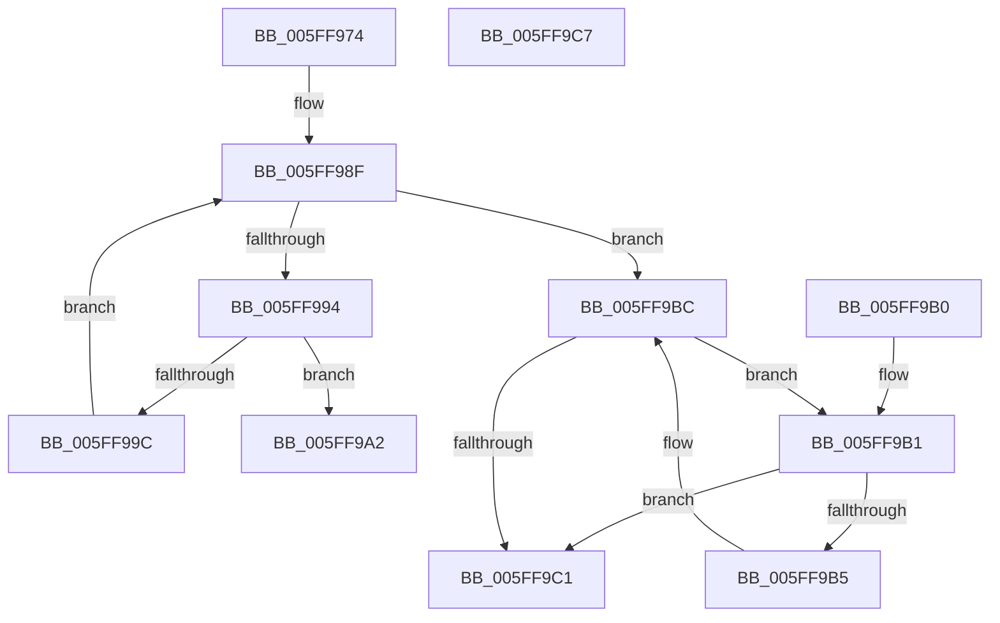

# LZ4HC_countPattern

- RVA: `0x005FF974`–`0x005FF9C8` (길이 `84` bytes)
- VA: `0x00000001405FF974`
- 실행 섹션: `.text`
- PDB 이름 있음: `예`; PDB Function 태그: `예`
- unwind 정보 RVA: `0x000DB714`
- 디코드: `29`개 명령, `84/84` bytes 표시
- 미해석 바이트: `0` (있으면 어셈블리에 `.byte`로 보존)

> 이 문서는 커널 이미지의 기계어와 PDB 기호를 분석해 생성했습니다. 4번과 5번은 함수 원형과 자료형을 바이너리 사용 방식에서 추정한 C 해석이며 원본 소스 복구 결과는 아닙니다.

## 1. Dependencies

- 직접 호출 지점: **0**; 고유 호출 대상: **0**
- 직접 호출자로 확인된 함수: **2**
- RIP 상대 이미지 참조: **0**

### Outgoing calls
- 직접 디코드된 call 명령이 없습니다.

### Direct callers
- [LZ4HC_compress_generic](LZ4HC_compress_generic_function_005F564C.md) at `0x005F59DD`
- [LZ4HC_compress_generic](LZ4HC_compress_generic_function_005F564C.md) at `0x005F5CA8`
- [LZ4HC_compress_generic](LZ4HC_compress_generic_function_005F564C.md) at `0x005F5CDE`
- [LZ4HC_compress_generic](LZ4HC_compress_generic_function_005F564C.md) at `0x005F648E`
- [LZ4HC_compress_generic](LZ4HC_compress_generic_function_005F564C.md) at `0x005F658B`
- [LZ4HC_compress_generic](LZ4HC_compress_generic_function_005F564C.md) at `0x005F65C3`
- [LZ4HC_compress_generic](LZ4HC_compress_generic_function_005F564C.md) at `0x005F6E31`
- [LZ4HC_compress_generic](LZ4HC_compress_generic_function_005F564C.md) at `0x005F6F35`
- [LZ4HC_compress_generic](LZ4HC_compress_generic_function_005F564C.md) at `0x005F6F6C`
- [LZ4HC_compress_generic_dictCtx](LZ4HC_compress_generic_dictCtx_function_005F7D94.md) at `0x005F8303`
- [LZ4HC_compress_generic_dictCtx](LZ4HC_compress_generic_dictCtx_function_005F7D94.md) at `0x005F8422`
- [LZ4HC_compress_generic_dictCtx](LZ4HC_compress_generic_dictCtx_function_005F7D94.md) at `0x005F8458`
- [LZ4HC_compress_generic_dictCtx](LZ4HC_compress_generic_dictCtx_function_005F7D94.md) at `0x005F8968`
- [LZ4HC_compress_generic_dictCtx](LZ4HC_compress_generic_dictCtx_function_005F7D94.md) at `0x005F8D00`
- [LZ4HC_compress_generic_dictCtx](LZ4HC_compress_generic_dictCtx_function_005F7D94.md) at `0x005F8D36`
- [LZ4HC_compress_generic_dictCtx](LZ4HC_compress_generic_dictCtx_function_005F7D94.md) at `0x005F95D6`
- [LZ4HC_compress_generic_dictCtx](LZ4HC_compress_generic_dictCtx_function_005F7D94.md) at `0x005F9677`
- [LZ4HC_compress_generic_dictCtx](LZ4HC_compress_generic_dictCtx_function_005F7D94.md) at `0x005F96AE`
- [LZ4HC_compress_generic_dictCtx](LZ4HC_compress_generic_dictCtx_function_005F7D94.md) at `0x005FAA17`
- [LZ4HC_compress_generic_dictCtx](LZ4HC_compress_generic_dictCtx_function_005F7D94.md) at `0x005FAB33`
- [LZ4HC_compress_generic_dictCtx](LZ4HC_compress_generic_dictCtx_function_005F7D94.md) at `0x005FAB62`
- [LZ4HC_compress_generic_dictCtx](LZ4HC_compress_generic_dictCtx_function_005F7D94.md) at `0x005FB066`
- [LZ4HC_compress_generic_dictCtx](LZ4HC_compress_generic_dictCtx_function_005F7D94.md) at `0x005FB3A7`
- [LZ4HC_compress_generic_dictCtx](LZ4HC_compress_generic_dictCtx_function_005F7D94.md) at `0x005FB3DB`
- [LZ4HC_compress_generic_dictCtx](LZ4HC_compress_generic_dictCtx_function_005F7D94.md) at `0x005FBCAA`
- [LZ4HC_compress_generic_dictCtx](LZ4HC_compress_generic_dictCtx_function_005F7D94.md) at `0x005FBD59`
- [LZ4HC_compress_generic_dictCtx](LZ4HC_compress_generic_dictCtx_function_005F7D94.md) at `0x005FBD89`
- [LZ4HC_compress_generic_dictCtx](LZ4HC_compress_generic_dictCtx_function_005F7D94.md) at `0x005FD0D9`
- [LZ4HC_compress_generic_dictCtx](LZ4HC_compress_generic_dictCtx_function_005F7D94.md) at `0x005FD270`
- [LZ4HC_compress_generic_dictCtx](LZ4HC_compress_generic_dictCtx_function_005F7D94.md) at `0x005FD29F`
- [LZ4HC_compress_generic_dictCtx](LZ4HC_compress_generic_dictCtx_function_005F7D94.md) at `0x005FD8CA`
- [LZ4HC_compress_generic_dictCtx](LZ4HC_compress_generic_dictCtx_function_005F7D94.md) at `0x005FDD38`
- [LZ4HC_compress_generic_dictCtx](LZ4HC_compress_generic_dictCtx_function_005F7D94.md) at `0x005FDD66`
- [LZ4HC_compress_generic_dictCtx](LZ4HC_compress_generic_dictCtx_function_005F7D94.md) at `0x005FE7C1`
- [LZ4HC_compress_generic_dictCtx](LZ4HC_compress_generic_dictCtx_function_005F7D94.md) at `0x005FE84C`
- [LZ4HC_compress_generic_dictCtx](LZ4HC_compress_generic_dictCtx_function_005F7D94.md) at `0x005FE87D`

### Static image references
- 디코드된 RIP-relative 메모리 참조가 없습니다.

## 2. Other-region calls and transfers

- 다른 실행 섹션으로 향하는 call: **0**
- 별도 외부 분기/꼬리 이동을 확인하지 못했습니다.

## 3. Assembly (complete function range)

```asm
005FF974  4C 8B CA                        mov r9, rdx
005FF977  41 8B C0                        mov eax, r8d
005FF97A  48 BA 01 00 00 00 01 00 00 00   movabs rdx, 0x100000001
005FF984  4C 8B D1                        mov r10, rcx
005FF987  48 0F AF C2                     imul rax, rdx
005FF98B  4D 8D 41 F9                     lea r8, [r9 - 7]
005FF98F  49 3B C8                        cmp rcx, r8
005FF992  73 28                           jae 0x1405ff9bc
005FF994  48 8B D0                        mov rdx, rax
005FF997  48 33 11                        xor rdx, qword ptr [rcx]
005FF99A  75 06                           jne 0x1405ff9a2
005FF99C  48 83 C1 08                     add rcx, 8
005FF9A0  EB ED                           jmp 0x1405ff98f
005FF9A2  F3 48 0F BC C2                  tzcnt rax, rdx
005FF9A7  C1 E8 03                        shr eax, 3
005FF9AA  41 2B C2                        sub eax, r10d
005FF9AD  03 C1                           add eax, ecx
005FF9AF  C3                              ret
005FF9B0  CC                              int3
005FF9B1  38 01                           cmp byte ptr [rcx], al
005FF9B3  75 0C                           jne 0x1405ff9c1
005FF9B5  48 FF C1                        inc rcx
005FF9B8  48 C1 E8 08                     shr rax, 8
005FF9BC  49 3B C9                        cmp rcx, r9
005FF9BF  72 F0                           jb 0x1405ff9b1
005FF9C1  41 2B CA                        sub ecx, r10d
005FF9C4  8B C1                           mov eax, ecx
005FF9C6  C3                              ret
005FF9C7  CC                              int3
```

## 4. C-style interpretation (structured pseudocode)

```c
__int64 __fastcall LZ4HC_countPattern(__int64 a1, __int64 a2, int a3)
{
    __int64 result;

    result = ((unsigned int)(a3)) * (a2);
loc_005FF98F:
    if (a1 >= (a2 - 7)) goto loc_005FF9BC;
    a2 = (result) ^ (*(unsigned __int64 *)(a1));
    if (condition_is_not_equal) goto loc_005FF9A2;
    a1 = (a1) + (8);
    goto loc_005FF98F;
loc_005FF9A2:
    result = (unsigned int)((result) >> (3));
    result = (unsigned int)((result) - ((unsigned int)(a1)));
    result = (unsigned int)((result) + ((unsigned int)(a1)));
    return result;
loc_005FF9B1:
    if ((*(unsigned __int8 *)(a1)) != ((unsigned __int8)(result))) goto loc_005FF9C1;
    a1 = (a1) + 1;
    result = (result) >> (8);
loc_005FF9BC:
    if (a1 < a2) goto loc_005FF9B1;
loc_005FF9C1:
    a1 = (unsigned int)((a1) - ((unsigned int)(a1)));
    return (unsigned int)((unsigned int)(a1));
}
```

## 5. (Beta) C Style

```c
int64_t LZ4HC_countPattern(int64_t Arg1, void *Arg2, int32_t Arg3)
{
    uint8_t *arg2 = (uint8_t *)Arg2;

    int64_t result;

    result = ((uint32_t)(Arg3)) * (Arg2);
loc_005FF98F:
    if (Arg1 >= (Arg2 - 7)) goto loc_005FF9BC;
    Arg2 = (result) ^ (*(uint64_t *)(Arg1));
    if (condition_is_not_equal) goto loc_005FF9A2;
    Arg1 = (Arg1) + (8);
    goto loc_005FF98F;
loc_005FF9A2:
    result = (uint32_t)((result) >> (3));
    result = (uint32_t)((result) - ((uint32_t)(Arg1)));
    result = (uint32_t)((result) + ((uint32_t)(Arg1)));
    return result;
loc_005FF9B1:
    if ((*(uint8_t *)(Arg1)) != ((uint8_t)(result))) goto loc_005FF9C1;
    Arg1 = (Arg1) + 1;
    result = (result) >> (8);
loc_005FF9BC:
    if (Arg1 < Arg2) goto loc_005FF9B1;
loc_005FF9C1:
    Arg1 = (uint32_t)((Arg1) - ((uint32_t)(Arg1)));
    return (uint32_t)((uint32_t)(Arg1));
}
```

### 관측된 메모리 오프셋

구조체 형식이 확인되지 않은 접근은 인자 기준의 오프셋으로만 기록했습니다.

| 기준 인자 | 오프셋 표현 | 폭 (bit) | 접근 |
|---|---:|---:|---|
| `Arg2` | `- 0x7` | `64` | `R` |

## 6. Execution-region graph

[열기: 2D/3D 그래프와 함수 탐색 컨트롤 패널](../../../control-panel.html?section=text&rva=0x005FF974&view=graph)

- 2D 그래프는 위에서 아래로 흐르고, 3D 그래프는 빈 공간을 드래그해 회전합니다. Shift+드래그는 이동, 휠은 확대·축소, 함수 노드 선택은 대상 보고서 이동입니다.

### Static fallback


