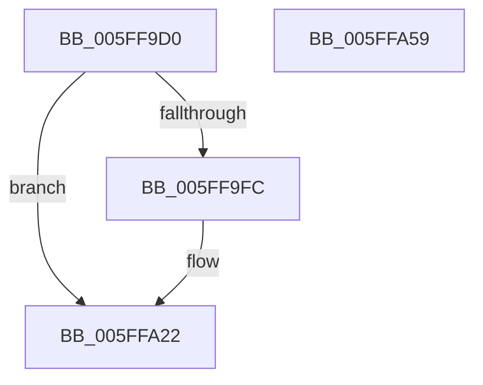

# LZ4HC_init_internal

- RVA: `0x005FF9D0`–`0x005FFA5A` (길이 `138` bytes)
- VA: `0x00000001405FF9D0`
- 실행 섹션: `.text`
- PDB 이름 있음: `예`; PDB Function 태그: `예`
- unwind 정보 RVA: `0x0005CAAC`
- 디코드: `30`개 명령, `138/138` bytes 표시
- 미해석 바이트: `0` (있으면 어셈블리에 `.byte`로 보존)

> 이 문서는 커널 이미지의 기계어와 PDB 기호를 분석해 생성했습니다. 4번과 5번은 함수 원형과 자료형을 바이너리 사용 방식에서 추정한 C 해석이며 원본 소스 복구 결과는 아닙니다.

## 1. Dependencies

- 직접 호출 지점: **2**; 고유 호출 대상: **1**
- 직접 호출자로 확인된 함수: **1**
- RIP 상대 이미지 참조: **0**

### Outgoing calls
- `0x005FFA04` → [memset](../6C/memset_function_006C6C40.md) (function, `0x006C6C40`)
- `0x005FFA1B` → [memset](../6C/memset_function_006C6C40.md) (function, `0x006C6C40`)

### Direct callers
- [LZ4_compress_HC_extStateHC_fastReset](LZ4_compress_HC_extStateHC_fastReset_function_005FFBB0.md) at `0x005FFBE1`

### Static image references
- 디코드된 RIP-relative 메모리 참조가 없습니다.

## 2. Other-region calls and transfers

- 다른 실행 섹션으로 향하는 call: **0**
- 별도 외부 분기/꼬리 이동을 확인하지 못했습니다.

## 3. Assembly (complete function range)

```asm
005FF9D0  48 89 5C 24 08                  mov qword ptr [rsp + 8], rbx
005FF9D5  57                              push rdi
005FF9D6  48 83 EC 20                     sub rsp, 0x20
005FF9DA  8B 81 18 00 04 00               mov eax, dword ptr [rcx + 0x40018]
005FF9E0  48 8B FA                        mov rdi, rdx
005FF9E3  48 2B 81 08 00 04 00            sub rax, qword ptr [rcx + 0x40008]
005FF9EA  48 8B D9                        mov rbx, rcx
005FF9ED  48 03 81 00 00 04 00            add rax, qword ptr [rcx + 0x40000]
005FF9F4  48 3D 00 00 00 40               cmp rax, 0x40000000
005FF9FA  76 26                           jbe 0x1405ffa22
005FF9FC  33 D2                           xor edx, edx
005FF9FE  41 B8 00 00 02 00               mov r8d, 0x20000
005FFA04  E8 37 72 0C 00                  call 0x1406c6c40
005FFA09  48 8D 8B 00 00 02 00            lea rcx, [rbx + 0x20000]
005FFA10  BA FF 00 00 00                  mov edx, 0xff
005FFA15  41 B8 00 00 02 00               mov r8d, 0x20000
005FFA1B  E8 20 72 0C 00                  call 0x1406c6c40
005FFA20  33 C0                           xor eax, eax
005FFA22  05 00 00 01 00                  add eax, 0x10000
005FFA27  48 89 BB 08 00 04 00            mov qword ptr [rbx + 0x40008], rdi
005FFA2E  89 83 20 00 04 00               mov dword ptr [rbx + 0x40020], eax
005FFA34  89 83 18 00 04 00               mov dword ptr [rbx + 0x40018], eax
005FFA3A  89 83 1C 00 04 00               mov dword ptr [rbx + 0x4001c], eax
005FFA40  48 89 BB 00 00 04 00            mov qword ptr [rbx + 0x40000], rdi
005FFA47  48 89 BB 10 00 04 00            mov qword ptr [rbx + 0x40010], rdi
005FFA4E  48 8B 5C 24 30                  mov rbx, qword ptr [rsp + 0x30]
005FFA53  48 83 C4 20                     add rsp, 0x20
005FFA57  5F                              pop rdi
005FFA58  C3                              ret
005FFA59  CC                              int3
```

## 4. C-style interpretation (structured pseudocode)

```c
__int64 __fastcall LZ4HC_init_internal(__int64 a1, __int64 a2)
{
    __int64 result;
    __int64 v_rsp;
    unsigned __int64 v_stack_p8;

    v_stack_p8 = v_rbx;
    v_rsp = (v_rsp) - (32);
    result = ((unsigned int)(*(unsigned int *)(a1 + 262168))) - (*(unsigned __int64 *)(a1 + 262152));
    result = (result) + (*(unsigned __int64 *)(a1 + 262144));
    if (result >= = 0x40000000ULL) {
        a2 = 0;
        a3 = 0x20000ULL;
        result = memset(a1, a2, a3, a4);
        a1 = a1 + 131072;
        a2 = 255;
        a3 = 0x20000ULL;
        result = memset(a1, a2, a3, a4);
        result = 0;
    }
    result = (unsigned int)((result) + (0x10000ULL));
    *(unsigned __int64 *)(a1 + 262152) = a2;
    *(unsigned int *)(a1 + 262176) = (unsigned int)(result);
    *(unsigned int *)(a1 + 262168) = (unsigned int)(result);
    *(unsigned int *)(a1 + 262172) = (unsigned int)(result);
    *(unsigned __int64 *)(a1 + 262144) = a2;
    *(unsigned __int64 *)(a1 + 262160) = a2;
    v_rsp = (v_rsp) + (32);
    return result;
}
```

## 5. (Beta) C Style

```c
int64_t LZ4HC_init_internal(void *Arg1, int64_t Arg2)
{
    uint8_t *arg1 = (uint8_t *)Arg1;

    int64_t result;
    int64_t local_rsp;
    uint64_t v_stack_p8;

    v_stack_p8 = local_rbx;
    local_rsp = (local_rsp) - (32);
    result = ((uint32_t)(*(uint32_t *)(arg1 + 0x40018))) - (*(uint64_t *)(arg1 + 0x40008));
    result = (result) + (*(uint64_t *)(arg1 + 0x40000));
    if (result >= = 0x40000000ULL) {
        Arg2 = 0;
        a3 = 0x20000ULL;
        result = memset(Arg1, Arg2, a3, a4);
        Arg1 = Arg1 + 131072;
        Arg2 = 255;
        a3 = 0x20000ULL;
        result = memset(Arg1, Arg2, a3, a4);
        result = 0;
    }
    result = (uint32_t)((result) + (0x10000ULL));
    *(uint64_t *)(arg1 + 0x40008) = Arg2;
    *(uint32_t *)(arg1 + 0x40020) = (uint32_t)(result);
    *(uint32_t *)(arg1 + 0x40018) = (uint32_t)(result);
    *(uint32_t *)(arg1 + 0x4001C) = (uint32_t)(result);
    *(uint64_t *)(arg1 + 0x40000) = Arg2;
    *(uint64_t *)(arg1 + 0x40010) = Arg2;
    local_rsp = (local_rsp) + (32);
    return result;
}
```

### 관측된 메모리 오프셋

구조체 형식이 확인되지 않은 접근은 인자 기준의 오프셋으로만 기록했습니다.

| 기준 인자 | 오프셋 표현 | 폭 (bit) | 접근 |
|---|---:|---:|---|
| `Arg1` | `+ 0x20000` | `64` | `R` |
| `Arg1` | `+ 0x40000` | `64` | `R` |
| `Arg1` | `+ 0x40000` | `64` | `W` |
| `Arg1` | `+ 0x40008` | `64` | `R` |
| `Arg1` | `+ 0x40008` | `64` | `W` |
| `Arg1` | `+ 0x40010` | `64` | `W` |
| `Arg1` | `+ 0x40018` | `32` | `R` |
| `Arg1` | `+ 0x40018` | `32` | `W` |
| `Arg1` | `+ 0x4001C` | `32` | `W` |
| `Arg1` | `+ 0x40020` | `32` | `W` |

## 6. Execution-region graph

[열기: 2D/3D 그래프와 함수 탐색 컨트롤 패널](../../../control-panel.html?section=text&rva=0x005FF9D0&view=graph)

- 2D 그래프는 위에서 아래로 흐르고, 3D 그래프는 빈 공간을 드래그해 회전합니다. Shift+드래그는 이동, 휠은 확대·축소, 함수 노드 선택은 대상 보고서 이동입니다.

### Static fallback


