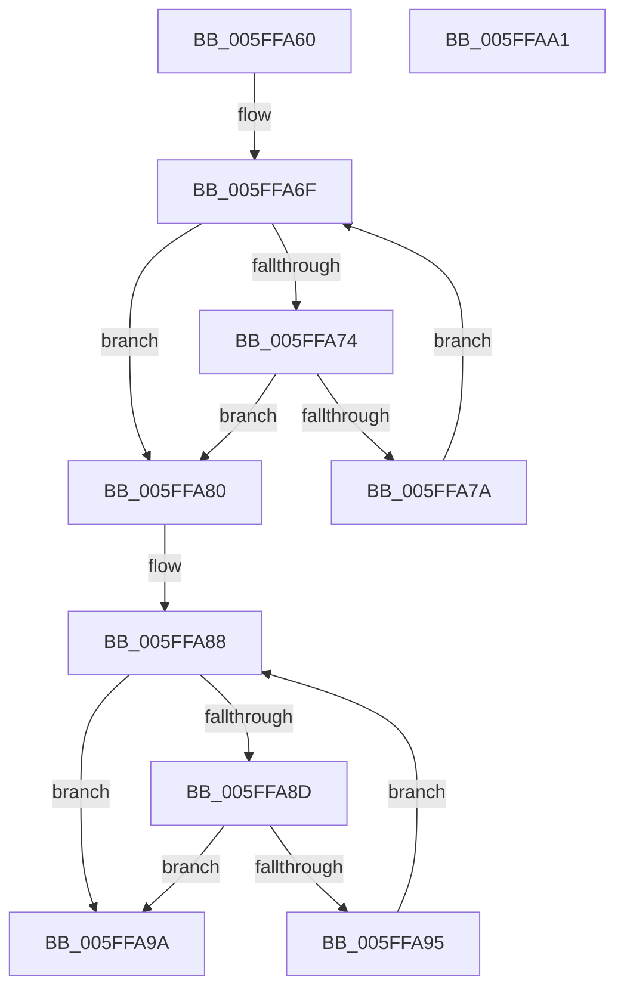

# LZ4HC_reverseCountPattern

- RVA: `0x005FFA60`–`0x005FFAA2` (길이 `66` bytes)
- VA: `0x00000001405FFA60`
- 실행 섹션: `.text`
- PDB 이름 있음: `예`; PDB Function 태그: `예`
- unwind 정보 RVA: `0x000DB714`
- 디코드: `23`개 명령, `66/66` bytes 표시
- 미해석 바이트: `0` (있으면 어셈블리에 `.byte`로 보존)

> 이 문서는 커널 이미지의 기계어와 PDB 기호를 분석해 생성했습니다. 4번과 5번은 함수 원형과 자료형을 바이너리 사용 방식에서 추정한 C 해석이며 원본 소스 복구 결과는 아닙니다.

## 1. Dependencies

- 직접 호출 지점: **0**; 고유 호출 대상: **0**
- 직접 호출자로 확인된 함수: **2**
- RIP 상대 이미지 참조: **0**

### Outgoing calls
- 직접 디코드된 call 명령이 없습니다.

### Direct callers
- [LZ4HC_compress_generic](LZ4HC_compress_generic_function_005F564C.md) at `0x005F5CF8`
- [LZ4HC_compress_generic](LZ4HC_compress_generic_function_005F564C.md) at `0x005F5D30`
- [LZ4HC_compress_generic](LZ4HC_compress_generic_function_005F564C.md) at `0x005F65E2`
- [LZ4HC_compress_generic](LZ4HC_compress_generic_function_005F564C.md) at `0x005F6622`
- [LZ4HC_compress_generic](LZ4HC_compress_generic_function_005F564C.md) at `0x005F6F87`
- [LZ4HC_compress_generic](LZ4HC_compress_generic_function_005F564C.md) at `0x005F6FC8`
- [LZ4HC_compress_generic_dictCtx](LZ4HC_compress_generic_dictCtx_function_005F7D94.md) at `0x005F8472`
- [LZ4HC_compress_generic_dictCtx](LZ4HC_compress_generic_dictCtx_function_005F7D94.md) at `0x005F84AA`
- [LZ4HC_compress_generic_dictCtx](LZ4HC_compress_generic_dictCtx_function_005F7D94.md) at `0x005F8D54`
- [LZ4HC_compress_generic_dictCtx](LZ4HC_compress_generic_dictCtx_function_005F7D94.md) at `0x005F8D97`
- [LZ4HC_compress_generic_dictCtx](LZ4HC_compress_generic_dictCtx_function_005F7D94.md) at `0x005F96C9`
- [LZ4HC_compress_generic_dictCtx](LZ4HC_compress_generic_dictCtx_function_005F7D94.md) at `0x005F9701`
- [LZ4HC_compress_generic_dictCtx](LZ4HC_compress_generic_dictCtx_function_005F7D94.md) at `0x005FAB7C`
- [LZ4HC_compress_generic_dictCtx](LZ4HC_compress_generic_dictCtx_function_005F7D94.md) at `0x005FABB0`
- [LZ4HC_compress_generic_dictCtx](LZ4HC_compress_generic_dictCtx_function_005F7D94.md) at `0x005FB3F4`
- [LZ4HC_compress_generic_dictCtx](LZ4HC_compress_generic_dictCtx_function_005F7D94.md) at `0x005FB42D`
- [LZ4HC_compress_generic_dictCtx](LZ4HC_compress_generic_dictCtx_function_005F7D94.md) at `0x005FBDA3`
- [LZ4HC_compress_generic_dictCtx](LZ4HC_compress_generic_dictCtx_function_005F7D94.md) at `0x005FBDD6`
- [LZ4HC_compress_generic_dictCtx](LZ4HC_compress_generic_dictCtx_function_005F7D94.md) at `0x005FD2BA`
- [LZ4HC_compress_generic_dictCtx](LZ4HC_compress_generic_dictCtx_function_005F7D94.md) at `0x005FD2EE`
- [LZ4HC_compress_generic_dictCtx](LZ4HC_compress_generic_dictCtx_function_005F7D94.md) at `0x005FDD88`
- [LZ4HC_compress_generic_dictCtx](LZ4HC_compress_generic_dictCtx_function_005F7D94.md) at `0x005FDDB9`
- [LZ4HC_compress_generic_dictCtx](LZ4HC_compress_generic_dictCtx_function_005F7D94.md) at `0x005FE8A0`
- [LZ4HC_compress_generic_dictCtx](LZ4HC_compress_generic_dictCtx_function_005F7D94.md) at `0x005FE8D2`

### Static image references
- 디코드된 RIP-relative 메모리 참조가 없습니다.

## 2. Other-region calls and transfers

- 다른 실행 섹션으로 향하는 call: **0**
- 별도 외부 분기/꼬리 이동을 확인하지 못했습니다.

## 3. Assembly (complete function range)

```asm
005FFA60  4C 8B D2                        mov r10, rdx
005FFA63  44 89 44 24 18                  mov dword ptr [rsp + 0x18], r8d
005FFA68  48 83 C2 04                     add rdx, 4
005FFA6C  4C 8B C9                        mov r9, rcx
005FFA6F  48 3B CA                        cmp rcx, rdx
005FFA72  72 0C                           jb 0x1405ffa80
005FFA74  44 39 41 FC                     cmp dword ptr [rcx - 4], r8d
005FFA78  75 06                           jne 0x1405ffa80
005FFA7A  48 83 C1 FC                     add rcx, -4
005FFA7E  EB EF                           jmp 0x1405ffa6f
005FFA80  48 8D 54 24 1B                  lea rdx, [rsp + 0x1b]
005FFA85  48 2B D1                        sub rdx, rcx
005FFA88  49 3B CA                        cmp rcx, r10
005FFA8B  76 0D                           jbe 0x1405ffa9a
005FFA8D  8A 04 0A                        mov al, byte ptr [rdx + rcx]
005FFA90  38 41 FF                        cmp byte ptr [rcx - 1], al
005FFA93  75 05                           jne 0x1405ffa9a
005FFA95  48 FF C9                        dec rcx
005FFA98  EB EE                           jmp 0x1405ffa88
005FFA9A  44 2B C9                        sub r9d, ecx
005FFA9D  41 8B C1                        mov eax, r9d
005FFAA0  C3                              ret
005FFAA1  CC                              int3
```

## 4. C-style interpretation (structured pseudocode)

```c
__int64 __fastcall LZ4HC_reverseCountPattern(__int64 a1, __int64 a2, int a3)
{
    unsigned int v_stack_p18;
    unsigned __int64 v_stack_p1B;

    v_stack_p18 = a3;
    a2 = (a2) + (4);
loc_005FFA6F:
    if (a1 < a2) goto loc_005FFA80;
    if ((*(unsigned int *)(a1 - 4)) != a3) goto loc_005FFA80;
    a1 = (a1) + (-4);
    goto loc_005FFA6F;
loc_005FFA80:
    a2 = (v_stack_p1B) - (a1);
loc_005FFA88:
    if (a1 <= a2) goto loc_005FFA9A;
    if ((*(unsigned __int8 *)(a1 - 1)) != ((unsigned __int8)(*(unsigned __int8 *)(a2 + a1 * 1)))) goto loc_005FFA9A;
    a1 = (a1) - 1;
    goto loc_005FFA88;
loc_005FFA9A:
    a4 = (unsigned int)((a1) - ((unsigned int)(a1)));
    return (unsigned int)((unsigned int)(a4));
}
```

## 5. (Beta) C Style

```c
int64_t LZ4HC_reverseCountPattern(int64_t Arg1, int64_t Arg2, int32_t Arg3)
{
    uint32_t v_stack_p18;
    uint64_t v_stack_p1B;

    v_stack_p18 = Arg3;
    Arg2 = (Arg2) + (4);
loc_005FFA6F:
    if (Arg1 < Arg2) goto loc_005FFA80;
    if ((*(uint32_t *)(Arg1 - 0x4)) != Arg3) goto loc_005FFA80;
    Arg1 = (Arg1) + (-4);
    goto loc_005FFA6F;
loc_005FFA80:
    Arg2 = (v_stack_p1B) - (Arg1);
loc_005FFA88:
    if (Arg1 <= Arg2) goto loc_005FFA9A;
    if ((*(uint8_t *)(Arg1 - 0x1)) != ((uint8_t)(*(uint8_t *)(Arg2 + Arg1 * 1)))) goto loc_005FFA9A;
    Arg1 = (Arg1) - 1;
    goto loc_005FFA88;
loc_005FFA9A:
    a4 = (uint32_t)((Arg1) - ((uint32_t)(Arg1)));
    return (uint32_t)((uint32_t)(a4));
}
```

## 6. Execution-region graph

[열기: 2D/3D 그래프와 함수 탐색 컨트롤 패널](../../../control-panel.html?section=text&rva=0x005FFA60&view=graph)

- 2D 그래프는 위에서 아래로 흐르고, 3D 그래프는 빈 공간을 드래그해 회전합니다. Shift+드래그는 이동, 휠은 확대·축소, 함수 노드 선택은 대상 보고서 이동입니다.

### Static fallback


