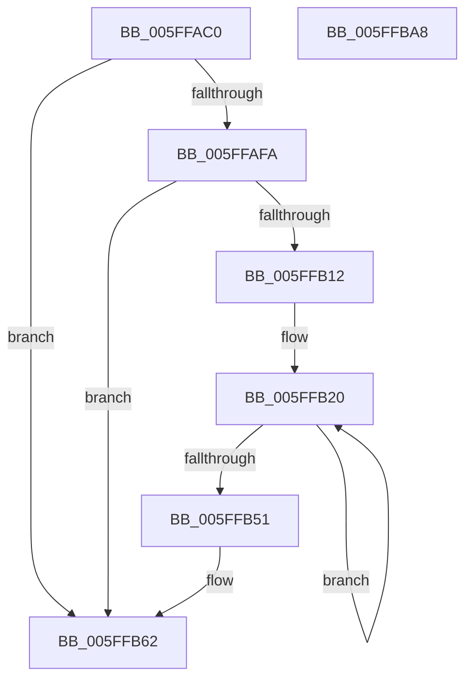

# LZ4HC_setExternalDict

- RVA: `0x005FFAC0`–`0x005FFBA9` (길이 `233` bytes)
- VA: `0x00000001405FFAC0`
- 실행 섹션: `.text`
- PDB 이름 있음: `예`; PDB Function 태그: `예`
- unwind 정보 RVA: `0x000A5A38`
- 디코드: `59`개 명령, `233/233` bytes 표시
- 미해석 바이트: `0` (있으면 어셈블리에 `.byte`로 보존)

> 이 문서는 커널 이미지의 기계어와 PDB 기호를 분석해 생성했습니다. 4번과 5번은 함수 원형과 자료형을 바이너리 사용 방식에서 추정한 C 해석이며 원본 소스 복구 결과는 아닙니다.

## 1. Dependencies

- 직접 호출 지점: **0**; 고유 호출 대상: **0**
- 직접 호출자로 확인된 함수: **1**
- RIP 상대 이미지 참조: **0**

### Outgoing calls
- 직접 디코드된 call 명령이 없습니다.

### Direct callers
- [LZ4HC_compress_generic_dictCtx](LZ4HC_compress_generic_dictCtx_function_005F7D94.md) at `0x005FA4EC`

### Static image references
- 디코드된 RIP-relative 메모리 참조가 없습니다.

## 2. Other-region calls and transfers

- 다른 실행 섹션으로 향하는 call: **0**
- 별도 외부 분기/꼬리 이동을 확인하지 못했습니다.

## 3. Assembly (complete function range)

```asm
005FFAC0  48 8B C4                        mov rax, rsp
005FFAC3  48 89 58 08                     mov qword ptr [rax + 8], rbx
005FFAC7  48 89 68 10                     mov qword ptr [rax + 0x10], rbp
005FFACB  48 89 70 18                     mov qword ptr [rax + 0x18], rsi
005FFACF  48 89 78 20                     mov qword ptr [rax + 0x20], rdi
005FFAD3  4C 8B C1                        mov r8, rcx
005FFAD6  4C 8D 89 08 00 04 00            lea r9, [rcx + 0x40008]
005FFADD  49 8B 09                        mov rcx, qword ptr [r9]
005FFAE0  48 8B FA                        mov rdi, rdx
005FFAE3  4D 8D 90 00 00 04 00            lea r10, [r8 + 0x40000]
005FFAEA  48 8D 41 04                     lea rax, [rcx + 4]
005FFAEE  4D 8D 98 18 00 04 00            lea r11, [r8 + 0x40018]
005FFAF5  49 39 02                        cmp qword ptr [r10], rax
005FFAF8  72 68                           jb 0x1405ffb62
005FFAFA  41 8B 33                        mov esi, dword ptr [r11]
005FFAFD  41 8B 02                        mov eax, dword ptr [r10]
005FFB00  41 8B 98 20 00 04 00            mov ebx, dword ptr [r8 + 0x40020]
005FFB07  2B C1                           sub eax, ecx
005FFB09  8D 6E FD                        lea ebp, [rsi - 3]
005FFB0C  03 E8                           add ebp, eax
005FFB0E  3B DD                           cmp ebx, ebp
005FFB10  73 50                           jae 0x1405ffb62
005FFB12  44 8B D3                        mov r10d, ebx
005FFB15  4C 2B D6                        sub r10, rsi
005FFB18  BE FF FF 00 00                  mov esi, 0xffff
005FFB1D  4C 03 D1                        add r10, rcx
005FFB20  41 69 12 B1 79 37 9E            imul edx, dword ptr [r10], 0x9e3779b1
005FFB27  8B CB                           mov ecx, ebx
005FFB29  0F B7 C3                        movzx eax, bx
005FFB2C  48 C1 EA 11                     shr rdx, 0x11
005FFB30  41 2B 0C 90                     sub ecx, dword ptr [r8 + rdx*4]
005FFB34  48 3B CE                        cmp rcx, rsi
005FFB37  48 0F 47 CE                     cmova rcx, rsi
005FFB3B  49 FF C2                        inc r10
005FFB3E  66 41 89 8C 40 00 00 02 00      mov word ptr [r8 + rax*2 + 0x20000], cx
005FFB47  41 89 1C 90                     mov dword ptr [r8 + rdx*4], ebx
005FFB4B  FF C3                           inc ebx
005FFB4D  3B DD                           cmp ebx, ebp
005FFB4F  72 CF                           jb 0x1405ffb20
005FFB51  49 8B 09                        mov rcx, qword ptr [r9]
005FFB54  4D 8D 90 00 00 04 00            lea r10, [r8 + 0x40000]
005FFB5B  4D 8D 88 08 00 04 00            lea r9, [r8 + 0x40008]
005FFB62  41 8B 13                        mov edx, dword ptr [r11]
005FFB65  41 8B 02                        mov eax, dword ptr [r10]
005FFB68  41 2B 01                        sub eax, dword ptr [r9]
005FFB6B  49 83 A0 28 00 04 00 00         and qword ptr [r8 + 0x40028], 0
005FFB73  03 C2                           add eax, edx
005FFB75  48 8B 5C 24 08                  mov rbx, qword ptr [rsp + 8]
005FFB7A  48 8B 6C 24 10                  mov rbp, qword ptr [rsp + 0x10]
005FFB7F  48 8B 74 24 18                  mov rsi, qword ptr [rsp + 0x18]
005FFB84  49 89 39                        mov qword ptr [r9], rdi
005FFB87  49 89 3A                        mov qword ptr [r10], rdi
005FFB8A  48 8B 7C 24 20                  mov rdi, qword ptr [rsp + 0x20]
005FFB8F  41 89 03                        mov dword ptr [r11], eax
005FFB92  41 89 80 20 00 04 00            mov dword ptr [r8 + 0x40020], eax
005FFB99  41 89 90 1C 00 04 00            mov dword ptr [r8 + 0x4001c], edx
005FFBA0  49 89 88 10 00 04 00            mov qword ptr [r8 + 0x40010], rcx
005FFBA7  C3                              ret
005FFBA8  CC                              int3
```

## 4. C-style interpretation (structured pseudocode)

```c
__int64 __fastcall LZ4HC_setExternalDict(__int64 a1, __int64 a2)
{
    __int64 result;
    __int64 v_r10;
    __int64 v_rbp;
    __int64 v_rbx;
    unsigned __int64 v_stack_p10;
    unsigned __int64 v_stack_p18;
    unsigned __int64 v_stack_p20;
    unsigned __int64 v_stack_p8;

    *(unsigned __int64 *)(v_rsp + 8) = v_rbx;
    *(unsigned __int64 *)(v_rsp + 16) = v_rbp;
    *(unsigned __int64 *)(v_rsp + 24) = v_rsi;
    *(unsigned __int64 *)(v_rsp + 32) = v_rdi;
    if ((*(unsigned __int64 *)(a1 + 262144)) < (*(unsigned __int64 *)(a1 + 262152) + 4)) goto loc_005FFB62;
    result = (unsigned int)(((unsigned int)(*(unsigned int *)(a1 + 262144))) - ((unsigned int)(*(unsigned __int64 *)(a1 + 262152))));
    v_rbp = (unsigned int)(((unsigned int)(*(unsigned int *)(a1 + 262168)) - 3) + ((unsigned int)(result)));
    if (((unsigned int)((unsigned int)(*(unsigned int *)(a1 + 262176)))) >= ((unsigned int)(v_rbp))) goto loc_005FFB62;
    v_r10 = ((unsigned int)((unsigned int)((unsigned int)(*(unsigned int *)(a1 + 262176))))) - ((unsigned int)(*(unsigned int *)(a1 + 262168)));
    v_r10 = (v_r10) + (*(unsigned __int64 *)(a1 + 262152));
loc_005FFB20:
    a2 = (unsigned int)((a2) * (*(unsigned int *)(v_r10)));
    a2 = (a2) >> (17);
    a1 = (unsigned int)(((unsigned int)((unsigned int)((unsigned int)(*(unsigned int *)(a1 + 262176))))) - (*(unsigned int *)(a1 + a2 * 4)));
    if (a1 > ((unsigned int)(0xFFFFULL))) { a1 = (unsigned int)(0xFFFFULL); }
    v_r10 = (v_r10) + 1;
    *(unsigned __int16 *)(a1 + (unsigned __int16)((unsigned int)(*(unsigned int *)(a1 + 262176))) * 2 + 131072) = (unsigned __int16)(a1);
    *(unsigned int *)(a1 + a2 * 4) = (unsigned int)((unsigned int)(*(unsigned int *)(a1 + 262176)));
    v_rbx = (unsigned int)(((unsigned int)(*(unsigned int *)(a1 + 262176))) + 1);
    if (((unsigned int)(v_rbx)) < ((unsigned int)(v_rbp))) goto loc_005FFB20;
loc_005FFB62:
    result = (unsigned int)(((unsigned int)(*(unsigned int *)(a1 + 262144))) - (*(unsigned int *)(a1 + 262152)));
    result = (unsigned int)((result) + ((unsigned int)((unsigned int)(*(unsigned int *)(a1 + 262168)))));
    *(unsigned __int64 *)(a1 + 262152) = a2;
    *(unsigned __int64 *)(a1 + 262144) = a2;
    *(unsigned int *)(a1 + 262168) = (unsigned int)(result);
    *(unsigned int *)(a1 + 262176) = (unsigned int)(result);
    *(unsigned int *)(a1 + 262172) = (unsigned int)((unsigned int)(*(unsigned int *)(a1 + 262168)));
    *(unsigned __int64 *)(a1 + 262160) = *(unsigned __int64 *)(a1 + 262152);
    return result;
}
```

## 5. (Beta) C Style

```c
int64_t LZ4HC_setExternalDict(void *Arg1, int64_t Arg2)
{
    uint8_t *arg1 = (uint8_t *)Arg1;

    int64_t result;
    int64_t local_r10;
    int64_t local_rbp;
    int64_t local_rbx;
    uint64_t v_stack_p10;
    uint64_t v_stack_p18;
    uint64_t v_stack_p20;
    uint64_t v_stack_p8;

    *(uint64_t *)(local_rsp + 0x8) = local_rbx;
    *(uint64_t *)(local_rsp + 0x10) = local_rbp;
    *(uint64_t *)(local_rsp + 0x18) = local_rsi;
    *(uint64_t *)(local_rsp + 0x20) = local_rdi;
    if ((*(uint64_t *)(arg1 + 0x40000)) < (*(uint64_t *)(arg1 + 0x40008) + 4)) goto loc_005FFB62;
    result = (uint32_t)(((uint32_t)(*(uint32_t *)(arg1 + 0x40000))) - ((uint32_t)(*(uint64_t *)(arg1 + 0x40008))));
    local_rbp = (uint32_t)(((uint32_t)(*(uint32_t *)(arg1 + 0x40018)) - 3) + ((uint32_t)(result)));
    if (((uint32_t)((uint32_t)(*(uint32_t *)(arg1 + 0x40020)))) >= ((uint32_t)(local_rbp))) goto loc_005FFB62;
    local_r10 = ((uint32_t)((uint32_t)((uint32_t)(*(uint32_t *)(arg1 + 0x40020))))) - ((uint32_t)(*(uint32_t *)(arg1 + 0x40018)));
    local_r10 = (local_r10) + (*(uint64_t *)(arg1 + 0x40008));
loc_005FFB20:
    Arg2 = (uint32_t)((Arg2) * (*(uint32_t *)(local_r10)));
    Arg2 = (Arg2) >> (17);
    Arg1 = (uint32_t)(((uint32_t)((uint32_t)((uint32_t)(*(uint32_t *)(arg1 + 0x40020))))) - (*(uint32_t *)(arg1 + Arg2 * 4)));
    if (Arg1 > ((uint32_t)(0xFFFFULL))) { Arg1 = (uint32_t)(0xFFFFULL); }
    local_r10 = (local_r10) + 1;
    *(uint16_t *)(arg1 + (uint16_t)((uint32_t)(*(uint32_t *)(arg1 + 0x40020))) * 2 + 0x20000) = (uint16_t)(Arg1);
    *(uint32_t *)(arg1 + Arg2 * 4) = (uint32_t)((uint32_t)(*(uint32_t *)(arg1 + 0x40020)));
    local_rbx = (uint32_t)(((uint32_t)(*(uint32_t *)(arg1 + 0x40020))) + 1);
    if (((uint32_t)(local_rbx)) < ((uint32_t)(local_rbp))) goto loc_005FFB20;
loc_005FFB62:
    result = (uint32_t)(((uint32_t)(*(uint32_t *)(arg1 + 0x40000))) - (*(uint32_t *)(arg1 + 0x40008)));
    result = (uint32_t)((result) + ((uint32_t)((uint32_t)(*(uint32_t *)(arg1 + 0x40018)))));
    *(uint64_t *)(arg1 + 0x40008) = Arg2;
    *(uint64_t *)(arg1 + 0x40000) = Arg2;
    *(uint32_t *)(arg1 + 0x40018) = (uint32_t)(result);
    *(uint32_t *)(arg1 + 0x40020) = (uint32_t)(result);
    *(uint32_t *)(arg1 + 0x4001C) = (uint32_t)((uint32_t)(*(uint32_t *)(arg1 + 0x40018)));
    *(uint64_t *)(arg1 + 0x40010) = *(uint64_t *)(arg1 + 0x40008);
    return result;
}
```

### 관측된 메모리 오프셋

구조체 형식이 확인되지 않은 접근은 인자 기준의 오프셋으로만 기록했습니다.

| 기준 인자 | 오프셋 표현 | 폭 (bit) | 접근 |
|---|---:|---:|---|
| `Arg1` | `+ 0x0` | `32` | `R` |
| `Arg1` | `+ 0x0` | `32` | `W` |
| `Arg1` | `+ 0x0` | `64` | `R` |
| `Arg1` | `+ 0x0` | `64` | `W` |
| `Arg1` | `+ 0x0 + rdx*4` | `32` | `R` |
| `Arg1` | `+ 0x0 + rdx*4` | `32` | `W` |
| `Arg1` | `+ 0x20000 + rax*2` | `16` | `W` |
| `Arg1` | `+ 0x40000` | `64` | `R` |
| `Arg1` | `+ 0x40008` | `64` | `R` |
| `Arg1` | `+ 0x40010` | `64` | `W` |
| `Arg1` | `+ 0x40018` | `64` | `R` |
| `Arg1` | `+ 0x4001C` | `32` | `W` |
| `Arg1` | `+ 0x40020` | `32` | `R` |
| `Arg1` | `+ 0x40020` | `32` | `W` |
| `Arg1` | `+ 0x40028` | `64` | `R/W` |

## 6. Execution-region graph

[열기: 2D/3D 그래프와 함수 탐색 컨트롤 패널](../../../control-panel.html?section=text&rva=0x005FFAC0&view=graph)

- 2D 그래프는 위에서 아래로 흐르고, 3D 그래프는 빈 공간을 드래그해 회전합니다. Shift+드래그는 이동, 휠은 확대·축소, 함수 노드 선택은 대상 보고서 이동입니다.

### Static fallback


