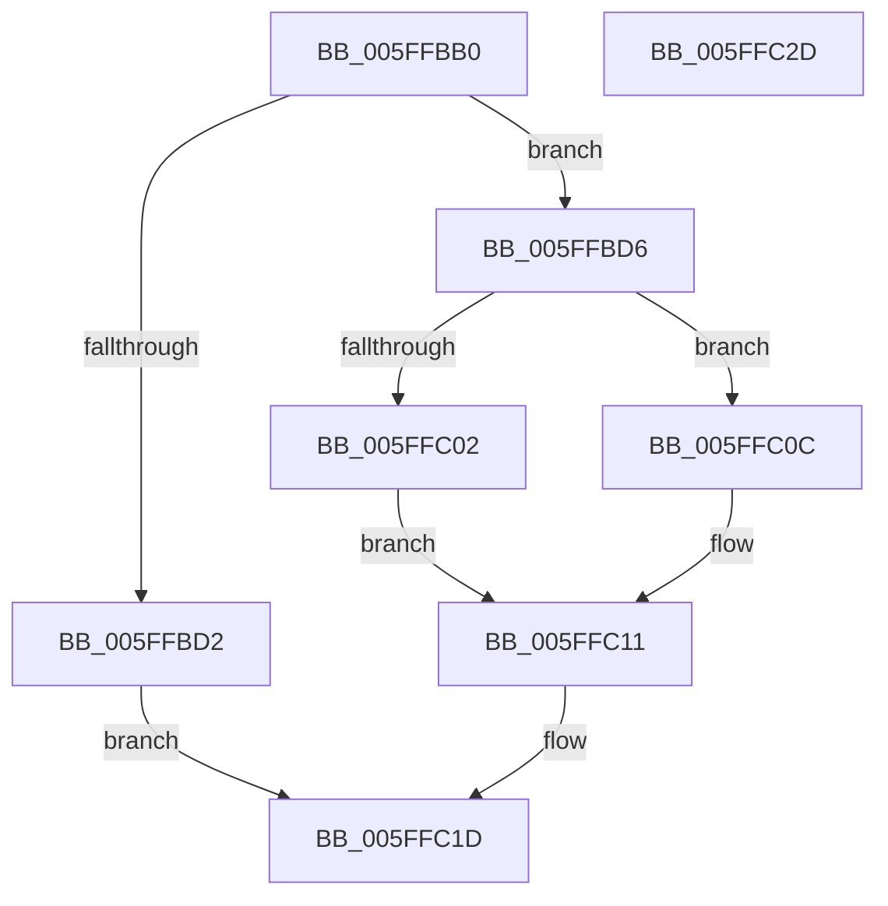

# LZ4_compress_HC_extStateHC_fastReset

- RVA: `0x005FFBB0`–`0x005FFC2E` (길이 `126` bytes)
- VA: `0x00000001405FFBB0`
- 실행 섹션: `.text`
- PDB 이름 있음: `예`; PDB Function 태그: `아니요`
- unwind 정보 RVA: `0x000C99BC`
- 디코드: `36`개 명령, `126/126` bytes 표시
- 미해석 바이트: `0` (있으면 어셈블리에 `.byte`로 보존)

> 이 문서는 커널 이미지의 기계어와 PDB 기호를 분석해 생성했습니다. 4번과 5번은 함수 원형과 자료형을 바이너리 사용 방식에서 추정한 C 해석이며 원본 소스 복구 결과는 아닙니다.

## 1. Dependencies

- 직접 호출 지점: **4**; 고유 호출 대상: **4**
- 직접 호출자로 확인된 함수: **1**
- RIP 상대 이미지 참조: **0**

### Outgoing calls
- `0x005FFBD6` → [LZ4_resetStreamHC_fast](LZ4_resetStreamHC_fast_function_005FFC34.md) (function, `0x005FFC34`)
- `0x005FFBE1` → [LZ4HC_init_internal](LZ4HC_init_internal_function_005FF9D0.md) (function, `0x005FF9D0`)
- `0x005FFBEA` → [LZ4_compressBound](../44/LZ4_compressBound_function_004499C0.md) (function, `0x004499C0`)
- `0x005FFC18` → [LZ4HC_compress_generic](LZ4HC_compress_generic_function_005F564C.md) (function, `0x005F564C`)

### Direct callers
- [LZ4_compress_HC_extStateHC](../4E/LZ4_compress_HC_extStateHC_function_004E2F10.md) at `0x004E2F4E`

### Static image references
- 디코드된 RIP-relative 메모리 참조가 없습니다.

## 2. Other-region calls and transfers

- 다른 실행 섹션으로 향하는 call: **0**
- 별도 외부 분기/꼬리 이동을 확인하지 못했습니다.

## 3. Assembly (complete function range)

```asm
005FFBB0  48 89 5C 24 08                  mov qword ptr [rsp + 8], rbx
005FFBB5  48 89 74 24 10                  mov qword ptr [rsp + 0x10], rsi
005FFBBA  44 89 4C 24 20                  mov dword ptr [rsp + 0x20], r9d
005FFBBF  57                              push rdi
005FFBC0  48 83 EC 40                     sub rsp, 0x40
005FFBC4  49 8B F0                        mov rsi, r8
005FFBC7  48 8B FA                        mov rdi, rdx
005FFBCA  48 8B D9                        mov rbx, rcx
005FFBCD  F6 C1 07                        test cl, 7
005FFBD0  74 04                           je 0x1405ffbd6
005FFBD2  33 C0                           xor eax, eax
005FFBD4  EB 47                           jmp 0x1405ffc1d
005FFBD6  E8 59 00 00 00                  call 0x1405ffc34
005FFBDB  48 8B D7                        mov rdx, rdi
005FFBDE  48 8B CB                        mov rcx, rbx
005FFBE1  E8 EA FD FF FF                  call 0x1405ff9d0
005FFBE6  8B 4C 24 68                     mov ecx, dword ptr [rsp + 0x68]
005FFBEA  E8 D1 9D E4 FF                  call 0x1404499c0
005FFBEF  8B 4C 24 70                     mov ecx, dword ptr [rsp + 0x70]
005FFBF3  4C 8D 4C 24 68                  lea r9, [rsp + 0x68]
005FFBF8  4C 8B C6                        mov r8, rsi
005FFBFB  48 8B D7                        mov rdx, rdi
005FFBFE  3B C8                           cmp ecx, eax
005FFC00  7D 0A                           jge 0x1405ffc0c
005FFC02  C7 44 24 30 01 00 00 00         mov dword ptr [rsp + 0x30], 1
005FFC0A  EB 05                           jmp 0x1405ffc11
005FFC0C  83 64 24 30 00                  and dword ptr [rsp + 0x30], 0
005FFC11  89 4C 24 20                     mov dword ptr [rsp + 0x20], ecx
005FFC15  48 8B CB                        mov rcx, rbx
005FFC18  E8 2F 5A FF FF                  call 0x1405f564c
005FFC1D  48 8B 5C 24 50                  mov rbx, qword ptr [rsp + 0x50]
005FFC22  48 8B 74 24 58                  mov rsi, qword ptr [rsp + 0x58]
005FFC27  48 83 C4 40                     add rsp, 0x40
005FFC2B  5F                              pop rdi
005FFC2C  C3                              ret
005FFC2D  CC                              int3
```

## 4. C-style interpretation (structured pseudocode)

```c
__int64 __fastcall LZ4_compress_HC_extStateHC_fastReset(__int64 a1, __int64 a2, __int64 a3, int a4, unsigned int a5)
{
    __int64 result;
    __int64 v_rsp;
    unsigned int v_stack_m18;
    unsigned int v_stack_m28;
    unsigned __int64 v_stack_p10;
    unsigned int v_stack_p20;
    unsigned __int64 v_stack_p8;

    v_stack_p8 = v_rbx;
    v_stack_p10 = v_rsi;
    v_stack_p20 = a4;
    v_rsp = (v_rsp) - (64);
    if ((((unsigned __int8)(a1)) & (7)) == 0) goto loc_005FFBD6;
    result = 0;
    goto loc_005FFC1D;
loc_005FFBD6:
    result = LZ4_resetStreamHC_fast(a1, a2, a3, a4);
    result = LZ4HC_init_internal(a1, a2, a3, a4);
    result = LZ4_compressBound((unsigned int)(v_stack_p20), a2, a3, a4);
    if (((unsigned int)((unsigned int)(a5))) >= ((unsigned int)(result))) goto loc_005FFC0C;
    v_stack_m18 = 1;
    goto loc_005FFC11;
loc_005FFC0C:
loc_005FFC11:
    v_stack_m28 = (unsigned int)((unsigned int)(a5));
    result = LZ4HC_compress_generic(a1, a2, a3, v_stack_p20);
loc_005FFC1D:
    v_rsp = (v_rsp) + (64);
    return result;
}
```

## 5. (Beta) C Style

```c
int64_t LZ4_compress_HC_extStateHC_fastReset(int64_t Arg1, int64_t Arg2, int64_t Arg3, int32_t Arg4, uint32_t Arg5)
{
    int64_t result;
    int64_t local_rsp;
    uint32_t v_stack_m18;
    uint32_t v_stack_m28;
    uint64_t v_stack_p10;
    uint32_t v_stack_p20;
    uint64_t v_stack_p8;

    v_stack_p8 = local_rbx;
    v_stack_p10 = local_rsi;
    v_stack_p20 = Arg4;
    local_rsp = (local_rsp) - (64);
    if ((((uint8_t)(Arg1)) & (7)) == 0) goto loc_005FFBD6;
    result = 0;
    goto loc_005FFC1D;
loc_005FFBD6:
    result = LZ4_resetStreamHC_fast(Arg1, Arg2, Arg3, Arg4);
    result = LZ4HC_init_internal(Arg1, Arg2, Arg3, Arg4);
    result = LZ4_compressBound((uint32_t)(v_stack_p20), Arg2, Arg3, Arg4);
    if (((uint32_t)((uint32_t)(Arg5))) >= ((uint32_t)(result))) goto loc_005FFC0C;
    v_stack_m18 = 1;
    goto loc_005FFC11;
loc_005FFC0C:
loc_005FFC11:
    v_stack_m28 = (uint32_t)((uint32_t)(Arg5));
    result = LZ4HC_compress_generic(Arg1, Arg2, Arg3, v_stack_p20);
loc_005FFC1D:
    local_rsp = (local_rsp) + (64);
    return result;
}
```

## 6. Execution-region graph

[열기: 2D/3D 그래프와 함수 탐색 컨트롤 패널](../../../control-panel.html?section=text&rva=0x005FFBB0&view=graph)

- 2D 그래프는 위에서 아래로 흐르고, 3D 그래프는 빈 공간을 드래그해 회전합니다. Shift+드래그는 이동, 휠은 확대·축소, 함수 노드 선택은 대상 보고서 이동입니다.

### Static fallback


