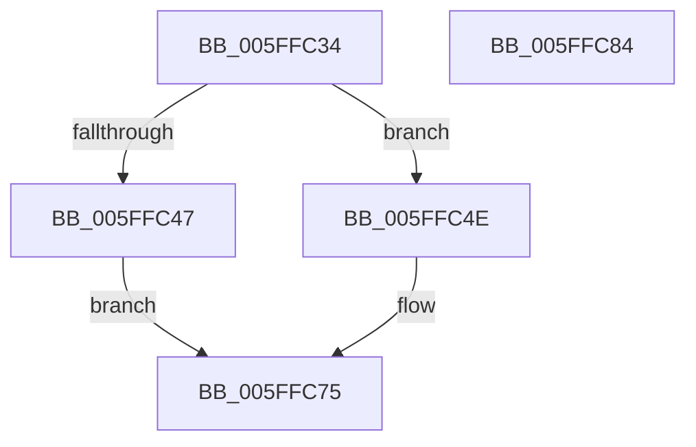

# LZ4_resetStreamHC_fast

- RVA: `0x005FFC34`–`0x005FFC85` (길이 `81` bytes)
- VA: `0x00000001405FFC34`
- 실행 섹션: `.text`
- PDB 이름 있음: `예`; PDB Function 태그: `아니요`
- unwind 정보 RVA: `0x0005CF00`
- 디코드: `19`개 명령, `81/81` bytes 표시
- 미해석 바이트: `0` (있으면 어셈블리에 `.byte`로 보존)

> 이 문서는 커널 이미지의 기계어와 PDB 기호를 분석해 생성했습니다. 4번과 5번은 함수 원형과 자료형을 바이너리 사용 방식에서 추정한 C 해석이며 원본 소스 복구 결과는 아닙니다.

## 1. Dependencies

- 직접 호출 지점: **1**; 고유 호출 대상: **1**
- 직접 호출자로 확인된 함수: **1**
- RIP 상대 이미지 참조: **0**

### Outgoing calls
- `0x005FFC47` → [LZ4_initStreamHC](../4F/LZ4_initStreamHC_function_004FB668.md) (function, `0x004FB668`)

### Direct callers
- [LZ4_compress_HC_extStateHC_fastReset](LZ4_compress_HC_extStateHC_fastReset_function_005FFBB0.md) at `0x005FFBD6`

### Static image references
- 디코드된 RIP-relative 메모리 참조가 없습니다.

## 2. Other-region calls and transfers

- 다른 실행 섹션으로 향하는 call: **0**
- 별도 외부 분기/꼬리 이동을 확인하지 못했습니다.

## 3. Assembly (complete function range)

```asm
005FFC34  40 53                           push rbx
005FFC36  48 83 EC 20                     sub rsp, 0x20
005FFC3A  33 D2                           xor edx, edx
005FFC3C  48 8B D9                        mov rbx, rcx
005FFC3F  38 91 27 00 04 00               cmp byte ptr [rcx + 0x40027], dl
005FFC45  74 07                           je 0x1405ffc4e
005FFC47  E8 1C BA EF FF                  call 0x1404fb668
005FFC4C  EB 27                           jmp 0x1405ffc75
005FFC4E  8B 89 00 00 04 00               mov ecx, dword ptr [rcx + 0x40000]
005FFC54  2B 8B 08 00 04 00               sub ecx, dword ptr [rbx + 0x40008]
005FFC5A  01 8B 18 00 04 00               add dword ptr [rbx + 0x40018], ecx
005FFC60  48 89 93 08 00 04 00            mov qword ptr [rbx + 0x40008], rdx
005FFC67  48 89 93 00 00 04 00            mov qword ptr [rbx + 0x40000], rdx
005FFC6E  48 89 93 28 00 04 00            mov qword ptr [rbx + 0x40028], rdx
005FFC75  66 C7 83 24 00 04 00 09 00      mov word ptr [rbx + 0x40024], 9
005FFC7E  48 83 C4 20                     add rsp, 0x20
005FFC82  5B                              pop rbx
005FFC83  C3                              ret
005FFC84  CC                              int3
```

## 4. C-style interpretation (structured pseudocode)

```c
__int64 __fastcall LZ4_resetStreamHC_fast(__int64 a1, int a2)
{
    __int64 result;
    __int64 v_rsp;

    v_rsp = (v_rsp) - (32);
    a2 = 0;
    if ((*(unsigned __int8 *)(a1 + 262183)) == 0) goto loc_005FFC4E;
    result = LZ4_initStreamHC(a1, a2, a3, a4);
    goto loc_005FFC75;
loc_005FFC4E:
    a1 = (unsigned int)(((unsigned int)(*(unsigned int *)(a1 + 262144))) - (*(unsigned int *)(a1 + 262152)));
    *(unsigned __int64 *)(a1 + 262152) = 0;
    *(unsigned __int64 *)(a1 + 262144) = 0;
    *(unsigned __int64 *)(a1 + 262184) = 0;
loc_005FFC75:
    *(unsigned __int16 *)(a1 + 262180) = 9;
    v_rsp = (v_rsp) + (32);
    return result;
}
```

## 5. (Beta) C Style

```c
int64_t LZ4_resetStreamHC_fast(void *Arg1, int32_t Arg2)
{
    uint8_t *arg1 = (uint8_t *)Arg1;

    int64_t result;
    int64_t local_rsp;

    local_rsp = (local_rsp) - (32);
    Arg2 = 0;
    if ((*(uint8_t *)(arg1 + 0x40027)) == 0) goto loc_005FFC4E;
    result = LZ4_initStreamHC(Arg1, Arg2, a3, a4);
    goto loc_005FFC75;
loc_005FFC4E:
    Arg1 = (uint32_t)(((uint32_t)(*(uint32_t *)(arg1 + 0x40000))) - (*(uint32_t *)(arg1 + 0x40008)));
    *(uint64_t *)(arg1 + 0x40008) = 0;
    *(uint64_t *)(arg1 + 0x40000) = 0;
    *(uint64_t *)(arg1 + 0x40028) = 0;
loc_005FFC75:
    *(uint16_t *)(arg1 + 0x40024) = 9;
    local_rsp = (local_rsp) + (32);
    return result;
}
```

### 관측된 메모리 오프셋

구조체 형식이 확인되지 않은 접근은 인자 기준의 오프셋으로만 기록했습니다.

| 기준 인자 | 오프셋 표현 | 폭 (bit) | 접근 |
|---|---:|---:|---|
| `Arg1` | `+ 0x40000` | `32` | `R` |
| `Arg1` | `+ 0x40000` | `64` | `W` |
| `Arg1` | `+ 0x40008` | `32` | `R` |
| `Arg1` | `+ 0x40008` | `64` | `W` |
| `Arg1` | `+ 0x40018` | `32` | `R/W` |
| `Arg1` | `+ 0x40024` | `16` | `W` |
| `Arg1` | `+ 0x40027` | `8` | `R` |
| `Arg1` | `+ 0x40028` | `64` | `W` |

## 6. Execution-region graph

[열기: 2D/3D 그래프와 함수 탐색 컨트롤 패널](../../../control-panel.html?section=text&rva=0x005FFC34&view=graph)

- 2D 그래프는 위에서 아래로 흐르고, 3D 그래프는 빈 공간을 드래그해 회전합니다. Shift+드래그는 이동, 휠은 확대·축소, 함수 노드 선택은 대상 보고서 이동입니다.

### Static fallback


