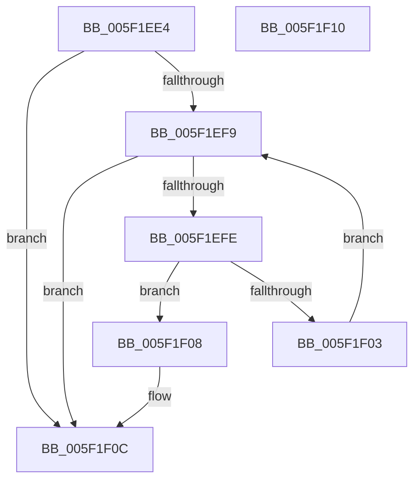

# NormalizationList__Lookup

- RVA: `0x005F1EE4`–`0x005F1F11` (길이 `45` bytes)
- VA: `0x00000001405F1EE4`
- 실행 섹션: `.text`
- PDB 이름 있음: `예`; PDB Function 태그: `아니요`
- unwind 정보 RVA: `0x000DB714`
- 디코드: `15`개 명령, `45/45` bytes 표시
- 미해석 바이트: `0` (있으면 어셈블리에 `.byte`로 보존)

> 이 문서는 커널 이미지의 기계어와 PDB 기호를 분석해 생성했습니다. 4번과 5번은 함수 원형과 자료형을 바이너리 사용 방식에서 추정한 C 해석이며 원본 소스 복구 결과는 아닙니다.

## 1. Dependencies

- 직접 호출 지점: **0**; 고유 호출 대상: **0**
- 직접 호출자로 확인된 함수: **1**
- RIP 상대 이미지 참조: **1**

### Outgoing calls
- 직접 디코드된 call 명령이 없습니다.

### Direct callers
- [RtlpGetNormalization](../../page/79/RtlpGetNormalization_function_0079AB58.md) at `0x0079AB85`
- [RtlpGetNormalization](../../page/79/RtlpGetNormalization_function_0079AB58.md) at `0x0079ABA4`

### Static image references
- `0x005F1EE4` → RVA `0x00E08858` (`.data`; read)

## 2. Other-region calls and transfers

- 다른 실행 섹션으로 향하는 call: **0**
- 별도 외부 분기/꼬리 이동을 확인하지 못했습니다.

## 3. Assembly (complete function range)

```asm
005F1EE4  48 8B 05 6D 69 81 00            mov rax, qword ptr [rip + 0x81696d]
005F1EEB  4C 8D 05 66 69 81 00            lea r8, [rip + 0x816966]
005F1EF2  33 D2                           xor edx, edx
005F1EF4  49 3B C0                        cmp rax, r8
005F1EF7  74 13                           je 0x1405f1f0c
005F1EF9  49 3B C0                        cmp rax, r8
005F1EFC  74 0E                           je 0x1405f1f0c
005F1EFE  39 48 10                        cmp dword ptr [rax + 0x10], ecx
005F1F01  74 05                           je 0x1405f1f08
005F1F03  48 8B 00                        mov rax, qword ptr [rax]
005F1F06  EB F1                           jmp 0x1405f1ef9
005F1F08  48 8D 50 18                     lea rdx, [rax + 0x18]
005F1F0C  48 8B C2                        mov rax, rdx
005F1F0F  C3                              ret
005F1F10  CC                              int3
```

## 4. C-style interpretation (structured pseudocode)

```c
__int64 __fastcall NormalizationList__Lookup(int a1, int a2)
{
    a2 = 0;
    if ((*(unsigned __int64 *)(v_rip + 8481133)) == (v_rip + 8481126)) goto loc_005F1F0C;
loc_005F1EF9:
    if ((*(unsigned __int64 *)(v_rip + 8481133)) == (v_rip + 8481126)) goto loc_005F1F0C;
    if ((*(unsigned int *)(*(unsigned __int64 *)(v_rip + 8481133) + 16)) == a1) goto loc_005F1F08;
    goto loc_005F1EF9;
loc_005F1F08:
loc_005F1F0C:
    return *(unsigned __int64 *)(*(unsigned __int64 *)(v_rip + 8481133)) + 24;
}
```

## 5. (Beta) C Style

```c
int64_t NormalizationList__Lookup(int32_t Arg1, int32_t Arg2)
{
    Arg2 = 0;
    if ((*(uint64_t *)(v_rip + 0x81696D)) == (v_rip + 8481126)) goto loc_005F1F0C;
loc_005F1EF9:
    if ((*(uint64_t *)(v_rip + 0x81696D)) == (v_rip + 8481126)) goto loc_005F1F0C;
    if ((*(uint32_t *)(*(uint64_t *)(v_rip + 0x81696D) + 0x10)) == Arg1) goto loc_005F1F08;
    goto loc_005F1EF9;
loc_005F1F08:
loc_005F1F0C:
    return *(uint64_t *)(*(uint64_t *)(v_rip + 0x81696D)) + 24;
}
```

## 6. Execution-region graph

[열기: 2D/3D 그래프와 함수 탐색 컨트롤 패널](../../../control-panel.html?section=text&rva=0x005F1EE4&view=graph)

- 2D 그래프는 위에서 아래로 흐르고, 3D 그래프는 빈 공간을 드래그해 회전합니다. Shift+드래그는 이동, 휠은 확대·축소, 함수 노드 선택은 대상 보고서 이동입니다.

### Static fallback


