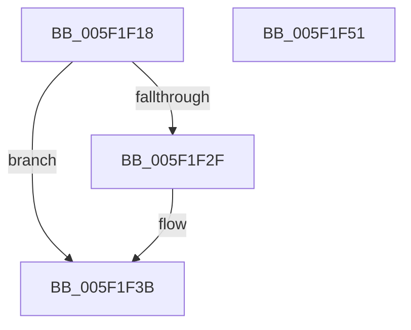

# NormalizationList__Unlock

- RVA: `0x005F1F18`–`0x005F1F52` (길이 `58` bytes)
- VA: `0x00000001405F1F18`
- 실행 섹션: `.text`
- PDB 이름 있음: `예`; PDB Function 태그: `아니요`
- unwind 정보 RVA: `0x0005C788`
- 디코드: `14`개 명령, `58/58` bytes 표시
- 미해석 바이트: `0` (있으면 어셈블리에 `.byte`로 보존)

> 이 문서는 커널 이미지의 기계어와 PDB 기호를 분석해 생성했습니다. 4번과 5번은 함수 원형과 자료형을 바이너리 사용 방식에서 추정한 C 해석이며 원본 소스 복구 결과는 아닙니다.

## 1. Dependencies

- 직접 호출 지점: **3**; 고유 호출 대상: **3**
- 직접 호출자로 확인된 함수: **1**
- RIP 상대 이미지 참조: **2**

### Outgoing calls
- `0x005F1F36` → [ExfTryToWakePushLock](../26/ExfTryToWakePushLock_function_00265DD0.md) (function, `0x00265DD0`)
- `0x005F1F42` → [KeAbPostRelease](../2E/KeAbPostRelease_function_002E1600.md) (function, `0x002E1600`)
- `0x005F1F47` → [KeLeaveCriticalRegion](../25/KeLeaveCriticalRegion_function_0025D8B0.md) (function, `0x0025D8B0`)

### Direct callers
- [RtlpGetNormalization](../../page/79/RtlpGetNormalization_function_0079AB58.md) at `0x0079AC29`
- [RtlpGetNormalization](../../page/79/RtlpGetNormalization_function_0079AB58.md) at `0x0079AC3A`

### Static image references
- `0x005F1F20` → RVA `0x00F05BD8` (`.data`; read/write)
- `0x005F1F2F` → RVA `0x00F05BD8` (`.data`; read)

## 2. Other-region calls and transfers

- 다른 실행 섹션으로 향하는 call: **0**
- 별도 외부 분기/꼬리 이동을 확인하지 못했습니다.

## 3. Assembly (complete function range)

```asm
005F1F18  48 83 EC 28                     sub rsp, 0x28
005F1F1C  48 83 C8 FF                     or rax, 0xffffffffffffffff
005F1F20  F0 48 0F C1 05 AF 3C 91 00      lock xadd qword ptr [rip + 0x913caf], rax
005F1F29  24 06                           and al, 6
005F1F2B  3C 02                           cmp al, 2
005F1F2D  75 0C                           jne 0x1405f1f3b
005F1F2F  48 8D 0D A2 3C 91 00            lea rcx, [rip + 0x913ca2]
005F1F36  E8 95 3E C7 FF                  call 0x140265dd0
005F1F3B  48 8D 0D 96 3C 91 00            lea rcx, [rip + 0x913c96]
005F1F42  E8 B9 F6 CE FF                  call 0x1402e1600
005F1F47  E8 64 B9 C6 FF                  call 0x14025d8b0
005F1F4C  48 83 C4 28                     add rsp, 0x28
005F1F50  C3                              ret
005F1F51  CC                              int3
```

## 4. C-style interpretation (structured pseudocode)

```c
__int64 __fastcall NormalizationList__Unlock(void)
{
    __int64 result;
    __int64 v_rsp;

    v_rsp = (v_rsp) - (40);
    result = (result) | (-1);
    result = (unsigned __int8)((result) & (6));
    if (((unsigned __int8)(result)) == 2) {
        a1 = v_rip + 9518242;
        result = ExfTryToWakePushLock(a1, a2, a3, a4);
    }
    result = KeAbPostRelease(v_rip + 9518230, a2, a3, a4);
    result = KeLeaveCriticalRegion(v_rip + 9518230, a2, a3, a4);
    v_rsp = (v_rsp) + (40);
    return result;
}
```

## 5. (Beta) C Style

```c
void NormalizationList__Unlock(void)
{
    int64_t result;
    int64_t local_rsp;

    local_rsp = (local_rsp) - (40);
    result = (result) | (-1);
    result = (uint8_t)((result) & (6));
    if (((uint8_t)(result)) == 2) {
        a1 = v_rip + 9518242;
        result = ExfTryToWakePushLock(a1, a2, a3, a4);
    }
    result = KeAbPostRelease(v_rip + 9518230, a2, a3, a4);
    result = KeLeaveCriticalRegion(v_rip + 9518230, a2, a3, a4);
    local_rsp = (local_rsp) + (40);
    return result;
}
```

## 6. Execution-region graph

[열기: 2D/3D 그래프와 함수 탐색 컨트롤 패널](../../../control-panel.html?section=text&rva=0x005F1F18&view=graph)

- 2D 그래프는 위에서 아래로 흐르고, 3D 그래프는 빈 공간을 드래그해 회전합니다. Shift+드래그는 이동, 휠은 확대·축소, 함수 노드 선택은 대상 보고서 이동입니다.

### Static fallback


