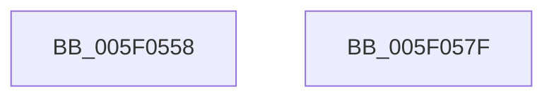

# RTLP_FLS_CALLBACK_ENTRY::RTLP_FLS_CALLBACK_ENTRY

- RVA: `0x005F0558`–`0x005F0580` (길이 `40` bytes)
- VA: `0x00000001405F0558`
- 실행 섹션: `.text`
- PDB 이름 있음: `예`; PDB Function 태그: `아니요`
- unwind 정보 RVA: `0x0005C788`
- 디코드: `12`개 명령, `40/40` bytes 표시
- 미해석 바이트: `0` (있으면 어셈블리에 `.byte`로 보존)

> 이 문서는 커널 이미지의 기계어와 PDB 기호를 분석해 생성했습니다. 4번과 5번은 함수 원형과 자료형을 바이너리 사용 방식에서 추정한 C 해석이며 원본 소스 복구 결과는 아닙니다.

## 1. Dependencies

- 직접 호출 지점: **1**; 고유 호출 대상: **1**
- 직접 호출자로 확인된 함수: **1**
- RIP 상대 이미지 참조: **0**

### Outgoing calls
- `0x005F055C` → [CmSiRWLockInitialize](../../page/AD/CmSiRWLockInitialize_function_00AD69E0.md) (function, `0x00AD69E0`)

### Direct callers
- [RTL_BINARY_ARRAY&lt;RTLP_FLS_CALLBACK_ENTRY,4,4&gt;::SlotAllocate](RTL_BINARY_ARRAY_RTLP_FLS_CALLBACK_ENTRY_4_4_SlotAllocate_function_005F0588.md) at `0x005F05EE`

### Static image references
- 디코드된 RIP-relative 메모리 참조가 없습니다.

## 2. Other-region calls and transfers

- 다른 실행 섹션으로 향하는 call: **1**
  - `0x005F055C` → [CmSiRWLockInitialize](../../page/AD/CmSiRWLockInitialize_function_00AD69E0.md) (`.text` → `PAGE`)
- 별도 외부 분기/꼬리 이동을 확인하지 못했습니다.

## 3. Assembly (complete function range)

```asm
005F0558  48 83 EC 28                     sub rsp, 0x28
005F055C  E8 7F 64 4E 00                  call 0x140ad69e0
005F0561  48 83 61 08 00                  and qword ptr [rcx + 8], 0
005F0566  33 C0                           xor eax, eax
005F0568  48 89 41 10                     mov qword ptr [rcx + 0x10], rax
005F056C  48 8D 41 18                     lea rax, [rcx + 0x18]
005F0570  48 89 40 08                     mov qword ptr [rax + 8], rax
005F0574  48 89 00                        mov qword ptr [rax], rax
005F0577  48 8B C1                        mov rax, rcx
005F057A  48 83 C4 28                     add rsp, 0x28
005F057E  C3                              ret
005F057F  CC                              int3
```

## 4. C-style interpretation (structured pseudocode)

```c
__int64 __fastcall RTLP_FLS_CALLBACK_ENTRY__RTLP_FLS_CALLBACK_ENTRY(__int64 a1)
{
    __int64 result;
    __int64 v_rsp;

    v_rsp = (v_rsp) - (40);
    result = CmSiRWLockInitialize(a1, a2, a3, a4);
    result = 0;
    *(unsigned __int64 *)(a1 + 16) = 0;
    *(unsigned __int64 *)(a1 + 24 + 8) = a1 + 24;
    *(unsigned __int64 *)(a1 + 24) = a1 + 24;
    v_rsp = (v_rsp) + (40);
    return a1;
}
```

## 5. (Beta) C Style

```c
int64_t RTLP_FLS_CALLBACK_ENTRY__RTLP_FLS_CALLBACK_ENTRY(int64_t Arg1)
{
    int64_t result;
    int64_t local_rsp;

    local_rsp = (local_rsp) - (40);
    result = CmSiRWLockInitialize(Arg1, a2, a3, a4);
    result = 0;
    *(uint64_t *)(Arg1 + 0x10) = 0;
    *(uint64_t *)(Arg1 + 0x18 + 0x8) = Arg1 + 24;
    *(uint64_t *)(Arg1 + 0x18) = Arg1 + 24;
    local_rsp = (local_rsp) + (40);
    return Arg1;
}
```

## 6. Execution-region graph

[열기: 2D/3D 그래프와 함수 탐색 컨트롤 패널](../../../control-panel.html?section=text&rva=0x005F0558&view=graph)

- 2D 그래프는 위에서 아래로 흐르고, 3D 그래프는 빈 공간을 드래그해 회전합니다. Shift+드래그는 이동, 휠은 확대·축소, 함수 노드 선택은 대상 보고서 이동입니다.

### Static fallback


