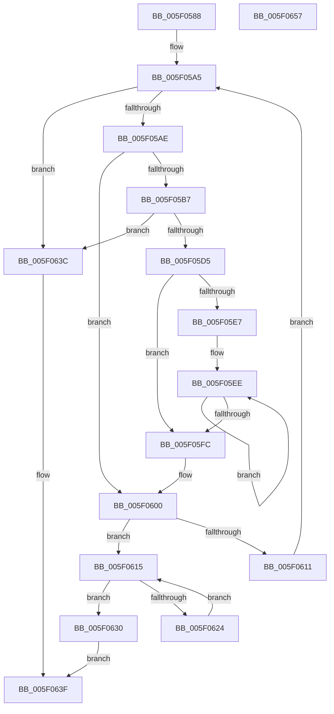

# RTL_BINARY_ARRAY&lt;RTLP_FLS_CALLBACK_ENTRY,4,4&gt;::SlotAllocate

- RVA: `0x005F0588`–`0x005F0658` (길이 `208` bytes)
- VA: `0x00000001405F0588`
- 실행 섹션: `.text`
- PDB 이름 있음: `예`; PDB Function 태그: `아니요`
- unwind 정보 RVA: `0x0006F978`
- 디코드: `65`개 명령, `208/208` bytes 표시
- 미해석 바이트: `0` (있으면 어셈블리에 `.byte`로 보존)

> 이 문서는 커널 이미지의 기계어와 PDB 기호를 분석해 생성했습니다. 4번과 5번은 함수 원형과 자료형을 바이너리 사용 방식에서 추정한 C 해석이며 원본 소스 복구 결과는 아닙니다.

## 1. Dependencies

- 직접 호출 지점: **2**; 고유 호출 대상: **2**
- 직접 호출자로 확인된 함수: **1**
- RIP 상대 이미지 참조: **0**

### Outgoing calls
- `0x005F05C8` → [RtlpFlsHeapAlloc](../../page/A4/RtlpFlsHeapAlloc_function_00A4F42C.md) (function, `0x00A4F42C`)
- `0x005F05EE` → [RTLP_FLS_CALLBACK_ENTRY::RTLP_FLS_CALLBACK_ENTRY](RTLP_FLS_CALLBACK_ENTRY_RTLP_FLS_CALLBACK_ENTRY_function_005F0558.md) (function, `0x005F0558`)

### Direct callers
- [RtlpFlsAlloc](../../page/79/RtlpFlsAlloc_function_00795074.md) at `0x007950E3`

### Static image references
- 디코드된 RIP-relative 메모리 참조가 없습니다.

## 2. Other-region calls and transfers

- 다른 실행 섹션으로 향하는 call: **1**
  - `0x005F05C8` → [RtlpFlsHeapAlloc](../../page/A4/RtlpFlsHeapAlloc_function_00A4F42C.md) (`.text` → `PAGE`)
- 별도 외부 분기/꼬리 이동을 확인하지 못했습니다.

## 3. Assembly (complete function range)

```asm
005F0588  48 89 5C 24 08                  mov qword ptr [rsp + 8], rbx
005F058D  48 89 74 24 10                  mov qword ptr [rsp + 0x10], rsi
005F0592  48 89 7C 24 18                  mov qword ptr [rsp + 0x18], rdi
005F0597  41 56                           push r14
005F0599  48 83 EC 20                     sub rsp, 0x20
005F059D  33 FF                           xor edi, edi
005F059F  4C 8B F1                        mov r14, rcx
005F05A2  8D 5F 01                        lea ebx, [rdi + 1]
005F05A5  83 FF 04                        cmp edi, 4
005F05A8  0F 83 8E 00 00 00               jae 0x1405f063c
005F05AE  49 8B 14 FE                     mov rdx, qword ptr [r14 + rdi*8]
005F05B2  48 85 D2                        test rdx, rdx
005F05B5  75 49                           jne 0x1405f0600
005F05B7  8D 4F 04                        lea ecx, [rdi + 4]
005F05BA  8B F3                           mov esi, ebx
005F05BC  D3 E6                           shl esi, cl
005F05BE  8D 0C B6                        lea ecx, [rsi + rsi*4]
005F05C1  8D 0C CD 08 00 00 00            lea ecx, [rcx*8 + 8]
005F05C8  E8 5F EE 45 00                  call 0x140a4f42c
005F05CD  48 8B D0                        mov rdx, rax
005F05D0  48 85 C0                        test rax, rax
005F05D3  74 67                           je 0x1405f063c
005F05D5  0F 57 C0                        xorps xmm0, xmm0
005F05D8  0F 11 00                        movups xmmword ptr [rax], xmm0
005F05DB  0F 11 40 10                     movups xmmword ptr [rax + 0x10], xmm0
005F05DF  0F 11 40 20                     movups xmmword ptr [rax + 0x20], xmm0
005F05E3  85 F6                           test esi, esi
005F05E5  74 15                           je 0x1405f05fc
005F05E7  48 8D 48 08                     lea rcx, [rax + 8]
005F05EB  44 8B C6                        mov r8d, esi
005F05EE  E8 65 FF FF FF                  call 0x1405f0558
005F05F3  48 83 C1 28                     add rcx, 0x28
005F05F7  4C 2B C3                        sub r8, rbx
005F05FA  75 F2                           jne 0x1405f05ee
005F05FC  49 89 14 FE                     mov qword ptr [r14 + rdi*8], rdx
005F0600  44 8B 02                        mov r8d, dword ptr [rdx]
005F0603  8D 4F 04                        lea ecx, [rdi + 4]
005F0606  44 8B CB                        mov r9d, ebx
005F0609  41 D3 E1                        shl r9d, cl
005F060C  45 3B C1                        cmp r8d, r9d
005F060F  72 04                           jb 0x1405f0615
005F0611  03 FB                           add edi, ebx
005F0613  EB 90                           jmp 0x1405f05a5
005F0615  41 8B C0                        mov eax, r8d
005F0618  48 8D 0C 80                     lea rcx, [rax + rax*4]
005F061C  48 83 7C CA 10 00               cmp qword ptr [rdx + rcx*8 + 0x10], 0
005F0622  74 0C                           je 0x1405f0630
005F0624  41 8D 49 FF                     lea ecx, [r9 - 1]
005F0628  41 FF C0                        inc r8d
005F062B  44 23 C1                        and r8d, ecx
005F062E  EB E5                           jmp 0x1405f0615
005F0630  01 1A                           add dword ptr [rdx], ebx
005F0632  8D 4F 04                        lea ecx, [rdi + 4]
005F0635  D3 E3                           shl ebx, cl
005F0637  41 0B D8                        or ebx, r8d
005F063A  EB 03                           jmp 0x1405f063f
005F063C  83 CB FF                        or ebx, 0xffffffff
005F063F  48 8B 74 24 38                  mov rsi, qword ptr [rsp + 0x38]
005F0644  8B C3                           mov eax, ebx
005F0646  48 8B 5C 24 30                  mov rbx, qword ptr [rsp + 0x30]
005F064B  48 8B 7C 24 40                  mov rdi, qword ptr [rsp + 0x40]
005F0650  48 83 C4 20                     add rsp, 0x20
005F0654  41 5E                           pop r14
005F0656  C3                              ret
005F0657  CC                              int3
```

## 4. C-style interpretation (structured pseudocode)

```c
__int64 __fastcall RTL_BINARY_ARRAY_RTLP_FLS_CALLBACK_ENTRY_4_4___SlotAllocate(__int64 a1)
{
    __int64 result;
    __int64 v_rbx;
    __int64 v_rdi;
    __int64 v_rsi;
    __int64 v_rsp;
    unsigned __int64 v_stack_p10;
    unsigned __int64 v_stack_p18;
    unsigned __int64 v_stack_p8;

    v_stack_p8 = v_rbx;
    v_stack_p10 = v_rsi;
    v_stack_p18 = v_rdi;
    v_rsp = (v_rsp) - (32);
    v_rdi = 0;
loc_005F05A5:
    if (0 >= 4) goto loc_005F063C;
    if (*(unsigned __int64 *)(a1 + v_rdi * 8) != 0) goto loc_005F0600;
    v_rsi = (unsigned int)(((unsigned int)((unsigned int)(v_rdi + 1))) << ((unsigned __int8)(v_rdi + 4)));
    result = RtlpFlsHeapAlloc(v_rsi + v_rsi * 4 * 8 + 8, *(unsigned __int64 *)(a1 + v_rdi * 8), a3, a4);
    if (result == 0) goto loc_005F063C;
    *(unsigned __int64 *)(result) = v_xmm0;
    *(unsigned __int64 *)(result + 16) = v_xmm0;
    *(unsigned __int64 *)(result + 32) = v_xmm0;
    if ((unsigned int)(v_rsi) == 0) goto loc_005F05FC;
loc_005F05EE:
    result = RTLP_FLS_CALLBACK_ENTRY__RTLP_FLS_CALLBACK_ENTRY(result + 8, result, (unsigned int)((unsigned int)(v_rsi)), a4);
    a1 = (result + 8) + (40);
    a3 = ((unsigned int)((unsigned int)(v_rsi))) - (v_rdi + 1);
    if (condition_is_not_equal) goto loc_005F05EE;
loc_005F05FC:
    *(unsigned __int64 *)(a1 + v_rdi * 8) = result;
loc_005F0600:
    a4 = (unsigned int)(((unsigned int)((unsigned int)(v_rdi + 1))) << ((unsigned __int8)(v_rdi + 4)));
    if (((unsigned int)((unsigned int)(*(unsigned int *)(result)))) < ((unsigned int)(a4))) goto loc_005F0615;
    v_rdi = (unsigned int)((v_rdi) + ((unsigned int)(v_rdi + 1)));
    goto loc_005F05A5;
loc_005F0615:
    if ((*(unsigned __int64 *)(result + (unsigned int)((unsigned int)((unsigned int)(*(unsigned int *)(result)))) + (unsigned int)((unsigned int)((unsigned int)(*(unsigned int *)(result)))) * 4 * 8 + 16)) == 0) goto loc_005F0630;
    a3 = (unsigned int)(((unsigned int)(*(unsigned int *)(result))) + 1);
    a3 = (unsigned int)((a3) & ((unsigned int)(a4 - 1)));
    goto loc_005F0615;
loc_005F0630:
    v_rbx = (unsigned int)((v_rdi + 1) << ((unsigned __int8)(v_rdi + 4)));
    v_rbx = (unsigned int)((v_rbx) | ((unsigned int)(a3)));
    goto loc_005F063F;
loc_005F063C:
    v_rbx = (unsigned int)((v_rbx) | (0xFFFFFFFFULL));
loc_005F063F:
    v_rsp = (v_rsp) + (32);
    return (unsigned int)((unsigned int)(v_rbx));
}
```

## 5. (Beta) C Style

```c
int64_t RTL_BINARY_ARRAY_RTLP_FLS_CALLBACK_ENTRY_4_4___SlotAllocate(void *Arg1)
{
    uint8_t *arg1 = (uint8_t *)Arg1;

    int64_t result;
    int64_t local_rbx;
    int64_t local_rdi;
    int64_t local_rsi;
    int64_t local_rsp;
    uint64_t v_stack_p10;
    uint64_t v_stack_p18;
    uint64_t v_stack_p8;

    v_stack_p8 = local_rbx;
    v_stack_p10 = local_rsi;
    v_stack_p18 = local_rdi;
    local_rsp = (local_rsp) - (32);
    local_rdi = 0;
loc_005F05A5:
    if (0 >= 4) goto loc_005F063C;
    if (*(uint64_t *)(arg1 + local_rdi * 8) != 0) goto loc_005F0600;
    local_rsi = (uint32_t)(((uint32_t)((uint32_t)(local_rdi + 1))) << ((uint8_t)(local_rdi + 4)));
    result = RtlpFlsHeapAlloc(local_rsi + local_rsi * 4 * 8 + 8, *(uint64_t *)(arg1 + local_rdi * 8), a3, a4);
    if (result == 0) goto loc_005F063C;
    *(uint64_t *)(result) = v_xmm0;
    *(uint64_t *)(result + 0x10) = v_xmm0;
    *(uint64_t *)(result + 0x20) = v_xmm0;
    if ((uint32_t)(local_rsi) == 0) goto loc_005F05FC;
loc_005F05EE:
    result = RTLP_FLS_CALLBACK_ENTRY__RTLP_FLS_CALLBACK_ENTRY(result + 8, result, (uint32_t)((uint32_t)(local_rsi)), a4);
    Arg1 = (result + 8) + (40);
    a3 = ((uint32_t)((uint32_t)(local_rsi))) - (local_rdi + 1);
    if (condition_is_not_equal) goto loc_005F05EE;
loc_005F05FC:
    *(uint64_t *)(arg1 + local_rdi * 8) = result;
loc_005F0600:
    a4 = (uint32_t)(((uint32_t)((uint32_t)(local_rdi + 1))) << ((uint8_t)(local_rdi + 4)));
    if (((uint32_t)((uint32_t)(*(uint32_t *)(result)))) < ((uint32_t)(a4))) goto loc_005F0615;
    local_rdi = (uint32_t)((local_rdi) + ((uint32_t)(local_rdi + 1)));
    goto loc_005F05A5;
loc_005F0615:
    if ((*(uint64_t *)(result + (uint32_t)((uint32_t)((uint32_t)(*(uint32_t *)(result)))) + (uint32_t)((uint32_t)((uint32_t)(*(uint32_t *)(result)))) * 4 * 8 + 0x10)) == 0) goto loc_005F0630;
    a3 = (uint32_t)(((uint32_t)(*(uint32_t *)(result))) + 1);
    a3 = (uint32_t)((a3) & ((uint32_t)(a4 - 1)));
    goto loc_005F0615;
loc_005F0630:
    local_rbx = (uint32_t)((local_rdi + 1) << ((uint8_t)(local_rdi + 4)));
    local_rbx = (uint32_t)((local_rbx) | ((uint32_t)(a3)));
    goto loc_005F063F;
loc_005F063C:
    local_rbx = (uint32_t)((local_rbx) | (0xFFFFFFFFULL));
loc_005F063F:
    local_rsp = (local_rsp) + (32);
    return (uint32_t)((uint32_t)(local_rbx));
}
```

### 관측된 메모리 오프셋

구조체 형식이 확인되지 않은 접근은 인자 기준의 오프셋으로만 기록했습니다.

| 기준 인자 | 오프셋 표현 | 폭 (bit) | 접근 |
|---|---:|---:|---|
| `Arg1` | `+ 0x0 + rdi*8` | `64` | `R` |
| `Arg1` | `+ 0x0 + rdi*8` | `64` | `W` |

## 6. Execution-region graph

[열기: 2D/3D 그래프와 함수 탐색 컨트롤 패널](../../../control-panel.html?section=text&rva=0x005F0588&view=graph)

- 2D 그래프는 위에서 아래로 흐르고, 3D 그래프는 빈 공간을 드래그해 회전합니다. Shift+드래그는 이동, 휠은 확대·축소, 함수 노드 선택은 대상 보고서 이동입니다.

### Static fallback


