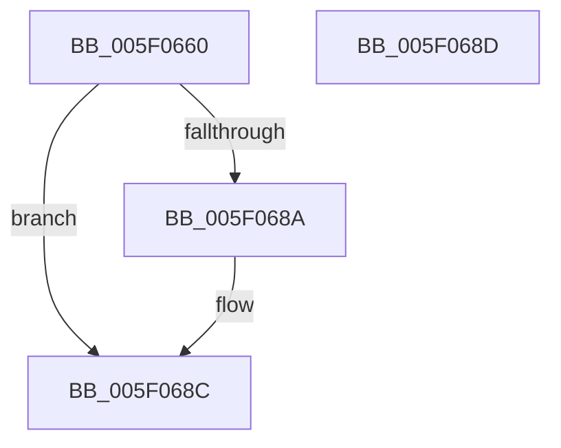

# RTL_BINARY_ARRAY&lt;RTLP_FLS_CALLBACK_ENTRY,4,4&gt;::SlotFree

- RVA: `0x005F0660`–`0x005F068E` (길이 `46` bytes)
- VA: `0x00000001405F0660`
- 실행 섹션: `.text`
- PDB 이름 있음: `예`; PDB Function 태그: `아니요`
- unwind 정보 RVA: `0x000DB714`
- 디코드: `16`개 명령, `46/46` bytes 표시
- 미해석 바이트: `0` (있으면 어셈블리에 `.byte`로 보존)

> 이 문서는 커널 이미지의 기계어와 PDB 기호를 분석해 생성했습니다. 4번과 5번은 함수 원형과 자료형을 바이너리 사용 방식에서 추정한 C 해석이며 원본 소스 복구 결과는 아닙니다.

## 1. Dependencies

- 직접 호출 지점: **0**; 고유 호출 대상: **0**
- 직접 호출자로 확인된 함수: **2**
- RIP 상대 이미지 참조: **0**

### Outgoing calls
- 직접 디코드된 call 명령이 없습니다.

### Direct callers
- [RtlpFlsAlloc](../../page/79/RtlpFlsAlloc_function_00795074.md) at `0x00795144`
- [RtlpFlsFree](../../page/79/RtlpFlsFree_function_0079521C.md) at `0x00795415`

### Static image references
- 디코드된 RIP-relative 메모리 참조가 없습니다.

## 2. Other-region calls and transfers

- 다른 실행 섹션으로 향하는 call: **0**
- 별도 외부 분기/꼬리 이동을 확인하지 못했습니다.

## 3. Assembly (complete function range)

```asm
005F0660  4C 8B C9                        mov r9, rcx
005F0663  0F BD CA                        bsr ecx, edx
005F0666  8D 41 FC                        lea eax, [rcx - 4]
005F0669  4D 8B 14 C1                     mov r10, qword ptr [r9 + rax*8]
005F066D  B8 01 00 00 00                  mov eax, 1
005F0672  D3 E0                           shl eax, cl
005F0674  8B C8                           mov ecx, eax
005F0676  8B C2                           mov eax, edx
005F0678  41 FF 0A                        dec dword ptr [r10]
005F067B  48 33 C8                        xor rcx, rax
005F067E  48 8D 04 89                     lea rax, [rcx + rcx*4]
005F0682  49 83 7C C2 10 00               cmp qword ptr [r10 + rax*8 + 0x10], 0
005F0688  74 02                           je 0x1405f068c
005F068A  CD 2C                           int 0x2c
005F068C  C3                              ret
005F068D  CC                              int3
```

## 4. C-style interpretation (structured pseudocode)

```c
__int64 __fastcall RTL_BINARY_ARRAY_RTLP_FLS_CALLBACK_ENTRY_4_4___SlotFree(__int64 a1, int a2)
{
    __int64 result;

    result = (unsigned int)((1) << ((unsigned __int8)(a1)));
    a1 = ((unsigned int)((unsigned int)(result))) ^ ((unsigned int)(a2));
    if ((*(unsigned __int64 *)(*(unsigned __int64 *)(a1 + a1 - 4 * 8) + a1 + a1 * 4 * 8 + 16)) != 0) {
    }
    return a1 + a1 * 4;
}
```

## 5. (Beta) C Style

```c
int64_t RTL_BINARY_ARRAY_RTLP_FLS_CALLBACK_ENTRY_4_4___SlotFree(void *Arg1, int32_t Arg2)
{
    uint8_t *arg1 = (uint8_t *)Arg1;

    int64_t result;

    result = (uint32_t)((1) << ((uint8_t)(Arg1)));
    Arg1 = ((uint32_t)((uint32_t)(result))) ^ ((uint32_t)(Arg2));
    if ((*(uint64_t *)(*(uint64_t *)(arg1 + arg1 - 0x4 * 8) + arg1 + arg1 * 4 * 8 + 0x10)) != 0) {
    }
    return Arg1 + Arg1 * 4;
}
```

### 관측된 메모리 오프셋

구조체 형식이 확인되지 않은 접근은 인자 기준의 오프셋으로만 기록했습니다.

| 기준 인자 | 오프셋 표현 | 폭 (bit) | 접근 |
|---|---:|---:|---|
| `Arg1` | `+ 0x0 + rax*8` | `64` | `R` |

## 6. Execution-region graph

[열기: 2D/3D 그래프와 함수 탐색 컨트롤 패널](../../../control-panel.html?section=text&rva=0x005F0660&view=graph)

- 2D 그래프는 위에서 아래로 흐르고, 3D 그래프는 빈 공간을 드래그해 회전합니다. Shift+드래그는 이동, 휠은 확대·축소, 함수 노드 선택은 대상 보고서 이동입니다.

### Static fallback


