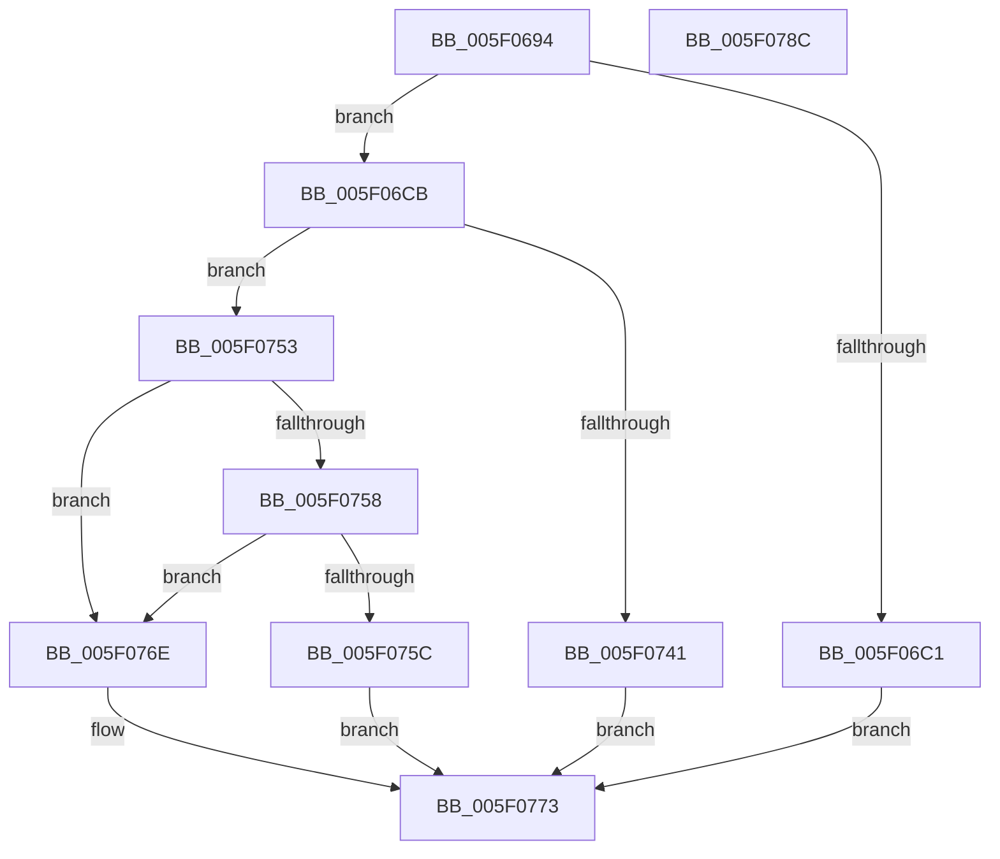

# RtlCompressBufferDeflateInternal

- RVA: `0x005F0694`–`0x005F078D` (길이 `249` bytes)
- VA: `0x00000001405F0694`
- 실행 섹션: `.text`
- PDB 이름 있음: `예`; PDB Function 태그: `아니요`
- unwind 정보 RVA: `0x0007FA5C`
- 디코드: `64`개 명령, `249/249` bytes 표시
- 미해석 바이트: `0` (있으면 어셈블리에 `.byte`로 보존)

> 이 문서는 커널 이미지의 기계어와 PDB 기호를 분석해 생성했습니다. 4번과 5번은 함수 원형과 자료형을 바이너리 사용 방식에서 추정한 C 해석이며 원본 소스 복구 결과는 아닙니다.

## 1. Dependencies

- 직접 호출 지점: **4**; 고유 호출 대상: **3**
- 직접 호출자로 확인된 함수: **2**
- RIP 상대 이미지 참조: **0**

### Outgoing calls
- `0x005F06D6` → [memset](../6C/memset_function_006C6C40.md) (function, `0x006C6C40`)
- `0x005F06EB` → [memset](../6C/memset_function_006C6C40.md) (function, `0x006C6C40`)
- `0x005F072B` → [RtlCompressDeflateInitCompressionStream](RtlCompressDeflateInitCompressionStream_function_005F1F74.md) (function, `0x005F1F74`)
- `0x005F0735` → [deflate](deflate_function_005F35C8.md) (function, `0x005F35C8`)

### Direct callers
- [RtlCompressBufferDeflateRaw](RtlCompressBufferDeflateRaw_function_005F07A0.md) at `0x005F07D9`
- [RtlCompressBufferDeflateZlib](RtlCompressBufferDeflateZlib_function_005F07F0.md) at `0x005F0829`

### Static image references
- 디코드된 RIP-relative 메모리 참조가 없습니다.

## 2. Other-region calls and transfers

- 다른 실행 섹션으로 향하는 call: **0**
- 별도 외부 분기/꼬리 이동을 확인하지 못했습니다.

## 3. Assembly (complete function range)

```asm
005F0694  48 89 5C 24 08                  mov qword ptr [rsp + 8], rbx
005F0699  48 89 6C 24 10                  mov qword ptr [rsp + 0x10], rbp
005F069E  48 89 74 24 18                  mov qword ptr [rsp + 0x18], rsi
005F06A3  57                              push rdi
005F06A4  48 81 EC 80 00 00 00            sub rsp, 0x80
005F06AB  B8 FF FE 00 00                  mov eax, 0xfeff
005F06B0  41 8B F9                        mov edi, r9d
005F06B3  49 8B F0                        mov rsi, r8
005F06B6  0F B7 DA                        movzx ebx, dx
005F06B9  40 8A E9                        mov bpl, cl
005F06BC  66 85 D0                        test ax, dx
005F06BF  74 0A                           je 0x1405f06cb
005F06C1  B8 BB 00 00 C0                  mov eax, 0xc00000bb
005F06C6  E9 A8 00 00 00                  jmp 0x1405f0773
005F06CB  33 D2                           xor edx, edx
005F06CD  48 8D 4C 24 20                  lea rcx, [rsp + 0x20]
005F06D2  44 8D 42 58                     lea r8d, [rdx + 0x58]
005F06D6  E8 65 65 0D 00                  call 0x1406c6c40
005F06DB  48 8B 8C 24 D0 00 00 00         mov rcx, qword ptr [rsp + 0xd0]
005F06E3  33 D2                           xor edx, edx
005F06E5  41 B8 EC 17 04 00               mov r8d, 0x417ec
005F06EB  E8 50 65 0D 00                  call 0x1406c6c40
005F06F0  48 8B 84 24 B0 00 00 00         mov rax, qword ptr [rsp + 0xb0]
005F06F8  48 8D 4C 24 20                  lea rcx, [rsp + 0x20]
005F06FD  4C 8B 8C 24 D0 00 00 00         mov r9, qword ptr [rsp + 0xd0]
005F0705  66 F7 DB                        neg bx
005F0708  48 89 44 24 30                  mov qword ptr [rsp + 0x30], rax
005F070D  44 8A C5                        mov r8b, bpl
005F0710  8B 84 24 B8 00 00 00            mov eax, dword ptr [rsp + 0xb8]
005F0717  1B D2                           sbb edx, edx
005F0719  83 E2 08                        and edx, 8
005F071C  48 89 74 24 20                  mov qword ptr [rsp + 0x20], rsi
005F0721  FF C2                           inc edx
005F0723  89 7C 24 28                     mov dword ptr [rsp + 0x28], edi
005F0727  89 44 24 38                     mov dword ptr [rsp + 0x38], eax
005F072B  E8 44 18 00 00                  call 0x1405f1f74
005F0730  48 8D 4C 24 20                  lea rcx, [rsp + 0x20]
005F0735  E8 8E 2E 00 00                  call 0x1405f35c8
005F073A  8B C8                           mov ecx, eax
005F073C  83 F8 01                        cmp eax, 1
005F073F  75 12                           jne 0x1405f0753
005F0741  48 8B 84 24 C8 00 00 00         mov rax, qword ptr [rsp + 0xc8]
005F0749  8B 4C 24 3C                     mov ecx, dword ptr [rsp + 0x3c]
005F074D  89 08                           mov dword ptr [rax], ecx
005F074F  33 C0                           xor eax, eax
005F0751  EB 20                           jmp 0x1405f0773
005F0753  83 F9 FB                        cmp ecx, -5
005F0756  74 16                           je 0x1405f076e
005F0758  85 C9                           test ecx, ecx
005F075A  74 12                           je 0x1405f076e
005F075C  83 F9 FE                        cmp ecx, -2
005F075F  B8 E5 00 00 C0                  mov eax, 0xc00000e5
005F0764  BA 0D 00 00 C0                  mov edx, 0xc000000d
005F0769  0F 44 C2                        cmove eax, edx
005F076C  EB 05                           jmp 0x1405f0773
005F076E  B8 23 00 00 C0                  mov eax, 0xc0000023
005F0773  4C 8D 9C 24 80 00 00 00         lea r11, [rsp + 0x80]
005F077B  49 8B 5B 10                     mov rbx, qword ptr [r11 + 0x10]
005F077F  49 8B 6B 18                     mov rbp, qword ptr [r11 + 0x18]
005F0783  49 8B 73 20                     mov rsi, qword ptr [r11 + 0x20]
005F0787  49 8B E3                        mov rsp, r11
005F078A  5F                              pop rdi
005F078B  C3                              ret
005F078C  CC                              int3
```

## 4. C-style interpretation (structured pseudocode)

```c
__int64 __fastcall RtlCompressBufferDeflateInternal(unsigned __int8 a1, int a2, __int64 a3, int a4, __int64 a5, unsigned int a6, __int64 a7, __int64 a8, __int64 a9)
{
    __int64 result;
    __int64 v_rbx;
    __int64 v_rsp;
    unsigned int v_stack_m4C;
    unsigned int v_stack_m50;
    unsigned __int64 v_stack_m58;
    unsigned int v_stack_m60;
    unsigned __int64 v_stack_m68;
    unsigned __int64 v_stack_m8;
    unsigned __int64 v_stack_p10;
    unsigned __int64 v_stack_p18;
    unsigned __int64 v_stack_p8;

    v_stack_p8 = v_rbx;
    v_stack_p10 = v_rbp;
    v_stack_p18 = v_rsi;
    v_rsp = (v_rsp) - (128);
    if ((((unsigned __int16)((unsigned int)(0xFEFFULL))) & ((unsigned __int16)(a2))) == 0) goto loc_005F06CB;
    goto loc_005F0773;
loc_005F06CB:
    a2 = 0;
    result = memset(v_stack_m68, a2, a2 + 88, a4);
    a2 = 0;
    result = memset(a9, a2, (unsigned int)(0x417ECULL), a4);
    v_rbx = (unsigned __int16)(-((unsigned __int16)(a2)));
    v_stack_m58 = a5;
    a2 = (unsigned int)((a2) & (8));
    v_stack_m68 = a3;
    a2 = (unsigned int)((a2) + 1);
    v_stack_m60 = (unsigned int)((unsigned int)(a4));
    v_stack_m50 = (unsigned int)((unsigned int)(a6));
    result = RtlCompressDeflateInitCompressionStream(v_stack_m68, a2, a1, a9);
    result = deflate(v_stack_m68, a2, a1, a9);
    if (((unsigned int)(result)) != 1) goto loc_005F0753;
    *(unsigned int *)(a8) = (unsigned int)((unsigned int)(v_stack_m4C));
    result = 0;
    goto loc_005F0773;
loc_005F0753:
    if (((unsigned int)((unsigned int)(v_stack_m4C))) == -5) goto loc_005F076E;
    if ((unsigned int)((unsigned int)(v_stack_m4C)) == 0) goto loc_005F076E;
    result = (unsigned int)(0xC00000E5ULL);
    if (((unsigned int)((unsigned int)(v_stack_m4C))) == -2) { result = (unsigned int)((unsigned int)(0xC000000DULL)); }
    goto loc_005F0773;
loc_005F076E:
loc_005F0773:
    return (unsigned int)(0xC0000023ULL);
}
```

## 5. (Beta) C Style

```c
int64_t RtlCompressBufferDeflateInternal(uint8_t Arg1, int32_t Arg2, int64_t Arg3, int32_t Arg4, int64_t Arg5, uint32_t Arg6, uint64_t Arg7, void *Arg8, int64_t Arg9)
{
    uint8_t *arg8 = (uint8_t *)Arg8;

    int64_t result;
    int64_t local_rbx;
    int64_t local_rsp;
    uint32_t v_stack_m4C;
    uint32_t v_stack_m50;
    uint64_t v_stack_m58;
    uint32_t v_stack_m60;
    uint64_t v_stack_m68;
    uint64_t v_stack_m8;
    uint64_t v_stack_p10;
    uint64_t v_stack_p18;
    uint64_t v_stack_p8;

    v_stack_p8 = local_rbx;
    v_stack_p10 = local_rbp;
    v_stack_p18 = local_rsi;
    local_rsp = (local_rsp) - (128);
    if ((((uint16_t)((uint32_t)(0xFEFFULL))) & ((uint16_t)(Arg2))) == 0) goto loc_005F06CB;
    goto loc_005F0773;
loc_005F06CB:
    Arg2 = 0;
    result = memset(v_stack_m68, Arg2, Arg2 + 88, Arg4);
    Arg2 = 0;
    result = memset(Arg9, Arg2, (uint32_t)(0x417ECULL), Arg4);
    local_rbx = (uint16_t)(-((uint16_t)(Arg2)));
    v_stack_m58 = Arg5;
    Arg2 = (uint32_t)((Arg2) & (8));
    v_stack_m68 = Arg3;
    Arg2 = (uint32_t)((Arg2) + 1);
    v_stack_m60 = (uint32_t)((uint32_t)(Arg4));
    v_stack_m50 = (uint32_t)((uint32_t)(Arg6));
    result = RtlCompressDeflateInitCompressionStream(v_stack_m68, Arg2, Arg1, Arg9);
    result = deflate(v_stack_m68, Arg2, Arg1, Arg9);
    if (((uint32_t)(result)) != 1) goto loc_005F0753;
    *(uint32_t *)(arg8) = (uint32_t)((uint32_t)(v_stack_m4C));
    result = 0;
    goto loc_005F0773;
loc_005F0753:
    if (((uint32_t)((uint32_t)(v_stack_m4C))) == -5) goto loc_005F076E;
    if ((uint32_t)((uint32_t)(v_stack_m4C)) == 0) goto loc_005F076E;
    result = (uint32_t)(0xC00000E5ULL);
    if (((uint32_t)((uint32_t)(v_stack_m4C))) == -2) { result = (uint32_t)((uint32_t)(0xC000000DULL)); }
    goto loc_005F0773;
loc_005F076E:
loc_005F0773:
    return (uint32_t)(0xC0000023ULL);
}
```

### 관측된 메모리 오프셋

구조체 형식이 확인되지 않은 접근은 인자 기준의 오프셋으로만 기록했습니다.

| 기준 인자 | 오프셋 표현 | 폭 (bit) | 접근 |
|---|---:|---:|---|
| `Arg8` | `+ 0x0` | `32` | `W` |

## 6. Execution-region graph

[열기: 2D/3D 그래프와 함수 탐색 컨트롤 패널](../../../control-panel.html?section=text&rva=0x005F0694&view=graph)

- 2D 그래프는 위에서 아래로 흐르고, 3D 그래프는 빈 공간을 드래그해 회전합니다. Shift+드래그는 이동, 휠은 확대·축소, 함수 노드 선택은 대상 보고서 이동입니다.

### Static fallback


