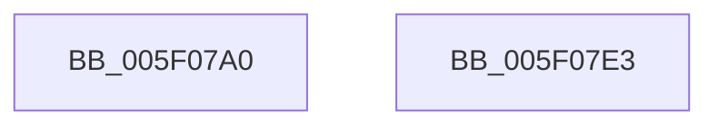

# RtlCompressBufferDeflateRaw

- RVA: `0x005F07A0`–`0x005F07E4` (길이 `68` bytes)
- VA: `0x00000001405F07A0`
- 실행 섹션: `.text`
- PDB 이름 있음: `예`; PDB Function 태그: `아니요`
- unwind 정보 RVA: `0x0006C2A4`
- 디코드: `16`개 명령, `68/68` bytes 표시
- 미해석 바이트: `0` (있으면 어셈블리에 `.byte`로 보존)

> 이 문서는 커널 이미지의 기계어와 PDB 기호를 분석해 생성했습니다. 4번과 5번은 함수 원형과 자료형을 바이너리 사용 방식에서 추정한 C 해석이며 원본 소스 복구 결과는 아닙니다.

## 1. Dependencies

- 직접 호출 지점: **1**; 고유 호출 대상: **1**
- 직접 호출자로 확인된 함수: **0**
- RIP 상대 이미지 참조: **0**

### Outgoing calls
- `0x005F07D9` → [RtlCompressBufferDeflateInternal](RtlCompressBufferDeflateInternal_function_005F0694.md) (function, `0x005F0694`)

### Direct callers
- 이 함수 시작 RVA로 연결되는 직접 call은 확인되지 않았습니다. 간접 호출은 완전히 역산할 수 없습니다.

### Static image references
- 디코드된 RIP-relative 메모리 참조가 없습니다.

## 2. Other-region calls and transfers

- 다른 실행 섹션으로 향하는 call: **0**
- 별도 외부 분기/꼬리 이동을 확인하지 못했습니다.

## 3. Assembly (complete function range)

```asm
005F07A0  48 83 EC 58                     sub rsp, 0x58
005F07A4  48 8B 84 24 98 00 00 00         mov rax, qword ptr [rsp + 0x98]
005F07AC  48 89 44 24 40                  mov qword ptr [rsp + 0x40], rax
005F07B1  48 8B 84 24 90 00 00 00         mov rax, qword ptr [rsp + 0x90]
005F07B9  48 89 44 24 38                  mov qword ptr [rsp + 0x38], rax
005F07BE  8B 84 24 80 00 00 00            mov eax, dword ptr [rsp + 0x80]
005F07C5  89 44 24 28                     mov dword ptr [rsp + 0x28], eax
005F07C9  4C 89 4C 24 20                  mov qword ptr [rsp + 0x20], r9
005F07CE  45 8B C8                        mov r9d, r8d
005F07D1  4C 8B C2                        mov r8, rdx
005F07D4  0F B7 D1                        movzx edx, cx
005F07D7  33 C9                           xor ecx, ecx
005F07D9  E8 B6 FE FF FF                  call 0x1405f0694
005F07DE  48 83 C4 58                     add rsp, 0x58
005F07E2  C3                              ret
005F07E3  CC                              int3
```

## 4. C-style interpretation (structured pseudocode)

```c
__int64 __fastcall RtlCompressBufferDeflateRaw(int a1, __int64 a2, int a3, __int64 a4, unsigned int a5, __int64 a6, __int64 a7, __int64 a8)
{
    __int64 result;
    __int64 v_rsp;
    unsigned __int64 v_stack_m18;
    unsigned __int64 v_stack_m20;
    unsigned int v_stack_m30;
    unsigned __int64 v_stack_m38;

    v_rsp = (v_rsp) - (88);
    v_stack_m18 = a8;
    v_stack_m20 = a7;
    v_stack_m30 = (unsigned int)((unsigned int)(a5));
    v_stack_m38 = a4;
    a1 = 0;
    result = RtlCompressBufferDeflateInternal(a1, (unsigned __int16)(a1), a2, (unsigned int)(a3));
    v_rsp = (v_rsp) + (88);
    return result;
}
```

## 5. (Beta) C Style

```c
int64_t RtlCompressBufferDeflateRaw(int32_t Arg1, int64_t Arg2, int32_t Arg3, int64_t Arg4, uint32_t Arg5, uint64_t Arg6, int64_t Arg7, int64_t Arg8)
{
    int64_t result;
    int64_t local_rsp;
    uint64_t v_stack_m18;
    uint64_t v_stack_m20;
    uint32_t v_stack_m30;
    uint64_t v_stack_m38;

    local_rsp = (local_rsp) - (88);
    v_stack_m18 = Arg8;
    v_stack_m20 = Arg7;
    v_stack_m30 = (uint32_t)((uint32_t)(Arg5));
    v_stack_m38 = Arg4;
    Arg1 = 0;
    result = RtlCompressBufferDeflateInternal(Arg1, (uint16_t)(Arg1), Arg2, (uint32_t)(Arg3));
    local_rsp = (local_rsp) + (88);
    return result;
}
```

## 6. Execution-region graph

[열기: 2D/3D 그래프와 함수 탐색 컨트롤 패널](../../../control-panel.html?section=text&rva=0x005F07A0&view=graph)

- 2D 그래프는 위에서 아래로 흐르고, 3D 그래프는 빈 공간을 드래그해 회전합니다. Shift+드래그는 이동, 휠은 확대·축소, 함수 노드 선택은 대상 보고서 이동입니다.

### Static fallback


