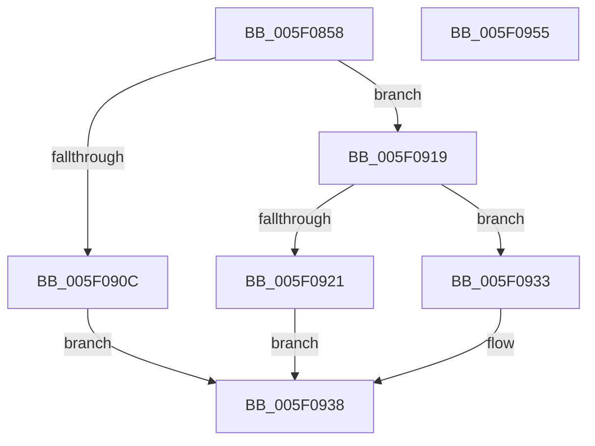

# RtlDecompressBufferDeflateInternal

- RVA: `0x005F0858`–`0x005F0956` (길이 `254` bytes)
- VA: `0x00000001405F0858`
- 실행 섹션: `.text`
- PDB 이름 있음: `예`; PDB Function 태그: `아니요`
- unwind 정보 RVA: `0x000C57B4`
- 디코드: `70`개 명령, `254/254` bytes 표시
- 미해석 바이트: `0` (있으면 어셈블리에 `.byte`로 보존)

> 이 문서는 커널 이미지의 기계어와 PDB 기호를 분석해 생성했습니다. 4번과 5번은 함수 원형과 자료형을 바이너리 사용 방식에서 추정한 C 해석이며 원본 소스 복구 결과는 아닙니다.

## 1. Dependencies

- 직접 호출 지점: **4**; 고유 호출 대상: **3**
- 직접 호출자로 확인된 함수: **2**
- RIP 상대 이미지 참조: **2**

### Outgoing calls
- `0x005F088C` → [memset](../6C/memset_function_006C6C40.md) (function, `0x006C6C40`)
- `0x005F08A0` → [memset](../6C/memset_function_006C6C40.md) (function, `0x006C6C40`)
- `0x005F08F2` → [inflateReset2](inflateReset2_function_005F334C.md) (function, `0x005F334C`)
- `0x005F0900` → [inflate](inflate_function_005F2280.md) (function, `0x005F2280`)

### Direct callers
- [RtlDecompressBufferDeflateRaw](RtlDecompressBufferDeflateRaw_function_005F0960.md) at `0x005F098B`
- [RtlDecompressBufferDeflateZlib](RtlDecompressBufferDeflateZlib_function_005F09A0.md) at `0x005F09CB`

### Static image references
- `0x005F08B4` → RVA `0x0048FDC0` (`HalAdjustResourceList`; read)
- `0x005F08C7` → RVA `0x0049E550` (`EmpCheckErrataList`; read)

## 2. Other-region calls and transfers

- 다른 실행 섹션으로 향하는 call: **0**
- 별도 외부 분기/꼬리 이동을 확인하지 못했습니다.

## 3. Assembly (complete function range)

```asm
005F0858  48 89 5C 24 08                  mov qword ptr [rsp + 8], rbx
005F085D  48 89 74 24 10                  mov qword ptr [rsp + 0x10], rsi
005F0862  48 89 7C 24 18                  mov qword ptr [rsp + 0x18], rdi
005F0867  55                              push rbp
005F0868  41 56                           push r14
005F086A  41 57                           push r15
005F086C  48 8B EC                        mov rbp, rsp
005F086F  48 81 EC 80 00 00 00            sub rsp, 0x80
005F0876  48 8B F2                        mov rsi, rdx
005F0879  45 8B F0                        mov r14d, r8d
005F087C  33 D2                           xor edx, edx
005F087E  44 8A F9                        mov r15b, cl
005F0881  48 8D 4D A0                     lea rcx, [rbp - 0x60]
005F0885  49 8B D9                        mov rbx, r9
005F0888  44 8D 42 58                     lea r8d, [rdx + 0x58]
005F088C  E8 AF 63 0D 00                  call 0x1406c6c40
005F0891  48 8B 7D 58                     mov rdi, qword ptr [rbp + 0x58]
005F0895  33 D2                           xor edx, edx
005F0897  48 8B CF                        mov rcx, rdi
005F089A  41 B8 70 23 00 00               mov r8d, 0x2370
005F08A0  E8 9B 63 0D 00                  call 0x1406c6c40
005F08A5  8B 45 40                        mov eax, dword ptr [rbp + 0x40]
005F08A8  48 8D 4D A0                     lea rcx, [rbp - 0x60]
005F08AC  89 45 A8                        mov dword ptr [rbp - 0x58], eax
005F08AF  BA 0F 00 00 00                  mov edx, 0xf
005F08B4  48 8D 05 05 F5 E9 FF            lea rax, [rip - 0x160afb]
005F08BB  48 89 5D A0                     mov qword ptr [rbp - 0x60], rbx
005F08BF  48 89 45 D0                     mov qword ptr [rbp - 0x30], rax
005F08C3  41 80 FF 01                     cmp r15b, 1
005F08C7  48 8D 05 82 DC EA FF            lea rax, [rip - 0x15237e]
005F08CE  48 89 75 B0                     mov qword ptr [rbp - 0x50], rsi
005F08D2  48 89 45 D8                     mov qword ptr [rbp - 0x28], rax
005F08D6  48 8D 45 A0                     lea rax, [rbp - 0x60]
005F08DA  48 89 07                        mov qword ptr [rdi], rax
005F08DD  8D 42 E2                        lea eax, [rdx - 0x1e]
005F08E0  0F 45 D0                        cmovne edx, eax
005F08E3  44 89 75 B8                     mov dword ptr [rbp - 0x48], r14d
005F08E7  48 89 7D C8                     mov qword ptr [rbp - 0x38], rdi
005F08EB  C7 47 08 34 3F 00 00            mov dword ptr [rdi + 8], 0x3f34
005F08F2  E8 55 2A 00 00                  call 0x1405f334c
005F08F7  BA 04 00 00 00                  mov edx, 4
005F08FC  48 8D 4D A0                     lea rcx, [rbp - 0x60]
005F0900  E8 7B 19 00 00                  call 0x1405f2280
005F0905  8B C8                           mov ecx, eax
005F0907  83 F8 01                        cmp eax, 1
005F090A  75 0D                           jne 0x1405f0919
005F090C  48 8B 45 50                     mov rax, qword ptr [rbp + 0x50]
005F0910  8B 4D BC                        mov ecx, dword ptr [rbp - 0x44]
005F0913  89 08                           mov dword ptr [rax], ecx
005F0915  33 C0                           xor eax, eax
005F0917  EB 1F                           jmp 0x1405f0938
005F0919  83 C0 05                        add eax, 5
005F091C  83 F8 01                        cmp eax, 1
005F091F  76 12                           jbe 0x1405f0933
005F0921  83 F9 FD                        cmp ecx, -3
005F0924  B8 E5 00 00 C0                  mov eax, 0xc00000e5
005F0929  BA 0D 00 00 C0                  mov edx, 0xc000000d
005F092E  0F 44 C2                        cmove eax, edx
005F0931  EB 05                           jmp 0x1405f0938
005F0933  B8 23 00 00 C0                  mov eax, 0xc0000023
005F0938  4C 8D 9C 24 80 00 00 00         lea r11, [rsp + 0x80]
005F0940  49 8B 5B 20                     mov rbx, qword ptr [r11 + 0x20]
005F0944  49 8B 73 28                     mov rsi, qword ptr [r11 + 0x28]
005F0948  49 8B 7B 30                     mov rdi, qword ptr [r11 + 0x30]
005F094C  49 8B E3                        mov rsp, r11
005F094F  41 5F                           pop r15
005F0951  41 5E                           pop r14
005F0953  5D                              pop rbp
005F0954  C3                              ret
005F0955  CC                              int3
```

## 4. C-style interpretation (structured pseudocode)

```c
__int64 __fastcall RtlDecompressBufferDeflateInternal(unsigned __int8 a1, __int64 a2, int a3, __int64 a4, unsigned int a5, __int64 a6, __int64 a7, __int64 a8)
{
    __int64 result;
    __int64 v_rsp;
    unsigned __int64 v_stack_m18;
    unsigned __int64 v_stack_m40;
    unsigned __int64 v_stack_m48;
    unsigned __int64 v_stack_m50;
    unsigned int v_stack_m5C;
    unsigned int v_stack_m60;
    unsigned __int64 v_stack_m68;
    unsigned int v_stack_m70;
    unsigned __int64 v_stack_m78;
    unsigned __int64 v_stack_p10;
    unsigned __int64 v_stack_p18;
    unsigned __int64 v_stack_p8;

    v_stack_p8 = v_rbx;
    v_stack_p10 = v_rsi;
    v_stack_p18 = v_rdi;
    v_rsp = (v_rsp) - (128);
    a2 = 0;
    result = memset(v_stack_m78, a2, a2 + 88, a4);
    a2 = 0;
    result = memset(a8, a2, (unsigned int)(0x2370ULL), a4);
    v_stack_m70 = (unsigned int)((unsigned int)(a5));
    v_stack_m78 = a4;
    v_stack_m48 = v_rip - 1444603;
    v_stack_m68 = 0;
    v_stack_m40 = v_rip - 1385342;
    *(unsigned __int64 *)(a8) = v_stack_m78;
    a2 = 15;
    if (a1 != 1) { a2 = (unsigned int)(15 - 30); }
    v_stack_m60 = (unsigned int)((unsigned int)(a3));
    v_stack_m50 = a8;
    *(unsigned int *)(a8 + 8) = 0x3F34ULL;
    result = inflateReset2(v_stack_m78, a2, (unsigned int)(0x2370ULL), a4);
    result = inflate(v_stack_m78, 4, (unsigned int)(0x2370ULL), a4);
    if (((unsigned int)(result)) != 1) goto loc_005F0919;
    *(unsigned int *)(a7) = (unsigned int)((unsigned int)(v_stack_m5C));
    result = 0;
    goto loc_005F0938;
loc_005F0919:
    result = (unsigned int)((result) + (5));
    if (((unsigned int)(result)) <= 1) goto loc_005F0933;
    result = (unsigned int)(0xC00000E5ULL);
    if (((unsigned int)((unsigned int)(v_stack_m5C))) == -3) { result = (unsigned int)((unsigned int)(0xC000000DULL)); }
    goto loc_005F0938;
loc_005F0933:
loc_005F0938:
    return (unsigned int)(0xC0000023ULL);
}
```

## 5. (Beta) C Style

```c
int64_t RtlDecompressBufferDeflateInternal(uint8_t Arg1, int64_t Arg2, int32_t Arg3, int64_t Arg4, uint32_t Arg5, uint64_t Arg6, void *Arg7, void *Arg8)
{
    uint8_t *arg7 = (uint8_t *)Arg7;
    uint8_t *arg8 = (uint8_t *)Arg8;

    int64_t result;
    int64_t local_rsp;
    uint64_t v_stack_m18;
    uint64_t v_stack_m40;
    uint64_t v_stack_m48;
    uint64_t v_stack_m50;
    uint32_t v_stack_m5C;
    uint32_t v_stack_m60;
    uint64_t v_stack_m68;
    uint32_t v_stack_m70;
    uint64_t v_stack_m78;
    uint64_t v_stack_p10;
    uint64_t v_stack_p18;
    uint64_t v_stack_p8;

    v_stack_p8 = local_rbx;
    v_stack_p10 = local_rsi;
    v_stack_p18 = local_rdi;
    local_rsp = (local_rsp) - (128);
    Arg2 = 0;
    result = memset(v_stack_m78, Arg2, Arg2 + 88, Arg4);
    Arg2 = 0;
    result = memset(Arg8, Arg2, (uint32_t)(0x2370ULL), Arg4);
    v_stack_m70 = (uint32_t)((uint32_t)(Arg5));
    v_stack_m78 = Arg4;
    v_stack_m48 = v_rip - 1444603;
    v_stack_m68 = 0;
    v_stack_m40 = v_rip - 1385342;
    *(uint64_t *)(arg8) = v_stack_m78;
    Arg2 = 15;
    if (Arg1 != 1) { Arg2 = (uint32_t)(15 - 30); }
    v_stack_m60 = (uint32_t)((uint32_t)(Arg3));
    v_stack_m50 = Arg8;
    *(uint32_t *)(arg8 + 0x8) = 0x3F34ULL;
    result = inflateReset2(v_stack_m78, Arg2, (uint32_t)(0x2370ULL), Arg4);
    result = inflate(v_stack_m78, 4, (uint32_t)(0x2370ULL), Arg4);
    if (((uint32_t)(result)) != 1) goto loc_005F0919;
    *(uint32_t *)(arg7) = (uint32_t)((uint32_t)(v_stack_m5C));
    result = 0;
    goto loc_005F0938;
loc_005F0919:
    result = (uint32_t)((result) + (5));
    if (((uint32_t)(result)) <= 1) goto loc_005F0933;
    result = (uint32_t)(0xC00000E5ULL);
    if (((uint32_t)((uint32_t)(v_stack_m5C))) == -3) { result = (uint32_t)((uint32_t)(0xC000000DULL)); }
    goto loc_005F0938;
loc_005F0933:
loc_005F0938:
    return (uint32_t)(0xC0000023ULL);
}
```

### 관측된 메모리 오프셋

구조체 형식이 확인되지 않은 접근은 인자 기준의 오프셋으로만 기록했습니다.

| 기준 인자 | 오프셋 표현 | 폭 (bit) | 접근 |
|---|---:|---:|---|
| `Arg7` | `+ 0x0` | `32` | `W` |
| `Arg8` | `+ 0x0` | `64` | `W` |
| `Arg8` | `+ 0x8` | `32` | `W` |

## 6. Execution-region graph

[열기: 2D/3D 그래프와 함수 탐색 컨트롤 패널](../../../control-panel.html?section=text&rva=0x005F0858&view=graph)

- 2D 그래프는 위에서 아래로 흐르고, 3D 그래프는 빈 공간을 드래그해 회전합니다. Shift+드래그는 이동, 휠은 확대·축소, 함수 노드 선택은 대상 보고서 이동입니다.

### Static fallback


