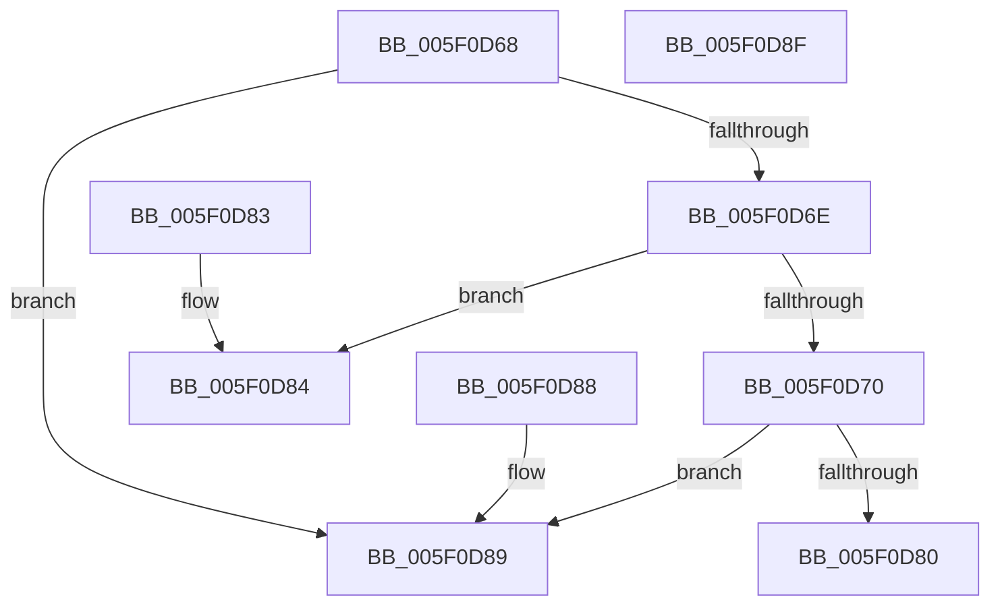

# RtlFcpCompareFeatureToFeature

- RVA: `0x005F0D68`–`0x005F0D90` (길이 `40` bytes)
- VA: `0x00000001405F0D68`
- 실행 섹션: `.text`
- PDB 이름 있음: `예`; PDB Function 태그: `아니요`
- unwind 정보 RVA: `0x000DB714`
- 디코드: `19`개 명령, `40/40` bytes 표시
- 미해석 바이트: `0` (있으면 어셈블리에 `.byte`로 보존)

> 이 문서는 커널 이미지의 기계어와 PDB 기호를 분석해 생성했습니다. 4번과 5번은 함수 원형과 자료형을 바이너리 사용 방식에서 추정한 C 해석이며 원본 소스 복구 결과는 아닙니다.

## 1. Dependencies

- 직접 호출 지점: **0**; 고유 호출 대상: **0**
- 직접 호출자로 확인된 함수: **1**
- RIP 상대 이미지 참조: **0**

### Outgoing calls
- 직접 디코드된 call 명령이 없습니다.

### Direct callers
- [RtlpFcValidateFeatureConfigurationBuffer](../../page/AD/RtlpFcValidateFeatureConfigurationBuffer_function_00AD14DC.md) at `0x00AD1554`

### Static image references
- 디코드된 RIP-relative 메모리 참조가 없습니다.

## 2. Other-region calls and transfers

- 다른 실행 섹션으로 향하는 call: **0**
- 별도 외부 분기/꼬리 이동을 확인하지 못했습니다.

## 3. Assembly (complete function range)

```asm
005F0D68  8B 01                           mov eax, dword ptr [rcx]
005F0D6A  3B 02                           cmp eax, dword ptr [rdx]
005F0D6C  77 1B                           ja 0x1405f0d89
005F0D6E  72 14                           jb 0x1405f0d84
005F0D70  8B 41 04                        mov eax, dword ptr [rcx + 4]
005F0D73  8B 4A 04                        mov ecx, dword ptr [rdx + 4]
005F0D76  83 E0 0F                        and eax, 0xf
005F0D79  83 E1 0F                        and ecx, 0xf
005F0D7C  3B C8                           cmp ecx, eax
005F0D7E  77 09                           ja 0x1405f0d89
005F0D80  1B C0                           sbb eax, eax
005F0D82  C3                              ret
005F0D83  CC                              int3
005F0D84  83 C8 FF                        or eax, 0xffffffff
005F0D87  C3                              ret
005F0D88  CC                              int3
005F0D89  B8 01 00 00 00                  mov eax, 1
005F0D8E  C3                              ret
005F0D8F  CC                              int3
```

## 4. C-style interpretation (structured pseudocode)

```c
__int64 __fastcall RtlFcpCompareFeatureToFeature(__int64 a1, __int64 a2)
{
    __int64 result;

    if (((unsigned int)((unsigned int)(*(unsigned int *)(a1)))) > (*(unsigned int *)(a2))) goto loc_005F0D89;
    if (((unsigned int)((unsigned int)(*(unsigned int *)(a1)))) < (*(unsigned int *)(a2))) goto loc_005F0D84;
    result = (unsigned int)(((unsigned int)(*(unsigned int *)(a1 + 4))) & (15));
    a1 = (unsigned int)(((unsigned int)(*(unsigned int *)(a2 + 4))) & (15));
    if (((unsigned int)(a1)) > ((unsigned int)(result))) goto loc_005F0D89;
    return result;
loc_005F0D84:
    result = (unsigned int)((result) | (0xFFFFFFFFULL));
    return result;
loc_005F0D89:
    return 1;
}
```

## 5. (Beta) C Style

```c
int64_t RtlFcpCompareFeatureToFeature(void *Arg1, void *Arg2)
{
    uint8_t *arg1 = (uint8_t *)Arg1;
    uint8_t *arg2 = (uint8_t *)Arg2;

    int64_t result;

    if (((uint32_t)((uint32_t)(*(uint32_t *)(arg1)))) > (*(uint32_t *)(arg2))) goto loc_005F0D89;
    if (((uint32_t)((uint32_t)(*(uint32_t *)(arg1)))) < (*(uint32_t *)(arg2))) goto loc_005F0D84;
    result = (uint32_t)(((uint32_t)(*(uint32_t *)(arg1 + 0x4))) & (15));
    Arg1 = (uint32_t)(((uint32_t)(*(uint32_t *)(arg2 + 0x4))) & (15));
    if (((uint32_t)(Arg1)) > ((uint32_t)(result))) goto loc_005F0D89;
    return result;
loc_005F0D84:
    result = (uint32_t)((result) | (0xFFFFFFFFULL));
    return result;
loc_005F0D89:
    return 1;
}
```

### 관측된 메모리 오프셋

구조체 형식이 확인되지 않은 접근은 인자 기준의 오프셋으로만 기록했습니다.

| 기준 인자 | 오프셋 표현 | 폭 (bit) | 접근 |
|---|---:|---:|---|
| `Arg1` | `+ 0x0` | `32` | `R` |
| `Arg1` | `+ 0x4` | `32` | `R` |
| `Arg2` | `+ 0x0` | `32` | `R` |
| `Arg2` | `+ 0x4` | `32` | `R` |

## 6. Execution-region graph

[열기: 2D/3D 그래프와 함수 탐색 컨트롤 패널](../../../control-panel.html?section=text&rva=0x005F0D68&view=graph)

- 2D 그래프는 위에서 아래로 흐르고, 3D 그래프는 빈 공간을 드래그해 회전합니다. Shift+드래그는 이동, 휠은 확대·축소, 함수 노드 선택은 대상 보고서 이동입니다.

### Static fallback


