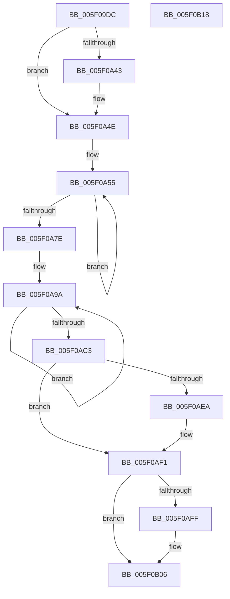

# RtlHpGlobalsInitialize

- RVA: `0x005F09DC`–`0x005F0B19` (길이 `317` bytes)
- VA: `0x00000001405F09DC`
- 실행 섹션: `.text`
- PDB 이름 있음: `예`; PDB Function 태그: `아니요`
- unwind 정보 RVA: `0x00085760`
- 디코드: `73`개 명령, `317/317` bytes 표시
- 미해석 바이트: `0` (있으면 어셈블리에 `.byte`로 보존)

> 이 문서는 커널 이미지의 기계어와 PDB 기호를 분석해 생성했습니다. 4번과 5번은 함수 원형과 자료형을 바이너리 사용 방식에서 추정한 C 해석이며 원본 소스 복구 결과는 아닙니다.

## 1. Dependencies

- 직접 호출 지점: **5**; 고유 호출 대상: **3**
- 직접 호출자로 확인된 함수: **2**
- RIP 상대 이미지 참조: **8**

### Outgoing calls
- `0x005F09F8` → [memset](../6C/memset_function_006C6C40.md) (function, `0x006C6C40`)
- `0x005F0A0F` → [ExGenRandom](../41/ExGenRandom_function_0041B010.md) (function, `0x0041B010`)
- `0x005F0A1F` → [ExGenRandom](../41/ExGenRandom_function_0041B010.md) (function, `0x0041B010`)
- `0x005F0AE1` → [RtlIsProcessorFeaturePresent](../4B/RtlIsProcessorFeaturePresent_function_004B22C0.md) (function, `0x004B22C0`)
- `0x005F0AF6` → [RtlIsProcessorFeaturePresent](../4B/RtlIsProcessorFeaturePresent_function_004B22C0.md) (function, `0x004B22C0`)

### Direct callers
- [RtlHpKInitializeHeapManager](../65/RtlHpKInitializeHeapManager_function_0065C9A0.md) at `0x0065C9AD`
- [ExpInitSystemPhase0](../../init/C5/ExpInitSystemPhase0_function_00C5136C.md) at `0x00C514B6`

### Static image references
- `0x005F09E6` → RVA `0x00E28300` (`.data`; read)
- `0x005F0A37` → RVA `0x00E28340` (`.data`; write)
- `0x005F0A4E` → RVA `0x00E28340` (`.data`; read)
- `0x005F0A93` → RVA `0x00E28300` (`.data`; write)
- `0x005F0AC7` → RVA `0x00E0C5D0` (`.data`; read)
- `0x005F0AD3` → RVA `0x00E28308` (`.data`; write)
- `0x005F0ADA` → RVA `0x00E28310` (`.data`; write)
- `0x005F0AEA` → RVA `0x00E28328` (`.data`; read/write)

## 2. Other-region calls and transfers

- 다른 실행 섹션으로 향하는 call: **0**
- 별도 외부 분기/꼬리 이동을 확인하지 못했습니다.

## 3. Assembly (complete function range)

```asm
005F09DC  48 89 5C 24 08                  mov qword ptr [rsp + 8], rbx
005F09E1  56                              push rsi
005F09E2  48 83 EC 20                     sub rsp, 0x20
005F09E6  48 8D 35 13 79 83 00            lea rsi, [rip + 0x837913]
005F09ED  33 D2                           xor edx, edx
005F09EF  48 8B CE                        mov rcx, rsi
005F09F2  41 B8 80 00 00 00               mov r8d, 0x80
005F09F8  E8 43 62 0D 00                  call 0x1406c6c40
005F09FD  48 B8 20 03 00 00 80 F7 FF FF   movabs rax, 0xfffff78000000320
005F0A07  B9 01 00 00 00                  mov ecx, 1
005F0A0C  48 8B 00                        mov rax, qword ptr [rax]
005F0A0F  E8 FC A5 E2 FF                  call 0x14041b010
005F0A14  8B D8                           mov ebx, eax
005F0A16  B9 01 00 00 00                  mov ecx, 1
005F0A1B  0F BA F3 1F                     btr ebx, 0x1f
005F0A1F  E8 EC A5 E2 FF                  call 0x14041b010
005F0A24  0F BA F0 1F                     btr eax, 0x1f
005F0A28  8B CB                           mov ecx, ebx
005F0A2A  48 C1 E1 20                     shl rcx, 0x20
005F0A2E  48 0B C1                        or rax, rcx
005F0A31  48 8B C8                        mov rcx, rax
005F0A34  48 33 CE                        xor rcx, rsi
005F0A37  48 89 0D 02 79 83 00            mov qword ptr [rip + 0x837902], rcx
005F0A3E  48 3B C6                        cmp rax, rsi
005F0A41  75 0B                           jne 0x1405f0a4e
005F0A43  48 C7 05 F2 78 83 00 01 00 00 00  mov qword ptr [rip + 0x8378f2], 1
005F0A4E  48 8B 05 EB 78 83 00            mov rax, qword ptr [rip + 0x8378eb]
005F0A55  48 8B D0                        mov rdx, rax
005F0A58  48 C1 EA 0C                     shr rdx, 0xc
005F0A5C  48 33 D0                        xor rdx, rax
005F0A5F  48 8B CA                        mov rcx, rdx
005F0A62  48 C1 E1 19                     shl rcx, 0x19
005F0A66  48 33 D1                        xor rdx, rcx
005F0A69  48 8B CA                        mov rcx, rdx
005F0A6C  48 C1 E9 1B                     shr rcx, 0x1b
005F0A70  48 33 D1                        xor rdx, rcx
005F0A73  F0 48 0F B1 15 C4 78 83 00      lock cmpxchg qword ptr [rip + 0x8378c4], rdx
005F0A7C  75 D7                           jne 0x1405f0a55
005F0A7E  48 8B 05 BB 78 83 00            mov rax, qword ptr [rip + 0x8378bb]
005F0A85  49 B8 1D DD 6C 4F 91 F4 45 25   movabs r8, 0x2545f4914f6cdd1d
005F0A8F  49 0F AF D0                     imul rdx, r8
005F0A93  48 89 15 66 78 83 00            mov qword ptr [rip + 0x837866], rdx
005F0A9A  48 8B D0                        mov rdx, rax
005F0A9D  48 C1 EA 0C                     shr rdx, 0xc
005F0AA1  48 33 D0                        xor rdx, rax
005F0AA4  48 8B CA                        mov rcx, rdx
005F0AA7  48 C1 E1 19                     shl rcx, 0x19
005F0AAB  48 33 D1                        xor rdx, rcx
005F0AAE  48 8B CA                        mov rcx, rdx
005F0AB1  48 C1 E9 1B                     shr rcx, 0x1b
005F0AB5  48 33 D1                        xor rdx, rcx
005F0AB8  F0 48 0F B1 15 7F 78 83 00      lock cmpxchg qword ptr [rip + 0x83787f], rdx
005F0AC1  75 D7                           jne 0x1405f0a9a
005F0AC3  49 0F AF D0                     imul rdx, r8
005F0AC7  48 8D 05 02 BB 81 00            lea rax, [rip + 0x81bb02]
005F0ACE  B9 2A 00 00 00                  mov ecx, 0x2a
005F0AD3  48 89 15 2E 78 83 00            mov qword ptr [rip + 0x83782e], rdx
005F0ADA  48 89 05 2F 78 83 00            mov qword ptr [rip + 0x83782f], rax
005F0AE1  E8 DA 17 EC FF                  call 0x1404b22c0
005F0AE6  84 C0                           test al, al
005F0AE8  74 07                           je 0x1405f0af1
005F0AEA  83 0D 37 78 83 00 02            or dword ptr [rip + 0x837837], 2
005F0AF1  B9 3C 00 00 00                  mov ecx, 0x3c
005F0AF6  E8 C5 17 EC FF                  call 0x1404b22c0
005F0AFB  84 C0                           test al, al
005F0AFD  74 07                           je 0x1405f0b06
005F0AFF  83 0D 22 78 83 00 04            or dword ptr [rip + 0x837822], 4
005F0B06  83 0D 1B 78 83 00 01            or dword ptr [rip + 0x83781b], 1
005F0B0D  48 8B 5C 24 30                  mov rbx, qword ptr [rsp + 0x30]
005F0B12  48 83 C4 20                     add rsp, 0x20
005F0B16  5E                              pop rsi
005F0B17  C3                              ret
005F0B18  CC                              int3
```

## 4. C-style interpretation (structured pseudocode)

```c
__int64 __fastcall RtlHpGlobalsInitialize(__int64 a1, int a2)
{
    __int64 result;
    __int64 v_rsp;
    unsigned __int64 v_stack_p8;

    v_stack_p8 = v_rbx;
    v_rsp = (v_rsp) - (32);
    a2 = 0;
    result = memset(v_rip + 8616211, a2, 128, a4);
    result = ExGenRandom(1, a2, 128, a4);
    result = ExGenRandom(1, a2, 128, a4);
    a1 = ((unsigned int)((unsigned int)((unsigned int)((unsigned int)(result))))) << (32);
    result = (result) | (a1);
    a1 = (result) ^ (v_rip + 8616211);
    *(unsigned __int64 *)(v_rip + 8616194) = a1;
    if (result == (v_rip + 8616211)) {
        *(unsigned __int64 *)(v_rip + 8616178) = 1;
    }
loc_005F0A55:
    a2 = (*(unsigned __int64 *)(v_rip + 8616171)) >> (12);
    a2 = (a2) ^ (*(unsigned __int64 *)(v_rip + 8616171));
    a1 = (a2) << (25);
    a2 = (a2) ^ (a1);
    a1 = (a2) >> (27);
    a2 = (a2) ^ (a1);
    if (condition_is_not_equal) goto loc_005F0A55;
    a2 = (a2) * (128);
    *(unsigned __int64 *)(v_rip + 8616038) = a2;
loc_005F0A9A:
    a2 = (*(unsigned __int64 *)(v_rip + 8616123)) >> (12);
    a2 = (a2) ^ (*(unsigned __int64 *)(v_rip + 8616123));
    a1 = (a2) << (25);
    a2 = (a2) ^ (a1);
    a1 = (a2) >> (27);
    a2 = (a2) ^ (a1);
    if (condition_is_not_equal) goto loc_005F0A9A;
    a2 = (a2) * (128);
    *(unsigned __int64 *)(v_rip + 8615982) = a2;
    *(unsigned __int64 *)(v_rip + 8615983) = v_rip + 8502018;
    result = RtlIsProcessorFeaturePresent(42, a2, 128, a4);
    if ((unsigned __int8)(result) != 0) {
    }
    result = RtlIsProcessorFeaturePresent(60, a2, 128, a4);
    if ((unsigned __int8)(result) != 0) {
    }
    v_rsp = (v_rsp) + (32);
    return result;
}
```

## 5. (Beta) C Style

```c
int64_t RtlHpGlobalsInitialize(int64_t Arg1, int32_t Arg2)
{
    int64_t result;
    int64_t local_rsp;
    uint64_t v_stack_p8;

    v_stack_p8 = local_rbx;
    local_rsp = (local_rsp) - (32);
    Arg2 = 0;
    result = memset(v_rip + 8616211, Arg2, 128, a4);
    result = ExGenRandom(1, Arg2, 128, a4);
    result = ExGenRandom(1, Arg2, 128, a4);
    Arg1 = ((uint32_t)((uint32_t)((uint32_t)((uint32_t)(result))))) << (32);
    result = (result) | (Arg1);
    Arg1 = (result) ^ (v_rip + 8616211);
    *(uint64_t *)(v_rip + 0x837902) = Arg1;
    if (result == (v_rip + 8616211)) {
        *(uint64_t *)(v_rip + 0x8378F2) = 1;
    }
loc_005F0A55:
    Arg2 = (*(uint64_t *)(v_rip + 0x8378EB)) >> (12);
    Arg2 = (Arg2) ^ (*(uint64_t *)(v_rip + 0x8378EB));
    Arg1 = (Arg2) << (25);
    Arg2 = (Arg2) ^ (Arg1);
    Arg1 = (Arg2) >> (27);
    Arg2 = (Arg2) ^ (Arg1);
    if (condition_is_not_equal) goto loc_005F0A55;
    Arg2 = (Arg2) * (128);
    *(uint64_t *)(v_rip + 0x837866) = Arg2;
loc_005F0A9A:
    Arg2 = (*(uint64_t *)(v_rip + 0x8378BB)) >> (12);
    Arg2 = (Arg2) ^ (*(uint64_t *)(v_rip + 0x8378BB));
    Arg1 = (Arg2) << (25);
    Arg2 = (Arg2) ^ (Arg1);
    Arg1 = (Arg2) >> (27);
    Arg2 = (Arg2) ^ (Arg1);
    if (condition_is_not_equal) goto loc_005F0A9A;
    Arg2 = (Arg2) * (128);
    *(uint64_t *)(v_rip + 0x83782E) = Arg2;
    *(uint64_t *)(v_rip + 0x83782F) = v_rip + 8502018;
    result = RtlIsProcessorFeaturePresent(42, Arg2, 128, a4);
    if ((uint8_t)(result) != 0) {
    }
    result = RtlIsProcessorFeaturePresent(60, Arg2, 128, a4);
    if ((uint8_t)(result) != 0) {
    }
    local_rsp = (local_rsp) + (32);
    return result;
}
```

## 6. Execution-region graph

[열기: 2D/3D 그래프와 함수 탐색 컨트롤 패널](../../../control-panel.html?section=text&rva=0x005F09DC&view=graph)

- 2D 그래프는 위에서 아래로 흐르고, 3D 그래프는 빈 공간을 드래그해 회전합니다. Shift+드래그는 이동, 휠은 확대·축소, 함수 노드 선택은 대상 보고서 이동입니다.

### Static fallback


