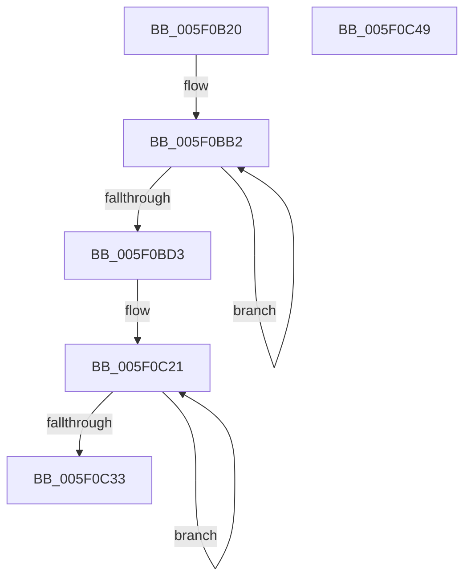

# RtlHpHeapManagerInitialize

- RVA: `0x005F0B20`–`0x005F0C4A` (길이 `298` bytes)
- VA: `0x00000001405F0B20`
- 실행 섹션: `.text`
- PDB 이름 있음: `예`; PDB Function 태그: `아니요`
- unwind 정보 RVA: `0x0006F978`
- 디코드: `69`개 명령, `298/298` bytes 표시
- 미해석 바이트: `0` (있으면 어셈블리에 `.byte`로 보존)

> 이 문서는 커널 이미지의 기계어와 PDB 기호를 분석해 생성했습니다. 4번과 5번은 함수 원형과 자료형을 바이너리 사용 방식에서 추정한 C 해석이며 원본 소스 복구 결과는 아닙니다.

## 1. Dependencies

- 직접 호출 지점: **7**; 고유 호출 대상: **3**
- 직접 호출자로 확인된 함수: **1**
- RIP 상대 이미지 참조: **7**

### Outgoing calls
- `0x005F0B47` → [memset](../6C/memset_function_006C6C40.md) (function, `0x006C6C40`)
- `0x005F0B60` → [memset](../6C/memset_function_006C6C40.md) (function, `0x006C6C40`)
- `0x005F0B6E` → [RtlCSparseBitmapInitialize](../60/RtlCSparseBitmapInitialize_function_006052F8.md) (function, `0x006052F8`)
- `0x005F0B82` → [memset](../6C/memset_function_006C6C40.md) (function, `0x006C6C40`)
- `0x005F0B91` → [memset](../6C/memset_function_006C6C40.md) (function, `0x006C6C40`)
- `0x005F0B9F` → [RtlCSparseBitmapInitialize](../60/RtlCSparseBitmapInitialize_function_006052F8.md) (function, `0x006052F8`)
- `0x005F0C24` → [CmSiRWLockInitialize](../../page/AD/CmSiRWLockInitialize_function_00AD69E0.md) (function, `0x00AD69E0`)

### Direct callers
- [RtlHpKInitializeHeapManager](../65/RtlHpKInitializeHeapManager_function_0065C9A0.md) at `0x0065C9D8`

### Static image references
- `0x005F0B4E` → RVA `0x00E28300` (`.data`; read)
- `0x005F0BD3` → RVA `0x00F059D0` (`.data`; write)
- `0x005F0BDA` → RVA `0x00F059D8` (`.data`; read)
- `0x005F0BE1` → RVA `0x00F059C0` (`.data`; write)
- `0x005F0BE7` → RVA `0x00F059C0` (`.data`; read)
- `0x005F0BEE` → RVA `0x00F059C8` (`.data`; write)
- `0x005F0BF9` → RVA `0x00F059C4` (`.data`; write)

## 2. Other-region calls and transfers

- 다른 실행 섹션으로 향하는 call: **1**
  - `0x005F0C24` → [CmSiRWLockInitialize](../../page/AD/CmSiRWLockInitialize_function_00AD69E0.md) (`.text` → `PAGE`)
- 별도 외부 분기/꼬리 이동을 확인하지 못했습니다.

## 3. Assembly (complete function range)

```asm
005F0B20  48 89 5C 24 08                  mov qword ptr [rsp + 8], rbx
005F0B25  48 89 74 24 10                  mov qword ptr [rsp + 0x10], rsi
005F0B2A  48 89 7C 24 18                  mov qword ptr [rsp + 0x18], rdi
005F0B2F  41 56                           push r14
005F0B31  48 83 EC 20                     sub rsp, 0x20
005F0B35  4C 8B F2                        mov r14, rdx
005F0B38  48 8B F1                        mov rsi, rcx
005F0B3B  48 83 C1 58                     add rcx, 0x58
005F0B3F  33 D2                           xor edx, edx
005F0B41  41 B8 88 38 00 00               mov r8d, 0x3888
005F0B47  E8 F4 60 0D 00                  call 0x1406c6c40
005F0B4C  33 D2                           xor edx, edx
005F0B4E  48 8D 05 AB 77 83 00            lea rax, [rip + 0x8377ab]
005F0B55  48 8D 4E 08                     lea rcx, [rsi + 8]
005F0B59  48 89 06                        mov qword ptr [rsi], rax
005F0B5C  44 8D 42 50                     lea r8d, [rdx + 0x50]
005F0B60  E8 DB 60 0D 00                  call 0x1406c6c40
005F0B65  48 8D 4E 10                     lea rcx, [rsi + 0x10]
005F0B69  BA 48 00 00 00                  mov edx, 0x48
005F0B6E  E8 85 47 01 00                  call 0x1406052f8
005F0B73  48 8D 5E 58                     lea rbx, [rsi + 0x58]
005F0B77  33 D2                           xor edx, edx
005F0B79  48 8B CB                        mov rcx, rbx
005F0B7C  41 B8 40 38 00 00               mov r8d, 0x3840
005F0B82  E8 B9 60 0D 00                  call 0x1406c6c40
005F0B87  33 D2                           xor edx, edx
005F0B89  48 8D 4B 10                     lea rcx, [rbx + 0x10]
005F0B8D  44 8D 42 50                     lea r8d, [rdx + 0x50]
005F0B91  E8 AA 60 0D 00                  call 0x1406c6c40
005F0B96  48 8D 4B 20                     lea rcx, [rbx + 0x20]
005F0B9A  BA 40 08 00 00                  mov edx, 0x840
005F0B9F  E8 54 47 01 00                  call 0x1406052f8
005F0BA4  48 81 C3 78 08 00 00            add rbx, 0x878
005F0BAB  B8 FF 00 00 00                  mov eax, 0xff
005F0BB0  33 C9                           xor ecx, ecx
005F0BB2  48 89 4B F8                     mov qword ptr [rbx - 8], rcx
005F0BB6  48 89 4B 10                     mov qword ptr [rbx + 0x10], rcx
005F0BBA  48 89 4B 18                     mov qword ptr [rbx + 0x18], rcx
005F0BBE  48 89 4B 20                     mov qword ptr [rbx + 0x20], rcx
005F0BC2  48 89 0B                        mov qword ptr [rbx], rcx
005F0BC5  48 89 4B 08                     mov qword ptr [rbx + 8], rcx
005F0BC9  48 8D 5B 30                     lea rbx, [rbx + 0x30]
005F0BCD  48 83 E8 01                     sub rax, 1
005F0BD1  75 DF                           jne 0x1405f0bb2
005F0BD3  48 89 0D F6 4D 91 00            mov qword ptr [rip + 0x914df6], rcx
005F0BDA  48 8D 3D F7 4D 91 00            lea rdi, [rip + 0x914df7]
005F0BE1  89 0D D9 4D 91 00               mov dword ptr [rip + 0x914dd9], ecx
005F0BE7  48 8D 05 D2 4D 91 00            lea rax, [rip + 0x914dd2]
005F0BEE  48 89 3D D3 4D 91 00            mov qword ptr [rip + 0x914dd3], rdi
005F0BF5  48 83 C8 01                     or rax, 1
005F0BF9  C7 05 C1 4D 91 00 00 08 00 00   mov dword ptr [rip + 0x914dc1], 0x800
005F0C03  B9 40 00 00 00                  mov ecx, 0x40
005F0C08  F3 48 AB                        rep stosq qword ptr [rdi], rax
005F0C0B  49 8B 06                        mov rax, qword ptr [r14]
005F0C0E  48 8D BE A0 38 00 00            lea rdi, [rsi + 0x38a0]
005F0C15  48 89 86 D8 38 00 00            mov qword ptr [rsi + 0x38d8], rax
005F0C1C  BB 04 00 00 00                  mov ebx, 4
005F0C21  48 8B CF                        mov rcx, rdi
005F0C24  E8 B7 5D 4E 00                  call 0x140ad69e0
005F0C29  48 83 C7 10                     add rdi, 0x10
005F0C2D  48 83 EB 01                     sub rbx, 1
005F0C31  75 EE                           jne 0x1405f0c21
005F0C33  48 8B 5C 24 30                  mov rbx, qword ptr [rsp + 0x30]
005F0C38  48 8B 74 24 38                  mov rsi, qword ptr [rsp + 0x38]
005F0C3D  48 8B 7C 24 40                  mov rdi, qword ptr [rsp + 0x40]
005F0C42  48 83 C4 20                     add rsp, 0x20
005F0C46  41 5E                           pop r14
005F0C48  C3                              ret
005F0C49  CC                              int3
```

## 4. C-style interpretation (structured pseudocode)

```c
__int64 __fastcall RtlHpHeapManagerInitialize(__int64 a1, __int64 a2)
{
    __int64 result;
    __int64 v_rbx;
    __int64 v_rdi;
    __int64 v_rsp;
    unsigned __int64 v_stack_p10;
    unsigned __int64 v_stack_p18;
    unsigned __int64 v_stack_p8;

    v_stack_p8 = v_rbx;
    v_stack_p10 = v_rsi;
    v_stack_p18 = v_rdi;
    v_rsp = (v_rsp) - (32);
    a1 = (a1) + (88);
    a2 = 0;
    result = memset(a1, a2, (unsigned int)(0x3888ULL), a4);
    a2 = 0;
    *(unsigned __int64 *)(a1) = v_rip + 8615851;
    result = memset(a1 + 8, a2, a2 + 80, a4);
    result = RtlCSparseBitmapInitialize(a1 + 16, 72, a2 + 80, a4);
    a2 = 0;
    result = memset(a1 + 88, a2, (unsigned int)(0x3840ULL), a4);
    a2 = 0;
    result = memset(a1 + 88 + 16, a2, a2 + 80, a4);
    result = RtlCSparseBitmapInitialize(a1 + 88 + 32, (unsigned int)(0x840ULL), a2 + 80, a4);
    v_rbx = (a1 + 88) + (0x878ULL);
    a1 = 0;
loc_005F0BB2:
    *(unsigned __int64 *)(v_rbx - 8) = 0;
    *(unsigned __int64 *)(v_rbx + 16) = 0;
    *(unsigned __int64 *)(v_rbx + 24) = 0;
    *(unsigned __int64 *)(v_rbx + 32) = 0;
    *(unsigned __int64 *)(v_rbx) = 0;
    *(unsigned __int64 *)(v_rbx + 8) = 0;
    result = (255) - (1);
    if (condition_is_not_equal) goto loc_005F0BB2;
    *(unsigned __int64 *)(v_rip + 9522678) = 0;
    *(unsigned int *)(v_rip + 9522649) = 0;
    *(unsigned __int64 *)(v_rip + 9522643) = v_rip + 9522679;
    result = (v_rip + 9522642) | (1);
    *(unsigned int *)(v_rip + 9522625) = 0x800ULL;
    *(unsigned __int64 *)(a1 + 14552) = *(unsigned __int64 *)(a2);
loc_005F0C21:
    result = CmSiRWLockInitialize(a1 + 14496, (unsigned int)(0x840ULL), a2 + 80, a4);
    v_rdi = (a1 + 14496) + (16);
    v_rbx = (4) - (1);
    if (condition_is_not_equal) goto loc_005F0C21;
    v_rsp = (v_rsp) + (32);
    return result;
}
```

## 5. (Beta) C Style

```c
int64_t RtlHpHeapManagerInitialize(void *Arg1, void *Arg2)
{
    uint8_t *arg1 = (uint8_t *)Arg1;
    uint8_t *arg2 = (uint8_t *)Arg2;

    int64_t result;
    int64_t local_rbx;
    int64_t local_rdi;
    int64_t local_rsp;
    uint64_t v_stack_p10;
    uint64_t v_stack_p18;
    uint64_t v_stack_p8;

    v_stack_p8 = local_rbx;
    v_stack_p10 = local_rsi;
    v_stack_p18 = local_rdi;
    local_rsp = (local_rsp) - (32);
    Arg1 = (Arg1) + (88);
    Arg2 = 0;
    result = memset(Arg1, Arg2, (uint32_t)(0x3888ULL), a4);
    Arg2 = 0;
    *(uint64_t *)(arg1) = v_rip + 8615851;
    result = memset(Arg1 + 8, Arg2, Arg2 + 80, a4);
    result = RtlCSparseBitmapInitialize(Arg1 + 16, 72, Arg2 + 80, a4);
    Arg2 = 0;
    result = memset(Arg1 + 88, Arg2, (uint32_t)(0x3840ULL), a4);
    Arg2 = 0;
    result = memset(Arg1 + 88 + 16, Arg2, Arg2 + 80, a4);
    result = RtlCSparseBitmapInitialize(Arg1 + 88 + 32, (uint32_t)(0x840ULL), Arg2 + 80, a4);
    local_rbx = (Arg1 + 88) + (0x878ULL);
    Arg1 = 0;
loc_005F0BB2:
    *(uint64_t *)(local_rbx - 0x8) = 0;
    *(uint64_t *)(local_rbx + 0x10) = 0;
    *(uint64_t *)(local_rbx + 0x18) = 0;
    *(uint64_t *)(local_rbx + 0x20) = 0;
    *(uint64_t *)(local_rbx) = 0;
    *(uint64_t *)(local_rbx + 0x8) = 0;
    result = (255) - (1);
    if (condition_is_not_equal) goto loc_005F0BB2;
    *(uint64_t *)(v_rip + 0x914DF6) = 0;
    *(uint32_t *)(v_rip + 0x914DD9) = 0;
    *(uint64_t *)(v_rip + 0x914DD3) = v_rip + 9522679;
    result = (v_rip + 9522642) | (1);
    *(uint32_t *)(v_rip + 0x914DC1) = 0x800ULL;
    *(uint64_t *)(arg1 + 0x38D8) = *(uint64_t *)(arg2);
loc_005F0C21:
    result = CmSiRWLockInitialize(Arg1 + 14496, (uint32_t)(0x840ULL), Arg2 + 80, a4);
    local_rdi = (Arg1 + 14496) + (16);
    local_rbx = (4) - (1);
    if (condition_is_not_equal) goto loc_005F0C21;
    local_rsp = (local_rsp) + (32);
    return result;
}
```

### 관측된 메모리 오프셋

구조체 형식이 확인되지 않은 접근은 인자 기준의 오프셋으로만 기록했습니다.

| 기준 인자 | 오프셋 표현 | 폭 (bit) | 접근 |
|---|---:|---:|---|
| `Arg1` | `- 0x8` | `64` | `W` |
| `Arg1` | `+ 0x0` | `64` | `W` |
| `Arg1` | `+ 0x8` | `64` | `R` |
| `Arg1` | `+ 0x8` | `64` | `W` |
| `Arg1` | `+ 0x10` | `64` | `R` |
| `Arg1` | `+ 0x10` | `64` | `W` |
| `Arg1` | `+ 0x18` | `64` | `W` |
| `Arg1` | `+ 0x20` | `64` | `R` |
| `Arg1` | `+ 0x20` | `64` | `W` |
| `Arg1` | `+ 0x30` | `64` | `R` |
| `Arg1` | `+ 0x58` | `64` | `R` |
| `Arg1` | `+ 0x38A0` | `64` | `R` |
| `Arg1` | `+ 0x38D8` | `64` | `W` |
| `Arg2` | `+ 0x0` | `64` | `R` |

## 6. Execution-region graph

[열기: 2D/3D 그래프와 함수 탐색 컨트롤 패널](../../../control-panel.html?section=text&rva=0x005F0B20&view=graph)

- 2D 그래프는 위에서 아래로 흐르고, 3D 그래프는 빈 공간을 드래그해 회전합니다. Shift+드래그는 이동, 휠은 확대·축소, 함수 노드 선택은 대상 보고서 이동입니다.

### Static fallback


