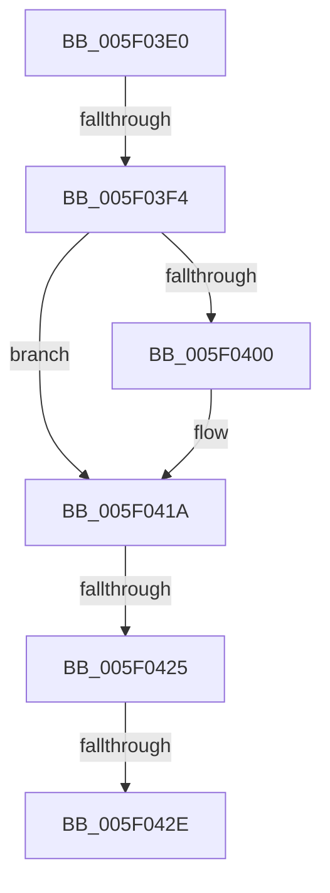

# RtlMarkHiberPhase

- RVA: `0x005F03E0`–`0x005F044E` (길이 `110` bytes)
- VA: `0x00000001405F03E0`
- 실행 섹션: `.text`
- PDB 이름 있음: `예`; PDB Function 태그: `아니요`
- unwind 정보 RVA: `0x000D013C`
- 디코드: `27`개 명령, `110/110` bytes 표시
- 미해석 바이트: `0` (있으면 어셈블리에 `.byte`로 보존)

> 이 문서는 커널 이미지의 기계어와 PDB 기호를 분석해 생성했습니다. 4번과 5번은 함수 원형과 자료형을 바이너리 사용 방식에서 추정한 C 해석이며 원본 소스 복구 결과는 아닙니다.

## 1. Dependencies

- 직접 호출 지점: **2**; 고유 호출 대상: **1**
- 직접 호출자로 확인된 함수: **1**
- RIP 상대 이미지 참조: **2**

### Outgoing calls
- `0x005F0414` → [KeBugCheckEx](../4F/KeBugCheckEx_function_004FD660.md) (function, `0x004FD660`)
- `0x005F0448` → [KeBugCheckEx](../4F/KeBugCheckEx_function_004FD660.md) (function, `0x004FD660`)

### Direct callers
- [PopMarkComponentsBootPhase](../../pagelk/B6/PopMarkComponentsBootPhase_function_00B6E0E4.md) at `0x00B6E277`

### Static image references
- `0x005F03E6` → RVA `0x00F4754C` (`.data`; read)
- `0x005F03F4` → RVA `0x00F0BD90` (`.data`; read)

## 2. Other-region calls and transfers

- 다른 실행 섹션으로 향하는 call: **0**
- call이 아닌 외부 분기/꼬리 이동: **3**
  - `0x005F03EE` → [sub_005F0527](Unknown_function_005F0527.md) (`tail-transfer`)
  - `0x005F0423` → [sub_005F044E](Unknown_function_005F044E.md) (`tail-transfer`)
  - `0x005F0428` → [sub_005F0527](Unknown_function_005F0527.md) (`tail-transfer`)

## 3. Assembly (complete function range)

```asm
005F03E0  40 56                           push rsi
005F03E2  48 83 EC 50                     sub rsp, 0x50
005F03E6  8B 05 60 71 95 00               mov eax, dword ptr [rip + 0x957160]
005F03EC  A8 03                           test al, 3
005F03EE  0F 85 33 01 00 00               jne 0x1405f0527
005F03F4  48 8B 35 95 B9 91 00            mov rsi, qword ptr [rip + 0x91b995]
005F03FB  48 85 F6                        test rsi, rsi
005F03FE  75 1A                           jne 0x1405f041a
005F0400  BA 0B 01 00 00                  mov edx, 0x10b
005F0405  48 89 74 24 20                  mov qword ptr [rsp + 0x20], rsi
005F040A  45 33 C9                        xor r9d, r9d
005F040D  44 8D 46 0A                     lea r8d, [rsi + 0xa]
005F0411  8D 4A 95                        lea ecx, [rdx - 0x6b]
005F0414  E8 47 D2 F0 FF                  call 0x1404fd660
005F0419  CC                              int3
005F041A  8B 86 C8 00 00 00               mov eax, dword ptr [rsi + 0xc8]
005F0420  83 F8 08                        cmp eax, 8
005F0423  74 29                           je 0x1405f044e
005F0425  83 F8 09                        cmp eax, 9
005F0428  0F 84 F9 00 00 00               je 0x1405f0527
005F042E  BA 0B 01 00 00                  mov edx, 0x10b
005F0433  48 C7 44 24 20 00 00 00 00      mov qword ptr [rsp + 0x20], 0
005F043C  44 8B C8                        mov r9d, eax
005F043F  41 B8 0A 00 00 00               mov r8d, 0xa
005F0445  8D 4A 95                        lea ecx, [rdx - 0x6b]
005F0448  E8 13 D2 F0 FF                  call 0x1404fd660
005F044D  CC                              int3
```

## 4. C-style interpretation (structured pseudocode)

```c
__int64 __fastcall RtlMarkHiberPhase(__int64 a1, __int64 a2, __int64 a3, int a4)
{
    __int64 result;
    __int64 v_rsp;
    unsigned __int64 v_stack_m38;

    v_rsp = (v_rsp) - (80);
    result = (unsigned int)(*(unsigned int *)(v_rip + 9793888));
    if (*(unsigned __int64 *)(v_rip + 9550229) == 0) {
        a2 = 267;
        v_stack_m38 = *(unsigned __int64 *)(v_rip + 9550229);
        a4 = 0;
        a3 = *(unsigned __int64 *)(v_rip + 9550229) + 10;
        a1 = a2 - 107;
        result = KeBugCheckEx(a1, a2, a3, a4);
    }
    v_stack_m38 = 0;
    result = KeBugCheckEx(267 - 107, 267, 10, (unsigned int)((unsigned int)((unsigned int)(*(unsigned int *)(*(unsigned __int64 *)(v_rip + 9550229) + 200)))));
    return result;
}
```

## 5. (Beta) C Style

```c
int64_t RtlMarkHiberPhase(int64_t Arg1, int64_t Arg2, int64_t Arg3, int32_t Arg4)
{
    int64_t result;
    int64_t local_rsp;
    uint64_t v_stack_m38;

    local_rsp = (local_rsp) - (80);
    result = (uint32_t)(*(uint32_t *)(v_rip + 0x957160));
    if (*(uint64_t *)(v_rip + 0x91B995) == 0) {
        Arg2 = 267;
        v_stack_m38 = *(uint64_t *)(v_rip + 0x91B995);
        Arg4 = 0;
        Arg3 = *(uint64_t *)(v_rip + 0x91B995) + 10;
        Arg1 = Arg2 - 107;
        result = KeBugCheckEx(Arg1, Arg2, Arg3, Arg4);
    }
    v_stack_m38 = 0;
    result = KeBugCheckEx(267 - 107, 267, 10, (uint32_t)((uint32_t)((uint32_t)(*(uint32_t *)(*(uint64_t *)(v_rip + 0x91B995) + 0xC8)))));
    return result;
}
```

## 6. Execution-region graph

[열기: 2D/3D 그래프와 함수 탐색 컨트롤 패널](../../../control-panel.html?section=text&rva=0x005F03E0&view=graph)

- 2D 그래프는 위에서 아래로 흐르고, 3D 그래프는 빈 공간을 드래그해 회전합니다. Shift+드래그는 이동, 휠은 확대·축소, 함수 노드 선택은 대상 보고서 이동입니다.

### Static fallback


