# RtlpAnalyzeHeapFailure

- RVA: `0x005F0F9C`–`0x005F12A6` (길이 `778` bytes)
- VA: `0x00000001405F0F9C`
- 실행 섹션: `.text`
- PDB 이름 있음: `예`; PDB Function 태그: `아니요`
- unwind 정보 RVA: `0x000D03D0`
- 디코드: `204`개 명령, `778/778` bytes 표시
- 미해석 바이트: `0` (있으면 어셈블리에 `.byte`로 보존)

> 이 문서는 커널 이미지의 기계어와 PDB 기호를 분석해 생성했습니다. 4번과 5번은 함수 원형과 자료형을 바이너리 사용 방식에서 추정한 C 해석이며 원본 소스 복구 결과는 아닙니다.

## 1. Dependencies

- 직접 호출 지점: **1**; 고유 호출 대상: **1**
- 직접 호출자로 확인된 함수: **9**
- RIP 상대 이미지 참조: **0**

### Outgoing calls
- `0x005F1295` → [RtlpLogHeapFailure](../35/RtlpLogHeapFailure_function_0035B7BC.md) (function, `0x0035B7BC`)

### Direct callers
- [RtlpAllocateHeap](../5E/RtlpAllocateHeap_function_005E8B1C.md) at `0x005E8D41`
- [RtlpCoalesceFreeBlocks](../5E/RtlpCoalesceFreeBlocks_function_005E952C.md) at `0x005E95A9`
- [RtlpCoalesceFreeBlocks](../5E/RtlpCoalesceFreeBlocks_function_005E952C.md) at `0x005E9750`
- [RtlpCreateSplitBlock](../5E/RtlpCreateSplitBlock_function_005E98F0.md) at `0x005E99CC`
- [RtlpExtendHeap](../5E/RtlpExtendHeap_function_005EA708.md) at `0x005EA790`
- [RtlpExtendHeap](../5E/RtlpExtendHeap_function_005EA708.md) at `0x005EA918`
- [RtlpFindAndCommitPages](../5E/RtlpFindAndCommitPages_function_005EA95C.md) at `0x005EAAC5`
- [RtlpFreeHeap](../5E/RtlpFreeHeap_function_005EABC0.md) at `0x005EAC81`
- [RtlpFreeHeap](../5E/RtlpFreeHeap_function_005EABC0.md) at `0x005EACCF`
- [RtlpSetupExtendedBlock](../5E/RtlpSetupExtendedBlock_function_005EB940.md) at `0x005EB9B5`
- [RtlpPopulateListIndex](RtlpPopulateListIndex_function_005F1C84.md) at `0x005F1D34`
- [RtlZeroHeap](../../page/79/RtlZeroHeap_function_00790AD0.md) at `0x00790BC0`

### Static image references
- 디코드된 RIP-relative 메모리 참조가 없습니다.

## 2. Other-region calls and transfers

- 다른 실행 섹션으로 향하는 call: **0**
- 별도 외부 분기/꼬리 이동을 확인하지 못했습니다.

## 3. Assembly (complete function range)

```asm
005F0F9C  48 8B C4                        mov rax, rsp
005F0F9F  48 89 58 18                     mov qword ptr [rax + 0x18], rbx
005F0FA3  48 89 50 10                     mov qword ptr [rax + 0x10], rdx
005F0FA7  48 89 48 08                     mov qword ptr [rax + 8], rcx
005F0FAB  57                              push rdi
005F0FAC  48 83 EC 50                     sub rsp, 0x50
005F0FB0  4C 8B D2                        mov r10, rdx
005F0FB3  48 8B D9                        mov rbx, rcx
005F0FB6  45 33 DB                        xor r11d, r11d
005F0FB9  45 8B CB                        mov r9d, r11d
005F0FBC  4C 89 58 E0                     mov qword ptr [rax - 0x20], r11
005F0FC0  45 8B C3                        mov r8d, r11d
005F0FC3  44 89 58 D8                     mov dword ptr [rax - 0x28], r11d
005F0FC7  8B 41 7C                        mov eax, dword ptr [rcx + 0x7c]
005F0FCA  85 42 08                        test dword ptr [rdx + 8], eax
005F0FCD  0F 85 12 02 00 00               jne 0x1405f11e5
005F0FD3  45 8D 43 0A                     lea r8d, [r11 + 0xa]
005F0FD7  44 89 44 24 30                  mov dword ptr [rsp + 0x30], r8d
005F0FDC  F7 41 70 00 00 00 04            test dword ptr [rcx + 0x70], 0x4000000
005F0FE3  75 12                           jne 0x1405f0ff7
005F0FE5  8A 4A 0A                        mov cl, byte ptr [rdx + 0xa]
005F0FE8  32 4A 09                        xor cl, byte ptr [rdx + 9]
005F0FEB  32 4A 08                        xor cl, byte ptr [rdx + 8]
005F0FEE  38 4A 0B                        cmp byte ptr [rdx + 0xb], cl
005F0FF1  0F 85 EE 01 00 00               jne 0x1405f11e5
005F0FF7  41 B8 01 00 00 00               mov r8d, 1
005F0FFD  44 89 44 24 30                  mov dword ptr [rsp + 0x30], r8d
005F1002  0F B6 42 0E                     movzx eax, byte ptr [rdx + 0xe]
005F1006  84 C0                           test al, al
005F1008  74 1D                           je 0x1405f1027
005F100A  45 8B C8                        mov r9d, r8d
005F100D  4C 2B C8                        sub r9, rax
005F1010  49 C1 E1 10                     shl r9, 0x10
005F1014  49 8B C2                        mov rax, r10
005F1017  48 25 00 00 FF FF               and rax, 0xffffffffffff0000
005F101D  4C 03 C8                        add r9, rax
005F1020  4C 89 4C 24 38                  mov qword ptr [rsp + 0x38], r9
005F1025  EB 08                           jmp 0x1405f102f
005F1027  4C 8B CB                        mov r9, rbx
005F102A  48 89 5C 24 38                  mov qword ptr [rsp + 0x38], rbx
005F102F  41 81 79 10 EE FF EE FF         cmp dword ptr [r9 + 0x10], 0xffeeffee
005F1037  0F 85 A8 01 00 00               jne 0x1405f11e5
005F103D  0F B6 42 0F                     movzx eax, byte ptr [rdx + 0xf]
005F1041  3C 04                           cmp al, 4
005F1043  74 29                           je 0x1405f106e
005F1045  41 B8 02 00 00 00               mov r8d, 2
005F104B  44 89 44 24 30                  mov dword ptr [rsp + 0x30], r8d
005F1050  4D 3B 51 30                     cmp r10, qword ptr [r9 + 0x30]
005F1054  0F 82 8B 01 00 00               jb 0x1405f11e5
005F105A  4D 3B 51 48                     cmp r10, qword ptr [r9 + 0x48]
005F105E  0F 83 81 01 00 00               jae 0x1405f11e5
005F1064  49 39 59 28                     cmp qword ptr [r9 + 0x28], rbx
005F1068  0F 85 77 01 00 00               jne 0x1405f11e5
005F106E  41 B8 03 00 00 00               mov r8d, 3
005F1074  44 89 44 24 30                  mov dword ptr [rsp + 0x30], r8d
005F1079  41 3A C0                        cmp al, r8b
005F107C  0F 85 98 00 00 00               jne 0x1405f111a
005F1082  A8 40                           test al, 0x40
005F1084  74 0C                           je 0x1405f1092
005F1086  83 E0 3F                        and eax, 0x3f
005F1089  48 C1 E0 04                     shl rax, 4
005F108D  49 03 C2                        add rax, r10
005F1090  EB 03                           jmp 0x1405f1095
005F1092  49 8B C2                        mov rax, r10
005F1095  48 8D 50 10                     lea rdx, [rax + 0x10]
005F1099  48 8B 7A 20                     mov rdi, qword ptr [rdx + 0x20]
005F109D  48 F7 C7 FF 0F 00 00            test rdi, 0xfff
005F10A4  0F 85 3B 01 00 00               jne 0x1405f11e5
005F10AA  49 3B 79 30                     cmp rdi, qword ptr [r9 + 0x30]
005F10AE  0F 82 31 01 00 00               jb 0x1405f11e5
005F10B4  48 8B 4A 28                     mov rcx, qword ptr [rdx + 0x28]
005F10B8  48 03 CF                        add rcx, rdi
005F10BB  49 3B 49 48                     cmp rcx, qword ptr [r9 + 0x48]
005F10BF  0F 87 20 01 00 00               ja 0x1405f11e5
005F10C5  41 B8 04 00 00 00               mov r8d, 4
005F10CB  44 89 44 24 30                  mov dword ptr [rsp + 0x30], r8d
005F10D0  48 8B 0A                        mov rcx, qword ptr [rdx]
005F10D3  48 8B 42 08                     mov rax, qword ptr [rdx + 8]
005F10D7  48 8B 00                        mov rax, qword ptr [rax]
005F10DA  48 3B 41 08                     cmp rax, qword ptr [rcx + 8]
005F10DE  0F 85 01 01 00 00               jne 0x1405f11e5
005F10E4  48 3B C2                        cmp rax, rdx
005F10E7  0F 85 F8 00 00 00               jne 0x1405f11e5
005F10ED  41 B8 05 00 00 00               mov r8d, 5
005F10F3  44 89 44 24 30                  mov dword ptr [rsp + 0x30], r8d
005F10F8  48 83 C2 10                     add rdx, 0x10
005F10FC  48 8B 0A                        mov rcx, qword ptr [rdx]
005F10FF  48 8B 42 08                     mov rax, qword ptr [rdx + 8]
005F1103  48 8B 00                        mov rax, qword ptr [rax]
005F1106  48 3B 41 08                     cmp rax, qword ptr [rcx + 8]
005F110A  0F 85 D5 00 00 00               jne 0x1405f11e5
005F1110  48 3B C2                        cmp rax, rdx
005F1113  74 2F                           je 0x1405f1144
005F1115  E9 CB 00 00 00                  jmp 0x1405f11e5
005F111A  0F B7 52 08                     movzx edx, word ptr [rdx + 8]
005F111E  8B CA                           mov ecx, edx
005F1120  48 03 C9                        add rcx, rcx
005F1123  41 B8 06 00 00 00               mov r8d, 6
005F1129  44 89 44 24 30                  mov dword ptr [rsp + 0x30], r8d
005F112E  41 0F B7 4C CA 0C               movzx ecx, word ptr [r10 + rcx*8 + 0xc]
005F1134  66 33 8B 8C 00 00 00            xor cx, word ptr [rbx + 0x8c]
005F113B  66 3B CA                        cmp cx, dx
005F113E  0F 85 A1 00 00 00               jne 0x1405f11e5
005F1144  41 B8 07 00 00 00               mov r8d, 7
005F114A  44 89 44 24 30                  mov dword ptr [rsp + 0x30], r8d
005F114F  0F B7 83 8C 00 00 00            movzx eax, word ptr [rbx + 0x8c]
005F1156  41 0F B7 4A 0C                  movzx ecx, word ptr [r10 + 0xc]
005F115B  66 3B C1                        cmp ax, cx
005F115E  74 4F                           je 0x1405f11af
005F1160  48 33 C8                        xor rcx, rax
005F1163  48 C1 E1 04                     shl rcx, 4
005F1167  49 8B C2                        mov rax, r10
005F116A  48 2B C1                        sub rax, rcx
005F116D  44 39 5B 7C                     cmp dword ptr [rbx + 0x7c], r11d
005F1171  74 27                           je 0x1405f119a
005F1173  8B 48 08                        mov ecx, dword ptr [rax + 8]
005F1176  89 4C 24 48                     mov dword ptr [rsp + 0x48], ecx
005F117A  85 4B 7C                        test dword ptr [rbx + 0x7c], ecx
005F117D  74 0A                           je 0x1405f1189
005F117F  33 8B 88 00 00 00               xor ecx, dword ptr [rbx + 0x88]
005F1185  89 4C 24 48                     mov dword ptr [rsp + 0x48], ecx
005F1189  0F B7 54 24 48                  movzx edx, word ptr [rsp + 0x48]
005F118E  4C 8B 4C 24 38                  mov r9, qword ptr [rsp + 0x38]
005F1193  44 8B 44 24 30                  mov r8d, dword ptr [rsp + 0x30]
005F1198  EB 04                           jmp 0x1405f119e
005F119A  0F B7 50 08                     movzx edx, word ptr [rax + 8]
005F119E  0F B7 8B 8C 00 00 00            movzx ecx, word ptr [rbx + 0x8c]
005F11A5  66 41 33 4A 0C                  xor cx, word ptr [r10 + 0xc]
005F11AA  66 3B D1                        cmp dx, cx
005F11AD  75 36                           jne 0x1405f11e5
005F11AF  41 B8 08 00 00 00               mov r8d, 8
005F11B5  44 89 44 24 30                  mov dword ptr [rsp + 0x30], r8d
005F11BA  41 F6 42 0A 01                  test byte ptr [r10 + 0xa], 1
005F11BF  75 19                           jne 0x1405f11da
005F11C1  49 8D 52 10                     lea rdx, [r10 + 0x10]
005F11C5  48 8B 0A                        mov rcx, qword ptr [rdx]
005F11C8  48 8B 42 08                     mov rax, qword ptr [rdx + 8]
005F11CC  48 8B 00                        mov rax, qword ptr [rax]
005F11CF  48 3B 41 08                     cmp rax, qword ptr [rcx + 8]
005F11D3  75 10                           jne 0x1405f11e5
005F11D5  48 3B C2                        cmp rax, rdx
005F11D8  75 0B                           jne 0x1405f11e5
005F11DA  41 B8 09 00 00 00               mov r8d, 9
005F11E0  44 89 44 24 30                  mov dword ptr [rsp + 0x30], r8d
005F11E5  EB 17                           jmp 0x1405f11fe
005F11E7  45 33 DB                        xor r11d, r11d
005F11EA  4C 8B 54 24 68                  mov r10, qword ptr [rsp + 0x68]
005F11EF  48 8B 5C 24 60                  mov rbx, qword ptr [rsp + 0x60]
005F11F4  4C 8B 4C 24 38                  mov r9, qword ptr [rsp + 0x38]
005F11F9  44 8B 44 24 30                  mov r8d, dword ptr [rsp + 0x30]
005F11FE  44 39 5B 7C                     cmp dword ptr [rbx + 0x7c], r11d
005F1202  74 1A                           je 0x1405f121e
005F1204  41 8A 4A 0A                     mov cl, byte ptr [r10 + 0xa]
005F1208  41 32 4A 09                     xor cl, byte ptr [r10 + 9]
005F120C  41 32 4A 08                     xor cl, byte ptr [r10 + 8]
005F1210  41 88 4A 0B                     mov byte ptr [r10 + 0xb], cl
005F1214  8B 83 88 00 00 00               mov eax, dword ptr [rbx + 0x88]
005F121A  41 31 42 08                     xor dword ptr [r10 + 8], eax
005F121E  41 83 F8 05                     cmp r8d, 5
005F1222  77 34                           ja 0x1405f1258
005F1224  74 1C                           je 0x1405f1242
005F1226  41 8B C0                        mov eax, r8d
005F1229  45 85 C0                        test r8d, r8d
005F122C  74 4F                           je 0x1405f127d
005F122E  83 E8 01                        sub eax, 1
005F1231  74 4A                           je 0x1405f127d
005F1233  83 E8 01                        sub eax, 1
005F1236  74 15                           je 0x1405f124d
005F1238  83 E8 01                        sub eax, 1
005F123B  74 0C                           je 0x1405f1249
005F123D  83 F8 01                        cmp eax, 1
005F1240  75 2D                           jne 0x1405f126f
005F1242  B9 0E 00 00 00                  mov ecx, 0xe
005F1247  EB 39                           jmp 0x1405f1282
005F1249  33 C9                           xor ecx, ecx
005F124B  EB 35                           jmp 0x1405f1282
005F124D  4D 8B 49 28                     mov r9, qword ptr [r9 + 0x28]
005F1251  B9 0C 00 00 00                  mov ecx, 0xc
005F1256  EB 2D                           jmp 0x1405f1285
005F1258  41 8B C0                        mov eax, r8d
005F125B  83 E8 06                        sub eax, 6
005F125E  74 1D                           je 0x1405f127d
005F1260  83 E8 01                        sub eax, 1
005F1263  74 18                           je 0x1405f127d
005F1265  83 E8 01                        sub eax, 1
005F1268  74 0C                           je 0x1405f1276
005F126A  83 F8 02                        cmp eax, 2
005F126D  74 0E                           je 0x1405f127d
005F126F  B9 02 00 00 00                  mov ecx, 2
005F1274  EB 0C                           jmp 0x1405f1282
005F1276  B9 0D 00 00 00                  mov ecx, 0xd
005F127B  EB 05                           jmp 0x1405f1282
005F127D  B9 03 00 00 00                  mov ecx, 3
005F1282  45 8B C8                        mov r9d, r8d
005F1285  4C 89 5C 24 28                  mov qword ptr [rsp + 0x28], r11
005F128A  4C 89 5C 24 20                  mov qword ptr [rsp + 0x20], r11
005F128F  4D 8B C2                        mov r8, r10
005F1292  48 8B D3                        mov rdx, rbx
005F1295  E8 22 A5 D6 FF                  call 0x14035b7bc
005F129A  48 8B 5C 24 70                  mov rbx, qword ptr [rsp + 0x70]
005F129F  48 83 C4 50                     add rsp, 0x50
005F12A3  5F                              pop rdi
005F12A4  C3                              ret
005F12A5  CC                              int3
```

## 4. C-style interpretation (structured pseudocode)

```c
__int64 __fastcall RtlpAnalyzeHeapFailure(__int64 a1, __int64 a2)
{
    __int64 result;
    __int64 v_r11;
    __int64 v_rsp;
    unsigned int v_stack_m10;
    unsigned __int64 v_stack_m20;
    unsigned int v_stack_m28;
    unsigned __int64 v_stack_m30;
    unsigned __int64 v_stack_m38;
    unsigned __int64 v_stack_p10;
    unsigned __int64 v_stack_p18;
    unsigned __int64 v_stack_p8;

    *(unsigned __int64 *)(v_rsp + 24) = v_rbx;
    *(unsigned __int64 *)(v_rsp + 16) = a2;
    *(unsigned __int64 *)(v_rsp + 8) = a1;
    v_rsp = (v_rsp) - (80);
    v_r11 = 0;
    *(unsigned __int64 *)(v_rsp - 32) = 0;
    *(unsigned int *)(v_rsp - 40) = 0;
    if (((*(unsigned int *)(a2 + 8)) & ((unsigned int)((unsigned int)(*(unsigned int *)(a1 + 124))))) != 0) goto loc_005F11E5;
    v_stack_m28 = (unsigned int)(v_r11 + 10);
    if (((*(unsigned int *)(a1 + 112)) & (0x4000000ULL)) != 0) goto loc_005F0FF7;
    a1 = (unsigned __int8)((*(unsigned __int8 *)(a2 + 10)) ^ (*(unsigned __int8 *)(a2 + 9)));
    a1 = (unsigned __int8)((a1) ^ (*(unsigned __int8 *)(a2 + 8)));
    if ((*(unsigned __int8 *)(a2 + 11)) != ((unsigned __int8)(a1))) goto loc_005F11E5;
loc_005F0FF7:
    v_stack_m28 = 1;
    if ((unsigned __int8)(*(unsigned __int8 *)(a2 + 14)) == 0) goto loc_005F1027;
    a4 = (1) - (*(unsigned __int8 *)(a2 + 14));
    a4 = (a4) << (16);
    result = (a2) & (0xFFFFFFFFFFFF0000ULL);
    a4 = (a4) + (result);
    v_stack_m20 = a4;
    goto loc_005F102F;
loc_005F1027:
    v_stack_m20 = a1;
loc_005F102F:
    if ((*(unsigned int *)(a1 + 16)) != 0xFFEEFFEEULL) goto loc_005F11E5;
    if (((unsigned __int8)(*(unsigned __int8 *)(a2 + 15))) == 4) goto loc_005F106E;
    v_stack_m28 = 2;
    if (a2 < (*(unsigned __int64 *)(a1 + 48))) goto loc_005F11E5;
    if (a2 >= (*(unsigned __int64 *)(a1 + 72))) goto loc_005F11E5;
    if ((*(unsigned __int64 *)(a1 + 40)) != a1) goto loc_005F11E5;
loc_005F106E:
    v_stack_m28 = 3;
    if (((unsigned __int8)(*(unsigned __int8 *)(a2 + 15))) != 3) goto loc_005F111A;
    if ((((unsigned __int8)(*(unsigned __int8 *)(a2 + 15))) & (64)) == 0) goto loc_005F1092;
    result = (unsigned int)((*(unsigned __int8 *)(a2 + 15)) & (63));
    result = (result) << (4);
    result = (result) + (a2);
    goto loc_005F1095;
loc_005F1092:
loc_005F1095:
    if (((*(unsigned __int64 *)(a2 + 16 + 32)) & (0xFFFULL)) != 0) goto loc_005F11E5;
    if ((*(unsigned __int64 *)(a2 + 16 + 32)) < (*(unsigned __int64 *)(a1 + 48))) goto loc_005F11E5;
    a1 = (*(unsigned __int64 *)(a2 + 16 + 40)) + (*(unsigned __int64 *)(a2 + 16 + 32));
    if (a1 > (*(unsigned __int64 *)(a1 + 72))) goto loc_005F11E5;
    v_stack_m28 = 4;
    if ((*(unsigned __int64 *)(*(unsigned __int64 *)(a2 + 16 + 8))) != (*(unsigned __int64 *)(*(unsigned __int64 *)(a2 + 16) + 8))) goto loc_005F11E5;
    if ((*(unsigned __int64 *)(*(unsigned __int64 *)(a2 + 16 + 8))) != (a2 + 16)) goto loc_005F11E5;
    v_stack_m28 = 5;
    a2 = (a2 + 16) + (16);
    if ((*(unsigned __int64 *)(*(unsigned __int64 *)(a2 + 8))) != (*(unsigned __int64 *)(*(unsigned __int64 *)(a2) + 8))) goto loc_005F11E5;
    if ((*(unsigned __int64 *)(*(unsigned __int64 *)(a2 + 8))) == a2) goto loc_005F1144;
    goto loc_005F11E5;
loc_005F111A:
    a1 = ((unsigned int)((unsigned int)(*(unsigned __int16 *)(a2 + 8)))) + ((unsigned int)((unsigned int)(*(unsigned __int16 *)(a2 + 8))));
    v_stack_m28 = 6;
    a1 = (unsigned __int16)((*(unsigned __int16 *)(a2 + a1 * 8 + 12)) ^ (*(unsigned __int16 *)(a1 + 140)));
    if (((unsigned __int16)(a1)) != ((unsigned __int16)(*(unsigned __int16 *)(a2 + 8)))) goto loc_005F11E5;
loc_005F1144:
    v_stack_m28 = 7;
    if (((unsigned __int16)(*(unsigned __int16 *)(a1 + 140))) == ((unsigned __int16)(*(unsigned __int16 *)(a2 + 12)))) goto loc_005F11AF;
    a1 = (*(unsigned __int16 *)(a2 + 12)) ^ (*(unsigned __int16 *)(a1 + 140));
    a1 = (a1) << (4);
    result = (a2) - (a1);
    if ((*(unsigned int *)(a1 + 124)) == 0) goto loc_005F119A;
    v_stack_m10 = (unsigned int)((unsigned int)(*(unsigned int *)(result + 8)));
    if (((*(unsigned int *)(a1 + 124)) & ((unsigned int)((unsigned int)(*(unsigned int *)(result + 8))))) != 0) {
        a1 = (unsigned int)(((unsigned int)(*(unsigned int *)(result + 8))) ^ (*(unsigned int *)(a1 + 136)));
        v_stack_m10 = (unsigned int)(a1);
    }
    goto loc_005F119E;
loc_005F119A:
loc_005F119E:
    a1 = (unsigned __int16)((*(unsigned __int16 *)(a1 + 140)) ^ (*(unsigned __int16 *)(a2 + 12)));
    if (((unsigned __int16)(*(unsigned __int16 *)(result + 8))) != ((unsigned __int16)(a1))) goto loc_005F11E5;
loc_005F11AF:
    v_stack_m28 = 8;
    if (((*(unsigned __int8 *)(a2 + 10)) & (1)) != 0) goto loc_005F11DA;
    if ((*(unsigned __int64 *)(*(unsigned __int64 *)(a2 + 16 + 8))) != (*(unsigned __int64 *)(*(unsigned __int64 *)(a2 + 16) + 8))) goto loc_005F11E5;
    if ((*(unsigned __int64 *)(*(unsigned __int64 *)(a2 + 16 + 8))) == (a2 + 16)) {
        a3 = 9;
        v_stack_m28 = (unsigned int)(a3);
    }
    goto loc_005F11FE;
loc_005F11FE:
    result = *(unsigned __int64 *)(*(unsigned __int64 *)(a2 + 16 + 8));
    if ((*(unsigned int *)(a1 + 124)) != 0) {
        a1 = *(unsigned __int8 *)(a2 + 10);
        a1 = (unsigned __int8)((a1) ^ (*(unsigned __int8 *)(a2 + 9)));
        a1 = (unsigned __int8)((a1) ^ (*(unsigned __int8 *)(a2 + 8)));
        *(unsigned __int8 *)(a2 + 11) = (unsigned __int8)(a1);
        result = *(unsigned int *)(a1 + 136);
    }
    if (((unsigned int)(a3)) > 5) goto loc_005F1258;
    if (((unsigned int)(a3)) == 5) goto loc_005F1242;
    if ((unsigned int)(a3) == 0) goto loc_005F127D;
    result = (unsigned int)(((unsigned int)((unsigned int)(a3))) - (1));
    if (condition_is_equal) goto loc_005F127D;
    result = (unsigned int)((result) - (1));
    if (condition_is_equal) goto loc_005F124D;
    result = (unsigned int)((result) - (1));
    if (condition_is_equal) goto loc_005F1249;
    if (((unsigned int)(result)) != 1) goto loc_005F126F;
loc_005F1242:
    goto loc_005F1282;
loc_005F1249:
    a1 = 0;
    goto loc_005F1282;
loc_005F124D:
    goto loc_005F1285;
loc_005F1258:
    result = (unsigned int)(((unsigned int)((unsigned int)(a3))) - (6));
    if (condition_is_equal) goto loc_005F127D;
    result = (unsigned int)((result) - (1));
    if (condition_is_equal) goto loc_005F127D;
    result = (unsigned int)((result) - (1));
    if (condition_is_equal) goto loc_005F1276;
    if (((unsigned int)(result)) == 2) goto loc_005F127D;
loc_005F126F:
    goto loc_005F1282;
loc_005F1276:
    goto loc_005F1282;
loc_005F127D:
loc_005F1282:
loc_005F1285:
    v_stack_m30 = 0;
    v_stack_m38 = 0;
    result = RtlpLogHeapFailure(3, 0, a2, (unsigned int)((unsigned int)(a3)));
    v_rsp = (v_rsp) + (80);
    return result;
}
```

## 5. (Beta) C Style

```c
int64_t RtlpAnalyzeHeapFailure(void *Arg1, void *Arg2)
{
    uint8_t *arg1 = (uint8_t *)Arg1;
    uint8_t *arg2 = (uint8_t *)Arg2;

    int64_t result;
    int64_t local_r11;
    int64_t local_rsp;
    uint32_t v_stack_m10;
    uint64_t v_stack_m20;
    uint32_t v_stack_m28;
    uint64_t v_stack_m30;
    uint64_t v_stack_m38;
    uint64_t v_stack_p10;
    uint64_t v_stack_p18;
    uint64_t v_stack_p8;

    *(uint64_t *)(local_rsp + 0x18) = local_rbx;
    *(void **)(local_rsp + 0x10) = Arg2;
    *(void **)(local_rsp + 0x8) = Arg1;
    local_rsp = (local_rsp) - (80);
    local_r11 = 0;
    *(uint64_t *)(local_rsp - 0x20) = 0;
    *(uint32_t *)(local_rsp - 0x28) = 0;
    if (((*(uint32_t *)(arg2 + 0x8)) & ((uint32_t)((uint32_t)(*(uint32_t *)(arg1 + 0x7C))))) != 0) goto loc_005F11E5;
    v_stack_m28 = (uint32_t)(local_r11 + 10);
    if (((*(uint32_t *)(arg1 + 0x70)) & (0x4000000ULL)) != 0) goto loc_005F0FF7;
    Arg1 = (uint8_t)((*(uint8_t *)(arg2 + 0xA)) ^ (*(uint8_t *)(arg2 + 0x9)));
    Arg1 = (uint8_t)((Arg1) ^ (*(uint8_t *)(arg2 + 0x8)));
    if ((*(uint8_t *)(arg2 + 0xB)) != ((uint8_t)(Arg1))) goto loc_005F11E5;
loc_005F0FF7:
    v_stack_m28 = 1;
    if ((uint8_t)(*(uint8_t *)(arg2 + 0xE)) == 0) goto loc_005F1027;
    a4 = (1) - (*(uint8_t *)(arg2 + 0xE));
    a4 = (a4) << (16);
    result = (Arg2) & (0xFFFFFFFFFFFF0000ULL);
    a4 = (a4) + (result);
    v_stack_m20 = a4;
    goto loc_005F102F;
loc_005F1027:
    v_stack_m20 = Arg1;
loc_005F102F:
    if ((*(uint32_t *)(arg1 + 0x10)) != 0xFFEEFFEEULL) goto loc_005F11E5;
    if (((uint8_t)(*(uint8_t *)(arg2 + 0xF))) == 4) goto loc_005F106E;
    v_stack_m28 = 2;
    if (Arg2 < (*(uint64_t *)(arg1 + 0x30))) goto loc_005F11E5;
    if (Arg2 >= (*(uint64_t *)(arg1 + 0x48))) goto loc_005F11E5;
    if ((*(uint64_t *)(arg1 + 0x28)) != Arg1) goto loc_005F11E5;
loc_005F106E:
    v_stack_m28 = 3;
    if (((uint8_t)(*(uint8_t *)(arg2 + 0xF))) != 3) goto loc_005F111A;
    if ((((uint8_t)(*(uint8_t *)(arg2 + 0xF))) & (64)) == 0) goto loc_005F1092;
    result = (uint32_t)((*(uint8_t *)(arg2 + 0xF)) & (63));
    result = (result) << (4);
    result = (result) + (Arg2);
    goto loc_005F1095;
loc_005F1092:
loc_005F1095:
    if (((*(uint64_t *)(arg2 + 0x10 + 0x20)) & (0xFFFULL)) != 0) goto loc_005F11E5;
    if ((*(uint64_t *)(arg2 + 0x10 + 0x20)) < (*(uint64_t *)(arg1 + 0x30))) goto loc_005F11E5;
    Arg1 = (*(uint64_t *)(arg2 + 0x10 + 0x28)) + (*(uint64_t *)(arg2 + 0x10 + 0x20));
    if (Arg1 > (*(uint64_t *)(arg1 + 0x48))) goto loc_005F11E5;
    v_stack_m28 = 4;
    if ((*(uint64_t *)(*(uint64_t *)(arg2 + 0x10 + 0x8))) != (*(uint64_t *)(*(uint64_t *)(arg2 + 0x10) + 0x8))) goto loc_005F11E5;
    if ((*(uint64_t *)(*(uint64_t *)(arg2 + 0x10 + 0x8))) != (Arg2 + 16)) goto loc_005F11E5;
    v_stack_m28 = 5;
    Arg2 = (Arg2 + 16) + (16);
    if ((*(uint64_t *)(*(uint64_t *)(arg2 + 0x8))) != (*(uint64_t *)(*(uint64_t *)(arg2) + 0x8))) goto loc_005F11E5;
    if ((*(uint64_t *)(*(uint64_t *)(arg2 + 0x8))) == Arg2) goto loc_005F1144;
    goto loc_005F11E5;
loc_005F111A:
    Arg1 = ((uint32_t)((uint32_t)(*(uint16_t *)(arg2 + 0x8)))) + ((uint32_t)((uint32_t)(*(uint16_t *)(arg2 + 0x8))));
    v_stack_m28 = 6;
    Arg1 = (uint16_t)((*(uint16_t *)(arg2 + arg1 * 8 + 0xC)) ^ (*(uint16_t *)(arg1 + 0x8C)));
    if (((uint16_t)(Arg1)) != ((uint16_t)(*(uint16_t *)(arg2 + 0x8)))) goto loc_005F11E5;
loc_005F1144:
    v_stack_m28 = 7;
    if (((uint16_t)(*(uint16_t *)(arg1 + 0x8C))) == ((uint16_t)(*(uint16_t *)(arg2 + 0xC)))) goto loc_005F11AF;
    Arg1 = (*(uint16_t *)(arg2 + 0xC)) ^ (*(uint16_t *)(arg1 + 0x8C));
    Arg1 = (Arg1) << (4);
    result = (Arg2) - (Arg1);
    if ((*(uint32_t *)(arg1 + 0x7C)) == 0) goto loc_005F119A;
    v_stack_m10 = (uint32_t)((uint32_t)(*(uint32_t *)(result + 0x8)));
    if (((*(uint32_t *)(arg1 + 0x7C)) & ((uint32_t)((uint32_t)(*(uint32_t *)(result + 0x8))))) != 0) {
        Arg1 = (uint32_t)(((uint32_t)(*(uint32_t *)(result + 0x8))) ^ (*(uint32_t *)(arg1 + 0x88)));
        v_stack_m10 = (uint32_t)(Arg1);
    }
    goto loc_005F119E;
loc_005F119A:
loc_005F119E:
    Arg1 = (uint16_t)((*(uint16_t *)(arg1 + 0x8C)) ^ (*(uint16_t *)(arg2 + 0xC)));
    if (((uint16_t)(*(uint16_t *)(result + 0x8))) != ((uint16_t)(Arg1))) goto loc_005F11E5;
loc_005F11AF:
    v_stack_m28 = 8;
    if (((*(uint8_t *)(arg2 + 0xA)) & (1)) != 0) goto loc_005F11DA;
    if ((*(uint64_t *)(*(uint64_t *)(arg2 + 0x10 + 0x8))) != (*(uint64_t *)(*(uint64_t *)(arg2 + 0x10) + 0x8))) goto loc_005F11E5;
    if ((*(uint64_t *)(*(uint64_t *)(arg2 + 0x10 + 0x8))) == (Arg2 + 16)) {
        a3 = 9;
        v_stack_m28 = (uint32_t)(a3);
    }
    goto loc_005F11FE;
loc_005F11FE:
    result = *(uint64_t *)(*(uint64_t *)(arg2 + 0x10 + 0x8));
    if ((*(uint32_t *)(arg1 + 0x7C)) != 0) {
        Arg1 = *(uint8_t *)(arg2 + 0xA);
        Arg1 = (uint8_t)((Arg1) ^ (*(uint8_t *)(arg2 + 0x9)));
        Arg1 = (uint8_t)((Arg1) ^ (*(uint8_t *)(arg2 + 0x8)));
        *(uint8_t *)(arg2 + 0xB) = (uint8_t)(Arg1);
        result = *(uint32_t *)(arg1 + 0x88);
    }
    if (((uint32_t)(a3)) > 5) goto loc_005F1258;
    if (((uint32_t)(a3)) == 5) goto loc_005F1242;
    if ((uint32_t)(a3) == 0) goto loc_005F127D;
    result = (uint32_t)(((uint32_t)((uint32_t)(a3))) - (1));
    if (condition_is_equal) goto loc_005F127D;
    result = (uint32_t)((result) - (1));
    if (condition_is_equal) goto loc_005F124D;
    result = (uint32_t)((result) - (1));
    if (condition_is_equal) goto loc_005F1249;
    if (((uint32_t)(result)) != 1) goto loc_005F126F;
loc_005F1242:
    goto loc_005F1282;
loc_005F1249:
    Arg1 = 0;
    goto loc_005F1282;
loc_005F124D:
    goto loc_005F1285;
loc_005F1258:
    result = (uint32_t)(((uint32_t)((uint32_t)(a3))) - (6));
    if (condition_is_equal) goto loc_005F127D;
    result = (uint32_t)((result) - (1));
    if (condition_is_equal) goto loc_005F127D;
    result = (uint32_t)((result) - (1));
    if (condition_is_equal) goto loc_005F1276;
    if (((uint32_t)(result)) == 2) goto loc_005F127D;
loc_005F126F:
    goto loc_005F1282;
loc_005F1276:
    goto loc_005F1282;
loc_005F127D:
loc_005F1282:
loc_005F1285:
    v_stack_m30 = 0;
    v_stack_m38 = 0;
    result = RtlpLogHeapFailure(3, 0, Arg2, (uint32_t)((uint32_t)(a3)));
    local_rsp = (local_rsp) + (80);
    return result;
}
```

### 관측된 메모리 오프셋

구조체 형식이 확인되지 않은 접근은 인자 기준의 오프셋으로만 기록했습니다.

| 기준 인자 | 오프셋 표현 | 폭 (bit) | 접근 |
|---|---:|---:|---|
| `Arg1` | `+ 0x70` | `32` | `R` |
| `Arg1` | `+ 0x7C` | `32` | `R` |
| `Arg1` | `+ 0x88` | `32` | `R` |
| `Arg1` | `+ 0x8C` | `16` | `R` |
| `Arg2` | `+ 0x8` | `8` | `R` |
| `Arg2` | `+ 0x8` | `16` | `R` |
| `Arg2` | `+ 0x8` | `32` | `R` |
| `Arg2` | `+ 0x9` | `8` | `R` |
| `Arg2` | `+ 0xA` | `8` | `R` |
| `Arg2` | `+ 0xB` | `8` | `R` |
| `Arg2` | `+ 0xE` | `8` | `R` |
| `Arg2` | `+ 0xF` | `8` | `R` |

## 6. Execution-region graph

[열기: 2D/3D 그래프와 함수 탐색 컨트롤 패널](../../../control-panel.html?section=text&rva=0x005F0F9C&view=graph)

- 2D 그래프는 위에서 아래로 흐르고, 3D 그래프는 빈 공간을 드래그해 회전합니다. Shift+드래그는 이동, 휠은 확대·축소, 함수 노드 선택은 대상 보고서 이동입니다.

### Static fallback

```mermaid
flowchart TD
  bb_005F0F9C[BB_005F0F9C]
  bb_005F0FD3[BB_005F0FD3]
  bb_005F0FE5[BB_005F0FE5]
  bb_005F0FF7[BB_005F0FF7]
  bb_005F100A[BB_005F100A]
  bb_005F1027[BB_005F1027]
  bb_005F102F[BB_005F102F]
  bb_005F103D[BB_005F103D]
  bb_005F1045[BB_005F1045]
  bb_005F105A[BB_005F105A]
  bb_005F1064[BB_005F1064]
  bb_005F106E[BB_005F106E]
  bb_005F1082[BB_005F1082]
  bb_005F1086[BB_005F1086]
  bb_005F1092[BB_005F1092]
  bb_005F1095[BB_005F1095]
  bb_005F10AA[BB_005F10AA]
  bb_005F10B4[BB_005F10B4]
  bb_005F10C5[BB_005F10C5]
  bb_005F10E4[BB_005F10E4]
  bb_005F10ED[BB_005F10ED]
  bb_005F1110[BB_005F1110]
  bb_005F1115[BB_005F1115]
  bb_005F111A[BB_005F111A]
  bb_005F1144[BB_005F1144]
  bb_005F1160[BB_005F1160]
  bb_005F1173[BB_005F1173]
  bb_005F117F[BB_005F117F]
  bb_005F1189[BB_005F1189]
  bb_005F119A[BB_005F119A]
  bb_005F119E[BB_005F119E]
  bb_005F11AF[BB_005F11AF]
  bb_005F11C1[BB_005F11C1]
  bb_005F11D5[BB_005F11D5]
  bb_005F11DA[BB_005F11DA]
  bb_005F11E5[BB_005F11E5]
  bb_005F11E7[BB_005F11E7]
  bb_005F11FE[BB_005F11FE]
  bb_005F1204[BB_005F1204]
  bb_005F121E[BB_005F121E]
  bb_005F1224[BB_005F1224]
  bb_005F1226[BB_005F1226]
  bb_005F122E[BB_005F122E]
  bb_005F1233[BB_005F1233]
  bb_005F1238[BB_005F1238]
  bb_005F123D[BB_005F123D]
  bb_005F1242[BB_005F1242]
  bb_005F1249[BB_005F1249]
  bb_005F124D[BB_005F124D]
  bb_005F1258[BB_005F1258]
  bb_005F1260[BB_005F1260]
  bb_005F1265[BB_005F1265]
  bb_005F126A[BB_005F126A]
  bb_005F126F[BB_005F126F]
  bb_005F1276[BB_005F1276]
  bb_005F127D[BB_005F127D]
  bb_005F1282[BB_005F1282]
  bb_005F1285[BB_005F1285]
  bb_005F12A5[BB_005F12A5]
  bb_005F0F9C -->|branch| bb_005F11E5
  bb_005F0F9C -->|fallthrough| bb_005F0FD3
  bb_005F0FD3 -->|branch| bb_005F0FF7
  bb_005F0FD3 -->|fallthrough| bb_005F0FE5
  bb_005F0FE5 -->|branch| bb_005F11E5
  bb_005F0FE5 -->|fallthrough| bb_005F0FF7
  bb_005F0FF7 -->|branch| bb_005F1027
  bb_005F0FF7 -->|fallthrough| bb_005F100A
  bb_005F100A -->|branch| bb_005F102F
  bb_005F1027 -->|flow| bb_005F102F
  bb_005F102F -->|branch| bb_005F11E5
  bb_005F102F -->|fallthrough| bb_005F103D
  bb_005F103D -->|branch| bb_005F106E
  bb_005F103D -->|fallthrough| bb_005F1045
  bb_005F1045 -->|branch| bb_005F11E5
  bb_005F1045 -->|fallthrough| bb_005F105A
  bb_005F105A -->|branch| bb_005F11E5
  bb_005F105A -->|fallthrough| bb_005F1064
  bb_005F1064 -->|branch| bb_005F11E5
  bb_005F1064 -->|fallthrough| bb_005F106E
  bb_005F106E -->|branch| bb_005F111A
  bb_005F106E -->|fallthrough| bb_005F1082
  bb_005F1082 -->|branch| bb_005F1092
  bb_005F1082 -->|fallthrough| bb_005F1086
  bb_005F1086 -->|branch| bb_005F1095
  bb_005F1092 -->|flow| bb_005F1095
  bb_005F1095 -->|branch| bb_005F11E5
  bb_005F1095 -->|fallthrough| bb_005F10AA
  bb_005F10AA -->|branch| bb_005F11E5
  bb_005F10AA -->|fallthrough| bb_005F10B4
  bb_005F10B4 -->|branch| bb_005F11E5
  bb_005F10B4 -->|fallthrough| bb_005F10C5
  bb_005F10C5 -->|branch| bb_005F11E5
  bb_005F10C5 -->|fallthrough| bb_005F10E4
  bb_005F10E4 -->|branch| bb_005F11E5
  bb_005F10E4 -->|fallthrough| bb_005F10ED
  bb_005F10ED -->|branch| bb_005F11E5
  bb_005F10ED -->|fallthrough| bb_005F1110
  bb_005F1110 -->|branch| bb_005F1144
  bb_005F1110 -->|fallthrough| bb_005F1115
  bb_005F1115 -->|branch| bb_005F11E5
  bb_005F111A -->|branch| bb_005F11E5
  bb_005F111A -->|fallthrough| bb_005F1144
  bb_005F1144 -->|branch| bb_005F11AF
  bb_005F1144 -->|fallthrough| bb_005F1160
  bb_005F1160 -->|branch| bb_005F119A
  bb_005F1160 -->|fallthrough| bb_005F1173
  bb_005F1173 -->|branch| bb_005F1189
  bb_005F1173 -->|fallthrough| bb_005F117F
  bb_005F117F -->|flow| bb_005F1189
  bb_005F1189 -->|branch| bb_005F119E
  bb_005F119A -->|flow| bb_005F119E
  bb_005F119E -->|branch| bb_005F11E5
  bb_005F119E -->|fallthrough| bb_005F11AF
  bb_005F11AF -->|branch| bb_005F11DA
  bb_005F11AF -->|fallthrough| bb_005F11C1
  bb_005F11C1 -->|branch| bb_005F11E5
  bb_005F11C1 -->|fallthrough| bb_005F11D5
  bb_005F11D5 -->|branch| bb_005F11E5
  bb_005F11D5 -->|fallthrough| bb_005F11DA
  bb_005F11DA -->|flow| bb_005F11E5
  bb_005F11E5 -->|branch| bb_005F11FE
  bb_005F11E7 -->|flow| bb_005F11FE
  bb_005F11FE -->|branch| bb_005F121E
  bb_005F11FE -->|fallthrough| bb_005F1204
  bb_005F1204 -->|flow| bb_005F121E
  bb_005F121E -->|branch| bb_005F1258
  bb_005F121E -->|fallthrough| bb_005F1224
  bb_005F1224 -->|branch| bb_005F1242
  bb_005F1224 -->|fallthrough| bb_005F1226
  bb_005F1226 -->|branch| bb_005F127D
  bb_005F1226 -->|fallthrough| bb_005F122E
  bb_005F122E -->|branch| bb_005F127D
  bb_005F122E -->|fallthrough| bb_005F1233
  bb_005F1233 -->|branch| bb_005F124D
  bb_005F1233 -->|fallthrough| bb_005F1238
  bb_005F1238 -->|branch| bb_005F1249
  bb_005F1238 -->|fallthrough| bb_005F123D
  bb_005F123D -->|branch| bb_005F126F
  bb_005F123D -->|fallthrough| bb_005F1242
  bb_005F1242 -->|branch| bb_005F1282
  bb_005F1249 -->|branch| bb_005F1282
  bb_005F124D -->|branch| bb_005F1285
  bb_005F1258 -->|branch| bb_005F127D
  bb_005F1258 -->|fallthrough| bb_005F1260
  bb_005F1260 -->|branch| bb_005F127D
  bb_005F1260 -->|fallthrough| bb_005F1265
  bb_005F1265 -->|branch| bb_005F1276
  bb_005F1265 -->|fallthrough| bb_005F126A
  bb_005F126A -->|branch| bb_005F127D
  bb_005F126A -->|fallthrough| bb_005F126F
  bb_005F126F -->|branch| bb_005F1282
  bb_005F1276 -->|branch| bb_005F1282
  bb_005F127D -->|flow| bb_005F1282
  bb_005F1282 -->|flow| bb_005F1285
```


