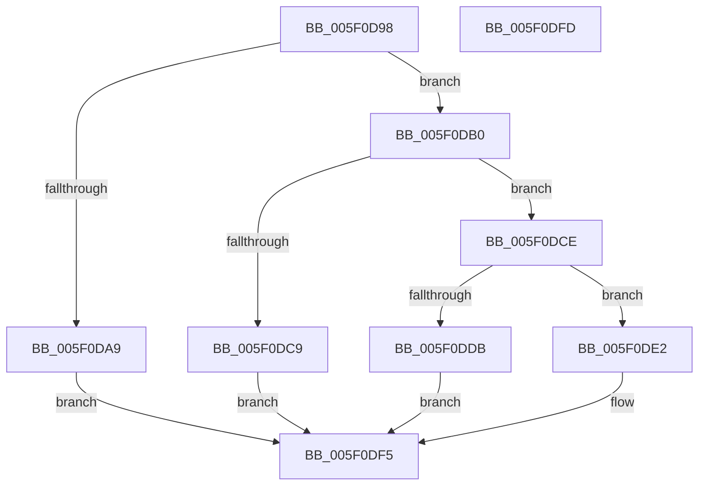

# RtlpFcQueryAllInternalFeatureConfigurationsFromBufferSet

- RVA: `0x005F0D98`–`0x005F0DFE` (길이 `102` bytes)
- VA: `0x00000001405F0D98`
- 실행 섹션: `.text`
- PDB 이름 있음: `예`; PDB Function 태그: `아니요`
- unwind 정보 RVA: `0x0005CF00`
- 디코드: `35`개 명령, `102/102` bytes 표시
- 미해석 바이트: `0` (있으면 어셈블리에 `.byte`로 보존)

> 이 문서는 커널 이미지의 기계어와 PDB 기호를 분석해 생성했습니다. 4번과 5번은 함수 원형과 자료형을 바이너리 사용 방식에서 추정한 C 해석이며 원본 소스 복구 결과는 아닙니다.

## 1. Dependencies

- 직접 호출 지점: **2**; 고유 호출 대상: **2**
- 직접 호출자로 확인된 함수: **2**
- RIP 상대 이미지 참조: **0**

### Outgoing calls
- `0x005F0DB2` → [RtlpFcConfigurationTypeToBufferType](../../page/AB/RtlpFcConfigurationTypeToBufferType_function_00AB74DC.md) (function, `0x00AB74DC`)
- `0x005F0DF0` → [memcpy](../6C/memcpy_function_006C6840.md) (function, `0x006C6840`)

### Direct callers
- [RtlQueryAllInternalFeatureConfigurations](../5E/RtlQueryAllInternalFeatureConfigurations_function_005E7280.md) at `0x005E72D5`
- [RtlQueryAllInternalRuntimeFeatureConfigurations](../5E/RtlQueryAllInternalRuntimeFeatureConfigurations_function_005E7320.md) at `0x005E7380`

### Static image references
- 디코드된 RIP-relative 메모리 참조가 없습니다.

## 2. Other-region calls and transfers

- 다른 실행 섹션으로 향하는 call: **1**
  - `0x005F0DB2` → [RtlpFcConfigurationTypeToBufferType](../../page/AB/RtlpFcConfigurationTypeToBufferType_function_00AB74DC.md) (`.text` → `PAGE`)
- 별도 외부 분기/꼬리 이동을 확인하지 못했습니다.

## 3. Assembly (complete function range)

```asm
005F0D98  40 53                           push rbx
005F0D9A  48 83 EC 20                     sub rsp, 0x20
005F0D9E  4D 8B D0                        mov r10, r8
005F0DA1  4C 8B C1                        mov r8, rcx
005F0DA4  83 FA 02                        cmp edx, 2
005F0DA7  72 07                           jb 0x1405f0db0
005F0DA9  BB 0D 00 00 C0                  mov ebx, 0xc000000d
005F0DAE  EB 45                           jmp 0x1405f0df5
005F0DB0  8B CA                           mov ecx, edx
005F0DB2  E8 25 67 4C 00                  call 0x140ab74dc
005F0DB7  8B C8                           mov ecx, eax
005F0DB9  33 DB                           xor ebx, ebx
005F0DBB  48 8D 04 49                     lea rax, [rcx + rcx*2]
005F0DBF  49 8B 54 C0 08                  mov rdx, qword ptr [r8 + rax*8 + 8]
005F0DC4  48 85 D2                        test rdx, rdx
005F0DC7  75 05                           jne 0x1405f0dce
005F0DC9  49 89 19                        mov qword ptr [r9], rbx
005F0DCC  EB 27                           jmp 0x1405f0df5
005F0DCE  8B 0A                           mov ecx, dword ptr [rdx]
005F0DD0  49 8B 01                        mov rax, qword ptr [r9]
005F0DD3  49 89 09                        mov qword ptr [r9], rcx
005F0DD6  48 3B C8                        cmp rcx, rax
005F0DD9  76 07                           jbe 0x1405f0de2
005F0DDB  BB 05 00 00 80                  mov ebx, 0x80000005
005F0DE0  EB 13                           jmp 0x1405f0df5
005F0DE2  44 8B 02                        mov r8d, dword ptr [rdx]
005F0DE5  49 8B CA                        mov rcx, r10
005F0DE8  49 C1 E0 04                     shl r8, 4
005F0DEC  48 83 C2 04                     add rdx, 4
005F0DF0  E8 4B 5A 0D 00                  call 0x1406c6840
005F0DF5  8B C3                           mov eax, ebx
005F0DF7  48 83 C4 20                     add rsp, 0x20
005F0DFB  5B                              pop rbx
005F0DFC  C3                              ret
005F0DFD  CC                              int3
```

## 4. C-style interpretation (structured pseudocode)

```c
__int64 __fastcall RtlpFcQueryAllInternalFeatureConfigurationsFromBufferSet(__int64 a1, int a2, __int64 a3, __int64 a4)
{
    __int64 result;
    __int64 v_rbx;
    __int64 v_rsp;

    v_rsp = (v_rsp) - (32);
    if (a2 < 2) goto loc_005F0DB0;
    goto loc_005F0DF5;
loc_005F0DB0:
    result = RtlpFcConfigurationTypeToBufferType((unsigned int)(a2), a2, a1, a4);
    v_rbx = 0;
    if (*(unsigned __int64 *)(a1 + (unsigned int)((unsigned int)(result)) + (unsigned int)((unsigned int)(result)) * 2 * 8 + 8) != 0) goto loc_005F0DCE;
    *(unsigned __int64 *)(a4) = 0;
    goto loc_005F0DF5;
loc_005F0DCE:
    *(unsigned __int64 *)(a4) = (unsigned int)(*(unsigned int *)(*(unsigned __int64 *)(a1 + (unsigned int)((unsigned int)(result)) + (unsigned int)((unsigned int)(result)) * 2 * 8 + 8)));
    if (((unsigned int)(*(unsigned int *)(*(unsigned __int64 *)(a1 + (unsigned int)((unsigned int)(result)) + (unsigned int)((unsigned int)(result)) * 2 * 8 + 8)))) <= (*(unsigned __int64 *)(a4))) goto loc_005F0DE2;
    goto loc_005F0DF5;
loc_005F0DE2:
    a3 = ((unsigned int)(*(unsigned int *)(*(unsigned __int64 *)(a1 + (unsigned int)((unsigned int)(result)) + (unsigned int)((unsigned int)(result)) * 2 * 8 + 8)))) << (4);
    a2 = (*(unsigned __int64 *)(a1 + (unsigned int)((unsigned int)(result)) + (unsigned int)((unsigned int)(result)) * 2 * 8 + 8)) + (4);
    result = memcpy(a3, a2, a3, a4);
loc_005F0DF5:
    v_rsp = (v_rsp) + (32);
    return (unsigned int)((unsigned int)((unsigned int)(0x80000005ULL)));
}
```

## 5. (Beta) C Style

```c
int64_t RtlpFcQueryAllInternalFeatureConfigurationsFromBufferSet(int64_t Arg1, int32_t Arg2, int64_t Arg3, int64_t Arg4)
{
    int64_t result;
    int64_t local_rbx;
    int64_t local_rsp;

    local_rsp = (local_rsp) - (32);
    if (Arg2 < 2) goto loc_005F0DB0;
    goto loc_005F0DF5;
loc_005F0DB0:
    result = RtlpFcConfigurationTypeToBufferType((uint32_t)(Arg2), Arg2, Arg1, Arg4);
    local_rbx = 0;
    if (*(uint64_t *)(Arg1 + (uint32_t)((uint32_t)(result)) + (uint32_t)((uint32_t)(result)) * 2 * 8 + 0x8) != 0) goto loc_005F0DCE;
    *(uint64_t *)(Arg4) = 0;
    goto loc_005F0DF5;
loc_005F0DCE:
    *(uint64_t *)(Arg4) = (uint32_t)(*(uint32_t *)(*(uint64_t *)(Arg1 + (uint32_t)((uint32_t)(result)) + (uint32_t)((uint32_t)(result)) * 2 * 8 + 0x8)));
    if (((uint32_t)(*(uint32_t *)(*(uint64_t *)(Arg1 + (uint32_t)((uint32_t)(result)) + (uint32_t)((uint32_t)(result)) * 2 * 8 + 0x8)))) <= (*(uint64_t *)(Arg4))) goto loc_005F0DE2;
    goto loc_005F0DF5;
loc_005F0DE2:
    Arg3 = ((uint32_t)(*(uint32_t *)(*(uint64_t *)(Arg1 + (uint32_t)((uint32_t)(result)) + (uint32_t)((uint32_t)(result)) * 2 * 8 + 0x8)))) << (4);
    Arg2 = (*(uint64_t *)(Arg1 + (uint32_t)((uint32_t)(result)) + (uint32_t)((uint32_t)(result)) * 2 * 8 + 0x8)) + (4);
    result = memcpy(Arg3, Arg2, Arg3, Arg4);
loc_005F0DF5:
    local_rsp = (local_rsp) + (32);
    return (uint32_t)((uint32_t)((uint32_t)(0x80000005ULL)));
}
```

## 6. Execution-region graph

[열기: 2D/3D 그래프와 함수 탐색 컨트롤 패널](../../../control-panel.html?section=text&rva=0x005F0D98&view=graph)

- 2D 그래프는 위에서 아래로 흐르고, 3D 그래프는 빈 공간을 드래그해 회전합니다. Shift+드래그는 이동, 휠은 확대·축소, 함수 노드 선택은 대상 보고서 이동입니다.

### Static fallback


