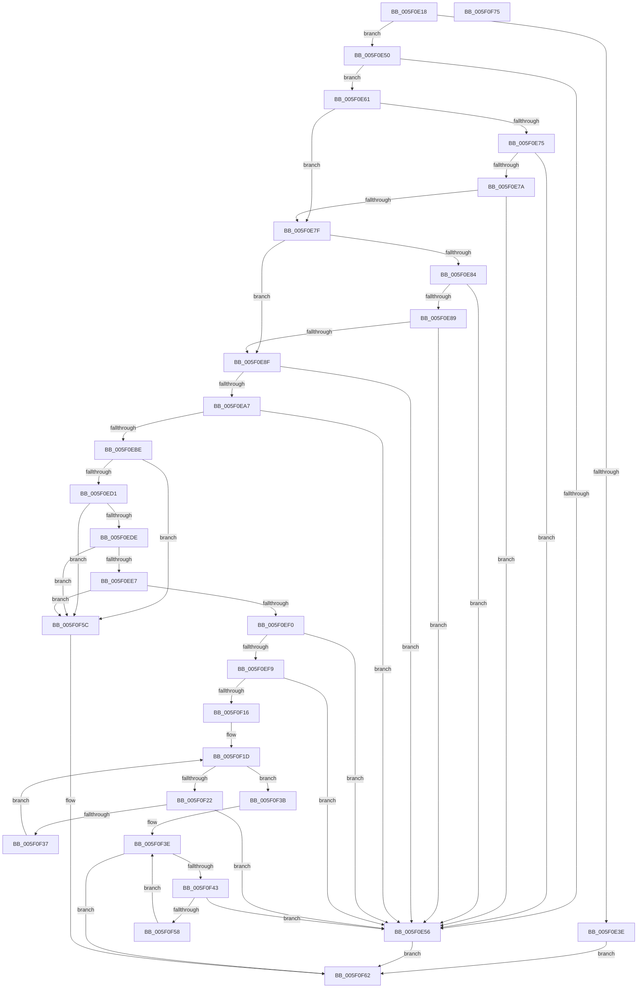

# RtlpFcValidateGovernedFeatures

- RVA: `0x005F0E18`–`0x005F0F76` (길이 `350` bytes)
- VA: `0x00000001405F0E18`
- 실행 섹션: `.text`
- PDB 이름 있음: `예`; PDB Function 태그: `아니요`
- unwind 정보 RVA: `0x000C4368`
- 디코드: `104`개 명령, `350/350` bytes 표시
- 미해석 바이트: `0` (있으면 어셈블리에 `.byte`로 보존)

> 이 문서는 커널 이미지의 기계어와 PDB 기호를 분석해 생성했습니다. 4번과 5번은 함수 원형과 자료형을 바이너리 사용 방식에서 추정한 C 해석이며 원본 소스 복구 결과는 아닙니다.

## 1. Dependencies

- 직접 호출 지점: **2**; 고유 호출 대상: **1**
- 직접 호출자로 확인된 함수: **2**
- RIP 상대 이미지 참조: **0**

### Outgoing calls
- `0x005F0E9E` → [RtlULongLongMult](../43/RtlULongLongMult_function_0043E530.md) (function, `0x0043E530`)
- `0x005F0EB5` → [RtlULongLongMult](../43/RtlULongLongMult_function_0043E530.md) (function, `0x0043E530`)

### Direct callers
- [CmFcManagerOverwriteFeatureConfigurationSection](../../page/7F/CmFcManagerOverwriteFeatureConfigurationSection_function_007F4450.md) at `0x007F477D`
- [CmFcManagerUpdateFeatureConfigurations](../../page/7F/CmFcManagerUpdateFeatureConfigurations_function_007F4CF4.md) at `0x007F5071`

### Static image references
- 디코드된 RIP-relative 메모리 참조가 없습니다.

## 2. Other-region calls and transfers

- 다른 실행 섹션으로 향하는 call: **0**
- 별도 외부 분기/꼬리 이동을 확인하지 못했습니다.

## 3. Assembly (complete function range)

```asm
005F0E18  48 8B C4                        mov rax, rsp
005F0E1B  48 89 58 10                     mov qword ptr [rax + 0x10], rbx
005F0E1F  48 89 70 20                     mov qword ptr [rax + 0x20], rsi
005F0E23  57                              push rdi
005F0E24  48 83 EC 20                     sub rsp, 0x20
005F0E28  45 33 C9                        xor r9d, r9d
005F0E2B  4C 8B DA                        mov r11, rdx
005F0E2E  4C 89 48 08                     mov qword ptr [rax + 8], r9
005F0E32  4C 8B D1                        mov r10, rcx
005F0E35  4C 89 48 18                     mov qword ptr [rax + 0x18], r9
005F0E39  48 85 C9                        test rcx, rcx
005F0E3C  75 12                           jne 0x1405f0e50
005F0E3E  49 F7 DB                        neg r11
005F0E41  45 1B C9                        sbb r9d, r9d
005F0E44  41 81 E1 0D 00 00 C0            and r9d, 0xc000000d
005F0E4B  E9 12 01 00 00                  jmp 0x1405f0f62
005F0E50  41 F6 C2 07                     test r10b, 7
005F0E54  74 0B                           je 0x1405f0e61
005F0E56  41 B9 0D 00 00 C0               mov r9d, 0xc000000d
005F0E5C  E9 01 01 00 00                  jmp 0x1405f0f62
005F0E61  48 8B 79 10                     mov rdi, qword ptr [rcx + 0x10]
005F0E65  48 8D 04 11                     lea rax, [rcx + rdx]
005F0E69  48 8B 59 08                     mov rbx, qword ptr [rcx + 8]
005F0E6D  49 03 FA                        add rdi, r10
005F0E70  49 03 DA                        add rbx, r10
005F0E73  74 0A                           je 0x1405f0e7f
005F0E75  48 3B D8                        cmp rbx, rax
005F0E78  73 DC                           jae 0x1405f0e56
005F0E7A  F6 C3 03                        test bl, 3
005F0E7D  75 D7                           jne 0x1405f0e56
005F0E7F  48 85 FF                        test rdi, rdi
005F0E82  74 0B                           je 0x1405f0e8f
005F0E84  48 3B F8                        cmp rdi, rax
005F0E87  73 CD                           jae 0x1405f0e56
005F0E89  40 F6 C7 03                     test dil, 3
005F0E8D  75 C7                           jne 0x1405f0e56
005F0E8F  8B 01                           mov eax, dword ptr [rcx]
005F0E91  4C 8D 44 24 30                  lea r8, [rsp + 0x30]
005F0E96  0F B7 C8                        movzx ecx, ax
005F0E99  BA 10 00 00 00                  mov edx, 0x10
005F0E9E  E8 8D D6 E4 FF                  call 0x14043e530
005F0EA3  85 C0                           test eax, eax
005F0EA5  78 AF                           js 0x1405f0e56
005F0EA7  41 8B 4A 04                     mov ecx, dword ptr [r10 + 4]
005F0EAB  4C 8D 44 24 40                  lea r8, [rsp + 0x40]
005F0EB0  BA 04 00 00 00                  mov edx, 4
005F0EB5  E8 76 D6 E4 FF                  call 0x14043e530
005F0EBA  85 C0                           test eax, eax
005F0EBC  78 98                           js 0x1405f0e56
005F0EBE  48 8B 4C 24 30                  mov rcx, qword ptr [rsp + 0x30]
005F0EC3  48 83 C1 18                     add rcx, 0x18
005F0EC7  48 83 F9 18                     cmp rcx, 0x18
005F0ECB  0F 82 8B 00 00 00               jb 0x1405f0f5c
005F0ED1  48 8B 54 24 40                  mov rdx, qword ptr [rsp + 0x40]
005F0ED6  48 03 D1                        add rdx, rcx
005F0ED9  48 3B D1                        cmp rdx, rcx
005F0EDC  72 7E                           jb 0x1405f0f5c
005F0EDE  48 8D 42 04                     lea rax, [rdx + 4]
005F0EE2  48 3B C2                        cmp rax, rdx
005F0EE5  72 75                           jb 0x1405f0f5c
005F0EE7  48 8D 48 04                     lea rcx, [rax + 4]
005F0EEB  48 3B C8                        cmp rcx, rax
005F0EEE  72 6C                           jb 0x1405f0f5c
005F0EF0  49 3B CB                        cmp rcx, r11
005F0EF3  0F 87 5D FF FF FF               ja 0x1405f0e56
005F0EF9  41 8B 32                        mov esi, dword ptr [r10]
005F0EFC  45 8B 5A 04                     mov r11d, dword ptr [r10 + 4]
005F0F00  0F B7 C6                        movzx eax, si
005F0F03  48 03 C0                        add rax, rax
005F0F06  8B 44 C3 04                     mov eax, dword ptr [rbx + rax*8 + 4]
005F0F0A  0F B7 C8                        movzx ecx, ax
005F0F0D  41 3B CB                        cmp ecx, r11d
005F0F10  0F 85 40 FF FF FF               jne 0x1405f0e56
005F0F16  41 8B D1                        mov edx, r9d
005F0F19  44 0F B7 C6                     movzx r8d, si
005F0F1D  41 3B D3                        cmp edx, r11d
005F0F20  73 19                           jae 0x1405f0f3b
005F0F22  8B C2                           mov eax, edx
005F0F24  44 0F B7 C6                     movzx r8d, si
005F0F28  8B 0C 87                        mov ecx, dword ptr [rdi + rax*4]
005F0F2B  0F B7 C1                        movzx eax, cx
005F0F2E  41 3B C0                        cmp eax, r8d
005F0F31  0F 83 1F FF FF FF               jae 0x1405f0e56
005F0F37  FF C2                           inc edx
005F0F39  EB E2                           jmp 0x1405f0f1d
005F0F3B  41 8B D1                        mov edx, r9d
005F0F3E  41 3B D0                        cmp edx, r8d
005F0F41  73 1F                           jae 0x1405f0f62
005F0F43  8B C2                           mov eax, edx
005F0F45  48 03 C0                        add rax, rax
005F0F48  8B 44 C3 04                     mov eax, dword ptr [rbx + rax*8 + 4]
005F0F4C  0F B7 C8                        movzx ecx, ax
005F0F4F  41 3B CB                        cmp ecx, r11d
005F0F52  0F 87 FE FE FF FF               ja 0x1405f0e56
005F0F58  FF C2                           inc edx
005F0F5A  EB E2                           jmp 0x1405f0f3e
005F0F5C  41 B9 95 00 00 C0               mov r9d, 0xc0000095
005F0F62  48 8B 5C 24 38                  mov rbx, qword ptr [rsp + 0x38]
005F0F67  41 8B C1                        mov eax, r9d
005F0F6A  48 8B 74 24 48                  mov rsi, qword ptr [rsp + 0x48]
005F0F6F  48 83 C4 20                     add rsp, 0x20
005F0F73  5F                              pop rdi
005F0F74  C3                              ret
005F0F75  CC                              int3
```

## 4. C-style interpretation (structured pseudocode)

```c
__int64 __fastcall RtlpFcValidateGovernedFeatures(__int64 a1, __int64 a2, __int64 a3, int a4)
{
    __int64 result;
    __int64 v_r11;
    __int64 v_rbx;
    __int64 v_rdi;
    __int64 v_rsp;
    unsigned __int64 v_stack_p10;
    unsigned __int64 v_stack_p18;
    unsigned __int64 v_stack_p20;
    unsigned __int64 v_stack_p8;

    *(unsigned __int64 *)(v_rsp + 16) = v_rbx;
    *(unsigned __int64 *)(v_rsp + 32) = v_rsi;
    v_rsp = (v_rsp) - (32);
    a4 = 0;
    *(unsigned __int64 *)(v_rsp + 8) = 0;
    *(unsigned __int64 *)(v_rsp + 24) = 0;
    if (a1 != 0) goto loc_005F0E50;
    v_r11 = -(a2);
    a4 = (unsigned int)((a4) & (0xC000000DULL));
    goto loc_005F0F62;
loc_005F0E50:
    if ((((unsigned __int8)(a1)) & (7)) == 0) goto loc_005F0E61;
loc_005F0E56:
    goto loc_005F0F62;
loc_005F0E61:
    v_rdi = (*(unsigned __int64 *)(a1 + 16)) + (a1);
    v_rbx = (*(unsigned __int64 *)(a1 + 8)) + (a1);
    if (condition_is_equal) goto loc_005F0E7F;
    if (v_rbx >= (a1 + a2 * 1)) goto loc_005F0E56;
    if ((((unsigned __int8)(v_rbx)) & (3)) != 0) goto loc_005F0E56;
loc_005F0E7F:
    if (v_rdi == 0) goto loc_005F0E8F;
    if (v_rdi >= (a1 + a2 * 1)) goto loc_005F0E56;
    if ((((unsigned __int8)(v_rdi)) & (3)) != 0) goto loc_005F0E56;
loc_005F0E8F:
    result = RtlULongLongMult((unsigned __int16)((unsigned int)(*(unsigned int *)(a1))), 16, v_stack_p8, (unsigned int)(0xC000000DULL));
    if (sign_flag) goto loc_005F0E56;
    result = RtlULongLongMult((unsigned int)(*(unsigned int *)(a1 + 4)), 4, v_stack_p18, (unsigned int)(0xC000000DULL));
    if (sign_flag) goto loc_005F0E56;
    a1 = (v_stack_p8) + (24);
    if (a1 < 24) goto loc_005F0F5C;
    a2 = (v_stack_p18) + (a1);
    if (a2 < a1) goto loc_005F0F5C;
    if ((a2 + 4) < a2) goto loc_005F0F5C;
    if ((a2 + 4 + 4) < (a2 + 4)) goto loc_005F0F5C;
    if ((a2 + 4 + 4) > v_r11) goto loc_005F0E56;
    result = ((unsigned __int16)((unsigned int)(*(unsigned int *)(a1)))) + ((unsigned __int16)((unsigned int)(*(unsigned int *)(a1))));
    if (((unsigned int)((unsigned __int16)((unsigned int)(*(unsigned int *)(v_rbx + result * 8 + 4))))) != ((unsigned int)((unsigned int)(*(unsigned int *)(a1 + 4))))) goto loc_005F0E56;
loc_005F0F1D:
    if (((unsigned int)((unsigned int)((unsigned int)((unsigned int)(0xC000000DULL))))) >= ((unsigned int)((unsigned int)(*(unsigned int *)(a1 + 4))))) goto loc_005F0F3B;
    if (((unsigned int)((unsigned __int16)((unsigned int)(*(unsigned int *)(v_rdi + (unsigned int)((unsigned int)((unsigned int)((unsigned int)((unsigned int)(0xC000000DULL))))) * 4))))) >= ((unsigned int)((unsigned __int16)((unsigned int)(*(unsigned int *)(a1)))))) goto loc_005F0E56;
    a2 = (unsigned int)(((unsigned int)((unsigned int)((unsigned int)(0xC000000DULL)))) + 1);
    goto loc_005F0F1D;
loc_005F0F3B:
loc_005F0F3E:
    if (((unsigned int)((unsigned int)((unsigned int)((unsigned int)(0xC000000DULL))))) >= ((unsigned int)((unsigned __int16)((unsigned int)(*(unsigned int *)(a1)))))) goto loc_005F0F62;
    result = ((unsigned int)((unsigned int)((unsigned int)((unsigned int)((unsigned int)(0xC000000DULL)))))) + ((unsigned int)((unsigned int)((unsigned int)((unsigned int)((unsigned int)(0xC000000DULL))))));
    if (((unsigned int)((unsigned __int16)((unsigned int)(*(unsigned int *)(v_rbx + result * 8 + 4))))) > ((unsigned int)((unsigned int)(*(unsigned int *)(a1 + 4))))) goto loc_005F0E56;
    a2 = (unsigned int)(((unsigned int)((unsigned int)((unsigned int)(0xC000000DULL)))) + 1);
    goto loc_005F0F3E;
loc_005F0F5C:
loc_005F0F62:
    v_rsp = (v_rsp) + (32);
    return (unsigned int)((unsigned int)((unsigned int)(0xC0000095ULL)));
}
```

## 5. (Beta) C Style

```c
int64_t RtlpFcValidateGovernedFeatures(int64_t Arg1, int64_t Arg2, int64_t Arg3, int32_t Arg4)
{
    int64_t result;
    int64_t local_r11;
    int64_t local_rbx;
    int64_t local_rdi;
    int64_t local_rsp;
    uint64_t v_stack_p10;
    uint64_t v_stack_p18;
    uint64_t v_stack_p20;
    uint64_t v_stack_p8;

    *(uint64_t *)(local_rsp + 0x10) = local_rbx;
    *(uint64_t *)(local_rsp + 0x20) = local_rsi;
    local_rsp = (local_rsp) - (32);
    Arg4 = 0;
    *(uint64_t *)(local_rsp + 0x8) = 0;
    *(uint64_t *)(local_rsp + 0x18) = 0;
    if (Arg1 != 0) goto loc_005F0E50;
    local_r11 = -(Arg2);
    Arg4 = (uint32_t)((Arg4) & (0xC000000DULL));
    goto loc_005F0F62;
loc_005F0E50:
    if ((((uint8_t)(Arg1)) & (7)) == 0) goto loc_005F0E61;
loc_005F0E56:
    goto loc_005F0F62;
loc_005F0E61:
    local_rdi = (*(uint64_t *)(Arg1 + 0x10)) + (Arg1);
    local_rbx = (*(uint64_t *)(Arg1 + 0x8)) + (Arg1);
    if (condition_is_equal) goto loc_005F0E7F;
    if (local_rbx >= (Arg1 + Arg2 * 1)) goto loc_005F0E56;
    if ((((uint8_t)(local_rbx)) & (3)) != 0) goto loc_005F0E56;
loc_005F0E7F:
    if (local_rdi == 0) goto loc_005F0E8F;
    if (local_rdi >= (Arg1 + Arg2 * 1)) goto loc_005F0E56;
    if ((((uint8_t)(local_rdi)) & (3)) != 0) goto loc_005F0E56;
loc_005F0E8F:
    result = RtlULongLongMult((uint16_t)((uint32_t)(*(uint32_t *)(Arg1))), 16, v_stack_p8, (uint32_t)(0xC000000DULL));
    if (sign_flag) goto loc_005F0E56;
    result = RtlULongLongMult((uint32_t)(*(uint32_t *)(Arg1 + 0x4)), 4, v_stack_p18, (uint32_t)(0xC000000DULL));
    if (sign_flag) goto loc_005F0E56;
    Arg1 = (v_stack_p8) + (24);
    if (Arg1 < 24) goto loc_005F0F5C;
    Arg2 = (v_stack_p18) + (Arg1);
    if (Arg2 < Arg1) goto loc_005F0F5C;
    if ((Arg2 + 4) < Arg2) goto loc_005F0F5C;
    if ((Arg2 + 4 + 4) < (Arg2 + 4)) goto loc_005F0F5C;
    if ((Arg2 + 4 + 4) > local_r11) goto loc_005F0E56;
    result = ((uint16_t)((uint32_t)(*(uint32_t *)(Arg1)))) + ((uint16_t)((uint32_t)(*(uint32_t *)(Arg1))));
    if (((uint32_t)((uint16_t)((uint32_t)(*(uint32_t *)(local_rbx + result * 8 + 0x4))))) != ((uint32_t)((uint32_t)(*(uint32_t *)(Arg1 + 0x4))))) goto loc_005F0E56;
loc_005F0F1D:
    if (((uint32_t)((uint32_t)((uint32_t)((uint32_t)(0xC000000DULL))))) >= ((uint32_t)((uint32_t)(*(uint32_t *)(Arg1 + 0x4))))) goto loc_005F0F3B;
    if (((uint32_t)((uint16_t)((uint32_t)(*(uint32_t *)(local_rdi + (uint32_t)((uint32_t)((uint32_t)((uint32_t)((uint32_t)(0xC000000DULL))))) * 4))))) >= ((uint32_t)((uint16_t)((uint32_t)(*(uint32_t *)(Arg1)))))) goto loc_005F0E56;
    Arg2 = (uint32_t)(((uint32_t)((uint32_t)((uint32_t)(0xC000000DULL)))) + 1);
    goto loc_005F0F1D;
loc_005F0F3B:
loc_005F0F3E:
    if (((uint32_t)((uint32_t)((uint32_t)((uint32_t)(0xC000000DULL))))) >= ((uint32_t)((uint16_t)((uint32_t)(*(uint32_t *)(Arg1)))))) goto loc_005F0F62;
    result = ((uint32_t)((uint32_t)((uint32_t)((uint32_t)((uint32_t)(0xC000000DULL)))))) + ((uint32_t)((uint32_t)((uint32_t)((uint32_t)((uint32_t)(0xC000000DULL))))));
    if (((uint32_t)((uint16_t)((uint32_t)(*(uint32_t *)(local_rbx + result * 8 + 0x4))))) > ((uint32_t)((uint32_t)(*(uint32_t *)(Arg1 + 0x4))))) goto loc_005F0E56;
    Arg2 = (uint32_t)(((uint32_t)((uint32_t)((uint32_t)(0xC000000DULL)))) + 1);
    goto loc_005F0F3E;
loc_005F0F5C:
loc_005F0F62:
    local_rsp = (local_rsp) + (32);
    return (uint32_t)((uint32_t)((uint32_t)(0xC0000095ULL)));
}
```

## 6. Execution-region graph

[열기: 2D/3D 그래프와 함수 탐색 컨트롤 패널](../../../control-panel.html?section=text&rva=0x005F0E18&view=graph)

- 2D 그래프는 위에서 아래로 흐르고, 3D 그래프는 빈 공간을 드래그해 회전합니다. Shift+드래그는 이동, 휠은 확대·축소, 함수 노드 선택은 대상 보고서 이동입니다.

### Static fallback


