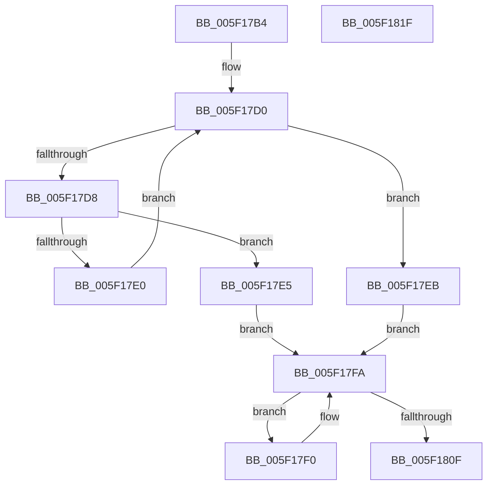

# RtlpFindEntry

- RVA: `0x005F17B4`–`0x005F1820` (길이 `108` bytes)
- VA: `0x00000001405F17B4`
- 실행 섹션: `.text`
- PDB 이름 있음: `예`; PDB Function 태그: `아니요`
- unwind 정보 RVA: `0x000794E0`
- 디코드: `34`개 명령, `108/108` bytes 표시
- 미해석 바이트: `0` (있으면 어셈블리에 `.byte`로 보존)

> 이 문서는 커널 이미지의 기계어와 PDB 기호를 분석해 생성했습니다. 4번과 5번은 함수 원형과 자료형을 바이너리 사용 방식에서 추정한 C 해석이며 원본 소스 복구 결과는 아닙니다.

## 1. Dependencies

- 직접 호출 지점: **1**; 고유 호출 대상: **1**
- 직접 호출자로 확인된 함수: **5**
- RIP 상대 이미지 참조: **0**

### Outgoing calls
- `0x005F1805` → [RtlpHeapFindListLookupEntry](RtlpHeapFindListLookupEntry_function_005F1978.md) (function, `0x005F1978`)

### Direct callers
- [RtlpAllocateHeap](../5E/RtlpAllocateHeap_function_005E8B1C.md) at `0x005E8CEF`
- [RtlpCreateSplitBlock](../5E/RtlpCreateSplitBlock_function_005E98F0.md) at `0x005E9B35`
- [RtlpCreateSplitBlock](../5E/RtlpCreateSplitBlock_function_005E98F0.md) at `0x005E9C66`
- [RtlpCreateSplitBlock](../5E/RtlpCreateSplitBlock_function_005E98F0.md) at `0x005E9DB3`
- [RtlpCreateSplitBlock](../5E/RtlpCreateSplitBlock_function_005E98F0.md) at `0x005E9EF9`
- [RtlpFreeHeap](../5E/RtlpFreeHeap_function_005EABC0.md) at `0x005EAD81`
- [RtlpFreeHeap](../5E/RtlpFreeHeap_function_005EABC0.md) at `0x005EAEF9`
- [RtlpInsertFreeBlock](../5E/RtlpInsertFreeBlock_function_005EB4C0.md) at `0x005EB669`
- [RtlZeroHeap](../../page/79/RtlZeroHeap_function_00790AD0.md) at `0x00790CC1`

### Static image references
- 디코드된 RIP-relative 메모리 참조가 없습니다.

## 2. Other-region calls and transfers

- 다른 실행 섹션으로 향하는 call: **0**
- 별도 외부 분기/꼬리 이동을 확인하지 못했습니다.

## 3. Assembly (complete function range)

```asm
005F17B4  48 89 5C 24 08                  mov qword ptr [rsp + 8], rbx
005F17B9  48 89 74 24 10                  mov qword ptr [rsp + 0x10], rsi
005F17BE  57                              push rdi
005F17BF  48 83 EC 30                     sub rsp, 0x30
005F17C3  48 8B 99 38 01 00 00            mov rbx, qword ptr [rcx + 0x138]
005F17CA  48 8B FA                        mov rdi, rdx
005F17CD  48 8B F1                        mov rsi, rcx
005F17D0  8B 53 08                        mov edx, dword ptr [rbx + 8]
005F17D3  48 3B FA                        cmp rdi, rdx
005F17D6  72 13                           jb 0x1405f17eb
005F17D8  48 8B 03                        mov rax, qword ptr [rbx]
005F17DB  48 85 C0                        test rax, rax
005F17DE  74 05                           je 0x1405f17e5
005F17E0  48 8B D8                        mov rbx, rax
005F17E3  EB EB                           jmp 0x1405f17d0
005F17E5  44 8D 4A FF                     lea r9d, [rdx - 1]
005F17E9  EB 0F                           jmp 0x1405f17fa
005F17EB  44 8B CF                        mov r9d, edi
005F17EE  EB 0A                           jmp 0x1405f17fa
005F17F0  48 8B 1B                        mov rbx, qword ptr [rbx]
005F17F3  48 8B CE                        mov rcx, rsi
005F17F6  44 8B 4B 18                     mov r9d, dword ptr [rbx + 0x18]
005F17FA  41 B0 01                        mov r8b, 1
005F17FD  48 89 7C 24 20                  mov qword ptr [rsp + 0x20], rdi
005F1802  48 8B D3                        mov rdx, rbx
005F1805  E8 6E 01 00 00                  call 0x1405f1978
005F180A  48 85 C0                        test rax, rax
005F180D  74 E1                           je 0x1405f17f0
005F180F  48 8B 5C 24 40                  mov rbx, qword ptr [rsp + 0x40]
005F1814  48 8B 74 24 48                  mov rsi, qword ptr [rsp + 0x48]
005F1819  48 83 C4 30                     add rsp, 0x30
005F181D  5F                              pop rdi
005F181E  C3                              ret
005F181F  CC                              int3
```

## 4. C-style interpretation (structured pseudocode)

```c
__int64 __fastcall RtlpFindEntry(__int64 a1, __int64 a2)
{
    __int64 result;
    __int64 v_rsp;
    unsigned __int64 v_stack_m18;
    unsigned __int64 v_stack_p10;
    unsigned __int64 v_stack_p8;

    v_stack_p8 = v_rbx;
    v_stack_p10 = v_rsi;
    v_rsp = (v_rsp) - (48);
loc_005F17D0:
    if (a2 < ((unsigned int)(*(unsigned int *)(*(unsigned __int64 *)(a1 + 312) + 8)))) goto loc_005F17EB;
    if (*(unsigned __int64 *)(*(unsigned __int64 *)(a1 + 312)) == 0) goto loc_005F17E5;
    goto loc_005F17D0;
loc_005F17E5:
    goto loc_005F17FA;
loc_005F17EB:
    goto loc_005F17FA;
loc_005F17F0:
loc_005F17FA:
    v_stack_m18 = a2;
    result = RtlpHeapFindListLookupEntry(a1, *(unsigned __int64 *)(*(unsigned __int64 *)(*(unsigned __int64 *)(a1 + 312))), 1, (unsigned int)(*(unsigned int *)(*(unsigned __int64 *)(*(unsigned __int64 *)(*(unsigned __int64 *)(a1 + 312))) + 24)));
    if (result == 0) goto loc_005F17F0;
    v_rsp = (v_rsp) + (48);
    return result;
}
```

## 5. (Beta) C Style

```c
int64_t RtlpFindEntry(void *Arg1, int64_t Arg2)
{
    uint8_t *arg1 = (uint8_t *)Arg1;

    int64_t result;
    int64_t local_rsp;
    uint64_t v_stack_m18;
    uint64_t v_stack_p10;
    uint64_t v_stack_p8;

    v_stack_p8 = local_rbx;
    v_stack_p10 = local_rsi;
    local_rsp = (local_rsp) - (48);
loc_005F17D0:
    if (Arg2 < ((uint32_t)(*(uint32_t *)(*(uint64_t *)(arg1 + 0x138) + 0x8)))) goto loc_005F17EB;
    if (*(uint64_t *)(*(uint64_t *)(arg1 + 0x138)) == 0) goto loc_005F17E5;
    goto loc_005F17D0;
loc_005F17E5:
    goto loc_005F17FA;
loc_005F17EB:
    goto loc_005F17FA;
loc_005F17F0:
loc_005F17FA:
    v_stack_m18 = Arg2;
    result = RtlpHeapFindListLookupEntry(Arg1, *(uint64_t *)(*(uint64_t *)(*(uint64_t *)(arg1 + 0x138))), 1, (uint32_t)(*(uint32_t *)(*(uint64_t *)(*(uint64_t *)(*(uint64_t *)(arg1 + 0x138))) + 0x18)));
    if (result == 0) goto loc_005F17F0;
    local_rsp = (local_rsp) + (48);
    return result;
}
```

### 관측된 메모리 오프셋

구조체 형식이 확인되지 않은 접근은 인자 기준의 오프셋으로만 기록했습니다.

| 기준 인자 | 오프셋 표현 | 폭 (bit) | 접근 |
|---|---:|---:|---|
| `Arg1` | `+ 0x138` | `64` | `R` |

## 6. Execution-region graph

[열기: 2D/3D 그래프와 함수 탐색 컨트롤 패널](../../../control-panel.html?section=text&rva=0x005F17B4&view=graph)

- 2D 그래프는 위에서 아래로 흐르고, 3D 그래프는 빈 공간을 드래그해 회전합니다. Shift+드래그는 이동, 휠은 확대·축소, 함수 노드 선택은 대상 보고서 이동입니다.

### Static fallback


