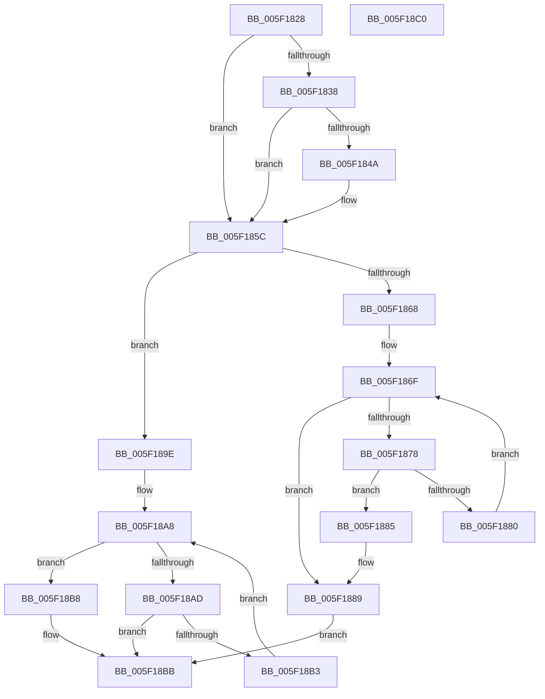

# RtlpFindUCREntry

- RVA: `0x005F1828`–`0x005F18C1` (길이 `153` bytes)
- VA: `0x00000001405F1828`
- 실행 섹션: `.text`
- PDB 이름 있음: `예`; PDB Function 태그: `아니요`
- unwind 정보 RVA: `0x0005D2F4`
- 디코드: `44`개 명령, `153/153` bytes 표시
- 미해석 바이트: `0` (있으면 어셈블리에 `.byte`로 보존)

> 이 문서는 커널 이미지의 기계어와 PDB 기호를 분석해 생성했습니다. 4번과 5번은 함수 원형과 자료형을 바이너리 사용 방식에서 추정한 C 해석이며 원본 소스 복구 결과는 아닙니다.

## 1. Dependencies

- 직접 호출 지점: **3**; 고유 호출 대상: **3**
- 직접 호출자로 확인된 함수: **2**
- RIP 상대 이미지 참조: **2**

### Outgoing calls
- `0x005F1851` → [DbgPrint](../35/DbgPrint_function_00358CB0.md) (function, `0x00358CB0`)
- `0x005F1856` → [RtlpHeapHandleError](RtlpHeapHandleError_function_005F12AC.md) (function, `0x005F12AC`)
- `0x005F1897` → [RtlpHeapFindListLookupEntry](RtlpHeapFindListLookupEntry_function_005F1978.md) (function, `0x005F1978`)

### Direct callers
- [RtlpFindAndCommitPages](../5E/RtlpFindAndCommitPages_function_005EA95C.md) at `0x005EA97D`
- [RtlpInsertUCRBlock](../5E/RtlpInsertUCRBlock_function_005EB7E8.md) at `0x005EB801`

### Static image references
- `0x005F182C` → RVA `0x00E67B60` (`.data`; read)
- `0x005F184A` → RVA `0x006CD3E0` (` ?? ::FNODOBFM::`string'`; read)

## 2. Other-region calls and transfers

- 다른 실행 섹션으로 향하는 call: **0**
- 별도 외부 분기/꼬리 이동을 확인하지 못했습니다.

## 3. Assembly (complete function range)

```asm
005F1828  48 83 EC 38                     sub rsp, 0x38
005F182C  83 3D 2D 63 87 00 01            cmp dword ptr [rip + 0x87632d], 1
005F1833  4C 8B D1                        mov r10, rcx
005F1836  7C 24                           jl 0x1405f185c
005F1838  48 8D 82 FF 0F 00 00            lea rax, [rdx + 0xfff]
005F183F  48 25 00 F0 FF FF               and rax, 0xfffffffffffff000
005F1845  48 3B C2                        cmp rax, rdx
005F1848  74 12                           je 0x1405f185c
005F184A  48 8D 0D 8F BB 0D 00            lea rcx, [rip + 0xdbb8f]
005F1851  E8 5A 74 D6 FF                  call 0x140358cb0
005F1856  E8 51 FA FF FF                  call 0x1405f12ac
005F185B  CC                              int3
005F185C  48 8B 89 40 01 00 00            mov rcx, qword ptr [rcx + 0x140]
005F1863  48 85 C9                        test rcx, rcx
005F1866  74 36                           je 0x1405f189e
005F1868  4C 8B CA                        mov r9, rdx
005F186B  49 C1 E9 0C                     shr r9, 0xc
005F186F  44 8B 41 08                     mov r8d, dword ptr [rcx + 8]
005F1873  4D 3B C8                        cmp r9, r8
005F1876  72 11                           jb 0x1405f1889
005F1878  48 8B 01                        mov rax, qword ptr [rcx]
005F187B  48 85 C0                        test rax, rax
005F187E  74 05                           je 0x1405f1885
005F1880  48 8B C8                        mov rcx, rax
005F1883  EB EA                           jmp 0x1405f186f
005F1885  45 8D 48 FF                     lea r9d, [r8 - 1]
005F1889  48 89 54 24 20                  mov qword ptr [rsp + 0x20], rdx
005F188E  45 33 C0                        xor r8d, r8d
005F1891  48 8B D1                        mov rdx, rcx
005F1894  49 8B CA                        mov rcx, r10
005F1897  E8 DC 00 00 00                  call 0x1405f1978
005F189C  EB 1D                           jmp 0x1405f18bb
005F189E  49 8D 8A F0 00 00 00            lea rcx, [r10 + 0xf0]
005F18A5  48 8B 01                        mov rax, qword ptr [rcx]
005F18A8  48 3B C8                        cmp rcx, rax
005F18AB  74 0B                           je 0x1405f18b8
005F18AD  48 39 50 28                     cmp qword ptr [rax + 0x28], rdx
005F18B1  73 08                           jae 0x1405f18bb
005F18B3  48 8B 00                        mov rax, qword ptr [rax]
005F18B6  EB F0                           jmp 0x1405f18a8
005F18B8  48 8B C1                        mov rax, rcx
005F18BB  48 83 C4 38                     add rsp, 0x38
005F18BF  C3                              ret
005F18C0  CC                              int3
```

## 4. C-style interpretation (structured pseudocode)

```c
__int64 __fastcall RtlpFindUCREntry(__int64 a1, __int64 a2)
{
    __int64 result;
    __int64 v_rsp;
    unsigned __int64 v_stack_m18;

    v_rsp = (v_rsp) - (56);
    if ((*(unsigned int *)(v_rip + 8872749)) < 1) goto loc_005F185C;
    result = (a2 + 4095) & (0xFFFFFFFFFFFFF000ULL);
    if (result != a2) {
        a1 = v_rip + 899983;
        result = DbgPrint(a1, a2, a3, a4);
        result = RtlpHeapHandleError(a1, a2, a3, a4);
    }
    if (*(unsigned __int64 *)(a1 + 320) == 0) goto loc_005F189E;
    a4 = (a2) >> (12);
loc_005F186F:
    if (a4 < ((unsigned int)(*(unsigned int *)(*(unsigned __int64 *)(a1 + 320) + 8)))) goto loc_005F1889;
    if (*(unsigned __int64 *)(*(unsigned __int64 *)(a1 + 320)) == 0) goto loc_005F1885;
    goto loc_005F186F;
loc_005F1885:
loc_005F1889:
    v_stack_m18 = a2;
    a3 = 0;
    result = RtlpHeapFindListLookupEntry(a1, *(unsigned __int64 *)(*(unsigned __int64 *)(a1 + 320)), a3, (unsigned int)(*(unsigned int *)(*(unsigned __int64 *)(a1 + 320) + 8)) - 1);
    goto loc_005F18BB;
loc_005F189E:
loc_005F18A8:
    if ((a1 + 240) == (*(unsigned __int64 *)(a1 + 240))) goto loc_005F18B8;
    if ((*(unsigned __int64 *)(*(unsigned __int64 *)(a1 + 240) + 40)) >= (*(unsigned __int64 *)(*(unsigned __int64 *)(a1 + 320)))) goto loc_005F18BB;
    goto loc_005F18A8;
loc_005F18B8:
loc_005F18BB:
    v_rsp = (v_rsp) + (56);
    return a1 + 240;
}
```

## 5. (Beta) C Style

```c
int64_t RtlpFindUCREntry(int64_t Arg1, void *Arg2)
{
    uint8_t *arg2 = (uint8_t *)Arg2;

    int64_t result;
    int64_t local_rsp;
    uint64_t v_stack_m18;

    local_rsp = (local_rsp) - (56);
    if ((*(uint32_t *)(v_rip + 0x87632D)) < 1) goto loc_005F185C;
    result = (Arg2 + 4095) & (0xFFFFFFFFFFFFF000ULL);
    if (result != Arg2) {
        Arg1 = v_rip + 899983;
        result = DbgPrint(Arg1, Arg2, a3, a4);
        result = RtlpHeapHandleError(Arg1, Arg2, a3, a4);
    }
    if (*(uint64_t *)(Arg1 + 0x140) == 0) goto loc_005F189E;
    a4 = (Arg2) >> (12);
loc_005F186F:
    if (a4 < ((uint32_t)(*(uint32_t *)(*(uint64_t *)(Arg1 + 0x140) + 0x8)))) goto loc_005F1889;
    if (*(uint64_t *)(*(uint64_t *)(Arg1 + 0x140)) == 0) goto loc_005F1885;
    goto loc_005F186F;
loc_005F1885:
loc_005F1889:
    v_stack_m18 = Arg2;
    a3 = 0;
    result = RtlpHeapFindListLookupEntry(Arg1, *(uint64_t *)(*(uint64_t *)(Arg1 + 0x140)), a3, (uint32_t)(*(uint32_t *)(*(uint64_t *)(Arg1 + 0x140) + 0x8)) - 1);
    goto loc_005F18BB;
loc_005F189E:
loc_005F18A8:
    if ((Arg1 + 240) == (*(uint64_t *)(Arg1 + 0xF0))) goto loc_005F18B8;
    if ((*(uint64_t *)(*(uint64_t *)(Arg1 + 0xF0) + 0x28)) >= (*(uint64_t *)(*(uint64_t *)(Arg1 + 0x140)))) goto loc_005F18BB;
    goto loc_005F18A8;
loc_005F18B8:
loc_005F18BB:
    local_rsp = (local_rsp) + (56);
    return Arg1 + 240;
}
```

### 관측된 메모리 오프셋

구조체 형식이 확인되지 않은 접근은 인자 기준의 오프셋으로만 기록했습니다.

| 기준 인자 | 오프셋 표현 | 폭 (bit) | 접근 |
|---|---:|---:|---|
| `Arg2` | `+ 0xFFF` | `64` | `R` |

## 6. Execution-region graph

[열기: 2D/3D 그래프와 함수 탐색 컨트롤 패널](../../../control-panel.html?section=text&rva=0x005F1828&view=graph)

- 2D 그래프는 위에서 아래로 흐르고, 3D 그래프는 빈 공간을 드래그해 회전합니다. Shift+드래그는 이동, 휠은 확대·축소, 함수 노드 선택은 대상 보고서 이동입니다.

### Static fallback


