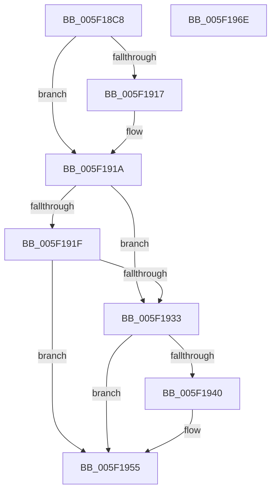

# RtlpHeapAddListEntry

- RVA: `0x005F18C8`–`0x005F196F` (길이 `167` bytes)
- VA: `0x00000001405F18C8`
- 실행 섹션: `.text`
- PDB 이름 있음: `예`; PDB Function 태그: `아니요`
- unwind 정보 RVA: `0x00060300`
- 디코드: `52`개 명령, `167/167` bytes 표시
- 미해석 바이트: `0` (있으면 어셈블리에 `.byte`로 보존)

> 이 문서는 커널 이미지의 기계어와 PDB 기호를 분석해 생성했습니다. 4번과 5번은 함수 원형과 자료형을 바이너리 사용 방식에서 추정한 C 해석이며 원본 소스 복구 결과는 아닙니다.

## 1. Dependencies

- 직접 호출 지점: **1**; 고유 호출 대상: **1**
- 직접 호출자로 확인된 함수: **5**
- RIP 상대 이미지 참조: **0**

### Outgoing calls
- `0x005F192A` → [RtlpHeapListCompare](RtlpHeapListCompare_function_005F1B14.md) (function, `0x005F1B14`)

### Direct callers
- [RtlpCreateSplitBlock](../5E/RtlpCreateSplitBlock_function_005E98F0.md) at `0x005E9D34`
- [RtlpCreateSplitBlock](../5E/RtlpCreateSplitBlock_function_005E98F0.md) at `0x005E9FC7`
- [RtlpFreeHeap](../5E/RtlpFreeHeap_function_005EABC0.md) at `0x005EAFD9`
- [RtlpInsertFreeBlock](../5E/RtlpInsertFreeBlock_function_005EB4C0.md) at `0x005EB73A`
- [RtlpPopulateListIndex](RtlpPopulateListIndex_function_005F1C84.md) at `0x005F1D9F`
- [RtlZeroHeap](../../page/79/RtlZeroHeap_function_00790AD0.md) at `0x00790DBC`

### Static image references
- 디코드된 RIP-relative 메모리 참조가 없습니다.

## 2. Other-region calls and transfers

- 다른 실행 섹션으로 향하는 call: **0**
- 별도 외부 분기/꼬리 이동을 확인하지 못했습니다.

## 3. Assembly (complete function range)

```asm
005F18C8  48 89 5C 24 08                  mov qword ptr [rsp + 8], rbx
005F18CD  48 89 6C 24 10                  mov qword ptr [rsp + 0x10], rbp
005F18D2  48 89 74 24 18                  mov qword ptr [rsp + 0x18], rsi
005F18D7  57                              push rdi
005F18D8  41 56                           push r14
005F18DA  41 57                           push r15
005F18DC  48 83 EC 20                     sub rsp, 0x20
005F18E0  48 8B 42 30                     mov rax, qword ptr [rdx + 0x30]
005F18E4  BF 01 00 00 00                  mov edi, 1
005F18E9  01 7A 10                        add dword ptr [rdx + 0x10], edi
005F18EC  4D 8B F9                        mov r15, r9
005F18EF  8B 74 24 60                     mov esi, dword ptr [rsp + 0x60]
005F18F3  48 8B DA                        mov rbx, rdx
005F18F6  2B 72 18                        sub esi, dword ptr [rdx + 0x18]
005F18F9  83 7A 0C 00                     cmp dword ptr [rdx + 0xc], 0
005F18FD  44 8D 04 36                     lea r8d, [rsi + rsi]
005F1901  44 0F 44 C6                     cmove r8d, esi
005F1905  45 8B F0                        mov r14d, r8d
005F1908  4A 8B 2C C0                     mov rbp, qword ptr [rax + r8*8]
005F190C  8B 42 08                        mov eax, dword ptr [rdx + 8]
005F190F  2B C7                           sub eax, edi
005F1911  39 44 24 60                     cmp dword ptr [rsp + 0x60], eax
005F1915  75 03                           jne 0x1405f191a
005F1917  01 7A 14                        add dword ptr [rdx + 0x14], edi
005F191A  48 85 ED                        test rbp, rbp
005F191D  74 14                           je 0x1405f1933
005F191F  4C 8B 44 24 68                  mov r8, qword ptr [rsp + 0x68]
005F1924  44 8A CF                        mov r9b, dil
005F1927  48 8B D5                        mov rdx, rbp
005F192A  E8 E5 01 00 00                  call 0x1405f1b14
005F192F  85 C0                           test eax, eax
005F1931  7F 22                           jg 0x1405f1955
005F1933  48 8B 43 30                     mov rax, qword ptr [rbx + 0x30]
005F1937  4E 89 3C F0                     mov qword ptr [rax + r14*8], r15
005F193B  48 85 ED                        test rbp, rbp
005F193E  75 15                           jne 0x1405f1955
005F1940  48 8B 43 28                     mov rax, qword ptr [rbx + 0x28]
005F1944  8B D6                           mov edx, esi
005F1946  83 E6 1F                        and esi, 0x1f
005F1949  48 C1 EA 05                     shr rdx, 5
005F194D  40 8A CE                        mov cl, sil
005F1950  D3 E7                           shl edi, cl
005F1952  09 3C 90                        or dword ptr [rax + rdx*4], edi
005F1955  48 8B 5C 24 40                  mov rbx, qword ptr [rsp + 0x40]
005F195A  48 8B 6C 24 48                  mov rbp, qword ptr [rsp + 0x48]
005F195F  48 8B 74 24 50                  mov rsi, qword ptr [rsp + 0x50]
005F1964  48 83 C4 20                     add rsp, 0x20
005F1968  41 5F                           pop r15
005F196A  41 5E                           pop r14
005F196C  5F                              pop rdi
005F196D  C3                              ret
005F196E  CC                              int3
```

## 4. C-style interpretation (structured pseudocode)

```c
__int64 __fastcall RtlpHeapAddListEntry(__int64 a1, __int64 a2, __int64 a3, __int64 a4, unsigned int a5, __int64 a6)
{
    __int64 result;
    __int64 v_rdi;
    __int64 v_rsi;
    __int64 v_rsp;
    unsigned __int64 v_stack_p10;
    unsigned __int64 v_stack_p18;
    unsigned __int64 v_stack_p8;

    v_stack_p8 = v_rbx;
    v_stack_p10 = v_rbp;
    v_stack_p18 = v_rsi;
    v_rsp = (v_rsp) - (32);
    v_rsi = (unsigned int)(((unsigned int)(a5)) - (*(unsigned int *)(a2 + 24)));
    a3 = v_rsi + v_rsi * 1;
    if ((*(unsigned int *)(a2 + 12)) == 0) { a3 = (unsigned int)(v_rsi); }
    result = (unsigned int)(((unsigned int)(*(unsigned int *)(a2 + 8))) - (1));
    if (a5 == ((unsigned int)(result))) {
    }
    if (*(unsigned __int64 *)(*(unsigned __int64 *)(a2 + 48) + a3 * 8) == 0) goto loc_005F1933;
    result = RtlpHeapListCompare(a1, *(unsigned __int64 *)(*(unsigned __int64 *)(a2 + 48) + a3 * 8), a6, 1);
    if (condition_is_greater) goto loc_005F1955;
loc_005F1933:
    *(unsigned __int64 *)(*(unsigned __int64 *)(a2 + 48) + (unsigned int)((unsigned int)(a3)) * 8) = a4;
    result = *(unsigned __int64 *)(a2 + 48);
    v_rdi = 1;
    if (*(unsigned __int64 *)(*(unsigned __int64 *)(a2 + 48) + a3 * 8) == 0) {
        result = *(unsigned __int64 *)(a2 + 40);
        a2 = (unsigned int)(v_rsi);
        v_rsi = (unsigned int)((v_rsi) & (31));
        a2 = (a2) >> (5);
        a1 = (unsigned __int8)(v_rsi);
        v_rdi = (unsigned int)((1) << ((unsigned __int8)(a1)));
    }
    v_rsp = (v_rsp) + (32);
    return result;
}
```

## 5. (Beta) C Style

```c
int64_t RtlpHeapAddListEntry(int64_t Arg1, void *Arg2, int64_t Arg3, int64_t Arg4, void *Arg5, int64_t Arg6)
{
    uint8_t *arg2 = (uint8_t *)Arg2;
    uint8_t *arg5 = (uint8_t *)Arg5;

    int64_t result;
    int64_t local_rdi;
    int64_t local_rsi;
    int64_t local_rsp;
    uint64_t v_stack_p10;
    uint64_t v_stack_p18;
    uint64_t v_stack_p8;

    v_stack_p8 = local_rbx;
    v_stack_p10 = local_rbp;
    v_stack_p18 = local_rsi;
    local_rsp = (local_rsp) - (32);
    local_rsi = (uint32_t)(((uint32_t)(Arg5)) - (*(uint32_t *)(arg2 + 0x18)));
    Arg3 = local_rsi + local_rsi * 1;
    if ((*(uint32_t *)(arg2 + 0xC)) == 0) { Arg3 = (uint32_t)(local_rsi); }
    result = (uint32_t)(((uint32_t)(*(uint32_t *)(arg2 + 0x8))) - (1));
    if (Arg5 == ((uint32_t)(result))) {
    }
    if (*(uint64_t *)(*(uint64_t *)(arg2 + 0x30) + Arg3 * 8) == 0) goto loc_005F1933;
    result = RtlpHeapListCompare(Arg1, *(uint64_t *)(*(uint64_t *)(arg2 + 0x30) + Arg3 * 8), Arg6, 1);
    if (condition_is_greater) goto loc_005F1955;
loc_005F1933:
    *(uint64_t *)(*(uint64_t *)(arg2 + 0x30) + (uint32_t)((uint32_t)(Arg3)) * 8) = Arg4;
    result = *(uint64_t *)(arg2 + 0x30);
    local_rdi = 1;
    if (*(uint64_t *)(*(uint64_t *)(arg2 + 0x30) + Arg3 * 8) == 0) {
        result = *(uint64_t *)(arg2 + 0x28);
        Arg2 = (uint32_t)(local_rsi);
        local_rsi = (uint32_t)((local_rsi) & (31));
        Arg2 = (Arg2) >> (5);
        Arg1 = (uint8_t)(local_rsi);
        local_rdi = (uint32_t)((1) << ((uint8_t)(Arg1)));
    }
    local_rsp = (local_rsp) + (32);
    return result;
}
```

### 관측된 메모리 오프셋

구조체 형식이 확인되지 않은 접근은 인자 기준의 오프셋으로만 기록했습니다.

| 기준 인자 | 오프셋 표현 | 폭 (bit) | 접근 |
|---|---:|---:|---|
| `Arg2` | `+ 0x8` | `32` | `R` |
| `Arg2` | `+ 0xC` | `32` | `R` |
| `Arg2` | `+ 0x10` | `32` | `R/W` |
| `Arg2` | `+ 0x14` | `32` | `R/W` |
| `Arg2` | `+ 0x18` | `32` | `R` |
| `Arg2` | `+ 0x28` | `64` | `R` |
| `Arg2` | `+ 0x30` | `64` | `R` |
| `Arg5` | `+ 0x0 + rsi*1` | `32` | `R` |

## 6. Execution-region graph

[열기: 2D/3D 그래프와 함수 탐색 컨트롤 패널](../../../control-panel.html?section=text&rva=0x005F18C8&view=graph)

- 2D 그래프는 위에서 아래로 흐르고, 3D 그래프는 빈 공간을 드래그해 회전합니다. Shift+드래그는 이동, 휠은 확대·축소, 함수 노드 선택은 대상 보고서 이동입니다.

### Static fallback


