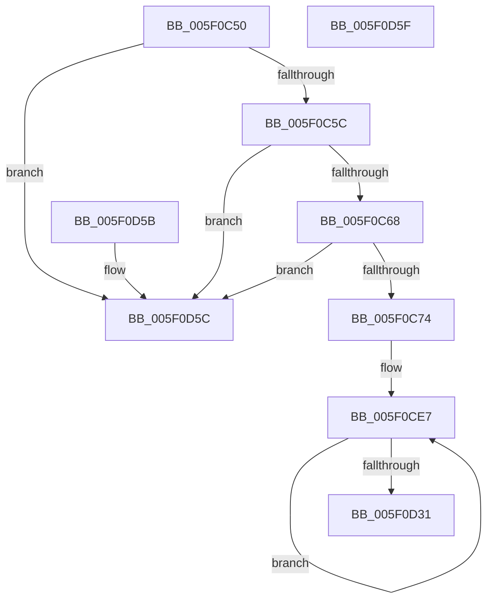

# RtlpHeapExceptionFilter

- RVA: `0x005F0C50`–`0x005F0D60` (길이 `272` bytes)
- VA: `0x00000001405F0C50`
- 실행 섹션: `.text`
- PDB 이름 있음: `예`; PDB Function 태그: `아니요`
- unwind 정보 RVA: `0x000DB714`
- 디코드: `68`개 명령, `272/272` bytes 표시
- 미해석 바이트: `0` (있으면 어셈블리에 `.byte`로 보존)

> 이 문서는 커널 이미지의 기계어와 PDB 기호를 분석해 생성했습니다. 4번과 5번은 함수 원형과 자료형을 바이너리 사용 방식에서 추정한 C 해석이며 원본 소스 복구 결과는 아닙니다.

## 1. Dependencies

- 직접 호출 지점: **0**; 고유 호출 대상: **0**
- 직접 호출자로 확인된 함수: **5**
- RIP 상대 이미지 참조: **2**

### Outgoing calls
- 직접 디코드된 call 명령이 없습니다.

### Direct callers
- [RtlpHeapFatalExceptionFilter](../5E/RtlpHeapFatalExceptionFilter_function_005E6F4C.md) at `0x005E6F50`
- [RtlpCreateHeap$filt$0](../6D/RtlpCreateHeap_filt_0_function_006D5000.md) at `0x006D5011`
- [RtlpAnalyzeHeapFailure$filt$0](../6D/RtlpAnalyzeHeapFailure_filt_0_function_006D5024.md) at `0x006D5035`
- [RtlpHpHeapHandleError$filt$0](../6D/RtlpHpHeapHandleError_filt_0_function_006D5BBB.md) at `0x006D5BCC`
- [RtlZeroHeap$filt$0](../../page/B1/RtlZeroHeap_filt_0_function_00B145EB.md) at `0x00B145FC`

### Static image references
- `0x005F0C77` → RVA `0x00E0C730` (`.data`; read)
- `0x005F0CD8` → RVA `0x00E0C7D0` (`.data`; read)

## 2. Other-region calls and transfers

- 다른 실행 섹션으로 향하는 call: **0**
- 별도 외부 분기/꼬리 이동을 확인하지 못했습니다.

## 3. Assembly (complete function range)

```asm
005F0C50  81 F9 FD 00 00 C0               cmp ecx, 0xc00000fd
005F0C56  0F 84 00 01 00 00               je 0x1405f0d5c
005F0C5C  81 F9 94 01 00 C0               cmp ecx, 0xc0000194
005F0C62  0F 84 F4 00 00 00               je 0x1405f0d5c
005F0C68  81 F9 17 00 00 C0               cmp ecx, 0xc0000017
005F0C6E  0F 84 E8 00 00 00               je 0x1405f0d5c
005F0C74  48 8B 02                        mov rax, qword ptr [rdx]
005F0C77  48 8D 0D B2 BA 81 00            lea rcx, [rip + 0x81bab2]
005F0C7E  41 B8 80 00 00 00               mov r8d, 0x80
005F0C84  0F 10 00                        movups xmm0, xmmword ptr [rax]
005F0C87  0F 11 01                        movups xmmword ptr [rcx], xmm0
005F0C8A  0F 10 48 10                     movups xmm1, xmmword ptr [rax + 0x10]
005F0C8E  0F 11 49 10                     movups xmmword ptr [rcx + 0x10], xmm1
005F0C92  0F 10 40 20                     movups xmm0, xmmword ptr [rax + 0x20]
005F0C96  0F 11 41 20                     movups xmmword ptr [rcx + 0x20], xmm0
005F0C9A  0F 10 48 30                     movups xmm1, xmmword ptr [rax + 0x30]
005F0C9E  0F 11 49 30                     movups xmmword ptr [rcx + 0x30], xmm1
005F0CA2  0F 10 40 40                     movups xmm0, xmmword ptr [rax + 0x40]
005F0CA6  0F 11 41 40                     movups xmmword ptr [rcx + 0x40], xmm0
005F0CAA  0F 10 48 50                     movups xmm1, xmmword ptr [rax + 0x50]
005F0CAE  0F 11 49 50                     movups xmmword ptr [rcx + 0x50], xmm1
005F0CB2  0F 10 40 60                     movups xmm0, xmmword ptr [rax + 0x60]
005F0CB6  0F 11 41 60                     movups xmmword ptr [rcx + 0x60], xmm0
005F0CBA  0F 10 40 70                     movups xmm0, xmmword ptr [rax + 0x70]
005F0CBE  42 0F 11 44 01 F0               movups xmmword ptr [rcx + r8 - 0x10], xmm0
005F0CC4  42 0F 10 0C 00                  movups xmm1, xmmword ptr [rax + r8]
005F0CC9  42 0F 11 0C 01                  movups xmmword ptr [rcx + r8], xmm1
005F0CCE  4A 8B 44 00 10                  mov rax, qword ptr [rax + r8 + 0x10]
005F0CD3  4A 89 44 01 10                  mov qword ptr [rcx + r8 + 0x10], rax
005F0CD8  48 8D 0D F1 BA 81 00            lea rcx, [rip + 0x81baf1]
005F0CDF  48 8B 42 08                     mov rax, qword ptr [rdx + 8]
005F0CE3  41 8D 50 89                     lea edx, [r8 - 0x77]
005F0CE7  0F 10 00                        movups xmm0, xmmword ptr [rax]
005F0CEA  0F 11 01                        movups xmmword ptr [rcx], xmm0
005F0CED  0F 10 48 10                     movups xmm1, xmmword ptr [rax + 0x10]
005F0CF1  0F 11 49 10                     movups xmmword ptr [rcx + 0x10], xmm1
005F0CF5  0F 10 40 20                     movups xmm0, xmmword ptr [rax + 0x20]
005F0CF9  0F 11 41 20                     movups xmmword ptr [rcx + 0x20], xmm0
005F0CFD  0F 10 48 30                     movups xmm1, xmmword ptr [rax + 0x30]
005F0D01  0F 11 49 30                     movups xmmword ptr [rcx + 0x30], xmm1
005F0D05  0F 10 40 40                     movups xmm0, xmmword ptr [rax + 0x40]
005F0D09  0F 11 41 40                     movups xmmword ptr [rcx + 0x40], xmm0
005F0D0D  0F 10 48 50                     movups xmm1, xmmword ptr [rax + 0x50]
005F0D11  0F 11 49 50                     movups xmmword ptr [rcx + 0x50], xmm1
005F0D15  0F 10 40 60                     movups xmm0, xmmword ptr [rax + 0x60]
005F0D19  0F 11 41 60                     movups xmmword ptr [rcx + 0x60], xmm0
005F0D1D  49 03 C8                        add rcx, r8
005F0D20  0F 10 48 70                     movups xmm1, xmmword ptr [rax + 0x70]
005F0D24  49 03 C0                        add rax, r8
005F0D27  0F 11 49 F0                     movups xmmword ptr [rcx - 0x10], xmm1
005F0D2B  48 83 EA 01                     sub rdx, 1
005F0D2F  75 B6                           jne 0x1405f0ce7
005F0D31  0F 10 00                        movups xmm0, xmmword ptr [rax]
005F0D34  0F 11 01                        movups xmmword ptr [rcx], xmm0
005F0D37  0F 10 48 10                     movups xmm1, xmmword ptr [rax + 0x10]
005F0D3B  0F 11 49 10                     movups xmmword ptr [rcx + 0x10], xmm1
005F0D3F  0F 10 40 20                     movups xmm0, xmmword ptr [rax + 0x20]
005F0D43  0F 11 41 20                     movups xmmword ptr [rcx + 0x20], xmm0
005F0D47  0F 10 48 30                     movups xmm1, xmmword ptr [rax + 0x30]
005F0D4B  0F 11 49 30                     movups xmmword ptr [rcx + 0x30], xmm1
005F0D4F  0F 10 40 40                     movups xmm0, xmmword ptr [rax + 0x40]
005F0D53  8D 42 01                        lea eax, [rdx + 1]
005F0D56  0F 11 41 40                     movups xmmword ptr [rcx + 0x40], xmm0
005F0D5A  C3                              ret
005F0D5B  CC                              int3
005F0D5C  33 C0                           xor eax, eax
005F0D5E  C3                              ret
005F0D5F  CC                              int3
```

## 4. C-style interpretation (structured pseudocode)

```c
__int64 __fastcall RtlpHeapExceptionFilter(int a1, __int64 a2)
{
    __int64 result;

    if (a1 == 0xC00000FDULL) goto loc_005F0D5C;
    if (a1 == 0xC0000194ULL) goto loc_005F0D5C;
    if (a1 == 0xC0000017ULL) goto loc_005F0D5C;
    *(unsigned __int64 *)(v_rip + 8501938) = v_xmm0;
    *(unsigned __int64 *)(v_rip + 8501938 + 16) = v_xmm1;
    *(unsigned __int64 *)(v_rip + 8501938 + 32) = v_xmm0;
    *(unsigned __int64 *)(v_rip + 8501938 + 48) = v_xmm1;
    *(unsigned __int64 *)(v_rip + 8501938 + 64) = v_xmm0;
    *(unsigned __int64 *)(v_rip + 8501938 + 80) = v_xmm1;
    *(unsigned __int64 *)(v_rip + 8501938 + 96) = v_xmm0;
    *(unsigned __int64 *)(v_rip + 8501938 + 128 * 1 - 16) = v_xmm0;
    *(unsigned __int64 *)(v_rip + 8501938 + 128 * 1) = v_xmm1;
    *(unsigned __int64 *)(v_rip + 8501938 + 128 * 1 + 16) = *(unsigned __int64 *)(*(unsigned __int64 *)(a2) + 128 * 1 + 16);
loc_005F0CE7:
    *(unsigned __int64 *)(v_rip + 8502001) = v_xmm0;
    *(unsigned __int64 *)(v_rip + 8502001 + 16) = v_xmm1;
    *(unsigned __int64 *)(v_rip + 8502001 + 32) = v_xmm0;
    *(unsigned __int64 *)(v_rip + 8502001 + 48) = v_xmm1;
    *(unsigned __int64 *)(v_rip + 8502001 + 64) = v_xmm0;
    *(unsigned __int64 *)(v_rip + 8502001 + 80) = v_xmm1;
    *(unsigned __int64 *)(v_rip + 8502001 + 96) = v_xmm0;
    a1 = (v_rip + 8502001) + (128);
    result = (*(unsigned __int64 *)(a2 + 8)) + (128);
    *(unsigned __int64 *)(a1 - 16) = v_xmm1;
    a2 = (128 - 119) - (1);
    if (condition_is_not_equal) goto loc_005F0CE7;
    *(unsigned __int64 *)(a1) = v_xmm0;
    *(unsigned __int64 *)(a1 + 16) = v_xmm1;
    *(unsigned __int64 *)(a1 + 32) = v_xmm0;
    *(unsigned __int64 *)(a1 + 48) = v_xmm1;
    *(unsigned __int64 *)(a1 + 64) = v_xmm0;
    return a2 + 1;
loc_005F0D5C:
    result = 0;
    return result;
}
```

## 5. (Beta) C Style

```c
void *RtlpHeapExceptionFilter(int32_t Arg1, void *Arg2)
{
    uint8_t *arg2 = (uint8_t *)Arg2;

    int64_t result;

    if (Arg1 == 0xC00000FDULL) goto loc_005F0D5C;
    if (Arg1 == 0xC0000194ULL) goto loc_005F0D5C;
    if (Arg1 == 0xC0000017ULL) goto loc_005F0D5C;
    *(uint64_t *)(v_rip + 0x81BAB2) = v_xmm0;
    *(uint64_t *)(v_rip + 0x81BAB2 + 0x10) = v_xmm1;
    *(uint64_t *)(v_rip + 0x81BAB2 + 0x20) = v_xmm0;
    *(uint64_t *)(v_rip + 0x81BAB2 + 0x30) = v_xmm1;
    *(uint64_t *)(v_rip + 0x81BAB2 + 0x40) = v_xmm0;
    *(uint64_t *)(v_rip + 0x81BAB2 + 0x50) = v_xmm1;
    *(uint64_t *)(v_rip + 0x81BAB2 + 0x60) = v_xmm0;
    *(uint64_t *)(v_rip + 0x81BAB2 + 0x80 * 1 - 0x10) = v_xmm0;
    *(uint64_t *)(v_rip + 0x81BAB2 + 0x80 * 1) = v_xmm1;
    *(uint64_t *)(v_rip + 0x81BAB2 + 0x80 * 1 + 0x10) = *(uint64_t *)(*(uint64_t *)(arg2) + 0x80 * 1 + 0x10);
loc_005F0CE7:
    *(uint64_t *)(v_rip + 0x81BAF1) = v_xmm0;
    *(uint64_t *)(v_rip + 0x81BAF1 + 0x10) = v_xmm1;
    *(uint64_t *)(v_rip + 0x81BAF1 + 0x20) = v_xmm0;
    *(uint64_t *)(v_rip + 0x81BAF1 + 0x30) = v_xmm1;
    *(uint64_t *)(v_rip + 0x81BAF1 + 0x40) = v_xmm0;
    *(uint64_t *)(v_rip + 0x81BAF1 + 0x50) = v_xmm1;
    *(uint64_t *)(v_rip + 0x81BAF1 + 0x60) = v_xmm0;
    Arg1 = (v_rip + 8502001) + (128);
    result = (*(uint64_t *)(arg2 + 0x8)) + (128);
    *(uint64_t *)(Arg1 - 0x10) = v_xmm1;
    Arg2 = (128 - 119) - (1);
    if (condition_is_not_equal) goto loc_005F0CE7;
    *(uint64_t *)(Arg1) = v_xmm0;
    *(uint64_t *)(Arg1 + 0x10) = v_xmm1;
    *(uint64_t *)(Arg1 + 0x20) = v_xmm0;
    *(uint64_t *)(Arg1 + 0x30) = v_xmm1;
    *(uint64_t *)(Arg1 + 0x40) = v_xmm0;
    return Arg2 + 1;
loc_005F0D5C:
    result = 0;
    return result;
}
```

### 관측된 메모리 오프셋

구조체 형식이 확인되지 않은 접근은 인자 기준의 오프셋으로만 기록했습니다.

| 기준 인자 | 오프셋 표현 | 폭 (bit) | 접근 |
|---|---:|---:|---|
| `Arg2` | `+ 0x0` | `64` | `R` |
| `Arg2` | `+ 0x8` | `64` | `R` |

## 6. Execution-region graph

[열기: 2D/3D 그래프와 함수 탐색 컨트롤 패널](../../../control-panel.html?section=text&rva=0x005F0C50&view=graph)

- 2D 그래프는 위에서 아래로 흐르고, 3D 그래프는 빈 공간을 드래그해 회전합니다. Shift+드래그는 이동, 휠은 확대·축소, 함수 노드 선택은 대상 보고서 이동입니다.

### Static fallback


