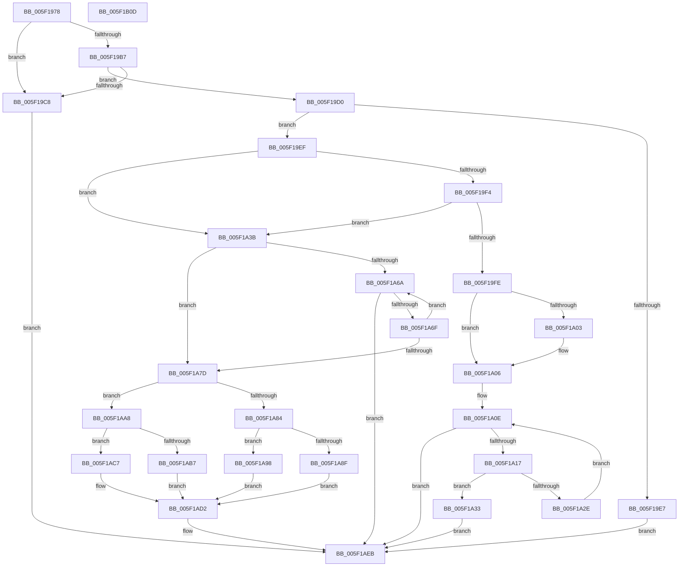

# RtlpHeapFindListLookupEntry

- RVA: `0x005F1978`–`0x005F1B0E` (길이 `406` bytes)
- VA: `0x00000001405F1978`
- 실행 섹션: `.text`
- PDB 이름 있음: `예`; PDB Function 태그: `아니요`
- unwind 정보 RVA: `0x0008A350`
- 디코드: `124`개 명령, `406/406` bytes 표시
- 미해석 바이트: `0` (있으면 어셈블리에 `.byte`로 보존)

> 이 문서는 커널 이미지의 기계어와 PDB 기호를 분석해 생성했습니다. 4번과 5번은 함수 원형과 자료형을 바이너리 사용 방식에서 추정한 C 해석이며 원본 소스 복구 결과는 아닙니다.

## 1. Dependencies

- 직접 호출 지점: **3**; 고유 호출 대상: **1**
- 직접 호출자로 확인된 함수: **2**
- RIP 상대 이미지 참조: **1**

### Outgoing calls
- `0x005F19BF` → [RtlpHeapListCompare](RtlpHeapListCompare_function_005F1B14.md) (function, `0x005F1B14`)
- `0x005F19DE` → [RtlpHeapListCompare](RtlpHeapListCompare_function_005F1B14.md) (function, `0x005F1B14`)
- `0x005F1A25` → [RtlpHeapListCompare](RtlpHeapListCompare_function_005F1B14.md) (function, `0x005F1B14`)

### Direct callers
- [RtlpFindEntry](RtlpFindEntry_function_005F17B4.md) at `0x005F1805`
- [RtlpFindUCREntry](RtlpFindUCREntry_function_005F1828.md) at `0x005F1897`

### Static image references
- `0x005F1A86` → RVA `0x0002C790` (`.rdata`; read)

## 2. Other-region calls and transfers

- 다른 실행 섹션으로 향하는 call: **0**
- 별도 외부 분기/꼬리 이동을 확인하지 못했습니다.

## 3. Assembly (complete function range)

```asm
005F1978  48 8B C4                        mov rax, rsp
005F197B  48 89 58 08                     mov qword ptr [rax + 8], rbx
005F197F  48 89 68 10                     mov qword ptr [rax + 0x10], rbp
005F1983  48 89 70 18                     mov qword ptr [rax + 0x18], rsi
005F1987  48 89 78 20                     mov qword ptr [rax + 0x20], rdi
005F198B  41 55                           push r13
005F198D  41 56                           push r14
005F198F  41 57                           push r15
005F1991  48 83 EC 20                     sub rsp, 0x20
005F1995  48 8B 7A 20                     mov rdi, qword ptr [rdx + 0x20]
005F1999  45 8B F1                        mov r14d, r9d
005F199C  44 2B 72 18                     sub r14d, dword ptr [rdx + 0x18]
005F19A0  48 8B F2                        mov rsi, rdx
005F19A3  33 DB                           xor ebx, ebx
005F19A5  45 8B E9                        mov r13d, r9d
005F19A8  41 8A E8                        mov bpl, r8b
005F19AB  4C 8B F9                        mov r15, rcx
005F19AE  48 8B 57 08                     mov rdx, qword ptr [rdi + 8]
005F19B2  48 3B FA                        cmp rdi, rdx
005F19B5  74 11                           je 0x1405f19c8
005F19B7  45 8A C8                        mov r9b, r8b
005F19BA  4C 8B 44 24 60                  mov r8, qword ptr [rsp + 0x60]
005F19BF  E8 50 01 00 00                  call 0x1405f1b14
005F19C4  85 C0                           test eax, eax
005F19C6  7E 08                           jle 0x1405f19d0
005F19C8  48 8B DF                        mov rbx, rdi
005F19CB  E9 1B 01 00 00                  jmp 0x1405f1aeb
005F19D0  4C 8B 44 24 60                  mov r8, qword ptr [rsp + 0x60]
005F19D5  44 8A CD                        mov r9b, bpl
005F19D8  48 8B 17                        mov rdx, qword ptr [rdi]
005F19DB  49 8B CF                        mov rcx, r15
005F19DE  E8 31 01 00 00                  call 0x1405f1b14
005F19E3  85 C0                           test eax, eax
005F19E5  7F 08                           jg 0x1405f19ef
005F19E7  48 8B 1F                        mov rbx, qword ptr [rdi]
005F19EA  E9 FC 00 00 00                  jmp 0x1405f1aeb
005F19EF  48 39 1E                        cmp qword ptr [rsi], rbx
005F19F2  75 47                           jne 0x1405f1a3b
005F19F4  8B 46 08                        mov eax, dword ptr [rsi + 8]
005F19F7  FF C8                           dec eax
005F19F9  44 3B E8                        cmp r13d, eax
005F19FC  75 3D                           jne 0x1405f1a3b
005F19FE  39 5E 0C                        cmp dword ptr [rsi + 0xc], ebx
005F1A01  74 03                           je 0x1405f1a06
005F1A03  45 03 F6                        add r14d, r14d
005F1A06  48 8B 46 30                     mov rax, qword ptr [rsi + 0x30]
005F1A0A  4A 8B 34 F0                     mov rsi, qword ptr [rax + r14*8]
005F1A0E  48 3B FE                        cmp rdi, rsi
005F1A11  0F 84 D4 00 00 00               je 0x1405f1aeb
005F1A17  4C 8B 44 24 60                  mov r8, qword ptr [rsp + 0x60]
005F1A1C  44 8A CD                        mov r9b, bpl
005F1A1F  48 8B D6                        mov rdx, rsi
005F1A22  49 8B CF                        mov rcx, r15
005F1A25  E8 EA 00 00 00                  call 0x1405f1b14
005F1A2A  85 C0                           test eax, eax
005F1A2C  7E 05                           jle 0x1405f1a33
005F1A2E  48 8B 36                        mov rsi, qword ptr [rsi]
005F1A31  EB DB                           jmp 0x1405f1a0e
005F1A33  48 8B DE                        mov rbx, rsi
005F1A36  E9 B0 00 00 00                  jmp 0x1405f1aeb
005F1A3B  44 8B 56 08                     mov r10d, dword ptr [rsi + 8]
005F1A3F  45 8B C6                        mov r8d, r14d
005F1A42  44 2B 56 18                     sub r10d, dword ptr [rsi + 0x18]
005F1A46  41 83 E6 1F                     and r14d, 0x1f
005F1A4A  48 8B 46 28                     mov rax, qword ptr [rsi + 0x28]
005F1A4E  83 CA FF                        or edx, 0xffffffff
005F1A51  41 C1 E8 05                     shr r8d, 5
005F1A55  41 8A CE                        mov cl, r14b
005F1A58  41 C1 EA 05                     shr r10d, 5
005F1A5C  41 FF CA                        dec r10d
005F1A5F  D3 E2                           shl edx, cl
005F1A61  4E 8D 0C 80                     lea r9, [rax + r8*4]
005F1A65  41 23 11                        and edx, dword ptr [r9]
005F1A68  75 13                           jne 0x1405f1a7d
005F1A6A  45 3B C2                        cmp r8d, r10d
005F1A6D  77 7C                           ja 0x1405f1aeb
005F1A6F  49 83 C1 04                     add r9, 4
005F1A73  41 FF C0                        inc r8d
005F1A76  41 8B 11                        mov edx, dword ptr [r9]
005F1A79  85 D2                           test edx, edx
005F1A7B  74 ED                           je 0x1405f1a6a
005F1A7D  8B CA                           mov ecx, edx
005F1A7F  66 85 D2                        test dx, dx
005F1A82  74 24                           je 0x1405f1aa8
005F1A84  84 D2                           test dl, dl
005F1A86  48 8D 15 03 AD A3 FF            lea rdx, [rip - 0x5c52fd]
005F1A8D  74 09                           je 0x1405f1a98
005F1A8F  0F B6 C1                        movzx eax, cl
005F1A92  0F B6 0C 10                     movzx ecx, byte ptr [rax + rdx]
005F1A96  EB 3A                           jmp 0x1405f1ad2
005F1A98  48 C1 E9 08                     shr rcx, 8
005F1A9C  0F B6 C1                        movzx eax, cl
005F1A9F  0F B6 0C 10                     movzx ecx, byte ptr [rax + rdx]
005F1AA3  83 C1 08                        add ecx, 8
005F1AA6  EB 2A                           jmp 0x1405f1ad2
005F1AA8  F7 C2 00 00 FF 00               test edx, 0xff0000
005F1AAE  48 8D 15 DB AC A3 FF            lea rdx, [rip - 0x5c5325]
005F1AB5  74 10                           je 0x1405f1ac7
005F1AB7  48 C1 E9 10                     shr rcx, 0x10
005F1ABB  0F B6 C1                        movzx eax, cl
005F1ABE  0F B6 0C 10                     movzx ecx, byte ptr [rax + rdx]
005F1AC2  83 C1 10                        add ecx, 0x10
005F1AC5  EB 0B                           jmp 0x1405f1ad2
005F1AC7  48 C1 E9 18                     shr rcx, 0x18
005F1ACB  0F B6 0C 11                     movzx ecx, byte ptr [rcx + rdx]
005F1ACF  83 C1 18                        add ecx, 0x18
005F1AD2  48 8B 46 30                     mov rax, qword ptr [rsi + 0x30]
005F1AD6  41 C1 E0 05                     shl r8d, 5
005F1ADA  39 5E 0C                        cmp dword ptr [rsi + 0xc], ebx
005F1ADD  41 8D 14 08                     lea edx, [r8 + rcx]
005F1AE1  8D 0C 12                        lea ecx, [rdx + rdx]
005F1AE4  0F 44 CA                        cmove ecx, edx
005F1AE7  48 8B 1C C8                     mov rbx, qword ptr [rax + rcx*8]
005F1AEB  48 8B 6C 24 48                  mov rbp, qword ptr [rsp + 0x48]
005F1AF0  48 8B C3                        mov rax, rbx
005F1AF3  48 8B 5C 24 40                  mov rbx, qword ptr [rsp + 0x40]
005F1AF8  48 8B 74 24 50                  mov rsi, qword ptr [rsp + 0x50]
005F1AFD  48 8B 7C 24 58                  mov rdi, qword ptr [rsp + 0x58]
005F1B02  48 83 C4 20                     add rsp, 0x20
005F1B06  41 5F                           pop r15
005F1B08  41 5E                           pop r14
005F1B0A  41 5D                           pop r13
005F1B0C  C3                              ret
005F1B0D  CC                              int3
```

## 4. C-style interpretation (structured pseudocode)

```c
__int64 __fastcall RtlpHeapFindListLookupEntry(__int64 a1, __int64 a2, unsigned __int8 a3, int a4, __int64 a5)
{
    __int64 result;
    __int64 v_r10;
    __int64 v_r14;
    __int64 v_rbx;
    __int64 v_rsp;
    unsigned __int64 v_stack_p10;
    unsigned __int64 v_stack_p18;
    unsigned __int64 v_stack_p20;
    unsigned __int64 v_stack_p8;

    *(unsigned __int64 *)(v_rsp + 8) = v_rbx;
    *(unsigned __int64 *)(v_rsp + 16) = v_rbp;
    *(unsigned __int64 *)(v_rsp + 24) = v_rsi;
    *(unsigned __int64 *)(v_rsp + 32) = v_rdi;
    v_rsp = (v_rsp) - (32);
    v_r14 = (unsigned int)(((unsigned int)(a4)) - (*(unsigned int *)(a2 + 24)));
    v_rbx = 0;
    if ((*(unsigned __int64 *)(a2 + 32)) == (*(unsigned __int64 *)(*(unsigned __int64 *)(a2 + 32) + 8))) goto loc_005F19C8;
    result = RtlpHeapListCompare(a1, *(unsigned __int64 *)(*(unsigned __int64 *)(a2 + 32) + 8), a5, a3);
    if (condition_is_less_or_equal) goto loc_005F19D0;
loc_005F19C8:
    goto loc_005F1AEB;
loc_005F19D0:
    result = RtlpHeapListCompare(a1, *(unsigned __int64 *)(*(unsigned __int64 *)(a2 + 32)), a5, a3);
    if (condition_is_greater) goto loc_005F19EF;
    goto loc_005F1AEB;
loc_005F19EF:
    if ((*(unsigned __int64 *)(a2)) != (*(unsigned __int64 *)(*(unsigned __int64 *)(a2 + 32)))) goto loc_005F1A3B;
    result = (unsigned int)(((unsigned int)(*(unsigned int *)(a2 + 8))) - 1);
    if (((unsigned int)((unsigned int)(a4))) != ((unsigned int)(result))) goto loc_005F1A3B;
    if ((*(unsigned int *)(a2 + 12)) != ((unsigned int)(*(unsigned __int64 *)(*(unsigned __int64 *)(a2 + 32))))) {
        v_r14 = (unsigned int)((v_r14) + ((unsigned int)(v_r14)));
    }
loc_005F1A0E:
    if ((*(unsigned __int64 *)(a2 + 32)) == (*(unsigned __int64 *)(*(unsigned __int64 *)(a2 + 48) + v_r14 * 8))) goto loc_005F1AEB;
    result = RtlpHeapListCompare(a1, *(unsigned __int64 *)(*(unsigned __int64 *)(a2 + 48) + v_r14 * 8), a5, a3);
    if (condition_is_less_or_equal) goto loc_005F1A33;
    goto loc_005F1A0E;
loc_005F1A33:
    goto loc_005F1AEB;
loc_005F1A3B:
    v_r10 = (unsigned int)(((unsigned int)(*(unsigned int *)(*(unsigned __int64 *)(*(unsigned __int64 *)(*(unsigned __int64 *)(a2 + 48) + v_r14 * 8)) + 8))) - (*(unsigned int *)(*(unsigned __int64 *)(*(unsigned __int64 *)(*(unsigned __int64 *)(a2 + 48) + v_r14 * 8)) + 24)));
    v_r14 = (unsigned int)((v_r14) & (31));
    a2 = (unsigned int)((*(unsigned __int64 *)(*(unsigned __int64 *)(a2 + 48) + v_r14 * 8)) | (0xFFFFFFFFULL));
    a3 = (unsigned int)(((unsigned int)((unsigned int)(v_r14))) >> (5));
    v_r10 = (unsigned int)((v_r10) >> (5));
    v_r10 = (unsigned int)((v_r10) - 1);
    a2 = (unsigned int)((a2) << ((unsigned __int8)((unsigned __int8)(v_r14))));
    a2 = (unsigned int)((a2) & (*(unsigned int *)(*(unsigned __int64 *)(*(unsigned __int64 *)(*(unsigned __int64 *)(*(unsigned __int64 *)(a2 + 48) + v_r14 * 8)) + 40) + a3 * 4)));
    if (condition_is_not_equal) goto loc_005F1A7D;
loc_005F1A6A:
    if (a3 > ((unsigned int)(v_r10))) goto loc_005F1AEB;
    a4 = (*(unsigned __int64 *)(*(unsigned __int64 *)(*(unsigned __int64 *)(*(unsigned __int64 *)(a2 + 48) + v_r14 * 8)) + 40) + a3 * 4) + (4);
    a3 = (unsigned int)((a3) + 1);
    if ((unsigned int)((unsigned int)(*(unsigned int *)(a4))) == 0) goto loc_005F1A6A;
loc_005F1A7D:
    if ((unsigned __int16)((unsigned int)(*(unsigned int *)(a4))) == 0) goto loc_005F1AA8;
    if ((unsigned __int8)((unsigned int)(*(unsigned int *)(a4))) == 0) goto loc_005F1A98;
    goto loc_005F1AD2;
loc_005F1A98:
    a1 = (*(unsigned __int8 *)((unsigned __int8)((unsigned int)((unsigned int)((unsigned int)(*(unsigned int *)(a4))))) + v_rip - 6050557 * 1)) >> (8);
    a1 = (unsigned int)((*(unsigned __int8 *)((unsigned __int8)(a1) + v_rip - 6050557 * 1)) + (8));
    goto loc_005F1AD2;
loc_005F1AA8:
    if ((((unsigned int)(v_rip - 6050557)) & (0xFF0000ULL)) == 0) goto loc_005F1AC7;
    a1 = (a1) >> (16);
    a1 = (unsigned int)((*(unsigned __int8 *)((unsigned __int8)(a1) + v_rip - 6050597 * 1)) + (16));
    goto loc_005F1AD2;
loc_005F1AC7:
    a1 = (a1) >> (24);
    a1 = (unsigned int)((*(unsigned __int8 *)(a1 + v_rip - 6050597 * 1)) + (24));
loc_005F1AD2:
    a3 = (unsigned int)((a3) << (5));
    a1 = a3 + a1 * 1 + a3 + a1 * 1 * 1;
    if ((*(unsigned int *)(*(unsigned __int64 *)(*(unsigned __int64 *)(*(unsigned __int64 *)(a2 + 48) + v_r14 * 8)) + 12)) == ((unsigned int)(*(unsigned __int64 *)(*(unsigned __int64 *)(*(unsigned __int64 *)(a2 + 48) + v_r14 * 8))))) { a1 = (unsigned int)(a3 + a1 * 1); }
loc_005F1AEB:
    v_rsp = (v_rsp) + (32);
    return *(unsigned __int64 *)(*(unsigned __int64 *)(*(unsigned __int64 *)(*(unsigned __int64 *)(*(unsigned __int64 *)(a2 + 48) + v_r14 * 8)) + 48) + a1 * 8);
}
```

## 5. (Beta) C Style

```c
int64_t RtlpHeapFindListLookupEntry(int64_t Arg1, void *Arg2, uint8_t Arg3, int32_t Arg4, int64_t Arg5)
{
    uint8_t *arg2 = (uint8_t *)Arg2;

    int64_t result;
    int64_t local_r10;
    int64_t local_r14;
    int64_t local_rbx;
    int64_t local_rsp;
    uint64_t v_stack_p10;
    uint64_t v_stack_p18;
    uint64_t v_stack_p20;
    uint64_t v_stack_p8;

    *(uint64_t *)(local_rsp + 0x8) = local_rbx;
    *(uint64_t *)(local_rsp + 0x10) = local_rbp;
    *(uint64_t *)(local_rsp + 0x18) = local_rsi;
    *(uint64_t *)(local_rsp + 0x20) = local_rdi;
    local_rsp = (local_rsp) - (32);
    local_r14 = (uint32_t)(((uint32_t)(Arg4)) - (*(uint32_t *)(arg2 + 0x18)));
    local_rbx = 0;
    if ((*(uint64_t *)(arg2 + 0x20)) == (*(uint64_t *)(*(uint64_t *)(arg2 + 0x20) + 0x8))) goto loc_005F19C8;
    result = RtlpHeapListCompare(Arg1, *(uint64_t *)(*(uint64_t *)(arg2 + 0x20) + 0x8), Arg5, Arg3);
    if (condition_is_less_or_equal) goto loc_005F19D0;
loc_005F19C8:
    goto loc_005F1AEB;
loc_005F19D0:
    result = RtlpHeapListCompare(Arg1, *(uint64_t *)(*(uint64_t *)(arg2 + 0x20)), Arg5, Arg3);
    if (condition_is_greater) goto loc_005F19EF;
    goto loc_005F1AEB;
loc_005F19EF:
    if ((*(uint64_t *)(arg2)) != (*(uint64_t *)(*(uint64_t *)(arg2 + 0x20)))) goto loc_005F1A3B;
    result = (uint32_t)(((uint32_t)(*(uint32_t *)(arg2 + 0x8))) - 1);
    if (((uint32_t)((uint32_t)(Arg4))) != ((uint32_t)(result))) goto loc_005F1A3B;
    if ((*(uint32_t *)(arg2 + 0xC)) != ((uint32_t)(*(uint64_t *)(*(uint64_t *)(arg2 + 0x20))))) {
        local_r14 = (uint32_t)((local_r14) + ((uint32_t)(local_r14)));
    }
loc_005F1A0E:
    if ((*(uint64_t *)(arg2 + 0x20)) == (*(uint64_t *)(*(uint64_t *)(arg2 + 0x30) + local_r14 * 8))) goto loc_005F1AEB;
    result = RtlpHeapListCompare(Arg1, *(uint64_t *)(*(uint64_t *)(arg2 + 0x30) + local_r14 * 8), Arg5, Arg3);
    if (condition_is_less_or_equal) goto loc_005F1A33;
    goto loc_005F1A0E;
loc_005F1A33:
    goto loc_005F1AEB;
loc_005F1A3B:
    local_r10 = (uint32_t)(((uint32_t)(*(uint32_t *)(*(uint64_t *)(*(uint64_t *)(*(uint64_t *)(arg2 + 0x30) + local_r14 * 8)) + 0x8))) - (*(uint32_t *)(*(uint64_t *)(*(uint64_t *)(*(uint64_t *)(arg2 + 0x30) + local_r14 * 8)) + 0x18)));
    local_r14 = (uint32_t)((local_r14) & (31));
    Arg2 = (uint32_t)((*(uint64_t *)(*(uint64_t *)(arg2 + 0x30) + local_r14 * 8)) | (0xFFFFFFFFULL));
    Arg3 = (uint32_t)(((uint32_t)((uint32_t)(local_r14))) >> (5));
    local_r10 = (uint32_t)((local_r10) >> (5));
    local_r10 = (uint32_t)((local_r10) - 1);
    Arg2 = (uint32_t)((Arg2) << ((uint8_t)((uint8_t)(local_r14))));
    Arg2 = (uint32_t)((Arg2) & (*(uint32_t *)(*(uint64_t *)(*(uint64_t *)(*(uint64_t *)(*(uint64_t *)(arg2 + 0x30) + local_r14 * 8)) + 0x28) + Arg3 * 4)));
    if (condition_is_not_equal) goto loc_005F1A7D;
loc_005F1A6A:
    if (Arg3 > ((uint32_t)(local_r10))) goto loc_005F1AEB;
    Arg4 = (*(uint64_t *)(*(uint64_t *)(*(uint64_t *)(*(uint64_t *)(arg2 + 0x30) + local_r14 * 8)) + 0x28) + Arg3 * 4) + (4);
    Arg3 = (uint32_t)((Arg3) + 1);
    if ((uint32_t)((uint32_t)(*(uint32_t *)(Arg4))) == 0) goto loc_005F1A6A;
loc_005F1A7D:
    if ((uint16_t)((uint32_t)(*(uint32_t *)(Arg4))) == 0) goto loc_005F1AA8;
    if ((uint8_t)((uint32_t)(*(uint32_t *)(Arg4))) == 0) goto loc_005F1A98;
    goto loc_005F1AD2;
loc_005F1A98:
    Arg1 = (*(uint8_t *)((uint8_t)((uint32_t)((uint32_t)((uint32_t)(*(uint32_t *)(Arg4))))) + v_rip - 0x5C52FD * 1)) >> (8);
    Arg1 = (uint32_t)((*(uint8_t *)((uint8_t)(Arg1) + v_rip - 0x5C52FD * 1)) + (8));
    goto loc_005F1AD2;
loc_005F1AA8:
    if ((((uint32_t)(v_rip - 6050557)) & (0xFF0000ULL)) == 0) goto loc_005F1AC7;
    Arg1 = (Arg1) >> (16);
    Arg1 = (uint32_t)((*(uint8_t *)((uint8_t)(Arg1) + v_rip - 0x5C5325 * 1)) + (16));
    goto loc_005F1AD2;
loc_005F1AC7:
    Arg1 = (Arg1) >> (24);
    Arg1 = (uint32_t)((*(uint8_t *)(Arg1 + v_rip - 0x5C5325 * 1)) + (24));
loc_005F1AD2:
    Arg3 = (uint32_t)((Arg3) << (5));
    Arg1 = Arg3 + Arg1 * 1 + Arg3 + Arg1 * 1 * 1;
    if ((*(uint32_t *)(*(uint64_t *)(*(uint64_t *)(*(uint64_t *)(arg2 + 0x30) + local_r14 * 8)) + 0xC)) == ((uint32_t)(*(uint64_t *)(*(uint64_t *)(*(uint64_t *)(arg2 + 0x30) + local_r14 * 8))))) { Arg1 = (uint32_t)(Arg3 + Arg1 * 1); }
loc_005F1AEB:
    local_rsp = (local_rsp) + (32);
    return *(uint64_t *)(*(uint64_t *)(*(uint64_t *)(*(uint64_t *)(*(uint64_t *)(arg2 + 0x30) + local_r14 * 8)) + 0x30) + Arg1 * 8);
}
```

### 관측된 메모리 오프셋

구조체 형식이 확인되지 않은 접근은 인자 기준의 오프셋으로만 기록했습니다.

| 기준 인자 | 오프셋 표현 | 폭 (bit) | 접근 |
|---|---:|---:|---|
| `Arg2` | `+ 0x0` | `64` | `R` |
| `Arg2` | `+ 0x8` | `32` | `R` |
| `Arg2` | `+ 0xC` | `32` | `R` |
| `Arg2` | `+ 0x18` | `32` | `R` |
| `Arg2` | `+ 0x20` | `64` | `R` |
| `Arg2` | `+ 0x28` | `64` | `R` |
| `Arg2` | `+ 0x30` | `64` | `R` |

## 6. Execution-region graph

[열기: 2D/3D 그래프와 함수 탐색 컨트롤 패널](../../../control-panel.html?section=text&rva=0x005F1978&view=graph)

- 2D 그래프는 위에서 아래로 흐르고, 3D 그래프는 빈 공간을 드래그해 회전합니다. Shift+드래그는 이동, 휠은 확대·축소, 함수 노드 선택은 대상 보고서 이동입니다.

### Static fallback


