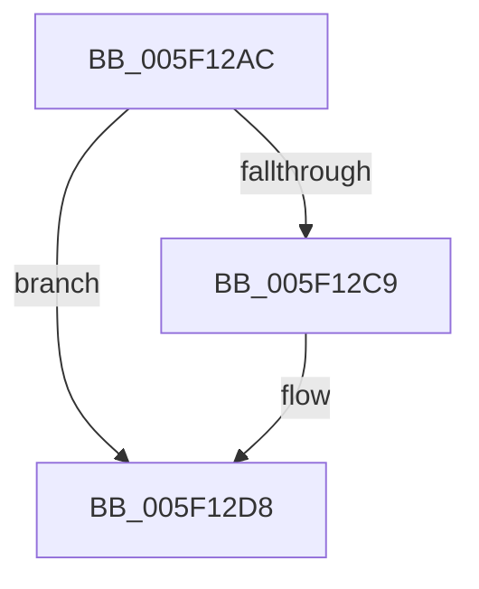

# RtlpHeapHandleError

- RVA: `0x005F12AC`–`0x005F12ED` (길이 `65` bytes)
- VA: `0x00000001405F12AC`
- 실행 섹션: `.text`
- PDB 이름 있음: `예`; PDB Function 태그: `아니요`
- unwind 정보 RVA: `0x000622F0`
- 디코드: `16`개 명령, `65/65` bytes 표시
- 미해석 바이트: `0` (있으면 어셈블리에 `.byte`로 보존)

> 이 문서는 커널 이미지의 기계어와 PDB 기호를 분석해 생성했습니다. 4번과 5번은 함수 원형과 자료형을 바이너리 사용 방식에서 추정한 C 해석이며 원본 소스 복구 결과는 아닙니다.

## 1. Dependencies

- 직접 호출 지점: **2**; 고유 호출 대상: **1**
- 직접 호출자로 확인된 함수: **9**
- RIP 상대 이미지 참조: **3**

### Outgoing calls
- `0x005F12D2` → [KeBugCheckEx](../4F/KeBugCheckEx_function_004FD660.md) (function, `0x004FD660`)
- `0x005F12E7` → [KeBugCheckEx](../4F/KeBugCheckEx_function_004FD660.md) (function, `0x004FD660`)

### Direct callers
- [RtlpCreateHeap](../4E/RtlpCreateHeap_function_004E1904.md) at `0x004E1AFC`
- [RtlpCreateUCREntry](../5E/RtlpCreateUCREntry_function_005EA010.md) at `0x005EA0B0`
- [RtlpDeCommitFreeBlock](../5E/RtlpDeCommitFreeBlock_function_005EA158.md) at `0x005EA30B`
- [RtlpDeCommitFreeBlock](../5E/RtlpDeCommitFreeBlock_function_005EA158.md) at `0x005EA34A`
- [RtlpDeCommitFreeBlock](../5E/RtlpDeCommitFreeBlock_function_005EA158.md) at `0x005EA484`
- [RtlpDeCommitFreeBlock](../5E/RtlpDeCommitFreeBlock_function_005EA158.md) at `0x005EA60C`
- [RtlpDeCommitFreeBlock](../5E/RtlpDeCommitFreeBlock_function_005EA158.md) at `0x005EA6D7`
- [RtlpFindAndCommitPages](../5E/RtlpFindAndCommitPages_function_005EA95C.md) at `0x005EA9B3`
- [RtlpInsertFreeBlock](../5E/RtlpInsertFreeBlock_function_005EB4C0.md) at `0x005EB52B`
- [RtlpInsertFreeBlock](../5E/RtlpInsertFreeBlock_function_005EB4C0.md) at `0x005EB7DB`
- [RtlpHpHeapHandleError](RtlpHpHeapHandleError_function_005F12F4.md) at `0x005F1347`
- [RtlpFindUCREntry](RtlpFindUCREntry_function_005F1828.md) at `0x005F1856`
- [RtlpPopulateListIndex](RtlpPopulateListIndex_function_005F1C84.md) at `0x005F1DFB`
- [RtlDestroyHeap](../../page/AA/RtlDestroyHeap_function_00AA8790.md) at `0x00AA87E3`

### Static image references
- `0x005F12B0` → RVA `0x00E0C5D8` (`.data`; read)
- `0x005F12BD` → RVA `0x00E0C5E0` (`.data`; read)
- `0x005F12D8` → RVA `0x00E0C5E8` (`.data`; read)

## 2. Other-region calls and transfers

- 다른 실행 섹션으로 향하는 call: **0**
- 별도 외부 분기/꼬리 이동을 확인하지 못했습니다.

## 3. Assembly (complete function range)

```asm
005F12AC  48 83 EC 38                     sub rsp, 0x38
005F12B0  48 63 05 21 B3 81 00            movsxd rax, dword ptr [rip + 0x81b321]
005F12B7  48 83 64 24 20 00               and qword ptr [rsp + 0x20], 0
005F12BD  4C 8B 05 1C B3 81 00            mov r8, qword ptr [rip + 0x81b31c]
005F12C4  83 F8 16                        cmp eax, 0x16
005F12C7  75 0F                           jne 0x1405f12d8
005F12C9  8D 50 30                        lea edx, [rax + 0x30]
005F12CC  45 33 C9                        xor r9d, r9d
005F12CF  8D 4A 7C                        lea ecx, [rdx + 0x7c]
005F12D2  E8 89 C3 F0 FF                  call 0x1404fd660
005F12D7  CC                              int3
005F12D8  4C 8B 0D 09 B3 81 00            mov r9, qword ptr [rip + 0x81b309]
005F12DF  48 8B D0                        mov rdx, rax
005F12E2  B9 3A 01 00 00                  mov ecx, 0x13a
005F12E7  E8 74 C3 F0 FF                  call 0x1404fd660
005F12EC  CC                              int3
```

## 4. C-style interpretation (structured pseudocode)

```c
__int64 __fastcall RtlpHeapHandleError(__int64 a1, __int64 a2, __int64 a3, int a4)
{
    __int64 result;
    __int64 v_rsp;
    unsigned __int64 v_stack_m18;

    v_rsp = (v_rsp) - (56);
    result = (int)(*(unsigned int *)(v_rip + 8500001));
    if (((unsigned int)((int)(*(unsigned int *)(v_rip + 8500001)))) == 22) {
        a2 = (int)(*(unsigned int *)(v_rip + 8500001)) + 48;
        a4 = 0;
        a1 = a2 + 124;
        result = KeBugCheckEx(a1, a2, *(unsigned __int64 *)(v_rip + 8499996), a4);
    }
    result = KeBugCheckEx(314, result, *(unsigned __int64 *)(v_rip + 8499996), *(unsigned __int64 *)(v_rip + 8499977));
    return result;
}
```

## 5. (Beta) C Style

```c
int64_t RtlpHeapHandleError(int64_t Arg1, int64_t Arg2, int64_t Arg3, int32_t Arg4)
{
    int64_t result;
    int64_t local_rsp;
    uint64_t v_stack_m18;

    local_rsp = (local_rsp) - (56);
    result = (int32_t)(*(uint32_t *)(v_rip + 0x81B321));
    if (((uint32_t)((int32_t)(*(uint32_t *)(v_rip + 0x81B321)))) == 22) {
        Arg2 = (int32_t)(*(uint32_t *)(v_rip + 0x81B321)) + 48;
        Arg4 = 0;
        Arg1 = Arg2 + 124;
        result = KeBugCheckEx(Arg1, Arg2, *(uint64_t *)(v_rip + 0x81B31C), Arg4);
    }
    result = KeBugCheckEx(314, result, *(uint64_t *)(v_rip + 0x81B31C), *(uint64_t *)(v_rip + 0x81B309));
    return result;
}
```

## 6. Execution-region graph

[열기: 2D/3D 그래프와 함수 탐색 컨트롤 패널](../../../control-panel.html?section=text&rva=0x005F12AC&view=graph)

- 2D 그래프는 위에서 아래로 흐르고, 3D 그래프는 빈 공간을 드래그해 회전합니다. Shift+드래그는 이동, 휠은 확대·축소, 함수 노드 선택은 대상 보고서 이동입니다.

### Static fallback


