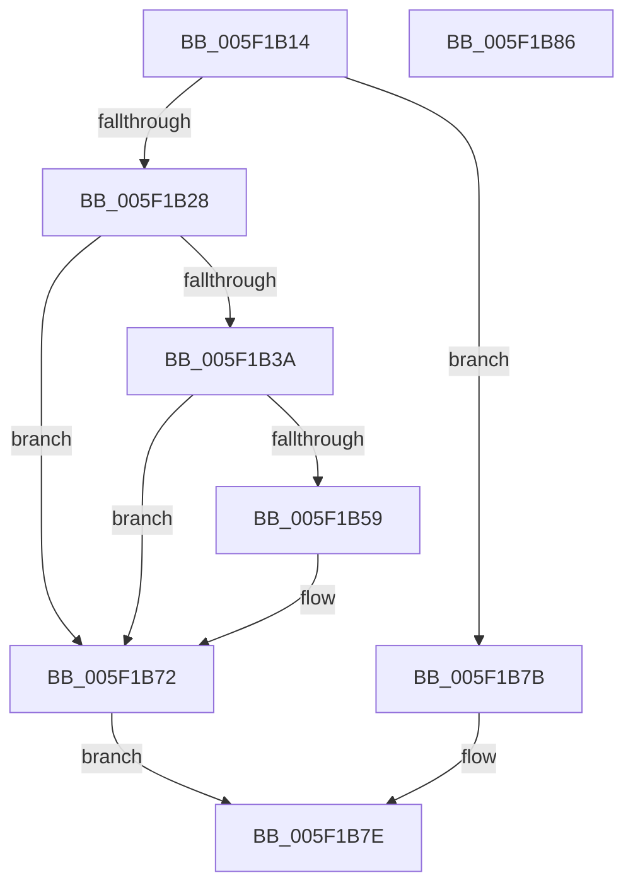

# RtlpHeapListCompare

- RVA: `0x005F1B14`–`0x005F1B87` (길이 `115` bytes)
- VA: `0x00000001405F1B14`
- 실행 섹션: `.text`
- PDB 이름 있음: `예`; PDB Function 태그: `아니요`
- unwind 정보 RVA: `0x000697A4`
- 디코드: `38`개 명령, `115/115` bytes 표시
- 미해석 바이트: `0` (있으면 어셈블리에 `.byte`로 보존)

> 이 문서는 커널 이미지의 기계어와 PDB 기호를 분석해 생성했습니다. 4번과 5번은 함수 원형과 자료형을 바이너리 사용 방식에서 추정한 C 해석이며 원본 소스 복구 결과는 아닙니다.

## 1. Dependencies

- 직접 호출 지점: **1**; 고유 호출 대상: **1**
- 직접 호출자로 확인된 함수: **3**
- RIP 상대 이미지 참조: **0**

### Outgoing calls
- `0x005F1B6D` → [RtlpLogHeapFailure](../35/RtlpLogHeapFailure_function_0035B7BC.md) (function, `0x0035B7BC`)

### Direct callers
- [RtlpHeapAddListEntry](RtlpHeapAddListEntry_function_005F18C8.md) at `0x005F192A`
- [RtlpHeapFindListLookupEntry](RtlpHeapFindListLookupEntry_function_005F1978.md) at `0x005F19BF`
- [RtlpHeapFindListLookupEntry](RtlpHeapFindListLookupEntry_function_005F1978.md) at `0x005F19DE`
- [RtlpHeapFindListLookupEntry](RtlpHeapFindListLookupEntry_function_005F1978.md) at `0x005F1A25`
- [RtlpHeapRemoveListEntry](RtlpHeapRemoveListEntry_function_005F1B90.md) at `0x005F1C17`

### Static image references
- 디코드된 RIP-relative 메모리 참조가 없습니다.

## 2. Other-region calls and transfers

- 다른 실행 섹션으로 향하는 call: **0**
- 별도 외부 분기/꼬리 이동을 확인하지 못했습니다.

## 3. Assembly (complete function range)

```asm
005F1B14  40 53                           push rbx
005F1B16  48 83 EC 40                     sub rsp, 0x40
005F1B1A  45 33 DB                        xor r11d, r11d
005F1B1D  49 8B D8                        mov rbx, r8
005F1B20  4C 8B D1                        mov r10, rcx
005F1B23  45 84 C9                        test r9b, r9b
005F1B26  74 53                           je 0x1405f1b7b
005F1B28  4C 8D 42 F0                     lea r8, [rdx - 0x10]
005F1B2C  41 8B 50 08                     mov edx, dword ptr [r8 + 8]
005F1B30  89 54 24 38                     mov dword ptr [rsp + 0x38], edx
005F1B34  44 39 59 7C                     cmp dword ptr [rcx + 0x7c], r11d
005F1B38  74 38                           je 0x1405f1b72
005F1B3A  33 91 88 00 00 00               xor edx, dword ptr [rcx + 0x88]
005F1B40  8B CA                           mov ecx, edx
005F1B42  89 54 24 38                     mov dword ptr [rsp + 0x38], edx
005F1B46  C1 E9 10                        shr ecx, 0x10
005F1B49  8B C2                           mov eax, edx
005F1B4B  C1 E8 08                        shr eax, 8
005F1B4E  32 C8                           xor cl, al
005F1B50  32 CA                           xor cl, dl
005F1B52  C1 EA 18                        shr edx, 0x18
005F1B55  3A D1                           cmp dl, cl
005F1B57  74 19                           je 0x1405f1b72
005F1B59  4C 89 5C 24 28                  mov qword ptr [rsp + 0x28], r11
005F1B5E  41 8D 4B 03                     lea ecx, [r11 + 3]
005F1B62  45 33 C9                        xor r9d, r9d
005F1B65  4C 89 5C 24 20                  mov qword ptr [rsp + 0x20], r11
005F1B6A  49 8B D2                        mov rdx, r10
005F1B6D  E8 4A 9C D6 FF                  call 0x14035b7bc
005F1B72  0F B7 44 24 38                  movzx eax, word ptr [rsp + 0x38]
005F1B77  2B D8                           sub ebx, eax
005F1B79  EB 03                           jmp 0x1405f1b7e
005F1B7B  2B 5A 28                        sub ebx, dword ptr [rdx + 0x28]
005F1B7E  8B C3                           mov eax, ebx
005F1B80  48 83 C4 40                     add rsp, 0x40
005F1B84  5B                              pop rbx
005F1B85  C3                              ret
005F1B86  CC                              int3
```

## 4. C-style interpretation (structured pseudocode)

```c
__int64 __fastcall RtlpHeapListCompare(__int64 a1, __int64 a2, __int64 a3, int a4)
{
    __int64 result;
    __int64 v_r11;
    __int64 v_rbx;
    __int64 v_rsp;
    unsigned int v_stack_m10;
    unsigned __int64 v_stack_m20;
    unsigned __int64 v_stack_m28;

    v_rsp = (v_rsp) - (64);
    v_r11 = 0;
    if ((unsigned __int8)(a4) == 0) goto loc_005F1B7B;
    v_stack_m10 = (unsigned int)((unsigned int)(*(unsigned int *)(a2 - 16 + 8)));
    if ((*(unsigned int *)(a1 + 124)) == 0) goto loc_005F1B72;
    a2 = (unsigned int)(((unsigned int)(*(unsigned int *)(a2 - 16 + 8))) ^ (*(unsigned int *)(a1 + 136)));
    v_stack_m10 = (unsigned int)(a2);
    a1 = (unsigned int)(((unsigned int)((unsigned int)(a2))) >> (16));
    result = (unsigned int)(((unsigned int)((unsigned int)(a2))) >> (8));
    a1 = (unsigned __int8)((a1) ^ ((unsigned __int8)(result)));
    a1 = (unsigned __int8)((a1) ^ ((unsigned __int8)(a2)));
    a2 = (unsigned int)((a2) >> (24));
    if (((unsigned __int8)(a2)) != ((unsigned __int8)(a1))) {
        v_stack_m20 = 0;
        a1 = v_r11 + 3;
        a4 = 0;
        v_stack_m28 = 0;
        a2 = a1;
        result = RtlpLogHeapFailure(a1, a2, a2 - 16, a4);
    }
    v_rbx = (unsigned int)((a3) - ((unsigned int)(v_stack_m10)));
    goto loc_005F1B7E;
loc_005F1B7B:
    v_rbx = (unsigned int)((v_rbx) - (*(unsigned int *)(a2 + 40)));
loc_005F1B7E:
    v_rsp = (v_rsp) + (64);
    return (unsigned int)((unsigned int)(v_rbx));
}
```

## 5. (Beta) C Style

```c
int64_t RtlpHeapListCompare(void *Arg1, void *Arg2, int64_t Arg3, int32_t Arg4)
{
    uint8_t *arg1 = (uint8_t *)Arg1;
    uint8_t *arg2 = (uint8_t *)Arg2;

    int64_t result;
    int64_t local_r11;
    int64_t local_rbx;
    int64_t local_rsp;
    uint32_t v_stack_m10;
    uint64_t v_stack_m20;
    uint64_t v_stack_m28;

    local_rsp = (local_rsp) - (64);
    local_r11 = 0;
    if ((uint8_t)(Arg4) == 0) goto loc_005F1B7B;
    v_stack_m10 = (uint32_t)((uint32_t)(*(uint32_t *)(arg2 - 0x10 + 0x8)));
    if ((*(uint32_t *)(arg1 + 0x7C)) == 0) goto loc_005F1B72;
    Arg2 = (uint32_t)(((uint32_t)(*(uint32_t *)(arg2 - 0x10 + 0x8))) ^ (*(uint32_t *)(arg1 + 0x88)));
    v_stack_m10 = (uint32_t)(Arg2);
    Arg1 = (uint32_t)(((uint32_t)((uint32_t)(Arg2))) >> (16));
    result = (uint32_t)(((uint32_t)((uint32_t)(Arg2))) >> (8));
    Arg1 = (uint8_t)((Arg1) ^ ((uint8_t)(result)));
    Arg1 = (uint8_t)((Arg1) ^ ((uint8_t)(Arg2)));
    Arg2 = (uint32_t)((Arg2) >> (24));
    if (((uint8_t)(Arg2)) != ((uint8_t)(Arg1))) {
        v_stack_m20 = 0;
        Arg1 = local_r11 + 3;
        Arg4 = 0;
        v_stack_m28 = 0;
        Arg2 = Arg1;
        result = RtlpLogHeapFailure(Arg1, Arg2, Arg2 - 16, Arg4);
    }
    local_rbx = (uint32_t)((Arg3) - ((uint32_t)(v_stack_m10)));
    goto loc_005F1B7E;
loc_005F1B7B:
    local_rbx = (uint32_t)((local_rbx) - (*(uint32_t *)(arg2 + 0x28)));
loc_005F1B7E:
    local_rsp = (local_rsp) + (64);
    return (uint32_t)((uint32_t)(local_rbx));
}
```

### 관측된 메모리 오프셋

구조체 형식이 확인되지 않은 접근은 인자 기준의 오프셋으로만 기록했습니다.

| 기준 인자 | 오프셋 표현 | 폭 (bit) | 접근 |
|---|---:|---:|---|
| `Arg1` | `+ 0x7C` | `32` | `R` |
| `Arg1` | `+ 0x88` | `32` | `R` |
| `Arg2` | `- 0x10` | `64` | `R` |
| `Arg2` | `+ 0x8` | `32` | `R` |
| `Arg2` | `+ 0x28` | `32` | `R` |

## 6. Execution-region graph

[열기: 2D/3D 그래프와 함수 탐색 컨트롤 패널](../../../control-panel.html?section=text&rva=0x005F1B14&view=graph)

- 2D 그래프는 위에서 아래로 흐르고, 3D 그래프는 빈 공간을 드래그해 회전합니다. Shift+드래그는 이동, 휠은 확대·축소, 함수 노드 선택은 대상 보고서 이동입니다.

### Static fallback


