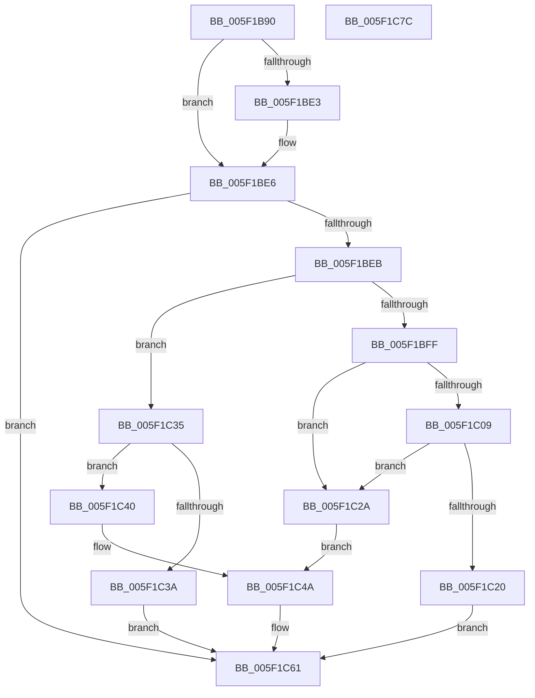

# RtlpHeapRemoveListEntry

- RVA: `0x005F1B90`–`0x005F1C7D` (길이 `237` bytes)
- VA: `0x00000001405F1B90`
- 실행 섹션: `.text`
- PDB 이름 있음: `예`; PDB Function 태그: `아니요`
- unwind 정보 RVA: `0x0005E6B4`
- 디코드: `71`개 명령, `237/237` bytes 표시
- 미해석 바이트: `0` (있으면 어셈블리에 `.byte`로 보존)

> 이 문서는 커널 이미지의 기계어와 PDB 기호를 분석해 생성했습니다. 4번과 5번은 함수 원형과 자료형을 바이너리 사용 방식에서 추정한 C 해석이며 원본 소스 복구 결과는 아닙니다.

## 1. Dependencies

- 직접 호출 지점: **1**; 고유 호출 대상: **1**
- 직접 호출자로 확인된 함수: **5**
- RIP 상대 이미지 참조: **0**

### Outgoing calls
- `0x005F1C17` → [RtlpHeapListCompare](RtlpHeapListCompare_function_005F1B14.md) (function, `0x005F1B14`)

### Direct callers
- [RtlpAllocateHeap](../5E/RtlpAllocateHeap_function_005E8B1C.md) at `0x005E8DD1`
- [RtlpAllocateHeap](../5E/RtlpAllocateHeap_function_005E8B1C.md) at `0x005E8EDB`
- [RtlpCoalesceFreeBlocks](../5E/RtlpCoalesceFreeBlocks_function_005E952C.md) at `0x005E961C`
- [RtlpCoalesceFreeBlocks](../5E/RtlpCoalesceFreeBlocks_function_005E952C.md) at `0x005E97D1`
- [RtlpCreateSplitBlock](../5E/RtlpCreateSplitBlock_function_005E98F0.md) at `0x005E9A65`
- [RtlpPopulateListIndex](RtlpPopulateListIndex_function_005F1C84.md) at `0x005F1D83`
- [RtlZeroHeap](../../page/79/RtlZeroHeap_function_00790AD0.md) at `0x00790C80`

### Static image references
- 디코드된 RIP-relative 메모리 참조가 없습니다.

## 2. Other-region calls and transfers

- 다른 실행 섹션으로 향하는 call: **0**
- 별도 외부 분기/꼬리 이동을 확인하지 못했습니다.

## 3. Assembly (complete function range)

```asm
005F1B90  48 8B C4                        mov rax, rsp
005F1B93  48 89 58 08                     mov qword ptr [rax + 8], rbx
005F1B97  48 89 68 10                     mov qword ptr [rax + 0x10], rbp
005F1B9B  48 89 70 18                     mov qword ptr [rax + 0x18], rsi
005F1B9F  48 89 78 20                     mov qword ptr [rax + 0x20], rdi
005F1BA3  41 56                           push r14
005F1BA5  48 83 EC 20                     sub rsp, 0x20
005F1BA9  44 8B 54 24 50                  mov r10d, dword ptr [rsp + 0x50]
005F1BAE  4C 8B D9                        mov r11, rcx
005F1BB1  48 8B 4A 30                     mov rcx, qword ptr [rdx + 0x30]
005F1BB5  41 8B F2                        mov esi, r10d
005F1BB8  2B 72 18                        sub esi, dword ptr [rdx + 0x18]
005F1BBB  48 8B FA                        mov rdi, rdx
005F1BBE  83 7A 0C 00                     cmp dword ptr [rdx + 0xc], 0
005F1BC2  44 8D 04 36                     lea r8d, [rsi + rsi]
005F1BC6  44 0F 44 C6                     cmove r8d, esi
005F1BCA  83 CB FF                        or ebx, 0xffffffff
005F1BCD  45 8B F0                        mov r14d, r8d
005F1BD0  4A 8B 04 C1                     mov rax, qword ptr [rcx + r8*8]
005F1BD4  01 5A 10                        add dword ptr [rdx + 0x10], ebx
005F1BD7  8B 52 08                        mov edx, dword ptr [rdx + 8]
005F1BDA  44 8D 42 FF                     lea r8d, [rdx - 1]
005F1BDE  45 3B D0                        cmp r10d, r8d
005F1BE1  75 03                           jne 0x1405f1be6
005F1BE3  01 5F 14                        add dword ptr [rdi + 0x14], ebx
005F1BE6  49 3B C1                        cmp rax, r9
005F1BE9  75 76                           jne 0x1405f1c61
005F1BEB  48 83 3F 00                     cmp qword ptr [rdi], 0
005F1BEF  49 8B 29                        mov rbp, qword ptr [r9]
005F1BF2  48 8B 47 20                     mov rax, qword ptr [rdi + 0x20]
005F1BF6  41 0F 44 D0                     cmove edx, r8d
005F1BFA  44 3B D2                        cmp r10d, edx
005F1BFD  73 36                           jae 0x1405f1c35
005F1BFF  BB 01 00 00 00                  mov ebx, 1
005F1C04  48 3B E8                        cmp rbp, rax
005F1C07  74 21                           je 0x1405f1c2a
005F1C09  4C 8B 44 24 58                  mov r8, qword ptr [rsp + 0x58]
005F1C0E  44 8A CB                        mov r9b, bl
005F1C11  48 8B D5                        mov rdx, rbp
005F1C14  49 8B CB                        mov rcx, r11
005F1C17  E8 F8 FE FF FF                  call 0x1405f1b14
005F1C1C  85 C0                           test eax, eax
005F1C1E  75 0A                           jne 0x1405f1c2a
005F1C20  48 8B 47 30                     mov rax, qword ptr [rdi + 0x30]
005F1C24  4A 89 2C F0                     mov qword ptr [rax + r14*8], rbp
005F1C28  EB 37                           jmp 0x1405f1c61
005F1C2A  48 8B 47 30                     mov rax, qword ptr [rdi + 0x30]
005F1C2E  4A 83 24 F0 00                  and qword ptr [rax + r14*8], 0
005F1C33  EB 15                           jmp 0x1405f1c4a
005F1C35  48 3B E8                        cmp rbp, rax
005F1C38  74 06                           je 0x1405f1c40
005F1C3A  4A 89 2C F1                     mov qword ptr [rcx + r14*8], rbp
005F1C3E  EB 21                           jmp 0x1405f1c61
005F1C40  4A 83 24 F1 00                  and qword ptr [rcx + r14*8], 0
005F1C45  BB 01 00 00 00                  mov ebx, 1
005F1C4A  48 8B 47 28                     mov rax, qword ptr [rdi + 0x28]
005F1C4E  8B D6                           mov edx, esi
005F1C50  83 E6 1F                        and esi, 0x1f
005F1C53  40 8A CE                        mov cl, sil
005F1C56  48 C1 EA 05                     shr rdx, 5
005F1C5A  D3 E3                           shl ebx, cl
005F1C5C  F7 D3                           not ebx
005F1C5E  21 1C 90                        and dword ptr [rax + rdx*4], ebx
005F1C61  48 8B 5C 24 30                  mov rbx, qword ptr [rsp + 0x30]
005F1C66  48 8B 6C 24 38                  mov rbp, qword ptr [rsp + 0x38]
005F1C6B  48 8B 74 24 40                  mov rsi, qword ptr [rsp + 0x40]
005F1C70  48 8B 7C 24 48                  mov rdi, qword ptr [rsp + 0x48]
005F1C75  48 83 C4 20                     add rsp, 0x20
005F1C79  41 5E                           pop r14
005F1C7B  C3                              ret
005F1C7C  CC                              int3
```

## 4. C-style interpretation (structured pseudocode)

```c
__int64 __fastcall RtlpHeapRemoveListEntry(__int64 a1, __int64 a2, __int64 a3, __int64 a4, unsigned int a5, __int64 a6)
{
    __int64 result;
    __int64 v_rbx;
    __int64 v_rsi;
    __int64 v_rsp;
    unsigned __int64 v_stack_p10;
    unsigned __int64 v_stack_p18;
    unsigned __int64 v_stack_p20;
    unsigned __int64 v_stack_p8;

    *(unsigned __int64 *)(v_rsp + 8) = v_rbx;
    *(unsigned __int64 *)(v_rsp + 16) = v_rbp;
    *(unsigned __int64 *)(v_rsp + 24) = v_rsi;
    *(unsigned __int64 *)(v_rsp + 32) = v_rdi;
    v_rsp = (v_rsp) - (32);
    v_rsi = (unsigned int)(((unsigned int)((unsigned int)((unsigned int)(a5)))) - (*(unsigned int *)(a2 + 24)));
    a3 = v_rsi + v_rsi * 1;
    if ((*(unsigned int *)(a2 + 12)) == 0) { a3 = (unsigned int)(v_rsi); }
    v_rbx = (unsigned int)((v_rbx) | (0xFFFFFFFFULL));
    if (((unsigned int)((unsigned int)(a5))) == ((unsigned int)((unsigned int)(*(unsigned int *)(a2 + 8)) - 1))) {
    }
    if ((*(unsigned __int64 *)(*(unsigned __int64 *)(a2 + 48) + a3 * 8)) != a4) goto loc_005F1C61;
    a2 = (unsigned int)(*(unsigned int *)(a2 + 8));
    if ((*(unsigned __int64 *)(a2)) == 0) { a2 = (unsigned int)((unsigned int)(*(unsigned int *)(a2 + 8)) - 1); }
    if (((unsigned int)((unsigned int)(a5))) >= ((unsigned int)(a2))) goto loc_005F1C35;
    if ((*(unsigned __int64 *)(a4)) == (*(unsigned __int64 *)(a2 + 32))) goto loc_005F1C2A;
    result = RtlpHeapListCompare(a1, *(unsigned __int64 *)(a4), a6, 1);
    if ((unsigned int)(result) != 0) goto loc_005F1C2A;
    *(unsigned __int64 *)(*(unsigned __int64 *)(a2 + 48) + (unsigned int)((unsigned int)(a3)) * 8) = *(unsigned __int64 *)(a4);
    goto loc_005F1C61;
loc_005F1C2A:
    goto loc_005F1C4A;
loc_005F1C35:
    if ((*(unsigned __int64 *)(a4)) == (*(unsigned __int64 *)(a2 + 48))) goto loc_005F1C40;
    *(unsigned __int64 *)(a1 + (unsigned int)((unsigned int)(a3)) * 8) = *(unsigned __int64 *)(a4);
    goto loc_005F1C61;
loc_005F1C40:
loc_005F1C4A:
    v_rsi = (unsigned int)((v_rsi) & (31));
    a2 = ((unsigned int)((unsigned int)(v_rsi))) >> (5);
    v_rbx = (unsigned int)((1) << ((unsigned __int8)((unsigned __int8)(v_rsi))));
    v_rbx = (unsigned int)(~(v_rbx));
loc_005F1C61:
    v_rsp = (v_rsp) + (32);
    return *(unsigned __int64 *)(a2 + 40);
}
```

## 5. (Beta) C Style

```c
int64_t RtlpHeapRemoveListEntry(int64_t Arg1, void *Arg2, int64_t Arg3, void *Arg4, void *Arg5, int64_t Arg6)
{
    uint8_t *arg2 = (uint8_t *)Arg2;
    uint8_t *arg4 = (uint8_t *)Arg4;
    uint8_t *arg5 = (uint8_t *)Arg5;

    int64_t result;
    int64_t local_rbx;
    int64_t local_rsi;
    int64_t local_rsp;
    uint64_t v_stack_p10;
    uint64_t v_stack_p18;
    uint64_t v_stack_p20;
    uint64_t v_stack_p8;

    *(uint64_t *)(local_rsp + 0x8) = local_rbx;
    *(uint64_t *)(local_rsp + 0x10) = local_rbp;
    *(uint64_t *)(local_rsp + 0x18) = local_rsi;
    *(uint64_t *)(local_rsp + 0x20) = local_rdi;
    local_rsp = (local_rsp) - (32);
    local_rsi = (uint32_t)(((uint32_t)((uint32_t)((uint32_t)(Arg5)))) - (*(uint32_t *)(arg2 + 0x18)));
    Arg3 = local_rsi + local_rsi * 1;
    if ((*(uint32_t *)(arg2 + 0xC)) == 0) { Arg3 = (uint32_t)(local_rsi); }
    local_rbx = (uint32_t)((local_rbx) | (0xFFFFFFFFULL));
    if (((uint32_t)((uint32_t)(Arg5))) == ((uint32_t)((uint32_t)(*(uint32_t *)(arg2 + 0x8)) - 1))) {
    }
    if ((*(uint64_t *)(*(uint64_t *)(arg2 + 0x30) + Arg3 * 8)) != Arg4) goto loc_005F1C61;
    Arg2 = (uint32_t)(*(uint32_t *)(arg2 + 0x8));
    if ((*(uint64_t *)(arg2)) == 0) { Arg2 = (uint32_t)((uint32_t)(*(uint32_t *)(arg2 + 0x8)) - 1); }
    if (((uint32_t)((uint32_t)(Arg5))) >= ((uint32_t)(Arg2))) goto loc_005F1C35;
    if ((*(uint64_t *)(arg4)) == (*(uint64_t *)(arg2 + 0x20))) goto loc_005F1C2A;
    result = RtlpHeapListCompare(Arg1, *(uint64_t *)(arg4), Arg6, 1);
    if ((uint32_t)(result) != 0) goto loc_005F1C2A;
    *(uint64_t *)(*(uint64_t *)(arg2 + 0x30) + (uint32_t)((uint32_t)(Arg3)) * 8) = *(uint64_t *)(arg4);
    goto loc_005F1C61;
loc_005F1C2A:
    goto loc_005F1C4A;
loc_005F1C35:
    if ((*(uint64_t *)(arg4)) == (*(uint64_t *)(arg2 + 0x30))) goto loc_005F1C40;
    *(uint64_t *)(Arg1 + (uint32_t)((uint32_t)(Arg3)) * 8) = *(uint64_t *)(arg4);
    goto loc_005F1C61;
loc_005F1C40:
loc_005F1C4A:
    local_rsi = (uint32_t)((local_rsi) & (31));
    Arg2 = ((uint32_t)((uint32_t)(local_rsi))) >> (5);
    local_rbx = (uint32_t)((1) << ((uint8_t)((uint8_t)(local_rsi))));
    local_rbx = (uint32_t)(~(local_rbx));
loc_005F1C61:
    local_rsp = (local_rsp) + (32);
    return *(uint64_t *)(arg2 + 0x28);
}
```

### 관측된 메모리 오프셋

구조체 형식이 확인되지 않은 접근은 인자 기준의 오프셋으로만 기록했습니다.

| 기준 인자 | 오프셋 표현 | 폭 (bit) | 접근 |
|---|---:|---:|---|
| `Arg2` | `+ 0x0` | `64` | `R` |
| `Arg2` | `+ 0x8` | `32` | `R` |
| `Arg2` | `+ 0xC` | `32` | `R` |
| `Arg2` | `+ 0x10` | `32` | `R/W` |
| `Arg2` | `+ 0x14` | `32` | `R/W` |
| `Arg2` | `+ 0x18` | `32` | `R` |
| `Arg2` | `+ 0x20` | `64` | `R` |
| `Arg2` | `+ 0x28` | `64` | `R` |
| `Arg2` | `+ 0x30` | `64` | `R` |
| `Arg4` | `+ 0x0` | `64` | `R` |
| `Arg5` | `+ 0x0 + rsi*1` | `32` | `R` |

## 6. Execution-region graph

[열기: 2D/3D 그래프와 함수 탐색 컨트롤 패널](../../../control-panel.html?section=text&rva=0x005F1B90&view=graph)

- 2D 그래프는 위에서 아래로 흐르고, 3D 그래프는 빈 공간을 드래그해 회전합니다. Shift+드래그는 이동, 휠은 확대·축소, 함수 노드 선택은 대상 보고서 이동입니다.

### Static fallback


