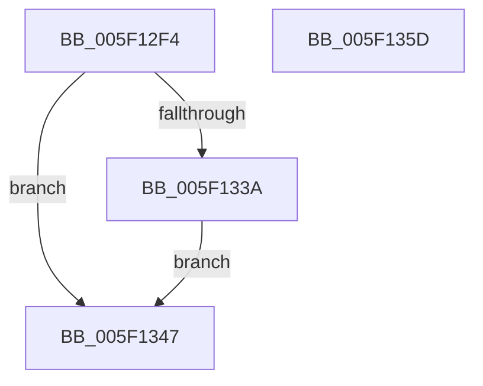

# RtlpHpHeapHandleError

- RVA: `0x005F12F4`–`0x005F135E` (길이 `106` bytes)
- VA: `0x00000001405F12F4`
- 실행 섹션: `.text`
- PDB 이름 있음: `예`; PDB Function 태그: `아니요`
- unwind 정보 RVA: `0x000D03A4`
- 디코드: `30`개 명령, `106/106` bytes 표시
- 미해석 바이트: `0` (있으면 어셈블리에 `.byte`로 보존)

> 이 문서는 커널 이미지의 기계어와 PDB 기호를 분석해 생성했습니다. 4번과 5번은 함수 원형과 자료형을 바이너리 사용 방식에서 추정한 C 해석이며 원본 소스 복구 결과는 아닙니다.

## 1. Dependencies

- 직접 호출 지점: **4**; 고유 호출 대상: **4**
- 직접 호출자로 확인된 함수: **1**
- RIP 상대 이미지 참조: **1**

### Outgoing calls
- `0x005F131A` → [memset](../6C/memset_function_006C6C40.md) (function, `0x006C6C40`)
- `0x005F1330` → [RtlCaptureStackBackTrace](../2F/RtlCaptureStackBackTrace_function_002F9FF0.md) (function, `0x002F9FF0`)
- `0x005F1340` → [RtlpLocateRelatedBlocks](RtlpLocateRelatedBlocks_function_005F1364.md) (function, `0x005F1364`)
- `0x005F1347` → [RtlpHeapHandleError](RtlpHeapHandleError_function_005F12AC.md) (function, `0x005F12AC`)

### Direct callers
- [RtlpLogHeapFailure](../35/RtlpLogHeapFailure_function_0035B7BC.md) at `0x0035B7FC`

### Static image references
- `0x005F1313` → RVA `0x00E0C628` (`.data`; read)

## 2. Other-region calls and transfers

- 다른 실행 섹션으로 향하는 call: **0**
- 별도 외부 분기/꼬리 이동을 확인하지 못했습니다.

## 3. Assembly (complete function range)

```asm
005F12F4  48 89 5C 24 08                  mov qword ptr [rsp + 8], rbx
005F12F9  48 89 74 24 10                  mov qword ptr [rsp + 0x10], rsi
005F12FE  57                              push rdi
005F12FF  48 83 EC 20                     sub rsp, 0x20
005F1303  49 8B F8                        mov rdi, r8
005F1306  48 8B F2                        mov rsi, rdx
005F1309  8B D9                           mov ebx, ecx
005F130B  33 D2                           xor edx, edx
005F130D  41 B8 00 01 00 00               mov r8d, 0x100
005F1313  48 8D 0D 0E B3 81 00            lea rcx, [rip + 0x81b30e]
005F131A  E8 21 59 0D 00                  call 0x1406c6c40
005F131F  45 33 C9                        xor r9d, r9d
005F1322  4C 8D 05 FF B2 81 00            lea r8, [rip + 0x81b2ff]
005F1329  41 8D 51 20                     lea edx, [r9 + 0x20]
005F132D  8D 4A E1                        lea ecx, [rdx - 0x1f]
005F1330  E8 BB 8C D0 FF                  call 0x1402f9ff0
005F1335  83 FB 03                        cmp ebx, 3
005F1338  75 0D                           jne 0x1405f1347
005F133A  48 8B D7                        mov rdx, rdi
005F133D  48 8B CE                        mov rcx, rsi
005F1340  E8 1F 00 00 00                  call 0x1405f1364
005F1345  EB 00                           jmp 0x1405f1347
005F1347  E8 60 FF FF FF                  call 0x1405f12ac
005F134C  CC                              int3
005F134D  48 8B 5C 24 30                  mov rbx, qword ptr [rsp + 0x30]
005F1352  48 8B 74 24 38                  mov rsi, qword ptr [rsp + 0x38]
005F1357  48 83 C4 20                     add rsp, 0x20
005F135B  5F                              pop rdi
005F135C  C3                              ret
005F135D  CC                              int3
```

## 4. C-style interpretation (structured pseudocode)

```c
__int64 __fastcall RtlpHpHeapHandleError(int a1, __int64 a2, __int64 a3, int a4)
{
    __int64 result;
    __int64 v_rsp;
    unsigned __int64 v_stack_p10;
    unsigned __int64 v_stack_p8;

    v_stack_p8 = v_rbx;
    v_stack_p10 = v_rsi;
    v_rsp = (v_rsp) - (32);
    a2 = 0;
    result = memset(v_rip + 8499982, a2, 256, a4);
    a4 = 0;
    result = RtlCaptureStackBackTrace(a4 + 32 - 31, a4 + 32, v_rip + 8499967, a4);
    if (((unsigned int)((unsigned int)(a1))) != 3) goto loc_005F1347;
    result = RtlpLocateRelatedBlocks(0, a3, v_rip + 8499967, a4);
    goto loc_005F1347;
loc_005F1347:
    result = RtlpHeapHandleError(0, a3, v_rip + 8499967, a4);
    v_rsp = (v_rsp) + (32);
    return result;
}
```

## 5. (Beta) C Style

```c
int64_t RtlpHpHeapHandleError(int32_t Arg1, int64_t Arg2, int64_t Arg3, int32_t Arg4)
{
    int64_t result;
    int64_t local_rsp;
    uint64_t v_stack_p10;
    uint64_t v_stack_p8;

    v_stack_p8 = local_rbx;
    v_stack_p10 = local_rsi;
    local_rsp = (local_rsp) - (32);
    Arg2 = 0;
    result = memset(v_rip + 8499982, Arg2, 256, Arg4);
    Arg4 = 0;
    result = RtlCaptureStackBackTrace(Arg4 + 32 - 31, Arg4 + 32, v_rip + 8499967, Arg4);
    if (((uint32_t)((uint32_t)(Arg1))) != 3) goto loc_005F1347;
    result = RtlpLocateRelatedBlocks(0, Arg3, v_rip + 8499967, Arg4);
    goto loc_005F1347;
loc_005F1347:
    result = RtlpHeapHandleError(0, Arg3, v_rip + 8499967, Arg4);
    local_rsp = (local_rsp) + (32);
    return result;
}
```

## 6. Execution-region graph

[열기: 2D/3D 그래프와 함수 탐색 컨트롤 패널](../../../control-panel.html?section=text&rva=0x005F12F4&view=graph)

- 2D 그래프는 위에서 아래로 흐르고, 3D 그래프는 빈 공간을 드래그해 회전합니다. Shift+드래그는 이동, 휠은 확대·축소, 함수 노드 선택은 대상 보고서 이동입니다.

### Static fallback


