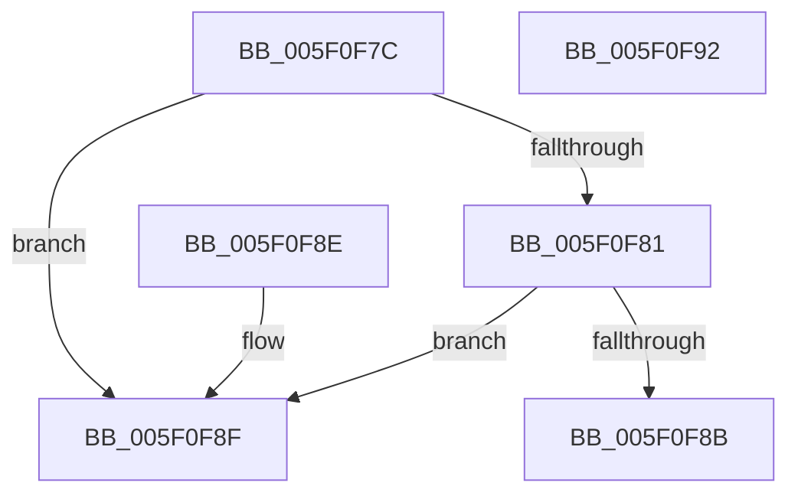

# RtlpIsImmutableFeatureConfigurationPriority

- RVA: `0x005F0F7C`–`0x005F0F93` (길이 `23` bytes)
- VA: `0x00000001405F0F7C`
- 실행 섹션: `.text`
- PDB 이름 있음: `예`; PDB Function 태그: `아니요`
- unwind 정보 RVA: `0x000DB714`
- 디코드: `11`개 명령, `23/23` bytes 표시
- 미해석 바이트: `0` (있으면 어셈블리에 `.byte`로 보존)

> 이 문서는 커널 이미지의 기계어와 PDB 기호를 분석해 생성했습니다. 4번과 5번은 함수 원형과 자료형을 바이너리 사용 방식에서 추정한 C 해석이며 원본 소스 복구 결과는 아닙니다.

## 1. Dependencies

- 직접 호출 지점: **0**; 고유 호출 대상: **0**
- 직접 호출자로 확인된 함수: **1**
- RIP 상대 이미지 참조: **0**

### Outgoing calls
- 직접 디코드된 call 명령이 없습니다.

### Direct callers
- [RtlpFcUpdateFeatureConfiguration](../../page/AB/RtlpFcUpdateFeatureConfiguration_function_00ABD7A0.md) at `0x00ABD82B`

### Static image references
- 디코드된 RIP-relative 메모리 참조가 없습니다.

## 2. Other-region calls and transfers

- 다른 실행 섹션으로 향하는 call: **0**
- 별도 외부 분기/꼬리 이동을 확인하지 못했습니다.

## 3. Assembly (complete function range)

```asm
005F0F7C  83 F9 0F                        cmp ecx, 0xf
005F0F7F  77 0E                           ja 0x1405f0f8f
005F0F81  B8 0B 82 00 00                  mov eax, 0x820b
005F0F86  0F A3 C8                        bt eax, ecx
005F0F89  73 04                           jae 0x1405f0f8f
005F0F8B  B0 01                           mov al, 1
005F0F8D  C3                              ret
005F0F8E  CC                              int3
005F0F8F  32 C0                           xor al, al
005F0F91  C3                              ret
005F0F92  CC                              int3
```

## 4. C-style interpretation (structured pseudocode)

```c
__int64 __fastcall RtlpIsImmutableFeatureConfigurationPriority(int a1)
{
    __int64 result;

    if (a1 > 15) goto loc_005F0F8F;
    if (a1 >= 15) goto loc_005F0F8F;
    return 1;
loc_005F0F8F:
    result = 0;
    return result;
}
```

## 5. (Beta) C Style

```c
int64_t RtlpIsImmutableFeatureConfigurationPriority(int32_t Arg1)
{
    int64_t result;

    if (Arg1 > 15) goto loc_005F0F8F;
    if (Arg1 >= 15) goto loc_005F0F8F;
    return 1;
loc_005F0F8F:
    result = 0;
    return result;
}
```

## 6. Execution-region graph

[열기: 2D/3D 그래프와 함수 탐색 컨트롤 패널](../../../control-panel.html?section=text&rva=0x005F0F7C&view=graph)

- 2D 그래프는 위에서 아래로 흐르고, 3D 그래프는 빈 공간을 드래그해 회전합니다. Shift+드래그는 이동, 휠은 확대·축소, 함수 노드 선택은 대상 보고서 이동입니다.

### Static fallback


