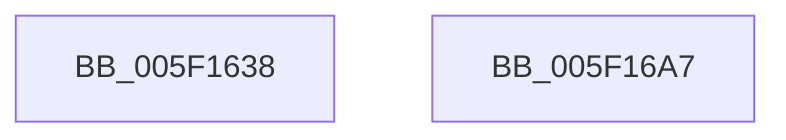

# RtlpLogHeapAllocateEvent

- RVA: `0x005F1638`–`0x005F16A8` (길이 `112` bytes)
- VA: `0x00000001405F1638`
- 실행 섹션: `.text`
- PDB 이름 있음: `예`; PDB Function 태그: `아니요`
- unwind 정보 RVA: `0x000AF370`
- 디코드: `25`개 명령, `112/112` bytes 표시
- 미해석 바이트: `0` (있으면 어셈블리에 `.byte`로 보존)

> 이 문서는 커널 이미지의 기계어와 PDB 기호를 분석해 생성했습니다. 4번과 5번은 함수 원형과 자료형을 바이너리 사용 방식에서 추정한 C 해석이며 원본 소스 복구 결과는 아닙니다.

## 1. Dependencies

- 직접 호출 지점: **2**; 고유 호출 대상: **2**
- 직접 호출자로 확인된 함수: **2**
- RIP 상대 이미지 참조: **1**

### Outgoing calls
- `0x005F1690` → [EtwTraceKernelEvent](../23/EtwTraceKernelEvent_function_00235350.md) (function, `0x00235350`)
- `0x005F169D` → [_security_check_cookie](../6A/_security_check_cookie_function_006AC640.md) (function, `0x006AC640`)

### Direct callers
- [RtlpHpAllocateHeapSlow](../2E/RtlpHpAllocateHeapSlow_function_002E9DEC.md) at `0x002EA5FB`
- [RtlpHpMetadataAlloc](../2E/RtlpHpMetadataAlloc_function_002EC180.md) at `0x002EC58E`

### Static image references
- `0x005F163F` → RVA `0x00E0A740` (`.data`; read)

## 2. Other-region calls and transfers

- 다른 실행 섹션으로 향하는 call: **0**
- 별도 외부 분기/꼬리 이동을 확인하지 못했습니다.

## 3. Assembly (complete function range)

```asm
005F1638  4C 8B DC                        mov r11, rsp
005F163B  48 83 EC 78                     sub rsp, 0x78
005F163F  48 8B 05 FA 90 81 00            mov rax, qword ptr [rip + 0x8190fa]
005F1646  48 33 C4                        xor rax, rsp
005F1649  48 89 44 24 60                  mov qword ptr [rsp + 0x60], rax
005F164E  49 8D 43 B8                     lea rax, [r11 - 0x48]
005F1652  49 89 4B B8                     mov qword ptr [r11 - 0x48], rcx
005F1656  49 89 43 D8                     mov qword ptr [r11 - 0x28], rax
005F165A  49 8D 4B D8                     lea rcx, [r11 - 0x28]
005F165E  83 64 24 5C 00                  and dword ptr [rsp + 0x5c], 0
005F1663  4D 89 43 C0                     mov qword ptr [r11 - 0x40], r8
005F1667  41 B8 20 00 00 40               mov r8d, 0x40000020
005F166D  49 89 53 C8                     mov qword ptr [r11 - 0x38], rdx
005F1671  BA 01 00 00 00                  mov edx, 1
005F1676  45 89 4B D0                     mov dword ptr [r11 - 0x30], r9d
005F167A  41 B9 21 10 00 00               mov r9d, 0x1021
005F1680  C7 44 24 58 1C 00 00 00         mov dword ptr [rsp + 0x58], 0x1c
005F1688  C7 44 24 20 02 19 50 10         mov dword ptr [rsp + 0x20], 0x10501902
005F1690  E8 BB 3C C4 FF                  call 0x140235350
005F1695  48 8B 4C 24 60                  mov rcx, qword ptr [rsp + 0x60]
005F169A  48 33 CC                        xor rcx, rsp
005F169D  E8 9E AF 0B 00                  call 0x1406ac640
005F16A2  48 83 C4 78                     add rsp, 0x78
005F16A6  C3                              ret
005F16A7  CC                              int3
```

## 4. C-style interpretation (structured pseudocode)

```c
__int64 __fastcall RtlpLogHeapAllocateEvent(__int64 a1, __int64 a2, __int64 a3, int a4)
{
    __int64 result;
    __int64 v_rsp;
    unsigned __int64 v_stack_m18;
    unsigned int v_stack_m1C;
    unsigned int v_stack_m20;
    unsigned int v_stack_m58;

    v_rsp = (v_rsp) - (120);
    result = (*(unsigned __int64 *)(v_rip + 8491258)) ^ (v_rsp);
    v_stack_m18 = result;
    *(unsigned __int64 *)(v_rsp - 72) = a1;
    *(unsigned __int64 *)(v_rsp - 40) = v_rsp - 72;
    *(unsigned __int64 *)(v_rsp - 64) = a3;
    *(unsigned __int64 *)(v_rsp - 56) = a2;
    *(unsigned int *)(v_rsp - 48) = a4;
    v_stack_m20 = 28;
    v_stack_m58 = 0x10501902ULL;
    result = EtwTraceKernelEvent(v_rsp - 40, 1, (unsigned int)(0x40000020ULL), (unsigned int)(0x1021ULL));
    a1 = (v_stack_m18) ^ (v_rsp);
    result = _security_check_cookie(a1, 1, (unsigned int)(0x40000020ULL), (unsigned int)(0x1021ULL));
    v_rsp = (v_rsp) + (120);
    return result;
}
```

## 5. (Beta) C Style

```c
int64_t RtlpLogHeapAllocateEvent(int64_t Arg1, int64_t Arg2, int64_t Arg3, int32_t Arg4)
{
    int64_t result;
    int64_t local_rsp;
    uint64_t v_stack_m18;
    uint32_t v_stack_m1C;
    uint32_t v_stack_m20;
    uint32_t v_stack_m58;

    local_rsp = (local_rsp) - (120);
    result = (*(uint64_t *)(v_rip + 0x8190FA)) ^ (local_rsp);
    v_stack_m18 = result;
    *(uint64_t *)(local_rsp - 0x48) = Arg1;
    *(uint64_t *)(local_rsp - 0x28) = local_rsp - 72;
    *(uint64_t *)(local_rsp - 0x40) = Arg3;
    *(uint64_t *)(local_rsp - 0x38) = Arg2;
    *(uint32_t *)(local_rsp - 0x30) = Arg4;
    v_stack_m20 = 28;
    v_stack_m58 = 0x10501902ULL;
    result = EtwTraceKernelEvent(local_rsp - 40, 1, (uint32_t)(0x40000020ULL), (uint32_t)(0x1021ULL));
    Arg1 = (v_stack_m18) ^ (local_rsp);
    result = _security_check_cookie(Arg1, 1, (uint32_t)(0x40000020ULL), (uint32_t)(0x1021ULL));
    local_rsp = (local_rsp) + (120);
    return result;
}
```

## 6. Execution-region graph

[열기: 2D/3D 그래프와 함수 탐색 컨트롤 패널](../../../control-panel.html?section=text&rva=0x005F1638&view=graph)

- 2D 그래프는 위에서 아래로 흐르고, 3D 그래프는 빈 공간을 드래그해 회전합니다. Shift+드래그는 이동, 휠은 확대·축소, 함수 노드 선택은 대상 보고서 이동입니다.

### Static fallback


