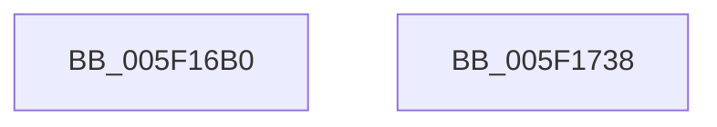

# RtlpLogHeapCreateEvent

- RVA: `0x005F16B0`–`0x005F1739` (길이 `137` bytes)
- VA: `0x00000001405F16B0`
- 실행 섹션: `.text`
- PDB 이름 있음: `예`; PDB Function 태그: `아니요`
- unwind 정보 RVA: `0x000A40A0`
- 디코드: `30`개 명령, `137/137` bytes 표시
- 미해석 바이트: `0` (있으면 어셈블리에 `.byte`로 보존)

> 이 문서는 커널 이미지의 기계어와 PDB 기호를 분석해 생성했습니다. 4번과 5번은 함수 원형과 자료형을 바이너리 사용 방식에서 추정한 C 해석이며 원본 소스 복구 결과는 아닙니다.

## 1. Dependencies

- 직접 호출 지점: **2**; 고유 호출 대상: **2**
- 직접 호출자로 확인된 함수: **1**
- RIP 상대 이미지 참조: **1**

### Outgoing calls
- `0x005F1721` → [EtwTraceKernelEvent](../23/EtwTraceKernelEvent_function_00235350.md) (function, `0x00235350`)
- `0x005F172E` → [_security_check_cookie](../6A/_security_check_cookie_function_006AC640.md) (function, `0x006AC640`)

### Direct callers
- [RtlpHpHeapCreate](../60/RtlpHpHeapCreate_function_00602FDC.md) at `0x00603379`

### Static image references
- `0x005F16B7` → RVA `0x00E0A740` (`.data`; read)

## 2. Other-region calls and transfers

- 다른 실행 섹션으로 향하는 call: **0**
- 별도 외부 분기/꼬리 이동을 확인하지 못했습니다.

## 3. Assembly (complete function range)

```asm
005F16B0  4C 8B DC                        mov r11, rsp
005F16B3  48 83 EC 78                     sub rsp, 0x78
005F16B7  48 8B 05 82 90 81 00            mov rax, qword ptr [rip + 0x819082]
005F16BE  48 33 C4                        xor rax, rsp
005F16C1  48 89 44 24 68                  mov qword ptr [rsp + 0x68], rax
005F16C6  48 8B 81 40 02 00 00            mov rax, qword ptr [rcx + 0x240]
005F16CD  49 89 4B B8                     mov qword ptr [r11 - 0x48], rcx
005F16D1  89 54 24 38                     mov dword ptr [rsp + 0x38], edx
005F16D5  48 8B 91 C0 00 00 00            mov rdx, qword ptr [rcx + 0xc0]
005F16DC  49 8D 4B E0                     lea rcx, [r11 - 0x20]
005F16E0  48 C1 E2 04                     shl rdx, 4
005F16E4  48 2B C2                        sub rax, rdx
005F16E7  4D 89 43 C4                     mov qword ptr [r11 - 0x3c], r8
005F16EB  49 89 43 D4                     mov qword ptr [r11 - 0x2c], rax
005F16EF  BA 01 00 00 00                  mov edx, 1
005F16F4  49 8D 43 B8                     lea rax, [r11 - 0x48]
005F16F8  4D 89 4B CC                     mov qword ptr [r11 - 0x34], r9
005F16FC  49 89 43 E0                     mov qword ptr [r11 - 0x20], rax
005F1700  41 B9 20 10 00 00               mov r9d, 0x1020
005F1706  83 64 24 64 00                  and dword ptr [rsp + 0x64], 0
005F170B  41 B8 20 00 00 40               mov r8d, 0x40000020
005F1711  C7 44 24 60 24 00 00 00         mov dword ptr [rsp + 0x60], 0x24
005F1719  C7 44 24 20 03 19 50 10         mov dword ptr [rsp + 0x20], 0x10501903
005F1721  E8 2A 3C C4 FF                  call 0x140235350
005F1726  48 8B 4C 24 68                  mov rcx, qword ptr [rsp + 0x68]
005F172B  48 33 CC                        xor rcx, rsp
005F172E  E8 0D AF 0B 00                  call 0x1406ac640
005F1733  48 83 C4 78                     add rsp, 0x78
005F1737  C3                              ret
005F1738  CC                              int3
```

## 4. C-style interpretation (structured pseudocode)

```c
__int64 __fastcall RtlpLogHeapCreateEvent(__int64 a1, int a2, __int64 a3, __int64 a4)
{
    __int64 result;
    __int64 v_rsp;
    unsigned __int64 v_stack_m10;
    unsigned int v_stack_m14;
    unsigned int v_stack_m18;
    unsigned int v_stack_m40;
    unsigned int v_stack_m58;

    v_rsp = (v_rsp) - (120);
    result = (*(unsigned __int64 *)(v_rip + 8491138)) ^ (v_rsp);
    v_stack_m10 = result;
    *(unsigned __int64 *)(v_rsp - 72) = a1;
    v_stack_m40 = a2;
    a2 = (*(unsigned __int64 *)(a1 + 192)) << (4);
    result = (*(unsigned __int64 *)(a1 + 576)) - (a2);
    *(unsigned __int64 *)(v_rsp - 60) = a3;
    *(unsigned __int64 *)(v_rsp - 44) = result;
    *(unsigned __int64 *)(v_rsp - 52) = a4;
    *(unsigned __int64 *)(v_rsp - 32) = v_rsp - 72;
    v_stack_m18 = 36;
    v_stack_m58 = 0x10501903ULL;
    result = EtwTraceKernelEvent(v_rsp - 32, 1, (unsigned int)(0x40000020ULL), (unsigned int)(0x1020ULL));
    a1 = (v_stack_m10) ^ (v_rsp);
    result = _security_check_cookie(a1, 1, (unsigned int)(0x40000020ULL), (unsigned int)(0x1020ULL));
    v_rsp = (v_rsp) + (120);
    return result;
}
```

## 5. (Beta) C Style

```c
int64_t RtlpLogHeapCreateEvent(void *Arg1, int32_t Arg2, int64_t Arg3, int64_t Arg4)
{
    uint8_t *arg1 = (uint8_t *)Arg1;

    int64_t result;
    int64_t local_rsp;
    uint64_t v_stack_m10;
    uint32_t v_stack_m14;
    uint32_t v_stack_m18;
    uint32_t v_stack_m40;
    uint32_t v_stack_m58;

    local_rsp = (local_rsp) - (120);
    result = (*(uint64_t *)(v_rip + 0x819082)) ^ (local_rsp);
    v_stack_m10 = result;
    *(void **)(local_rsp - 0x48) = Arg1;
    v_stack_m40 = Arg2;
    Arg2 = (*(uint64_t *)(arg1 + 0xC0)) << (4);
    result = (*(uint64_t *)(arg1 + 0x240)) - (Arg2);
    *(uint64_t *)(local_rsp - 0x3C) = Arg3;
    *(uint64_t *)(local_rsp - 0x2C) = result;
    *(uint64_t *)(local_rsp - 0x34) = Arg4;
    *(uint64_t *)(local_rsp - 0x20) = local_rsp - 72;
    v_stack_m18 = 36;
    v_stack_m58 = 0x10501903ULL;
    result = EtwTraceKernelEvent(local_rsp - 32, 1, (uint32_t)(0x40000020ULL), (uint32_t)(0x1020ULL));
    Arg1 = (v_stack_m10) ^ (local_rsp);
    result = _security_check_cookie(Arg1, 1, (uint32_t)(0x40000020ULL), (uint32_t)(0x1020ULL));
    local_rsp = (local_rsp) + (120);
    return result;
}
```

### 관측된 메모리 오프셋

구조체 형식이 확인되지 않은 접근은 인자 기준의 오프셋으로만 기록했습니다.

| 기준 인자 | 오프셋 표현 | 폭 (bit) | 접근 |
|---|---:|---:|---|
| `Arg1` | `+ 0xC0` | `64` | `R` |
| `Arg1` | `+ 0x240` | `64` | `R` |

## 6. Execution-region graph

[열기: 2D/3D 그래프와 함수 탐색 컨트롤 패널](../../../control-panel.html?section=text&rva=0x005F16B0&view=graph)

- 2D 그래프는 위에서 아래로 흐르고, 3D 그래프는 빈 공간을 드래그해 회전합니다. Shift+드래그는 이동, 휠은 확대·축소, 함수 노드 선택은 대상 보고서 이동입니다.

### Static fallback


