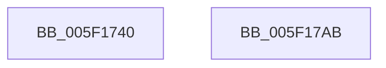

# RtlpLogHeapFreeEvent

- RVA: `0x005F1740`–`0x005F17AC` (길이 `108` bytes)
- VA: `0x00000001405F1740`
- 실행 섹션: `.text`
- PDB 이름 있음: `예`; PDB Function 태그: `아니요`
- unwind 정보 RVA: `0x000BE484`
- 디코드: `24`개 명령, `108/108` bytes 표시
- 미해석 바이트: `0` (있으면 어셈블리에 `.byte`로 보존)

> 이 문서는 커널 이미지의 기계어와 PDB 기호를 분석해 생성했습니다. 4번과 5번은 함수 원형과 자료형을 바이너리 사용 방식에서 추정한 C 해석이며 원본 소스 복구 결과는 아닙니다.

## 1. Dependencies

- 직접 호출 지점: **2**; 고유 호출 대상: **2**
- 직접 호출자로 확인된 함수: **1**
- RIP 상대 이미지 참조: **1**

### Outgoing calls
- `0x005F1794` → [EtwTraceKernelEvent](../23/EtwTraceKernelEvent_function_00235350.md) (function, `0x00235350`)
- `0x005F17A1` → [_security_check_cookie](../6A/_security_check_cookie_function_006AC640.md) (function, `0x006AC640`)

### Direct callers
- [RtlpHpMetadataFree](../2E/RtlpHpMetadataFree_function_002ECA64.md) at `0x002ECBAD`

### Static image references
- `0x005F1747` → RVA `0x00E0A740` (`.data`; read)

## 2. Other-region calls and transfers

- 다른 실행 섹션으로 향하는 call: **0**
- 별도 외부 분기/꼬리 이동을 확인하지 못했습니다.

## 3. Assembly (complete function range)

```asm
005F1740  4C 8B DC                        mov r11, rsp
005F1743  48 83 EC 68                     sub rsp, 0x68
005F1747  48 8B 05 F2 8F 81 00            mov rax, qword ptr [rip + 0x818ff2]
005F174E  48 33 C4                        xor rax, rsp
005F1751  48 89 44 24 58                  mov qword ptr [rsp + 0x58], rax
005F1756  49 8D 43 C8                     lea rax, [r11 - 0x38]
005F175A  49 89 4B C8                     mov qword ptr [r11 - 0x38], rcx
005F175E  49 89 43 E0                     mov qword ptr [r11 - 0x20], rax
005F1762  49 8D 4B E0                     lea rcx, [r11 - 0x20]
005F1766  83 64 24 54 00                  and dword ptr [rsp + 0x54], 0
005F176B  41 B9 24 10 00 00               mov r9d, 0x1024
005F1771  49 89 53 D0                     mov qword ptr [r11 - 0x30], rdx
005F1775  BA 01 00 00 00                  mov edx, 1
005F177A  45 89 43 D8                     mov dword ptr [r11 - 0x28], r8d
005F177E  41 B8 20 00 00 40               mov r8d, 0x40000020
005F1784  C7 44 24 50 14 00 00 00         mov dword ptr [rsp + 0x50], 0x14
005F178C  C7 44 24 20 02 19 50 10         mov dword ptr [rsp + 0x20], 0x10501902
005F1794  E8 B7 3B C4 FF                  call 0x140235350
005F1799  48 8B 4C 24 58                  mov rcx, qword ptr [rsp + 0x58]
005F179E  48 33 CC                        xor rcx, rsp
005F17A1  E8 9A AE 0B 00                  call 0x1406ac640
005F17A6  48 83 C4 68                     add rsp, 0x68
005F17AA  C3                              ret
005F17AB  CC                              int3
```

## 4. C-style interpretation (structured pseudocode)

```c
__int64 __fastcall RtlpLogHeapFreeEvent(__int64 a1, __int64 a2, int a3)
{
    __int64 result;
    __int64 v_rsp;
    unsigned __int64 v_stack_m10;
    unsigned int v_stack_m14;
    unsigned int v_stack_m18;
    unsigned int v_stack_m48;

    v_rsp = (v_rsp) - (104);
    result = (*(unsigned __int64 *)(v_rip + 8490994)) ^ (v_rsp);
    v_stack_m10 = result;
    *(unsigned __int64 *)(v_rsp - 56) = a1;
    *(unsigned __int64 *)(v_rsp - 32) = v_rsp - 56;
    *(unsigned __int64 *)(v_rsp - 48) = a2;
    *(unsigned int *)(v_rsp - 40) = a3;
    v_stack_m18 = 20;
    v_stack_m48 = 0x10501902ULL;
    result = EtwTraceKernelEvent(v_rsp - 32, 1, (unsigned int)(0x40000020ULL), (unsigned int)(0x1024ULL));
    a1 = (v_stack_m10) ^ (v_rsp);
    result = _security_check_cookie(a1, 1, (unsigned int)(0x40000020ULL), (unsigned int)(0x1024ULL));
    v_rsp = (v_rsp) + (104);
    return result;
}
```

## 5. (Beta) C Style

```c
int64_t RtlpLogHeapFreeEvent(int64_t Arg1, int64_t Arg2, int32_t Arg3)
{
    int64_t result;
    int64_t local_rsp;
    uint64_t v_stack_m10;
    uint32_t v_stack_m14;
    uint32_t v_stack_m18;
    uint32_t v_stack_m48;

    local_rsp = (local_rsp) - (104);
    result = (*(uint64_t *)(v_rip + 0x818FF2)) ^ (local_rsp);
    v_stack_m10 = result;
    *(uint64_t *)(local_rsp - 0x38) = Arg1;
    *(uint64_t *)(local_rsp - 0x20) = local_rsp - 56;
    *(uint64_t *)(local_rsp - 0x30) = Arg2;
    *(uint32_t *)(local_rsp - 0x28) = Arg3;
    v_stack_m18 = 20;
    v_stack_m48 = 0x10501902ULL;
    result = EtwTraceKernelEvent(local_rsp - 32, 1, (uint32_t)(0x40000020ULL), (uint32_t)(0x1024ULL));
    Arg1 = (v_stack_m10) ^ (local_rsp);
    result = _security_check_cookie(Arg1, 1, (uint32_t)(0x40000020ULL), (uint32_t)(0x1024ULL));
    local_rsp = (local_rsp) + (104);
    return result;
}
```

## 6. Execution-region graph

[열기: 2D/3D 그래프와 함수 탐색 컨트롤 패널](../../../control-panel.html?section=text&rva=0x005F1740&view=graph)

- 2D 그래프는 위에서 아래로 흐르고, 3D 그래프는 빈 공간을 드래그해 회전합니다. Shift+드래그는 이동, 휠은 확대·축소, 함수 노드 선택은 대상 보고서 이동입니다.

### Static fallback


