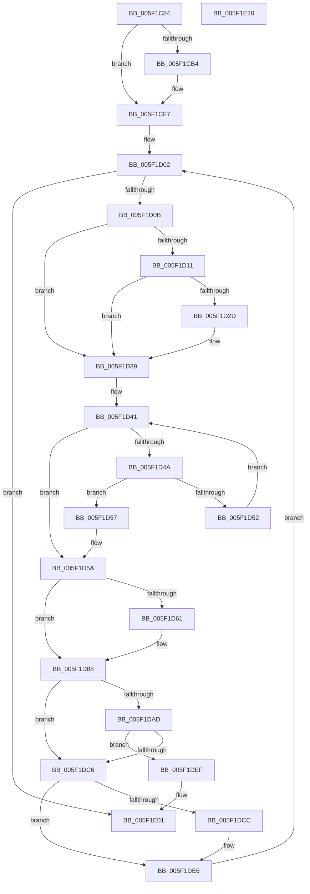

# RtlpPopulateListIndex

- RVA: `0x005F1C84`–`0x005F1E21` (길이 `413` bytes)
- VA: `0x00000001405F1C84`
- 실행 섹션: `.text`
- PDB 이름 있음: `예`; PDB Function 태그: `아니요`
- unwind 정보 RVA: `0x000ACFA4`
- 디코드: `114`개 명령, `413/413` bytes 표시
- 미해석 바이트: `0` (있으면 어셈블리에 `.byte`로 보존)

> 이 문서는 커널 이미지의 기계어와 PDB 기호를 분석해 생성했습니다. 4번과 5번은 함수 원형과 자료형을 바이너리 사용 방식에서 추정한 C 해석이며 원본 소스 복구 결과는 아닙니다.

## 1. Dependencies

- 직접 호출 지점: **5**; 고유 호출 대상: **5**
- 직접 호출자로 확인된 함수: **1**
- RIP 상대 이미지 참조: **2**

### Outgoing calls
- `0x005F1D34` → [RtlpAnalyzeHeapFailure](RtlpAnalyzeHeapFailure_function_005F0F9C.md) (function, `0x005F0F9C`)
- `0x005F1D83` → [RtlpHeapRemoveListEntry](RtlpHeapRemoveListEntry_function_005F1B90.md) (function, `0x005F1B90`)
- `0x005F1D9F` → [RtlpHeapAddListEntry](RtlpHeapAddListEntry_function_005F18C8.md) (function, `0x005F18C8`)
- `0x005F1DF6` → [DbgPrint](../35/DbgPrint_function_00358CB0.md) (function, `0x00358CB0`)
- `0x005F1DFB` → [RtlpHeapHandleError](RtlpHeapHandleError_function_005F12AC.md) (function, `0x005F12AC`)

### Direct callers
- [RtlpCreateHeap](../4E/RtlpCreateHeap_function_004E1904.md) at `0x004E233E`

### Static image references
- `0x005F1DA4` → RVA `0x00E67B60` (`.data`; read)
- `0x005F1DEF` → RVA `0x006CD390` (` ?? ::FNODOBFM::`string'`; read)

## 2. Other-region calls and transfers

- 다른 실행 섹션으로 향하는 call: **0**
- 별도 외부 분기/꼬리 이동을 확인하지 못했습니다.

## 3. Assembly (complete function range)

```asm
005F1C84  48 8B C4                        mov rax, rsp
005F1C87  48 89 58 08                     mov qword ptr [rax + 8], rbx
005F1C8B  48 89 68 10                     mov qword ptr [rax + 0x10], rbp
005F1C8F  48 89 70 18                     mov qword ptr [rax + 0x18], rsi
005F1C93  48 89 78 20                     mov qword ptr [rax + 0x20], rdi
005F1C97  41 55                           push r13
005F1C99  41 56                           push r14
005F1C9B  41 57                           push r15
005F1C9D  48 83 EC 30                     sub rsp, 0x30
005F1CA1  48 89 91 38 01 00 00            mov qword ptr [rcx + 0x138], rdx
005F1CA8  48 8B EA                        mov rbp, rdx
005F1CAB  48 83 3A 00                     cmp qword ptr [rdx], 0
005F1CAF  48 8B F9                        mov rdi, rcx
005F1CB2  74 43                           je 0x1405f1cf7
005F1CB4  44 8B 42 08                     mov r8d, dword ptr [rdx + 8]
005F1CB8  44 2B 42 18                     sub r8d, dword ptr [rdx + 0x18]
005F1CBC  48 8B 42 30                     mov rax, qword ptr [rdx + 0x30]
005F1CC0  41 FF C8                        dec r8d
005F1CC3  83 7A 0C 00                     cmp dword ptr [rdx + 0xc], 0
005F1CC7  43 8D 0C 00                     lea ecx, [r8 + r8]
005F1CCB  41 0F 44 C8                     cmove ecx, r8d
005F1CCF  48 83 24 C8 00                  and qword ptr [rax + rcx*8], 0
005F1CD4  B8 01 00 00 00                  mov eax, 1
005F1CD9  8B 4A 08                        mov ecx, dword ptr [rdx + 8]
005F1CDC  2B 4A 18                        sub ecx, dword ptr [rdx + 0x18]
005F1CDF  48 8B 52 28                     mov rdx, qword ptr [rdx + 0x28]
005F1CE3  FF C9                           dec ecx
005F1CE5  44 8B C1                        mov r8d, ecx
005F1CE8  83 E1 1F                        and ecx, 0x1f
005F1CEB  D3 E0                           shl eax, cl
005F1CED  49 C1 E8 05                     shr r8, 5
005F1CF1  F7 D0                           not eax
005F1CF3  42 21 04 82                     and dword ptr [rdx + r8*4], eax
005F1CF7  4C 8D AF 50 01 00 00            lea r13, [rdi + 0x150]
005F1CFE  4D 8B 75 08                     mov r14, qword ptr [r13 + 8]
005F1D02  4D 3B EE                        cmp r13, r14
005F1D05  0F 84 F6 00 00 00               je 0x1405f1e01
005F1D0B  83 7F 7C 00                     cmp dword ptr [rdi + 0x7c], 0
005F1D0F  74 28                           je 0x1405f1d39
005F1D11  8B 8F 88 00 00 00               mov ecx, dword ptr [rdi + 0x88]
005F1D17  41 31 4E F8                     xor dword ptr [r14 - 8], ecx
005F1D1B  41 8A 4E FA                     mov cl, byte ptr [r14 - 6]
005F1D1F  41 32 4E F9                     xor cl, byte ptr [r14 - 7]
005F1D23  41 32 4E F8                     xor cl, byte ptr [r14 - 8]
005F1D27  41 38 4E FB                     cmp byte ptr [r14 - 5], cl
005F1D2B  74 0C                           je 0x1405f1d39
005F1D2D  49 8D 56 F0                     lea rdx, [r14 - 0x10]
005F1D31  48 8B CF                        mov rcx, rdi
005F1D34  E8 63 F2 FF FF                  call 0x1405f0f9c
005F1D39  41 0F B7 76 F8                  movzx esi, word ptr [r14 - 8]
005F1D3E  4C 8B FD                        mov r15, rbp
005F1D41  41 8B 4F 08                     mov ecx, dword ptr [r15 + 8]
005F1D45  48 3B F1                        cmp rsi, rcx
005F1D48  72 10                           jb 0x1405f1d5a
005F1D4A  49 8B 07                        mov rax, qword ptr [r15]
005F1D4D  48 85 C0                        test rax, rax
005F1D50  74 05                           je 0x1405f1d57
005F1D52  4C 8B F8                        mov r15, rax
005F1D55  EB EA                           jmp 0x1405f1d41
005F1D57  8D 71 FF                        lea esi, [rcx - 1]
005F1D5A  48 83 7D 00 00                  cmp qword ptr [rbp], 0
005F1D5F  74 27                           je 0x1405f1d88
005F1D61  41 0F B7 56 F8                  movzx edx, word ptr [r14 - 8]
005F1D66  4D 8B CE                        mov r9, r14
005F1D69  8B 4D 08                        mov ecx, dword ptr [rbp + 8]
005F1D6C  3B D1                           cmp edx, ecx
005F1D6E  48 89 54 24 28                  mov qword ptr [rsp + 0x28], rdx
005F1D73  8D 41 FF                        lea eax, [rcx - 1]
005F1D76  48 8B CF                        mov rcx, rdi
005F1D79  0F 42 C2                        cmovb eax, edx
005F1D7C  48 8B D5                        mov rdx, rbp
005F1D7F  89 44 24 20                     mov dword ptr [rsp + 0x20], eax
005F1D83  E8 08 FE FF FF                  call 0x1405f1b90
005F1D88  41 0F B7 46 F8                  movzx eax, word ptr [r14 - 8]
005F1D8D  4D 8B CE                        mov r9, r14
005F1D90  48 89 44 24 28                  mov qword ptr [rsp + 0x28], rax
005F1D95  49 8B D7                        mov rdx, r15
005F1D98  48 8B CF                        mov rcx, rdi
005F1D9B  89 74 24 20                     mov dword ptr [rsp + 0x20], esi
005F1D9F  E8 24 FB FF FF                  call 0x1405f18c8
005F1DA4  83 3D B5 5D 87 00 01            cmp dword ptr [rip + 0x875db5], 1
005F1DAB  7C 19                           jl 0x1405f1dc6
005F1DAD  41 2B 77 18                     sub esi, dword ptr [r15 + 0x18]
005F1DB1  49 8B 47 28                     mov rax, qword ptr [r15 + 0x28]
005F1DB5  8B D6                           mov edx, esi
005F1DB7  83 E6 1F                        and esi, 0x1f
005F1DBA  48 C1 EA 05                     shr rdx, 5
005F1DBE  8B 04 90                        mov eax, dword ptr [rax + rdx*4]
005F1DC1  0F A3 F0                        bt eax, esi
005F1DC4  73 29                           jae 0x1405f1def
005F1DC6  83 7F 7C 00                     cmp dword ptr [rdi + 0x7c], 0
005F1DCA  74 1A                           je 0x1405f1de6
005F1DCC  41 8A 4E FA                     mov cl, byte ptr [r14 - 6]
005F1DD0  41 32 4E F9                     xor cl, byte ptr [r14 - 7]
005F1DD4  41 32 4E F8                     xor cl, byte ptr [r14 - 8]
005F1DD8  41 88 4E FB                     mov byte ptr [r14 - 5], cl
005F1DDC  8B 8F 88 00 00 00               mov ecx, dword ptr [rdi + 0x88]
005F1DE2  41 31 4E F8                     xor dword ptr [r14 - 8], ecx
005F1DE6  4D 8B 76 08                     mov r14, qword ptr [r14 + 8]
005F1DEA  E9 13 FF FF FF                  jmp 0x1405f1d02
005F1DEF  48 8D 0D 9A B5 0D 00            lea rcx, [rip + 0xdb59a]
005F1DF6  E8 B5 6E D6 FF                  call 0x140358cb0
005F1DFB  E8 AC F4 FF FF                  call 0x1405f12ac
005F1E00  CC                              int3
005F1E01  48 8B 5C 24 50                  mov rbx, qword ptr [rsp + 0x50]
005F1E06  48 8B 6C 24 58                  mov rbp, qword ptr [rsp + 0x58]
005F1E0B  48 8B 74 24 60                  mov rsi, qword ptr [rsp + 0x60]
005F1E10  48 8B 7C 24 68                  mov rdi, qword ptr [rsp + 0x68]
005F1E15  48 83 C4 30                     add rsp, 0x30
005F1E19  41 5F                           pop r15
005F1E1B  41 5E                           pop r14
005F1E1D  41 5D                           pop r13
005F1E1F  C3                              ret
005F1E20  CC                              int3
```

## 4. C-style interpretation (structured pseudocode)

```c
__int64 __fastcall RtlpPopulateListIndex(__int64 a1, __int64 a2)
{
    __int64 result;
    __int64 v_rsi;
    __int64 v_rsp;
    unsigned __int64 v_stack_m20;
    unsigned int v_stack_m28;
    unsigned __int64 v_stack_p10;
    unsigned __int64 v_stack_p18;
    unsigned __int64 v_stack_p20;
    unsigned __int64 v_stack_p8;

    *(unsigned __int64 *)(v_rsp + 8) = v_rbx;
    *(unsigned __int64 *)(v_rsp + 16) = v_rbp;
    *(unsigned __int64 *)(v_rsp + 24) = v_rsi;
    *(unsigned __int64 *)(v_rsp + 32) = v_rdi;
    v_rsp = (v_rsp) - (48);
    *(unsigned __int64 *)(a1 + 312) = a2;
    result = v_rsp;
    if ((*(unsigned __int64 *)(a2)) != 0) {
        a3 = *(unsigned int *)(a2 + 8);
        a3 = (unsigned int)((a3) - (*(unsigned int *)(a2 + 24)));
        result = *(unsigned __int64 *)(a2 + 48);
        a3 = (unsigned int)((a3) - 1);
        a1 = a3 + a3 * 1;
        if ((*(unsigned int *)(a2 + 12)) == 0) { a1 = (unsigned int)(a3); }
        result = 1;
        a1 = *(unsigned int *)(a2 + 8);
        a1 = (unsigned int)((a1) - (*(unsigned int *)(a2 + 24)));
        a2 = *(unsigned __int64 *)(a2 + 40);
        a1 = (unsigned int)((a1) - 1);
        a3 = (unsigned int)(a1);
        a1 = (unsigned int)((a1) & (31));
        result = (unsigned int)((result) << ((unsigned __int8)(a1)));
        a3 = (a3) >> (5);
        result = (unsigned int)(~(result));
    }
loc_005F1D02:
    if ((a1 + 336) == (*(unsigned __int64 *)(a1 + 336 + 8))) goto loc_005F1E01;
    if ((*(unsigned int *)(a1 + 124)) == 0) goto loc_005F1D39;
    a1 = (unsigned __int8)((*(unsigned __int8 *)(*(unsigned __int64 *)(a1 + 336 + 8) - 6)) ^ (*(unsigned __int8 *)(*(unsigned __int64 *)(a1 + 336 + 8) - 7)));
    a1 = (unsigned __int8)((a1) ^ (*(unsigned __int8 *)(*(unsigned __int64 *)(a1 + 336 + 8) - 8)));
    if ((*(unsigned __int8 *)(*(unsigned __int64 *)(a1 + 336 + 8) - 5)) != ((unsigned __int8)(a1))) {
        a2 = *(unsigned __int64 *)(a1 + 336 + 8) - 16;
        a1 = a1;
        result = RtlpAnalyzeHeapFailure(a1, a2, a3, a4);
    }
loc_005F1D41:
    if ((*(unsigned __int16 *)(*(unsigned __int64 *)(a1 + 336 + 8) - 8)) < ((unsigned int)(*(unsigned int *)(a2 + 8)))) goto loc_005F1D5A;
    if (*(unsigned __int64 *)(a2) == 0) goto loc_005F1D57;
    goto loc_005F1D41;
loc_005F1D57:
loc_005F1D5A:
    result = *(unsigned __int64 *)(a2);
    if ((*(unsigned __int64 *)(a2)) != 0) {
        a2 = *(unsigned __int16 *)(*(unsigned __int64 *)(a1 + 336 + 8) - 8);
        a4 = *(unsigned __int64 *)(a1 + 336 + 8);
        a1 = *(unsigned int *)(a2 + 8);
        v_stack_m20 = a2;
        result = a1 - 1;
        a1 = a1;
        if (((unsigned int)(a2)) < ((unsigned int)(a1))) { result = (unsigned int)(a2); }
        a2 = a2;
        v_stack_m28 = (unsigned int)(result);
        result = RtlpHeapRemoveListEntry(a1, a2, a3, a4);
    }
    v_stack_m20 = *(unsigned __int16 *)(*(unsigned __int64 *)(a1 + 336 + 8) - 8);
    v_stack_m28 = (unsigned int)((unsigned int)(*(unsigned int *)(a2 + 8)) - 1);
    result = RtlpHeapAddListEntry(a1, *(unsigned __int64 *)(a2), a3, *(unsigned __int64 *)(a1 + 336 + 8));
    if ((*(unsigned int *)(v_rip + 8871349)) < 1) goto loc_005F1DC6;
    v_rsi = (unsigned int)(((unsigned int)(*(unsigned int *)(a2 + 8)) - 1) - (*(unsigned int *)(*(unsigned __int64 *)(a2) + 24)));
    v_rsi = (unsigned int)((v_rsi) & (31));
    a2 = ((unsigned int)((unsigned int)(v_rsi))) >> (5);
    if (condition_is_above_or_equal) goto loc_005F1DEF;
loc_005F1DC6:
    if ((*(unsigned int *)(a1 + 124)) != 0) {
        a1 = *(unsigned __int8 *)(*(unsigned __int64 *)(a1 + 336 + 8) - 6);
        a1 = (unsigned __int8)((a1) ^ (*(unsigned __int8 *)(*(unsigned __int64 *)(a1 + 336 + 8) - 7)));
        a1 = (unsigned __int8)((a1) ^ (*(unsigned __int8 *)(*(unsigned __int64 *)(a1 + 336 + 8) - 8)));
        *(unsigned __int8 *)(*(unsigned __int64 *)(a1 + 336 + 8) - 5) = (unsigned __int8)(a1);
        a1 = *(unsigned int *)(a1 + 136);
    }
    goto loc_005F1D02;
loc_005F1DEF:
    result = DbgPrint(v_rip + 898458, a2, a3, *(unsigned __int64 *)(a1 + 336 + 8));
    result = RtlpHeapHandleError(v_rip + 898458, a2, a3, *(unsigned __int64 *)(a1 + 336 + 8));
loc_005F1E01:
    v_rsp = (v_rsp) + (48);
    return result;
}
```

## 5. (Beta) C Style

```c
int64_t RtlpPopulateListIndex(void *Arg1, void *Arg2)
{
    uint8_t *arg1 = (uint8_t *)Arg1;
    uint8_t *arg2 = (uint8_t *)Arg2;

    int64_t result;
    int64_t local_rsi;
    int64_t local_rsp;
    uint64_t v_stack_m20;
    uint32_t v_stack_m28;
    uint64_t v_stack_p10;
    uint64_t v_stack_p18;
    uint64_t v_stack_p20;
    uint64_t v_stack_p8;

    *(uint64_t *)(local_rsp + 0x8) = local_rbx;
    *(uint64_t *)(local_rsp + 0x10) = local_rbp;
    *(uint64_t *)(local_rsp + 0x18) = local_rsi;
    *(uint64_t *)(local_rsp + 0x20) = local_rdi;
    local_rsp = (local_rsp) - (48);
    *(void **)(arg1 + 0x138) = Arg2;
    result = local_rsp;
    if ((*(uint64_t *)(arg2)) != 0) {
        a3 = *(uint32_t *)(arg2 + 0x8);
        a3 = (uint32_t)((a3) - (*(uint32_t *)(arg2 + 0x18)));
        result = *(uint64_t *)(arg2 + 0x30);
        a3 = (uint32_t)((a3) - 1);
        Arg1 = a3 + a3 * 1;
        if ((*(uint32_t *)(arg2 + 0xC)) == 0) { Arg1 = (uint32_t)(a3); }
        result = 1;
        Arg1 = *(uint32_t *)(arg2 + 0x8);
        Arg1 = (uint32_t)((Arg1) - (*(uint32_t *)(arg2 + 0x18)));
        Arg2 = *(uint64_t *)(arg2 + 0x28);
        Arg1 = (uint32_t)((Arg1) - 1);
        a3 = (uint32_t)(Arg1);
        Arg1 = (uint32_t)((Arg1) & (31));
        result = (uint32_t)((result) << ((uint8_t)(Arg1)));
        a3 = (a3) >> (5);
        result = (uint32_t)(~(result));
    }
loc_005F1D02:
    if ((Arg1 + 336) == (*(uint64_t *)(arg1 + 0x150 + 0x8))) goto loc_005F1E01;
    if ((*(uint32_t *)(arg1 + 0x7C)) == 0) goto loc_005F1D39;
    Arg1 = (uint8_t)((*(uint8_t *)(*(uint64_t *)(arg1 + 0x150 + 0x8) - 0x6)) ^ (*(uint8_t *)(*(uint64_t *)(arg1 + 0x150 + 0x8) - 0x7)));
    Arg1 = (uint8_t)((Arg1) ^ (*(uint8_t *)(*(uint64_t *)(arg1 + 0x150 + 0x8) - 0x8)));
    if ((*(uint8_t *)(*(uint64_t *)(arg1 + 0x150 + 0x8) - 0x5)) != ((uint8_t)(Arg1))) {
        Arg2 = *(uint64_t *)(arg1 + 0x150 + 0x8) - 16;
        Arg1 = Arg1;
        result = RtlpAnalyzeHeapFailure(Arg1, Arg2, a3, a4);
    }
loc_005F1D41:
    if ((*(uint16_t *)(*(uint64_t *)(arg1 + 0x150 + 0x8) - 0x8)) < ((uint32_t)(*(uint32_t *)(arg2 + 0x8)))) goto loc_005F1D5A;
    if (*(uint64_t *)(arg2) == 0) goto loc_005F1D57;
    goto loc_005F1D41;
loc_005F1D57:
loc_005F1D5A:
    result = *(uint64_t *)(arg2);
    if ((*(uint64_t *)(arg2)) != 0) {
        Arg2 = *(uint16_t *)(*(uint64_t *)(arg1 + 0x150 + 0x8) - 0x8);
        a4 = *(uint64_t *)(arg1 + 0x150 + 0x8);
        Arg1 = *(uint32_t *)(arg2 + 0x8);
        v_stack_m20 = Arg2;
        result = Arg1 - 1;
        Arg1 = Arg1;
        if (((uint32_t)(Arg2)) < ((uint32_t)(Arg1))) { result = (uint32_t)(Arg2); }
        Arg2 = Arg2;
        v_stack_m28 = (uint32_t)(result);
        result = RtlpHeapRemoveListEntry(Arg1, Arg2, a3, a4);
    }
    v_stack_m20 = *(uint16_t *)(*(uint64_t *)(arg1 + 0x150 + 0x8) - 0x8);
    v_stack_m28 = (uint32_t)((uint32_t)(*(uint32_t *)(arg2 + 0x8)) - 1);
    result = RtlpHeapAddListEntry(Arg1, *(uint64_t *)(arg2), a3, *(uint64_t *)(arg1 + 0x150 + 0x8));
    if ((*(uint32_t *)(v_rip + 0x875DB5)) < 1) goto loc_005F1DC6;
    local_rsi = (uint32_t)(((uint32_t)(*(uint32_t *)(arg2 + 0x8)) - 1) - (*(uint32_t *)(*(uint64_t *)(arg2) + 0x18)));
    local_rsi = (uint32_t)((local_rsi) & (31));
    Arg2 = ((uint32_t)((uint32_t)(local_rsi))) >> (5);
    if (condition_is_above_or_equal) goto loc_005F1DEF;
loc_005F1DC6:
    if ((*(uint32_t *)(arg1 + 0x7C)) != 0) {
        Arg1 = *(uint8_t *)(*(uint64_t *)(arg1 + 0x150 + 0x8) - 0x6);
        Arg1 = (uint8_t)((Arg1) ^ (*(uint8_t *)(*(uint64_t *)(arg1 + 0x150 + 0x8) - 0x7)));
        Arg1 = (uint8_t)((Arg1) ^ (*(uint8_t *)(*(uint64_t *)(arg1 + 0x150 + 0x8) - 0x8)));
        *(uint8_t *)(*(uint64_t *)(arg1 + 0x150 + 0x8) - 0x5) = (uint8_t)(Arg1);
        Arg1 = *(uint32_t *)(arg1 + 0x88);
    }
    goto loc_005F1D02;
loc_005F1DEF:
    result = DbgPrint(v_rip + 898458, Arg2, a3, *(uint64_t *)(arg1 + 0x150 + 0x8));
    result = RtlpHeapHandleError(v_rip + 898458, Arg2, a3, *(uint64_t *)(arg1 + 0x150 + 0x8));
loc_005F1E01:
    local_rsp = (local_rsp) + (48);
    return result;
}
```

### 관측된 메모리 오프셋

구조체 형식이 확인되지 않은 접근은 인자 기준의 오프셋으로만 기록했습니다.

| 기준 인자 | 오프셋 표현 | 폭 (bit) | 접근 |
|---|---:|---:|---|
| `Arg1` | `+ 0x8` | `64` | `R` |
| `Arg1` | `+ 0x7C` | `32` | `R` |
| `Arg1` | `+ 0x88` | `32` | `R` |
| `Arg1` | `+ 0x138` | `64` | `W` |
| `Arg1` | `+ 0x150` | `64` | `R` |
| `Arg2` | `+ 0x0` | `64` | `R` |
| `Arg2` | `+ 0x8` | `32` | `R` |
| `Arg2` | `+ 0xC` | `32` | `R` |
| `Arg2` | `+ 0x18` | `32` | `R` |
| `Arg2` | `+ 0x28` | `64` | `R` |
| `Arg2` | `+ 0x30` | `64` | `R` |

## 6. Execution-region graph

[열기: 2D/3D 그래프와 함수 탐색 컨트롤 패널](../../../control-panel.html?section=text&rva=0x005F1C84&view=graph)

- 2D 그래프는 위에서 아래로 흐르고, 3D 그래프는 빈 공간을 드래그해 회전합니다. Shift+드래그는 이동, 휠은 확대·축소, 함수 노드 선택은 대상 보고서 이동입니다.

### Static fallback


