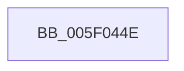

# sub_005F044E

- RVA: `0x005F044E`–`0x005F0477` (길이 `41` bytes)
- VA: `0x00000001405F044E`
- 실행 섹션: `.text`
- PDB 이름 있음: `아니요`; PDB Function 태그: `아니요`
- unwind 정보 RVA: `0x000D0144`
- 디코드: `8`개 명령, `41/41` bytes 표시
- 미해석 바이트: `0` (있으면 어셈블리에 `.byte`로 보존)

> 이 문서는 커널 이미지의 기계어와 PDB 기호를 분석해 생성했습니다. 4번과 5번은 함수 원형과 자료형을 바이너리 사용 방식에서 추정한 C 해석이며 원본 소스 복구 결과는 아닙니다.

## 1. Dependencies

- 직접 호출 지점: **0**; 고유 호출 대상: **0**
- 직접 호출자로 확인된 함수: **0**
- RIP 상대 이미지 참조: **2**

### Outgoing calls
- 직접 디코드된 call 명령이 없습니다.

### Direct callers
- 이 함수 시작 RVA로 연결되는 직접 call은 확인되지 않았습니다. 간접 호출은 완전히 역산할 수 없습니다.

### Static image references
- `0x005F0453` → RVA `0x00013610` (`.rdata`; read)
- `0x005F045F` → RVA `0x00014C0F` (`.rdata`; read)

## 2. Other-region calls and transfers

- 다른 실행 섹션으로 향하는 call: **0**
- call이 아닌 외부 분기/꼬리 이동: **1**
  - `0x005F0471` → [sub_005F051D](Unknown_function_005F051D.md) (`tail-transfer`)

## 3. Assembly (complete function range)

```asm
005F044E  48 89 5C 24 60                  mov qword ptr [rsp + 0x60], rbx
005F0453  48 8D 1D B6 31 A2 FF            lea rbx, [rip - 0x5dce4a]
005F045A  48 89 7C 24 70                  mov qword ptr [rsp + 0x70], rdi
005F045F  48 8D 3D A9 47 A2 FF            lea rdi, [rip - 0x5db857]
005F0466  48 C1 EF 0C                     shr rdi, 0xc
005F046A  48 C1 EB 0C                     shr rbx, 0xc
005F046E  48 3B DF                        cmp rbx, rdi
005F0471  0F 83 A6 00 00 00               jae 0x1405f051d
```

## 4. C-style interpretation (structured pseudocode)

```c
void __fastcall sub_005F044E(void)
{
    __int64 v_rbx;
    __int64 v_rdi;
    unsigned __int64 v_stack_p60;
    unsigned __int64 v_stack_p70;

    v_stack_p60 = v_rbx;
    v_stack_p70 = v_rdi;
    v_rdi = (v_rip - 6142039) >> (12);
    v_rbx = (v_rip - 6147658) >> (12);
}
```

## 5. (Beta) C Style

```c
void sub_005F044E(void)
{
    int64_t local_rbx;
    int64_t local_rdi;
    uint64_t v_stack_p60;
    uint64_t v_stack_p70;

    v_stack_p60 = local_rbx;
    v_stack_p70 = local_rdi;
    local_rdi = (v_rip - 6142039) >> (12);
    local_rbx = (v_rip - 6147658) >> (12);
}
```

## 6. Execution-region graph

[열기: 2D/3D 그래프와 함수 탐색 컨트롤 패널](../../../control-panel.html?section=text&rva=0x005F044E&view=graph)

- 2D 그래프는 위에서 아래로 흐르고, 3D 그래프는 빈 공간을 드래그해 회전합니다. Shift+드래그는 이동, 휠은 확대·축소, 함수 노드 선택은 대상 보고서 이동입니다.

### Static fallback


