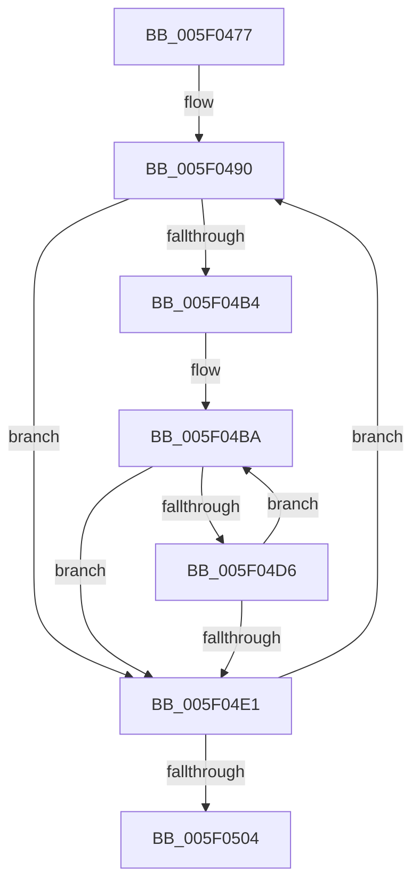

# sub_005F0477

- RVA: `0x005F0477`–`0x005F051D` (길이 `166` bytes)
- VA: `0x00000001405F0477`
- 실행 섹션: `.text`
- PDB 이름 있음: `아니요`; PDB Function 태그: `아니요`
- unwind 정보 RVA: `0x000D015C`
- 디코드: `43`개 명령, `166/166` bytes 표시
- 미해석 바이트: `0` (있으면 어셈블리에 `.byte`로 보존)

> 이 문서는 커널 이미지의 기계어와 PDB 기호를 분석해 생성했습니다. 4번과 5번은 함수 원형과 자료형을 바이너리 사용 방식에서 추정한 C 해석이며 원본 소스 복구 결과는 아닙니다.

## 1. Dependencies

- 직접 호출 지점: **3**; 고유 호출 대상: **2**
- 직접 호출자로 확인된 함수: **0**
- RIP 상대 이미지 참조: **0**

### Outgoing calls
- `0x005F049A` → [MmGetPhysicalAddress](../23/MmGetPhysicalAddress_function_0023A500.md) (function, `0x0023A500`)
- `0x005F04C4` → [MmGetPhysicalAddress](../23/MmGetPhysicalAddress_function_0023A500.md) (function, `0x0023A500`)
- `0x005F04F7` → [PopSetRange](../47/PopSetRange_function_0047C750.md) (function, `0x0047C750`)

### Direct callers
- 이 함수 시작 RVA로 연결되는 직접 call은 확인되지 않았습니다. 간접 호출은 완전히 역산할 수 없습니다.

### Static image references
- 디코드된 RIP-relative 메모리 참조가 없습니다.

## 2. Other-region calls and transfers

- 다른 실행 섹션으로 향하는 call: **0**
- 별도 외부 분기/꼬리 이동을 확인하지 못했습니다.

## 3. Assembly (complete function range)

```asm
005F0477  48 89 6C 24 68                  mov qword ptr [rsp + 0x68], rbp
005F047C  4C 89 64 24 48                  mov qword ptr [rsp + 0x48], r12
005F0481  4C 89 6C 24 40                  mov qword ptr [rsp + 0x40], r13
005F0486  4C 89 74 24 38                  mov qword ptr [rsp + 0x38], r14
005F048B  4C 89 7C 24 30                  mov qword ptr [rsp + 0x30], r15
005F0490  4C 8B EB                        mov r13, rbx
005F0493  49 C1 E5 0C                     shl r13, 0xc
005F0497  49 8B CD                        mov rcx, r13
005F049A  E8 61 A0 C4 FF                  call 0x14023a500
005F049F  4C 8B F8                        mov r15, rax
005F04A2  4C 8D 73 01                     lea r14, [rbx + 1]
005F04A6  49 C1 EF 0C                     shr r15, 0xc
005F04AA  BD 01 00 00 00                  mov ebp, 1
005F04AF  4C 3B F7                        cmp r14, rdi
005F04B2  73 2D                           jae 0x1405f04e1
005F04B4  4D 8B E7                        mov r12, r15
005F04B7  4C 2B E3                        sub r12, rbx
005F04BA  48 8B CD                        mov rcx, rbp
005F04BD  48 C1 E1 0C                     shl rcx, 0xc
005F04C1  49 03 CD                        add rcx, r13
005F04C4  E8 37 A0 C4 FF                  call 0x14023a500
005F04C9  48 C1 E8 0C                     shr rax, 0xc
005F04CD  4B 8D 0C 34                     lea rcx, [r12 + r14]
005F04D1  48 3B C8                        cmp rcx, rax
005F04D4  75 0B                           jne 0x1405f04e1
005F04D6  48 FF C5                        inc rbp
005F04D9  49 FF C6                        inc r14
005F04DC  4C 3B F7                        cmp r14, rdi
005F04DF  72 D9                           jb 0x1405f04ba
005F04E1  4C 8B CD                        mov r9, rbp
005F04E4  C7 44 24 20 58 70 72 73         mov dword ptr [rsp + 0x20], 0x73727058
005F04EC  4D 8B C7                        mov r8, r15
005F04EF  BA 00 00 01 00                  mov edx, 0x10000
005F04F4  48 8B CE                        mov rcx, rsi
005F04F7  E8 54 C2 E8 FF                  call 0x14047c750
005F04FC  48 03 DD                        add rbx, rbp
005F04FF  48 3B DF                        cmp rbx, rdi
005F0502  72 8C                           jb 0x1405f0490
005F0504  4C 8B 7C 24 30                  mov r15, qword ptr [rsp + 0x30]
005F0509  4C 8B 74 24 38                  mov r14, qword ptr [rsp + 0x38]
005F050E  4C 8B 6C 24 40                  mov r13, qword ptr [rsp + 0x40]
005F0513  4C 8B 64 24 48                  mov r12, qword ptr [rsp + 0x48]
005F0518  48 8B 6C 24 68                  mov rbp, qword ptr [rsp + 0x68]
```

## 4. C-style interpretation (structured pseudocode)

```c
__int64 __fastcall sub_005F0477(__int64 a1, __int64 a2, __int64 a3, __int64 a4, __int64 a5, __int64 a6, __int64 a7, __int64 a8, __int64 a9, __int64 a10, __int64 a11, __int64 a12, __int64 a13)
{
    __int64 result;
    __int64 v_r12;
    __int64 v_r13;
    __int64 v_r14;
    __int64 v_r15;
    __int64 v_rbp;
    __int64 v_rbx;
    unsigned int v_stack_p20;
    unsigned __int64 v_stack_p30;
    unsigned __int64 v_stack_p38;
    unsigned __int64 v_stack_p40;
    unsigned __int64 v_stack_p48;
    unsigned __int64 v_stack_p68;

    v_stack_p68 = v_rbp;
    v_stack_p48 = v_r12;
    v_stack_p40 = v_r13;
    v_stack_p38 = v_r14;
    v_stack_p30 = v_r15;
loc_005F0490:
    v_r13 = (v_rbx) << (12);
    result = MmGetPhysicalAddress(v_r13, a2, a3, a4);
    v_r15 = (result) >> (12);
    if ((v_rbx + 1) >= v_rdi) goto loc_005F04E1;
    v_r12 = (v_r15) - (v_rbx);
loc_005F04BA:
    a1 = (1) << (12);
    a1 = (a1) + (v_r13);
    result = MmGetPhysicalAddress(a1, a2, a3, a4);
    result = (result) >> (12);
    if ((v_r12 + v_rbx + 1 * 1) != result) goto loc_005F04E1;
    v_rbp = (1) + 1;
    v_r14 = (v_rbx + 1) + 1;
    if (v_r14 < v_rdi) goto loc_005F04BA;
loc_005F04E1:
    v_stack_p20 = 0x73727058ULL;
    result = PopSetRange(v_rsi, (unsigned int)(0x10000ULL), v_r15, v_rbp);
    v_rbx = (v_rbx) + (v_rbp);
    if (v_rbx < v_rdi) goto loc_005F0490;
    return result;
}
```

## 5. (Beta) C Style

```c
int64_t sub_005F0477(int64_t Arg1, int64_t Arg2, int64_t Arg3, int64_t Arg4, uint64_t Arg5, int64_t Arg6, int64_t Arg7, int64_t Arg8, int64_t Arg9, uint64_t Arg10, uint64_t Arg11, uint64_t Arg12, int64_t Arg13)
{
    int64_t result;
    int64_t local_r12;
    int64_t local_r13;
    int64_t local_r14;
    int64_t local_r15;
    int64_t local_rbp;
    int64_t local_rbx;
    uint32_t v_stack_p20;
    uint64_t v_stack_p30;
    uint64_t v_stack_p38;
    uint64_t v_stack_p40;
    uint64_t v_stack_p48;
    uint64_t v_stack_p68;

    v_stack_p68 = local_rbp;
    v_stack_p48 = local_r12;
    v_stack_p40 = local_r13;
    v_stack_p38 = local_r14;
    v_stack_p30 = local_r15;
loc_005F0490:
    local_r13 = (local_rbx) << (12);
    result = MmGetPhysicalAddress(local_r13, Arg2, Arg3, Arg4);
    local_r15 = (result) >> (12);
    if ((local_rbx + 1) >= local_rdi) goto loc_005F04E1;
    local_r12 = (local_r15) - (local_rbx);
loc_005F04BA:
    Arg1 = (1) << (12);
    Arg1 = (Arg1) + (local_r13);
    result = MmGetPhysicalAddress(Arg1, Arg2, Arg3, Arg4);
    result = (result) >> (12);
    if ((local_r12 + local_rbx + 1 * 1) != result) goto loc_005F04E1;
    local_rbp = (1) + 1;
    local_r14 = (local_rbx + 1) + 1;
    if (local_r14 < local_rdi) goto loc_005F04BA;
loc_005F04E1:
    v_stack_p20 = 0x73727058ULL;
    result = PopSetRange(local_rsi, (uint32_t)(0x10000ULL), local_r15, local_rbp);
    local_rbx = (local_rbx) + (local_rbp);
    if (local_rbx < local_rdi) goto loc_005F0490;
    return result;
}
```

## 6. Execution-region graph

[열기: 2D/3D 그래프와 함수 탐색 컨트롤 패널](../../../control-panel.html?section=text&rva=0x005F0477&view=graph)

- 2D 그래프는 위에서 아래로 흐르고, 3D 그래프는 빈 공간을 드래그해 회전합니다. Shift+드래그는 이동, 휠은 확대·축소, 함수 노드 선택은 대상 보고서 이동입니다.

### Static fallback


