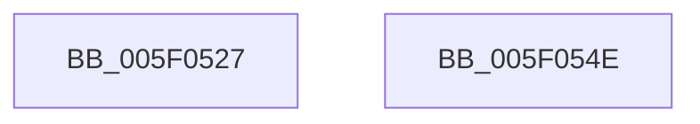

# sub_005F0527

- RVA: `0x005F0527`–`0x005F054F` (길이 `40` bytes)
- VA: `0x00000001405F0527`
- 실행 섹션: `.text`
- PDB 이름 있음: `아니요`; PDB Function 태그: `아니요`
- unwind 정보 RVA: `0x000D0190`
- 디코드: `10`개 명령, `40/40` bytes 표시
- 미해석 바이트: `0` (있으면 어셈블리에 `.byte`로 보존)

> 이 문서는 커널 이미지의 기계어와 PDB 기호를 분석해 생성했습니다. 4번과 5번은 함수 원형과 자료형을 바이너리 사용 방식에서 추정한 C 해석이며 원본 소스 복구 결과는 아닙니다.

## 1. Dependencies

- 직접 호출 지점: **1**; 고유 호출 대상: **1**
- 직접 호출자로 확인된 함수: **0**
- RIP 상대 이미지 참조: **1**

### Outgoing calls
- `0x005F0543` → [PoSetHiberRange](../47/PoSetHiberRange_function_0047C580.md) (function, `0x0047C580`)

### Direct callers
- 이 함수 시작 RVA로 연결되는 직접 call은 확인되지 않았습니다. 간접 호출은 완전히 역산할 수 없습니다.

### Static image references
- `0x005F0535` → RVA `0x00010650` (`.rdata`; read)

## 2. Other-region calls and transfers

- 다른 실행 섹션으로 향하는 call: **0**
- 별도 외부 분기/꼬리 이동을 확인하지 못했습니다.

## 3. Assembly (complete function range)

```asm
005F0527  41 B9 00 01 00 00               mov r9d, 0x100
005F052D  C7 44 24 20 58 70 72 73         mov dword ptr [rsp + 0x20], 0x73727058
005F0535  4C 8D 05 14 01 A2 FF            lea r8, [rip - 0x5dfeec]
005F053C  BA 00 00 01 00                  mov edx, 0x10000
005F0541  33 C9                           xor ecx, ecx
005F0543  E8 38 C0 E8 FF                  call 0x14047c580
005F0548  48 83 C4 50                     add rsp, 0x50
005F054C  5E                              pop rsi
005F054D  C3                              ret
005F054E  CC                              int3
```

## 4. C-style interpretation (structured pseudocode)

```c
__int64 __fastcall sub_005F0527(int a1)
{
    __int64 result;
    __int64 v_rsp;
    unsigned int v_stack_p20;

    v_stack_p20 = 0x73727058ULL;
    a1 = 0;
    result = PoSetHiberRange(a1, (unsigned int)(0x10000ULL), v_rip - 6160108, 256);
    v_rsp = (v_rsp) + (80);
    return result;
}
```

## 5. (Beta) C Style

```c
int64_t sub_005F0527(int32_t Arg1)
{
    int64_t result;
    int64_t local_rsp;
    uint32_t v_stack_p20;

    v_stack_p20 = 0x73727058ULL;
    Arg1 = 0;
    result = PoSetHiberRange(Arg1, (uint32_t)(0x10000ULL), v_rip - 6160108, 256);
    local_rsp = (local_rsp) + (80);
    return result;
}
```

## 6. Execution-region graph

[열기: 2D/3D 그래프와 함수 탐색 컨트롤 패널](../../../control-panel.html?section=text&rva=0x005F0527&view=graph)

- 2D 그래프는 위에서 아래로 흐르고, 3D 그래프는 빈 공간을 드래그해 회전합니다. Shift+드래그는 이동, 휠은 확대·축소, 함수 노드 선택은 대상 보고서 이동입니다.

### Static fallback


