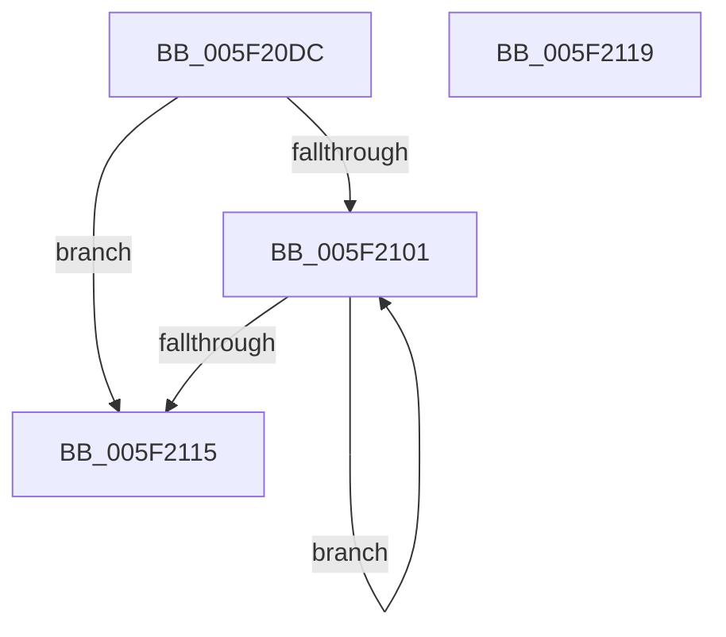

# chunkcopy_core

- RVA: `0x005F20DC`–`0x005F211A` (길이 `62` bytes)
- VA: `0x00000001405F20DC`
- 실행 섹션: `.text`
- PDB 이름 있음: `예`; PDB Function 태그: `예`
- unwind 정보 RVA: `0x000DB714`
- 디코드: `21`개 명령, `62/62` bytes 표시
- 미해석 바이트: `0` (있으면 어셈블리에 `.byte`로 보존)

> 이 문서는 커널 이미지의 기계어와 PDB 기호를 분석해 생성했습니다. 4번과 5번은 함수 원형과 자료형을 바이너리 사용 방식에서 추정한 C 해석이며 원본 소스 복구 결과는 아닙니다.

## 1. Dependencies

- 직접 호출 지점: **0**; 고유 호출 대상: **0**
- 직접 호출자로 확인된 함수: **5**
- RIP 상대 이미지 참조: **0**

### Outgoing calls
- 직접 디코드된 call 명령이 없습니다.

### Direct callers
- [chunkset_core](chunkset_core_function_005F2120.md) at `0x005F217B`
- [inflate](inflate_function_005F2280.md) at `0x005F30B1`
- [chunkcopy_lapped_relaxed](chunkcopy_lapped_relaxed_function_005FFC8C.md) at `0x005FFCA9`
- [chunkset_core](chunkset_core_function_005FFCBC.md) at `0x005FFD10`
- [inflate_fast_chunk_](inflate_fast_chunk__function_005FFE4C.md) at `0x00600126`
- [inflate_fast_chunk_](inflate_fast_chunk__function_005FFE4C.md) at `0x006001A2`
- [inflate_fast_chunk_](inflate_fast_chunk__function_005FFE4C.md) at `0x0060026F`

### Static image references
- 디코드된 RIP-relative 메모리 참조가 없습니다.

## 2. Other-region calls and transfers

- 다른 실행 섹션으로 향하는 call: **0**
- 별도 외부 분기/꼬리 이동을 확인하지 못했습니다.

## 3. Assembly (complete function range)

```asm
005F20DC  0F 10 02                        movups xmm0, xmmword ptr [rdx]
005F20DF  41 83 C9 FF                     or r9d, 0xffffffff
005F20E3  45 03 C1                        add r8d, r9d
005F20E6  41 8B C0                        mov eax, r8d
005F20E9  41 C1 E8 04                     shr r8d, 4
005F20ED  83 E0 0F                        and eax, 0xf
005F20F0  FF C0                           inc eax
005F20F2  F3 0F 7F 01                     movdqu xmmword ptr [rcx], xmm0
005F20F6  48 03 C8                        add rcx, rax
005F20F9  48 03 D0                        add rdx, rax
005F20FC  45 85 C0                        test r8d, r8d
005F20FF  74 14                           je 0x1405f2115
005F2101  0F 10 02                        movups xmm0, xmmword ptr [rdx]
005F2104  48 8D 52 10                     lea rdx, [rdx + 0x10]
005F2108  F3 0F 7F 01                     movdqu xmmword ptr [rcx], xmm0
005F210C  48 83 C1 10                     add rcx, 0x10
005F2110  45 03 C1                        add r8d, r9d
005F2113  75 EC                           jne 0x1405f2101
005F2115  48 8B C1                        mov rax, rcx
005F2118  C3                              ret
005F2119  CC                              int3
```

## 4. C-style interpretation (structured pseudocode)

```c
__int64 __fastcall chunkcopy_core(__int64 a1, __int64 a2, int a3, int a4)
{
    __int64 result;

    a4 = (unsigned int)((a4) | (0xFFFFFFFFULL));
    a3 = (unsigned int)((a3) + (a4));
    a3 = (unsigned int)((a3) >> (4));
    result = (unsigned int)(((unsigned int)(a3)) & (15));
    result = (unsigned int)((result) + 1);
    *(unsigned __int64 *)(a1) = v_xmm0;
    a1 = (a1) + (result);
    a2 = (a2) + (result);
    if (a3 == 0) goto loc_005F2115;
loc_005F2101:
    *(unsigned __int64 *)(a1) = v_xmm0;
    a1 = (a1) + (16);
    a3 = (unsigned int)((a3) + (a4));
    if (condition_is_not_equal) goto loc_005F2101;
loc_005F2115:
    return a1;
}
```

## 5. (Beta) C Style

```c
void *chunkcopy_core(void *Arg1, void *Arg2, int32_t Arg3, int32_t Arg4)
{
    uint8_t *arg1 = (uint8_t *)Arg1;
    uint8_t *arg2 = (uint8_t *)Arg2;

    int64_t result;

    Arg4 = (uint32_t)((Arg4) | (0xFFFFFFFFULL));
    Arg3 = (uint32_t)((Arg3) + (Arg4));
    Arg3 = (uint32_t)((Arg3) >> (4));
    result = (uint32_t)(((uint32_t)(Arg3)) & (15));
    result = (uint32_t)((result) + 1);
    *(uint64_t *)(arg1) = v_xmm0;
    Arg1 = (Arg1) + (result);
    Arg2 = (Arg2) + (result);
    if (Arg3 == 0) goto loc_005F2115;
loc_005F2101:
    *(uint64_t *)(arg1) = v_xmm0;
    Arg1 = (Arg1) + (16);
    Arg3 = (uint32_t)((Arg3) + (Arg4));
    if (condition_is_not_equal) goto loc_005F2101;
loc_005F2115:
    return Arg1;
}
```

### 관측된 메모리 오프셋

구조체 형식이 확인되지 않은 접근은 인자 기준의 오프셋으로만 기록했습니다.

| 기준 인자 | 오프셋 표현 | 폭 (bit) | 접근 |
|---|---:|---:|---|
| `Arg1` | `+ 0x0` | `128` | `W` |
| `Arg2` | `+ 0x0` | `128` | `R` |
| `Arg2` | `+ 0x10` | `64` | `R` |

## 6. Execution-region graph

[열기: 2D/3D 그래프와 함수 탐색 컨트롤 패널](../../../control-panel.html?section=text&rva=0x005F20DC&view=graph)

- 2D 그래프는 위에서 아래로 흐르고, 3D 그래프는 빈 공간을 드래그해 회전합니다. Shift+드래그는 이동, 휠은 확대·축소, 함수 노드 선택은 대상 보고서 이동입니다.

### Static fallback


