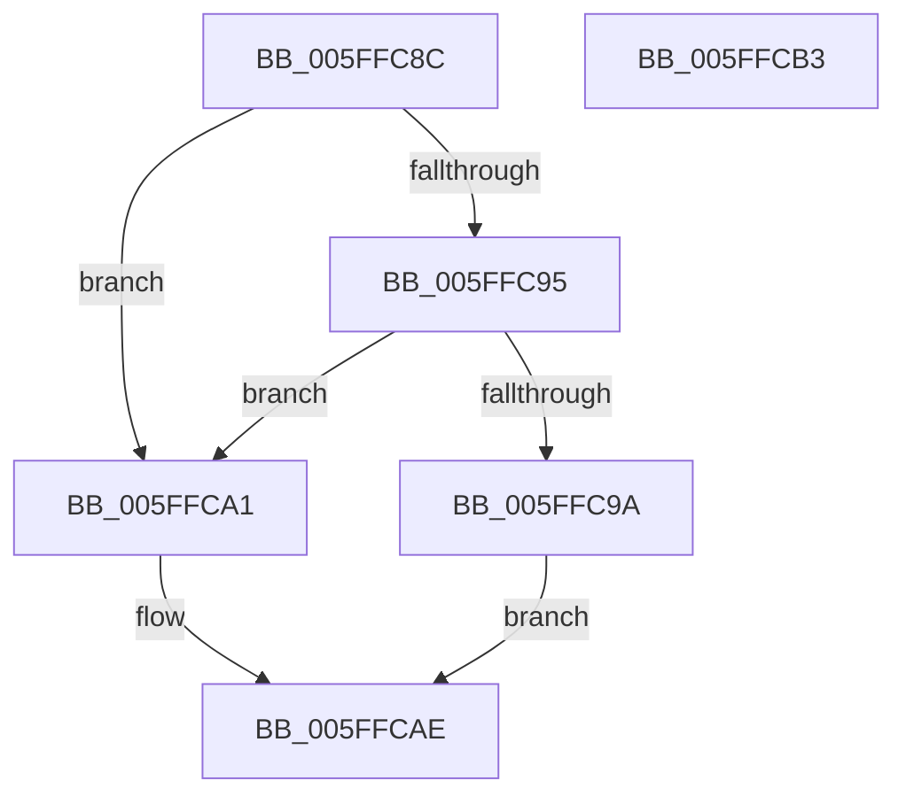

# chunkcopy_lapped_relaxed

- RVA: `0x005FFC8C`–`0x005FFCB4` (길이 `40` bytes)
- VA: `0x00000001405FFC8C`
- 실행 섹션: `.text`
- PDB 이름 있음: `예`; PDB Function 태그: `예`
- unwind 정보 RVA: `0x0005C788`
- 디코드: `14`개 명령, `40/40` bytes 표시
- 미해석 바이트: `0` (있으면 어셈블리에 `.byte`로 보존)

> 이 문서는 커널 이미지의 기계어와 PDB 기호를 분석해 생성했습니다. 4번과 5번은 함수 원형과 자료형을 바이너리 사용 방식에서 추정한 C 해석이며 원본 소스 복구 결과는 아닙니다.

## 1. Dependencies

- 직접 호출 지점: **2**; 고유 호출 대상: **2**
- 직접 호출자로 확인된 함수: **1**
- RIP 상대 이미지 참조: **0**

### Outgoing calls
- `0x005FFC9A` → [chunkset_core](chunkset_core_function_005FFCBC.md) (function, `0x005FFCBC`)
- `0x005FFCA9` → [chunkcopy_core](chunkcopy_core_function_005F20DC.md) (function, `0x005F20DC`)

### Direct callers
- [inflate_fast_chunk_](inflate_fast_chunk__function_005FFE4C.md) at `0x00600294`

### Static image references
- 디코드된 RIP-relative 메모리 참조가 없습니다.

## 2. Other-region calls and transfers

- 다른 실행 섹션으로 향하는 call: **0**
- 별도 외부 분기/꼬리 이동을 확인하지 못했습니다.

## 3. Assembly (complete function range)

```asm
005FFC8C  48 83 EC 28                     sub rsp, 0x28
005FFC90  41 3B D0                        cmp edx, r8d
005FFC93  73 0C                           jae 0x1405ffca1
005FFC95  83 FA 10                        cmp edx, 0x10
005FFC98  73 07                           jae 0x1405ffca1
005FFC9A  E8 1D 00 00 00                  call 0x1405ffcbc
005FFC9F  EB 0D                           jmp 0x1405ffcae
005FFCA1  8B C2                           mov eax, edx
005FFCA3  48 8B D1                        mov rdx, rcx
005FFCA6  48 2B D0                        sub rdx, rax
005FFCA9  E8 2E 24 FF FF                  call 0x1405f20dc
005FFCAE  48 83 C4 28                     add rsp, 0x28
005FFCB2  C3                              ret
005FFCB3  CC                              int3
```

## 4. C-style interpretation (structured pseudocode)

```c
__int64 __fastcall chunkcopy_lapped_relaxed(__int64 a1, int a2, int a3)
{
    __int64 result;
    __int64 v_rsp;

    v_rsp = (v_rsp) - (40);
    if (a2 >= a3) goto loc_005FFCA1;
    if (a2 >= 16) goto loc_005FFCA1;
    result = chunkset_core(a1, a2, a3, a4);
    goto loc_005FFCAE;
loc_005FFCA1:
    a2 = (a1) - ((unsigned int)(a2));
    result = chunkcopy_core(a1, a2, a3, a4);
loc_005FFCAE:
    v_rsp = (v_rsp) + (40);
    return result;
}
```

## 5. (Beta) C Style

```c
int64_t chunkcopy_lapped_relaxed(int64_t Arg1, int32_t Arg2, int32_t Arg3)
{
    int64_t result;
    int64_t local_rsp;

    local_rsp = (local_rsp) - (40);
    if (Arg2 >= Arg3) goto loc_005FFCA1;
    if (Arg2 >= 16) goto loc_005FFCA1;
    result = chunkset_core(Arg1, Arg2, Arg3, a4);
    goto loc_005FFCAE;
loc_005FFCA1:
    Arg2 = (Arg1) - ((uint32_t)(Arg2));
    result = chunkcopy_core(Arg1, Arg2, Arg3, a4);
loc_005FFCAE:
    local_rsp = (local_rsp) + (40);
    return result;
}
```

## 6. Execution-region graph

[열기: 2D/3D 그래프와 함수 탐색 컨트롤 패널](../../../control-panel.html?section=text&rva=0x005FFC8C&view=graph)

- 2D 그래프는 위에서 아래로 흐르고, 3D 그래프는 빈 공간을 드래그해 회전합니다. Shift+드래그는 이동, 휠은 확대·축소, 함수 노드 선택은 대상 보고서 이동입니다.

### Static fallback


