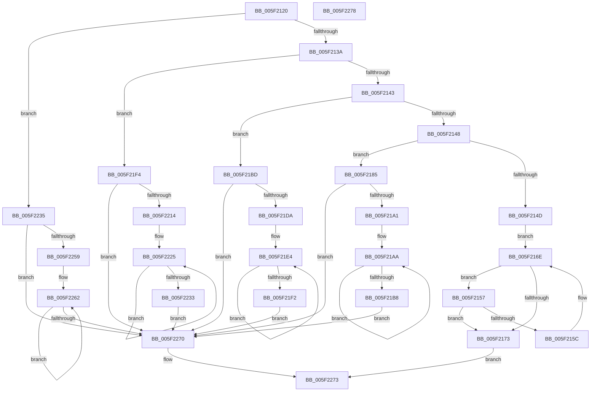

# chunkset_core

- RVA: `0x005F2120`–`0x005F2279` (길이 `345` bytes)
- VA: `0x00000001405F2120`
- 실행 섹션: `.text`
- PDB 이름 있음: `예`; PDB Function 태그: `예`
- unwind 정보 RVA: `0x0005C788`
- 디코드: `99`개 명령, `345/345` bytes 표시
- 미해석 바이트: `0` (있으면 어셈블리에 `.byte`로 보존)

> 이 문서는 커널 이미지의 기계어와 PDB 기호를 분석해 생성했습니다. 4번과 5번은 함수 원형과 자료형을 바이너리 사용 방식에서 추정한 C 해석이며 원본 소스 복구 결과는 아닙니다.

## 1. Dependencies

- 직접 호출 지점: **1**; 고유 호출 대상: **1**
- 직접 호출자로 확인된 함수: **1**
- RIP 상대 이미지 참조: **0**

### Outgoing calls
- `0x005F217B` → [chunkcopy_core](chunkcopy_core_function_005F20DC.md) (function, `0x005F20DC`)

### Direct callers
- [inflate](inflate_function_005F2280.md) at `0x005F309E`

### Static image references
- 디코드된 RIP-relative 메모리 참조가 없습니다.

## 2. Other-region calls and transfers

- 다른 실행 섹션으로 향하는 call: **0**
- 별도 외부 분기/꼬리 이동을 확인하지 못했습니다.

## 3. Assembly (complete function range)

```asm
005F2120  48 83 EC 28                     sub rsp, 0x28
005F2124  45 8D 48 FF                     lea r9d, [r8 - 1]
005F2128  8B C2                           mov eax, edx
005F212A  41 83 E1 0F                     and r9d, 0xf
005F212E  41 FF C1                        inc r9d
005F2131  83 E8 01                        sub eax, 1
005F2134  0F 84 FB 00 00 00               je 0x1405f2235
005F213A  83 E8 01                        sub eax, 1
005F213D  0F 84 B1 00 00 00               je 0x1405f21f4
005F2143  83 E8 02                        sub eax, 2
005F2146  74 75                           je 0x1405f21bd
005F2148  83 F8 04                        cmp eax, 4
005F214B  74 38                           je 0x1405f2185
005F214D  8B C2                           mov eax, edx
005F214F  4C 8B C9                        mov r9, rcx
005F2152  4C 2B C8                        sub r9, rax
005F2155  EB 17                           jmp 0x1405f216e
005F2157  83 FA 10                        cmp edx, 0x10
005F215A  73 17                           jae 0x1405f2173
005F215C  41 0F 10 01                     movups xmm0, xmmword ptr [r9]
005F2160  8B C2                           mov eax, edx
005F2162  44 2B C2                        sub r8d, edx
005F2165  F3 0F 7F 01                     movdqu xmmword ptr [rcx], xmm0
005F2169  48 03 C8                        add rcx, rax
005F216C  03 D2                           add edx, edx
005F216E  41 3B D0                        cmp edx, r8d
005F2171  72 E4                           jb 0x1405f2157
005F2173  8B C2                           mov eax, edx
005F2175  48 8B D1                        mov rdx, rcx
005F2178  48 2B D0                        sub rdx, rax
005F217B  E8 5C FF FF FF                  call 0x1405f20dc
005F2180  E9 EE 00 00 00                  jmp 0x1405f2273
005F2185  F3 0F 7E 41 F8                  movq xmm0, qword ptr [rcx - 8]
005F218A  66 0F 6C C0                     punpcklqdq xmm0, xmm0
005F218E  41 8B C1                        mov eax, r9d
005F2191  F3 0F 7F 01                     movdqu xmmword ptr [rcx], xmm0
005F2195  48 03 C8                        add rcx, rax
005F2198  45 2B C1                        sub r8d, r9d
005F219B  0F 84 CF 00 00 00               je 0x1405f2270
005F21A1  F3 0F 7E 41 F8                  movq xmm0, qword ptr [rcx - 8]
005F21A6  66 0F 6C C0                     punpcklqdq xmm0, xmm0
005F21AA  F3 0F 7F 01                     movdqu xmmword ptr [rcx], xmm0
005F21AE  48 83 C1 10                     add rcx, 0x10
005F21B2  41 83 C0 F0                     add r8d, -0x10
005F21B6  75 F2                           jne 0x1405f21aa
005F21B8  E9 B3 00 00 00                  jmp 0x1405f2270
005F21BD  66 0F 6E 41 FC                  movd xmm0, dword ptr [rcx - 4]
005F21C2  66 0F 70 C0 00                  pshufd xmm0, xmm0, 0
005F21C7  41 8B C1                        mov eax, r9d
005F21CA  F3 0F 7F 01                     movdqu xmmword ptr [rcx], xmm0
005F21CE  48 03 C8                        add rcx, rax
005F21D1  45 2B C1                        sub r8d, r9d
005F21D4  0F 84 96 00 00 00               je 0x1405f2270
005F21DA  66 0F 6E 41 FC                  movd xmm0, dword ptr [rcx - 4]
005F21DF  66 0F 70 C0 00                  pshufd xmm0, xmm0, 0
005F21E4  F3 0F 7F 01                     movdqu xmmword ptr [rcx], xmm0
005F21E8  48 83 C1 10                     add rcx, 0x10
005F21EC  41 83 C0 F0                     add r8d, -0x10
005F21F0  75 F2                           jne 0x1405f21e4
005F21F2  EB 7C                           jmp 0x1405f2270
005F21F4  0F BF 41 FE                     movsx eax, word ptr [rcx - 2]
005F21F8  66 0F 6E C0                     movd xmm0, eax
005F21FC  66 0F 61 C0                     punpcklwd xmm0, xmm0
005F2200  66 0F 70 C0 00                  pshufd xmm0, xmm0, 0
005F2205  41 8B C1                        mov eax, r9d
005F2208  F3 0F 7F 01                     movdqu xmmword ptr [rcx], xmm0
005F220C  48 03 C8                        add rcx, rax
005F220F  45 2B C1                        sub r8d, r9d
005F2212  74 5C                           je 0x1405f2270
005F2214  0F BF 41 FE                     movsx eax, word ptr [rcx - 2]
005F2218  66 0F 6E C0                     movd xmm0, eax
005F221C  66 0F 61 C0                     punpcklwd xmm0, xmm0
005F2220  66 0F 70 C0 00                  pshufd xmm0, xmm0, 0
005F2225  F3 0F 7F 01                     movdqu xmmword ptr [rcx], xmm0
005F2229  48 83 C1 10                     add rcx, 0x10
005F222D  41 83 C0 F0                     add r8d, -0x10
005F2231  75 F2                           jne 0x1405f2225
005F2233  EB 3B                           jmp 0x1405f2270
005F2235  0F BE 41 FF                     movsx eax, byte ptr [rcx - 1]
005F2239  66 0F 6E C0                     movd xmm0, eax
005F223D  66 0F 60 C0                     punpcklbw xmm0, xmm0
005F2241  66 0F 61 C0                     punpcklwd xmm0, xmm0
005F2245  66 0F 70 C0 00                  pshufd xmm0, xmm0, 0
005F224A  41 8B C1                        mov eax, r9d
005F224D  F3 0F 7F 01                     movdqu xmmword ptr [rcx], xmm0
005F2251  48 03 C8                        add rcx, rax
005F2254  45 2B C1                        sub r8d, r9d
005F2257  74 17                           je 0x1405f2270
005F2259  41 8D 50 FF                     lea edx, [r8 - 1]
005F225D  C1 EA 04                        shr edx, 4
005F2260  FF C2                           inc edx
005F2262  F3 0F 7F 01                     movdqu xmmword ptr [rcx], xmm0
005F2266  48 83 C1 10                     add rcx, 0x10
005F226A  48 83 EA 01                     sub rdx, 1
005F226E  75 F2                           jne 0x1405f2262
005F2270  48 8B C1                        mov rax, rcx
005F2273  48 83 C4 28                     add rsp, 0x28
005F2277  C3                              ret
005F2278  CC                              int3
```

## 4. C-style interpretation (structured pseudocode)

```c
__int64 __fastcall chunkset_core(__int64 a1, int a2, __int64 a3)
{
    __int64 result;
    __int64 v_rsp;

    v_rsp = (v_rsp) - (40);
    a4 = (unsigned int)((a3 - 1) & (15));
    a4 = (unsigned int)((a4) + 1);
    result = (unsigned int)(((unsigned int)(a2)) - (1));
    if (condition_is_equal) goto loc_005F2235;
    result = (unsigned int)((result) - (1));
    if (condition_is_equal) goto loc_005F21F4;
    result = (unsigned int)((result) - (2));
    if (condition_is_equal) goto loc_005F21BD;
    if (((unsigned int)(result)) == 4) goto loc_005F2185;
    a4 = (a1) - ((unsigned int)(a2));
    goto loc_005F216E;
loc_005F2157:
    if (a2 >= 16) goto loc_005F2173;
    a3 = (unsigned int)((a3) - (a2));
    *(unsigned __int64 *)(a1) = v_xmm0;
    a1 = (a1) + ((unsigned int)(a2));
    a2 = (unsigned int)((a2) + (a2));
loc_005F216E:
    if (a2 < ((unsigned int)(a3))) goto loc_005F2157;
loc_005F2173:
    a2 = (a1) - ((unsigned int)(a2));
    result = chunkcopy_core(a1, a2, a3, a4);
    goto loc_005F2273;
loc_005F2185:
    *(unsigned __int64 *)(a1) = v_xmm0;
    a1 = (a1) + ((unsigned int)((unsigned int)(a4)));
    a3 = (unsigned int)((a3) - ((unsigned int)(a4)));
    if (condition_is_equal) goto loc_005F2270;
loc_005F21AA:
    *(unsigned __int64 *)(a1) = v_xmm0;
    a1 = (a1) + (16);
    a3 = (unsigned int)((a3) + (-16));
    if (condition_is_not_equal) goto loc_005F21AA;
    goto loc_005F2270;
loc_005F21BD:
    *(unsigned __int64 *)(a1) = v_xmm0;
    a1 = (a1) + ((unsigned int)((unsigned int)(a4)));
    a3 = (unsigned int)((a3) - ((unsigned int)(a4)));
    if (condition_is_equal) goto loc_005F2270;
loc_005F21E4:
    *(unsigned __int64 *)(a1) = v_xmm0;
    a1 = (a1) + (16);
    a3 = (unsigned int)((a3) + (-16));
    if (condition_is_not_equal) goto loc_005F21E4;
    goto loc_005F2270;
loc_005F21F4:
    *(unsigned __int64 *)(a1) = v_xmm0;
    a1 = (a1) + ((unsigned int)((unsigned int)(a4)));
    a3 = (unsigned int)((a3) - ((unsigned int)(a4)));
    if (condition_is_equal) goto loc_005F2270;
loc_005F2225:
    *(unsigned __int64 *)(a1) = v_xmm0;
    a1 = (a1) + (16);
    a3 = (unsigned int)((a3) + (-16));
    if (condition_is_not_equal) goto loc_005F2225;
    goto loc_005F2270;
loc_005F2235:
    *(unsigned __int64 *)(a1) = v_xmm0;
    a1 = (a1) + ((unsigned int)((unsigned int)(a4)));
    a3 = (unsigned int)((a3) - ((unsigned int)(a4)));
    if (condition_is_equal) goto loc_005F2270;
    a2 = (unsigned int)((a3 - 1) >> (4));
    a2 = (unsigned int)((a2) + 1);
loc_005F2262:
    *(unsigned __int64 *)(a1) = v_xmm0;
    a1 = (a1) + (16);
    a2 = (a2) - (1);
    if (condition_is_not_equal) goto loc_005F2262;
loc_005F2270:
loc_005F2273:
    v_rsp = (v_rsp) + (40);
    return a1;
}
```

## 5. (Beta) C Style

```c
void *chunkset_core(void *Arg1, int32_t Arg2, void *Arg3)
{
    uint8_t *arg1 = (uint8_t *)Arg1;
    uint8_t *arg3 = (uint8_t *)Arg3;

    int64_t result;
    int64_t local_rsp;

    local_rsp = (local_rsp) - (40);
    a4 = (uint32_t)((Arg3 - 1) & (15));
    a4 = (uint32_t)((a4) + 1);
    result = (uint32_t)(((uint32_t)(Arg2)) - (1));
    if (condition_is_equal) goto loc_005F2235;
    result = (uint32_t)((result) - (1));
    if (condition_is_equal) goto loc_005F21F4;
    result = (uint32_t)((result) - (2));
    if (condition_is_equal) goto loc_005F21BD;
    if (((uint32_t)(result)) == 4) goto loc_005F2185;
    a4 = (Arg1) - ((uint32_t)(Arg2));
    goto loc_005F216E;
loc_005F2157:
    if (Arg2 >= 16) goto loc_005F2173;
    Arg3 = (uint32_t)((Arg3) - (Arg2));
    *(uint64_t *)(arg1) = v_xmm0;
    Arg1 = (Arg1) + ((uint32_t)(Arg2));
    Arg2 = (uint32_t)((Arg2) + (Arg2));
loc_005F216E:
    if (Arg2 < ((uint32_t)(Arg3))) goto loc_005F2157;
loc_005F2173:
    Arg2 = (Arg1) - ((uint32_t)(Arg2));
    result = chunkcopy_core(Arg1, Arg2, Arg3, a4);
    goto loc_005F2273;
loc_005F2185:
    *(uint64_t *)(arg1) = v_xmm0;
    Arg1 = (Arg1) + ((uint32_t)((uint32_t)(a4)));
    Arg3 = (uint32_t)((Arg3) - ((uint32_t)(a4)));
    if (condition_is_equal) goto loc_005F2270;
loc_005F21AA:
    *(uint64_t *)(arg1) = v_xmm0;
    Arg1 = (Arg1) + (16);
    Arg3 = (uint32_t)((Arg3) + (-16));
    if (condition_is_not_equal) goto loc_005F21AA;
    goto loc_005F2270;
loc_005F21BD:
    *(uint64_t *)(arg1) = v_xmm0;
    Arg1 = (Arg1) + ((uint32_t)((uint32_t)(a4)));
    Arg3 = (uint32_t)((Arg3) - ((uint32_t)(a4)));
    if (condition_is_equal) goto loc_005F2270;
loc_005F21E4:
    *(uint64_t *)(arg1) = v_xmm0;
    Arg1 = (Arg1) + (16);
    Arg3 = (uint32_t)((Arg3) + (-16));
    if (condition_is_not_equal) goto loc_005F21E4;
    goto loc_005F2270;
loc_005F21F4:
    *(uint64_t *)(arg1) = v_xmm0;
    Arg1 = (Arg1) + ((uint32_t)((uint32_t)(a4)));
    Arg3 = (uint32_t)((Arg3) - ((uint32_t)(a4)));
    if (condition_is_equal) goto loc_005F2270;
loc_005F2225:
    *(uint64_t *)(arg1) = v_xmm0;
    Arg1 = (Arg1) + (16);
    Arg3 = (uint32_t)((Arg3) + (-16));
    if (condition_is_not_equal) goto loc_005F2225;
    goto loc_005F2270;
loc_005F2235:
    *(uint64_t *)(arg1) = v_xmm0;
    Arg1 = (Arg1) + ((uint32_t)((uint32_t)(a4)));
    Arg3 = (uint32_t)((Arg3) - ((uint32_t)(a4)));
    if (condition_is_equal) goto loc_005F2270;
    Arg2 = (uint32_t)((Arg3 - 1) >> (4));
    Arg2 = (uint32_t)((Arg2) + 1);
loc_005F2262:
    *(uint64_t *)(arg1) = v_xmm0;
    Arg1 = (Arg1) + (16);
    Arg2 = (Arg2) - (1);
    if (condition_is_not_equal) goto loc_005F2262;
loc_005F2270:
loc_005F2273:
    local_rsp = (local_rsp) + (40);
    return Arg1;
}
```

### 관측된 메모리 오프셋

구조체 형식이 확인되지 않은 접근은 인자 기준의 오프셋으로만 기록했습니다.

| 기준 인자 | 오프셋 표현 | 폭 (bit) | 접근 |
|---|---:|---:|---|
| `Arg1` | `- 0x8` | `64` | `R` |
| `Arg1` | `- 0x4` | `32` | `R` |
| `Arg1` | `- 0x2` | `16` | `R` |
| `Arg1` | `- 0x1` | `8` | `R` |
| `Arg1` | `+ 0x0` | `128` | `R` |
| `Arg1` | `+ 0x0` | `128` | `W` |
| `Arg3` | `- 0x1` | `32` | `R` |

## 6. Execution-region graph

[열기: 2D/3D 그래프와 함수 탐색 컨트롤 패널](../../../control-panel.html?section=text&rva=0x005F2120&view=graph)

- 2D 그래프는 위에서 아래로 흐르고, 3D 그래프는 빈 공간을 드래그해 회전합니다. Shift+드래그는 이동, 휠은 확대·축소, 함수 노드 선택은 대상 보고서 이동입니다.

### Static fallback


