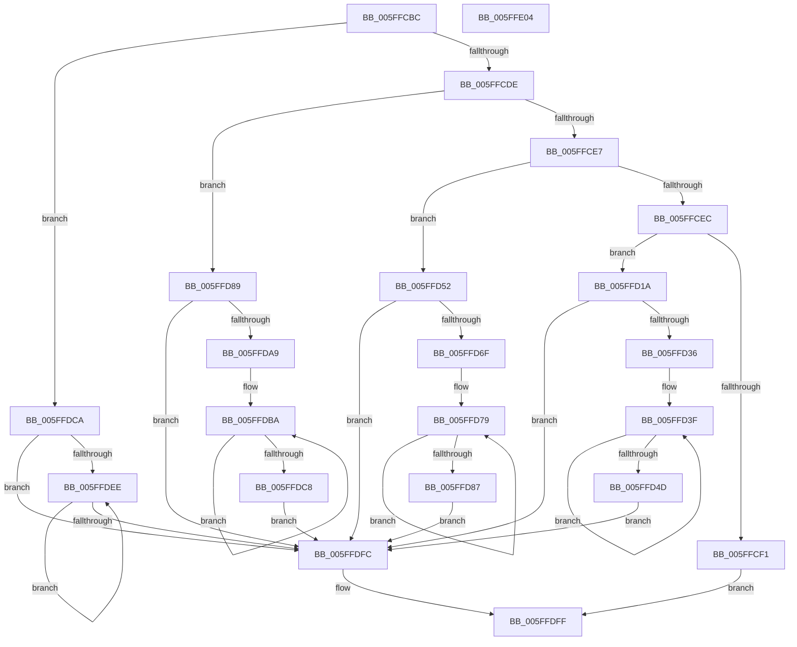

# chunkset_core

- RVA: `0x005FFCBC`–`0x005FFE05` (길이 `329` bytes)
- VA: `0x00000001405FFCBC`
- 실행 섹션: `.text`
- PDB 이름 있음: `예`; PDB Function 태그: `예`
- unwind 정보 RVA: `0x000D04C4`
- 디코드: `89`개 명령, `329/329` bytes 표시
- 미해석 바이트: `0` (있으면 어셈블리에 `.byte`로 보존)

> 이 문서는 커널 이미지의 기계어와 PDB 기호를 분석해 생성했습니다. 4번과 5번은 함수 원형과 자료형을 바이너리 사용 방식에서 추정한 C 해석이며 원본 소스 복구 결과는 아닙니다.

## 1. Dependencies

- 직접 호출 지점: **2**; 고유 호출 대상: **2**
- 직접 호출자로 확인된 함수: **1**
- RIP 상대 이미지 참조: **0**

### Outgoing calls
- `0x005FFCF9` → [chunkunroll_relaxed](chunkunroll_relaxed_function_005FFE0C.md) (function, `0x005FFE0C`)
- `0x005FFD10` → [chunkcopy_core](chunkcopy_core_function_005F20DC.md) (function, `0x005F20DC`)

### Direct callers
- [chunkcopy_lapped_relaxed](chunkcopy_lapped_relaxed_function_005FFC8C.md) at `0x005FFC9A`

### Static image references
- 디코드된 RIP-relative 메모리 참조가 없습니다.

## 2. Other-region calls and transfers

- 다른 실행 섹션으로 향하는 call: **0**
- 별도 외부 분기/꼬리 이동을 확인하지 못했습니다.

## 3. Assembly (complete function range)

```asm
005FFCBC  48 8B C4                        mov rax, rsp
005FFCBF  44 89 40 18                     mov dword ptr [rax + 0x18], r8d
005FFCC3  89 50 10                        mov dword ptr [rax + 0x10], edx
005FFCC6  48 83 EC 28                     sub rsp, 0x28
005FFCCA  45 8D 48 FF                     lea r9d, [r8 - 1]
005FFCCE  41 83 E1 0F                     and r9d, 0xf
005FFCD2  41 FF C1                        inc r9d
005FFCD5  83 EA 01                        sub edx, 1
005FFCD8  0F 84 EC 00 00 00               je 0x1405ffdca
005FFCDE  83 EA 01                        sub edx, 1
005FFCE1  0F 84 A2 00 00 00               je 0x1405ffd89
005FFCE7  83 EA 02                        sub edx, 2
005FFCEA  74 66                           je 0x1405ffd52
005FFCEC  83 FA 04                        cmp edx, 4
005FFCEF  74 29                           je 0x1405ffd1a
005FFCF1  4C 8D 40 18                     lea r8, [rax + 0x18]
005FFCF5  48 8D 50 10                     lea rdx, [rax + 0x10]
005FFCF9  E8 0E 01 00 00                  call 0x1405ffe0c
005FFCFE  8B 4C 24 38                     mov ecx, dword ptr [rsp + 0x38]
005FFD02  48 8B D0                        mov rdx, rax
005FFD05  44 8B 44 24 40                  mov r8d, dword ptr [rsp + 0x40]
005FFD0A  48 2B D1                        sub rdx, rcx
005FFD0D  48 8B C8                        mov rcx, rax
005FFD10  E8 C7 23 FF FF                  call 0x1405f20dc
005FFD15  E9 E5 00 00 00                  jmp 0x1405ffdff
005FFD1A  F3 0F 7E 41 F8                  movq xmm0, qword ptr [rcx - 8]
005FFD1F  66 0F 6C C0                     punpcklqdq xmm0, xmm0
005FFD23  41 8B C1                        mov eax, r9d
005FFD26  F3 0F 7F 01                     movdqu xmmword ptr [rcx], xmm0
005FFD2A  48 03 C8                        add rcx, rax
005FFD2D  45 2B C1                        sub r8d, r9d
005FFD30  0F 84 C6 00 00 00               je 0x1405ffdfc
005FFD36  F3 0F 7E 41 F8                  movq xmm0, qword ptr [rcx - 8]
005FFD3B  66 0F 6C C0                     punpcklqdq xmm0, xmm0
005FFD3F  F3 0F 7F 01                     movdqu xmmword ptr [rcx], xmm0
005FFD43  48 83 C1 10                     add rcx, 0x10
005FFD47  41 83 C0 F0                     add r8d, -0x10
005FFD4B  75 F2                           jne 0x1405ffd3f
005FFD4D  E9 AA 00 00 00                  jmp 0x1405ffdfc
005FFD52  66 0F 6E 41 FC                  movd xmm0, dword ptr [rcx - 4]
005FFD57  66 0F 70 C0 00                  pshufd xmm0, xmm0, 0
005FFD5C  41 8B C1                        mov eax, r9d
005FFD5F  F3 0F 7F 01                     movdqu xmmword ptr [rcx], xmm0
005FFD63  48 03 C8                        add rcx, rax
005FFD66  45 2B C1                        sub r8d, r9d
005FFD69  0F 84 8D 00 00 00               je 0x1405ffdfc
005FFD6F  66 0F 6E 41 FC                  movd xmm0, dword ptr [rcx - 4]
005FFD74  66 0F 70 C0 00                  pshufd xmm0, xmm0, 0
005FFD79  F3 0F 7F 01                     movdqu xmmword ptr [rcx], xmm0
005FFD7D  48 83 C1 10                     add rcx, 0x10
005FFD81  41 83 C0 F0                     add r8d, -0x10
005FFD85  75 F2                           jne 0x1405ffd79
005FFD87  EB 73                           jmp 0x1405ffdfc
005FFD89  0F BF 41 FE                     movsx eax, word ptr [rcx - 2]
005FFD8D  66 0F 6E C0                     movd xmm0, eax
005FFD91  66 0F 61 C0                     punpcklwd xmm0, xmm0
005FFD95  66 0F 70 C0 00                  pshufd xmm0, xmm0, 0
005FFD9A  41 8B C1                        mov eax, r9d
005FFD9D  F3 0F 7F 01                     movdqu xmmword ptr [rcx], xmm0
005FFDA1  48 03 C8                        add rcx, rax
005FFDA4  45 2B C1                        sub r8d, r9d
005FFDA7  74 53                           je 0x1405ffdfc
005FFDA9  0F BF 41 FE                     movsx eax, word ptr [rcx - 2]
005FFDAD  66 0F 6E C0                     movd xmm0, eax
005FFDB1  66 0F 61 C0                     punpcklwd xmm0, xmm0
005FFDB5  66 0F 70 C0 00                  pshufd xmm0, xmm0, 0
005FFDBA  F3 0F 7F 01                     movdqu xmmword ptr [rcx], xmm0
005FFDBE  48 83 C1 10                     add rcx, 0x10
005FFDC2  41 83 C0 F0                     add r8d, -0x10
005FFDC6  75 F2                           jne 0x1405ffdba
005FFDC8  EB 32                           jmp 0x1405ffdfc
005FFDCA  0F BE 41 FF                     movsx eax, byte ptr [rcx - 1]
005FFDCE  66 0F 6E C0                     movd xmm0, eax
005FFDD2  66 0F 60 C0                     punpcklbw xmm0, xmm0
005FFDD6  66 0F 61 C0                     punpcklwd xmm0, xmm0
005FFDDA  66 0F 70 C0 00                  pshufd xmm0, xmm0, 0
005FFDDF  41 8B C1                        mov eax, r9d
005FFDE2  F3 0F 7F 01                     movdqu xmmword ptr [rcx], xmm0
005FFDE6  48 03 C8                        add rcx, rax
005FFDE9  45 2B C1                        sub r8d, r9d
005FFDEC  74 0E                           je 0x1405ffdfc
005FFDEE  F3 0F 7F 01                     movdqu xmmword ptr [rcx], xmm0
005FFDF2  48 83 C1 10                     add rcx, 0x10
005FFDF6  41 83 C0 F0                     add r8d, -0x10
005FFDFA  75 F2                           jne 0x1405ffdee
005FFDFC  48 8B C1                        mov rax, rcx
005FFDFF  48 83 C4 28                     add rsp, 0x28
005FFE03  C3                              ret
005FFE04  CC                              int3
```

## 4. C-style interpretation (structured pseudocode)

```c
__int64 __fastcall chunkset_core(__int64 a1, int a2, __int64 a3)
{
    __int64 result;
    __int64 v_rsp;
    unsigned int v_stack_p10;
    unsigned int v_stack_p18;

    *(unsigned int *)(v_rsp + 24) = (unsigned int)(a3);
    *(unsigned int *)(v_rsp + 16) = a2;
    v_rsp = (v_rsp) - (40);
    a4 = (unsigned int)((a3 - 1) & (15));
    a4 = (unsigned int)((a4) + 1);
    a2 = (unsigned int)((a2) - (1));
    if (condition_is_equal) goto loc_005FFDCA;
    a2 = (unsigned int)((a2) - (1));
    if (condition_is_equal) goto loc_005FFD89;
    a2 = (unsigned int)((a2) - (2));
    if (condition_is_equal) goto loc_005FFD52;
    if (a2 == 4) goto loc_005FFD1A;
    result = chunkunroll_relaxed(a1, v_rsp + 16, v_rsp + 24, a4);
    a2 = (result) - ((unsigned int)(v_stack_p10));
    result = chunkcopy_core(result, a2, (unsigned int)(v_stack_p18), a4);
    goto loc_005FFDFF;
loc_005FFD1A:
    *(unsigned __int64 *)(result) = v_xmm0;
    a1 = (result) + ((unsigned int)((unsigned int)(a4)));
    a3 = (unsigned int)(((unsigned int)(v_stack_p18)) - ((unsigned int)(a4)));
    if (condition_is_equal) goto loc_005FFDFC;
loc_005FFD3F:
    *(unsigned __int64 *)(a1) = v_xmm0;
    a1 = (a1) + (16);
    a3 = (unsigned int)((a3) + (-16));
    if (condition_is_not_equal) goto loc_005FFD3F;
    goto loc_005FFDFC;
loc_005FFD52:
    *(unsigned __int64 *)(a1) = v_xmm0;
    a1 = (a1) + ((unsigned int)((unsigned int)(a4)));
    a3 = (unsigned int)((a3) - ((unsigned int)(a4)));
    if (condition_is_equal) goto loc_005FFDFC;
loc_005FFD79:
    *(unsigned __int64 *)(a1) = v_xmm0;
    a1 = (a1) + (16);
    a3 = (unsigned int)((a3) + (-16));
    if (condition_is_not_equal) goto loc_005FFD79;
    goto loc_005FFDFC;
loc_005FFD89:
    *(unsigned __int64 *)(a1) = v_xmm0;
    a1 = (a1) + ((unsigned int)((unsigned int)(a4)));
    a3 = (unsigned int)((a3) - ((unsigned int)(a4)));
    if (condition_is_equal) goto loc_005FFDFC;
loc_005FFDBA:
    *(unsigned __int64 *)(a1) = v_xmm0;
    a1 = (a1) + (16);
    a3 = (unsigned int)((a3) + (-16));
    if (condition_is_not_equal) goto loc_005FFDBA;
    goto loc_005FFDFC;
loc_005FFDCA:
    *(unsigned __int64 *)(a1) = v_xmm0;
    a1 = (a1) + ((unsigned int)((unsigned int)(a4)));
    a3 = (unsigned int)((a3) - ((unsigned int)(a4)));
    if (condition_is_equal) goto loc_005FFDFC;
loc_005FFDEE:
    *(unsigned __int64 *)(a1) = v_xmm0;
    a1 = (a1) + (16);
    a3 = (unsigned int)((a3) + (-16));
    if (condition_is_not_equal) goto loc_005FFDEE;
loc_005FFDFC:
loc_005FFDFF:
    v_rsp = (v_rsp) + (40);
    return a1;
}
```

## 5. (Beta) C Style

```c
void *chunkset_core(void *Arg1, int32_t Arg2, void *Arg3)
{
    uint8_t *arg1 = (uint8_t *)Arg1;
    uint8_t *arg3 = (uint8_t *)Arg3;

    int64_t result;
    int64_t local_rsp;
    uint32_t v_stack_p10;
    uint32_t v_stack_p18;

    *(uint32_t *)(local_rsp + 0x18) = (uint32_t)(Arg3);
    *(uint32_t *)(local_rsp + 0x10) = Arg2;
    local_rsp = (local_rsp) - (40);
    a4 = (uint32_t)((Arg3 - 1) & (15));
    a4 = (uint32_t)((a4) + 1);
    Arg2 = (uint32_t)((Arg2) - (1));
    if (condition_is_equal) goto loc_005FFDCA;
    Arg2 = (uint32_t)((Arg2) - (1));
    if (condition_is_equal) goto loc_005FFD89;
    Arg2 = (uint32_t)((Arg2) - (2));
    if (condition_is_equal) goto loc_005FFD52;
    if (Arg2 == 4) goto loc_005FFD1A;
    result = chunkunroll_relaxed(Arg1, local_rsp + 16, local_rsp + 24, a4);
    Arg2 = (result) - ((uint32_t)(v_stack_p10));
    result = chunkcopy_core(result, Arg2, (uint32_t)(v_stack_p18), a4);
    goto loc_005FFDFF;
loc_005FFD1A:
    *(uint64_t *)(result) = v_xmm0;
    Arg1 = (result) + ((uint32_t)((uint32_t)(a4)));
    Arg3 = (uint32_t)(((uint32_t)(v_stack_p18)) - ((uint32_t)(a4)));
    if (condition_is_equal) goto loc_005FFDFC;
loc_005FFD3F:
    *(uint64_t *)(arg1) = v_xmm0;
    Arg1 = (Arg1) + (16);
    Arg3 = (uint32_t)((Arg3) + (-16));
    if (condition_is_not_equal) goto loc_005FFD3F;
    goto loc_005FFDFC;
loc_005FFD52:
    *(uint64_t *)(arg1) = v_xmm0;
    Arg1 = (Arg1) + ((uint32_t)((uint32_t)(a4)));
    Arg3 = (uint32_t)((Arg3) - ((uint32_t)(a4)));
    if (condition_is_equal) goto loc_005FFDFC;
loc_005FFD79:
    *(uint64_t *)(arg1) = v_xmm0;
    Arg1 = (Arg1) + (16);
    Arg3 = (uint32_t)((Arg3) + (-16));
    if (condition_is_not_equal) goto loc_005FFD79;
    goto loc_005FFDFC;
loc_005FFD89:
    *(uint64_t *)(arg1) = v_xmm0;
    Arg1 = (Arg1) + ((uint32_t)((uint32_t)(a4)));
    Arg3 = (uint32_t)((Arg3) - ((uint32_t)(a4)));
    if (condition_is_equal) goto loc_005FFDFC;
loc_005FFDBA:
    *(uint64_t *)(arg1) = v_xmm0;
    Arg1 = (Arg1) + (16);
    Arg3 = (uint32_t)((Arg3) + (-16));
    if (condition_is_not_equal) goto loc_005FFDBA;
    goto loc_005FFDFC;
loc_005FFDCA:
    *(uint64_t *)(arg1) = v_xmm0;
    Arg1 = (Arg1) + ((uint32_t)((uint32_t)(a4)));
    Arg3 = (uint32_t)((Arg3) - ((uint32_t)(a4)));
    if (condition_is_equal) goto loc_005FFDFC;
loc_005FFDEE:
    *(uint64_t *)(arg1) = v_xmm0;
    Arg1 = (Arg1) + (16);
    Arg3 = (uint32_t)((Arg3) + (-16));
    if (condition_is_not_equal) goto loc_005FFDEE;
loc_005FFDFC:
loc_005FFDFF:
    local_rsp = (local_rsp) + (40);
    return Arg1;
}
```

### 관측된 메모리 오프셋

구조체 형식이 확인되지 않은 접근은 인자 기준의 오프셋으로만 기록했습니다.

| 기준 인자 | 오프셋 표현 | 폭 (bit) | 접근 |
|---|---:|---:|---|
| `Arg1` | `- 0x8` | `64` | `R` |
| `Arg1` | `- 0x4` | `32` | `R` |
| `Arg1` | `- 0x2` | `16` | `R` |
| `Arg1` | `- 0x1` | `8` | `R` |
| `Arg1` | `+ 0x0` | `128` | `W` |
| `Arg3` | `- 0x1` | `32` | `R` |

## 6. Execution-region graph

[열기: 2D/3D 그래프와 함수 탐색 컨트롤 패널](../../../control-panel.html?section=text&rva=0x005FFCBC&view=graph)

- 2D 그래프는 위에서 아래로 흐르고, 3D 그래프는 빈 공간을 드래그해 회전합니다. Shift+드래그는 이동, 휠은 확대·축소, 함수 노드 선택은 대상 보고서 이동입니다.

### Static fallback


