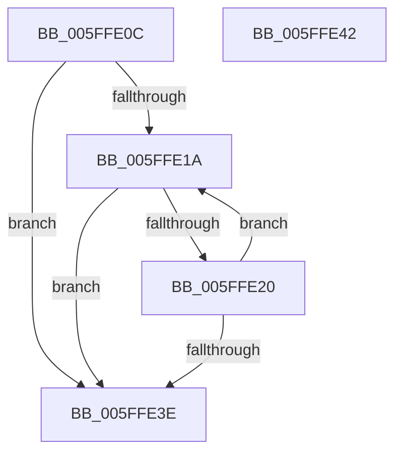

# chunkunroll_relaxed

- RVA: `0x005FFE0C`–`0x005FFE43` (길이 `55` bytes)
- VA: `0x00000001405FFE0C`
- 실행 섹션: `.text`
- PDB 이름 있음: `예`; PDB Function 태그: `예`
- unwind 정보 RVA: `0x000DB714`
- 디코드: `21`개 명령, `55/55` bytes 표시
- 미해석 바이트: `0` (있으면 어셈블리에 `.byte`로 보존)

> 이 문서는 커널 이미지의 기계어와 PDB 기호를 분석해 생성했습니다. 4번과 5번은 함수 원형과 자료형을 바이너리 사용 방식에서 추정한 C 해석이며 원본 소스 복구 결과는 아닙니다.

## 1. Dependencies

- 직접 호출 지점: **0**; 고유 호출 대상: **0**
- 직접 호출자로 확인된 함수: **2**
- RIP 상대 이미지 참조: **0**

### Outgoing calls
- 직접 디코드된 call 명령이 없습니다.

### Direct callers
- [chunkset_core](chunkset_core_function_005FFCBC.md) at `0x005FFCF9`
- [inflate_fast_chunk_](inflate_fast_chunk__function_005FFE4C.md) at `0x006001C7`

### Static image references
- 디코드된 RIP-relative 메모리 참조가 없습니다.

## 2. Other-region calls and transfers

- 다른 실행 섹션으로 향하는 call: **0**
- 별도 외부 분기/꼬리 이동을 확인하지 못했습니다.

## 3. Assembly (complete function range)

```asm
005FFE0C  44 8B 0A                        mov r9d, dword ptr [rdx]
005FFE0F  4C 8B D1                        mov r10, rcx
005FFE12  4D 2B D1                        sub r10, r9
005FFE15  45 3B 08                        cmp r9d, dword ptr [r8]
005FFE18  73 24                           jae 0x1405ffe3e
005FFE1A  41 83 F9 10                     cmp r9d, 0x10
005FFE1E  73 1E                           jae 0x1405ffe3e
005FFE20  41 0F 10 02                     movups xmm0, xmmword ptr [r10]
005FFE24  F3 0F 7F 01                     movdqu xmmword ptr [rcx], xmm0
005FFE28  8B 02                           mov eax, dword ptr [rdx]
005FFE2A  41 29 00                        sub dword ptr [r8], eax
005FFE2D  48 03 C8                        add rcx, rax
005FFE30  8B 02                           mov eax, dword ptr [rdx]
005FFE32  03 C0                           add eax, eax
005FFE34  89 02                           mov dword ptr [rdx], eax
005FFE36  44 8B C8                        mov r9d, eax
005FFE39  41 3B 00                        cmp eax, dword ptr [r8]
005FFE3C  72 DC                           jb 0x1405ffe1a
005FFE3E  48 8B C1                        mov rax, rcx
005FFE41  C3                              ret
005FFE42  CC                              int3
```

## 4. C-style interpretation (structured pseudocode)

```c
__int64 __fastcall chunkunroll_relaxed(__int64 a1, __int64 a2, __int64 a3)
{
    __int64 result;
    __int64 v_r10;

    v_r10 = (a1) - ((unsigned int)(*(unsigned int *)(a2)));
    if (((unsigned int)((unsigned int)(*(unsigned int *)(a2)))) >= (*(unsigned int *)(a3))) goto loc_005FFE3E;
loc_005FFE1A:
    if (((unsigned int)((unsigned int)(*(unsigned int *)(a2)))) >= 16) goto loc_005FFE3E;
    *(unsigned __int64 *)(a1) = v_xmm0;
    a1 = (a1) + ((unsigned int)(*(unsigned int *)(a2)));
    result = (unsigned int)(((unsigned int)(*(unsigned int *)(a2))) + ((unsigned int)((unsigned int)(*(unsigned int *)(a2)))));
    *(unsigned int *)(a2) = (unsigned int)(result);
    if (((unsigned int)(result)) < (*(unsigned int *)(a3))) goto loc_005FFE1A;
loc_005FFE3E:
    return a1;
}
```

## 5. (Beta) C Style

```c
void *chunkunroll_relaxed(void *Arg1, void *Arg2, void *Arg3)
{
    uint8_t *arg1 = (uint8_t *)Arg1;
    uint8_t *arg2 = (uint8_t *)Arg2;
    uint8_t *arg3 = (uint8_t *)Arg3;

    int64_t result;
    int64_t local_r10;

    local_r10 = (Arg1) - ((uint32_t)(*(uint32_t *)(arg2)));
    if (((uint32_t)((uint32_t)(*(uint32_t *)(arg2)))) >= (*(uint32_t *)(arg3))) goto loc_005FFE3E;
loc_005FFE1A:
    if (((uint32_t)((uint32_t)(*(uint32_t *)(arg2)))) >= 16) goto loc_005FFE3E;
    *(uint64_t *)(arg1) = v_xmm0;
    Arg1 = (Arg1) + ((uint32_t)(*(uint32_t *)(arg2)));
    result = (uint32_t)(((uint32_t)(*(uint32_t *)(arg2))) + ((uint32_t)((uint32_t)(*(uint32_t *)(arg2)))));
    *(uint32_t *)(arg2) = (uint32_t)(result);
    if (((uint32_t)(result)) < (*(uint32_t *)(arg3))) goto loc_005FFE1A;
loc_005FFE3E:
    return Arg1;
}
```

### 관측된 메모리 오프셋

구조체 형식이 확인되지 않은 접근은 인자 기준의 오프셋으로만 기록했습니다.

| 기준 인자 | 오프셋 표현 | 폭 (bit) | 접근 |
|---|---:|---:|---|
| `Arg1` | `+ 0x0` | `128` | `R` |
| `Arg1` | `+ 0x0` | `128` | `W` |
| `Arg2` | `+ 0x0` | `32` | `R` |
| `Arg2` | `+ 0x0` | `32` | `W` |
| `Arg3` | `+ 0x0` | `32` | `R` |
| `Arg3` | `+ 0x0` | `32` | `R/W` |

## 6. Execution-region graph

[열기: 2D/3D 그래프와 함수 탐색 컨트롤 패널](../../../control-panel.html?section=text&rva=0x005FFE0C&view=graph)

- 2D 그래프는 위에서 아래로 흐르고, 3D 그래프는 빈 공간을 드래그해 회전합니다. Shift+드래그는 이동, 휠은 확대·축소, 함수 노드 선택은 대상 보고서 이동입니다.

### Static fallback


