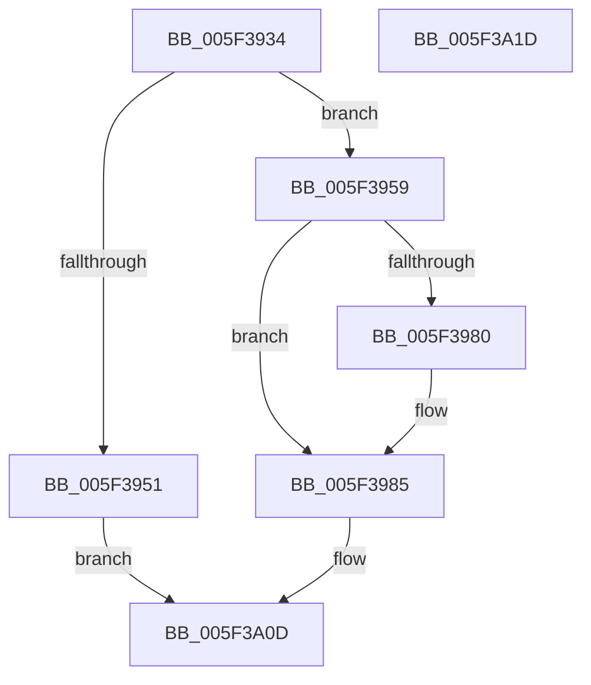

# deflateResetKeep

- RVA: `0x005F3934`–`0x005F3A1E` (길이 `234` bytes)
- VA: `0x00000001405F3934`
- 실행 섹션: `.text`
- PDB 이름 있음: `예`; PDB Function 태그: `아니요`
- unwind 정보 RVA: `0x00060BC4`
- 디코드: `54`개 명령, `234/234` bytes 표시
- 미해석 바이트: `0` (있으면 어셈블리에 `.byte`로 보존)

> 이 문서는 커널 이미지의 기계어와 PDB 기호를 분석해 생성했습니다. 4번과 5번은 함수 원형과 자료형을 바이너리 사용 방식에서 추정한 C 해석이며 원본 소스 복구 결과는 아닙니다.

## 1. Dependencies

- 직접 호출 지점: **3**; 고유 호출 대상: **3**
- 직접 호출자로 확인된 함수: **1**
- RIP 상대 이미지 참조: **3**

### Outgoing calls
- `0x005F3946` → [deflateStateCheck](deflateStateCheck_function_005F3A24.md) (function, `0x005F3A24`)
- `0x005F3993` → [adler32_z](../60/adler32_z_function_00600344.md) (function, `0x00600344`)
- `0x005F3A06` → [init_block](../60/init_block_function_0060193C.md) (function, `0x0060193C`)

### Direct callers
- [deflateReset](deflateReset_function_005F38FC.md) at `0x005F3909`

### Static image references
- `0x005F39B3` → RVA `0x0000B700` (`.rdata`; read)
- `0x005F39CF` → RVA `0x0000B740` (`.rdata`; read)
- `0x005F39EB` → RVA `0x0000B720` (`.rdata`; read)

## 2. Other-region calls and transfers

- 다른 실행 섹션으로 향하는 call: **0**
- 별도 외부 분기/꼬리 이동을 확인하지 못했습니다.

## 3. Assembly (complete function range)

```asm
005F3934  48 89 5C 24 08                  mov qword ptr [rsp + 8], rbx
005F3939  48 89 74 24 10                  mov qword ptr [rsp + 0x10], rsi
005F393E  57                              push rdi
005F393F  48 83 EC 20                     sub rsp, 0x20
005F3943  48 8B F9                        mov rdi, rcx
005F3946  E8 D9 00 00 00                  call 0x1405f3a24
005F394B  33 F6                           xor esi, esi
005F394D  85 C0                           test eax, eax
005F394F  74 08                           je 0x1405f3959
005F3951  8D 46 FE                        lea eax, [rsi - 2]
005F3954  E9 B4 00 00 00                  jmp 0x1405f3a0d
005F3959  48 8B 5F 28                     mov rbx, qword ptr [rdi + 0x28]
005F395D  89 77 1C                        mov dword ptr [rdi + 0x1c], esi
005F3960  89 77 0C                        mov dword ptr [rdi + 0xc], esi
005F3963  48 89 77 20                     mov qword ptr [rdi + 0x20], rsi
005F3967  C7 47 48 02 00 00 00            mov dword ptr [rdi + 0x48], 2
005F396E  48 8B 43 10                     mov rax, qword ptr [rbx + 0x10]
005F3972  48 89 43 20                     mov qword ptr [rbx + 0x20], rax
005F3976  8B 43 2C                        mov eax, dword ptr [rbx + 0x2c]
005F3979  89 73 28                        mov dword ptr [rbx + 0x28], esi
005F397C  85 C0                           test eax, eax
005F397E  79 05                           jns 0x1405f3985
005F3980  F7 D8                           neg eax
005F3982  89 43 2C                        mov dword ptr [rbx + 0x2c], eax
005F3985  45 33 C0                        xor r8d, r8d
005F3988  C7 43 08 2A 00 00 00            mov dword ptr [rbx + 8], 0x2a
005F398F  33 D2                           xor edx, edx
005F3991  33 C9                           xor ecx, ecx
005F3993  E8 AC C9 00 00                  call 0x140600344
005F3998  89 47 4C                        mov dword ptr [rdi + 0x4c], eax
005F399B  48 8B CB                        mov rcx, rbx
005F399E  48 8D 83 0C 01 00 00            lea rax, [rbx + 0x10c]
005F39A5  C7 43 40 FE FF FF FF            mov dword ptr [rbx + 0x40], 0xfffffffe
005F39AC  48 89 83 90 0B 00 00            mov qword ptr [rbx + 0xb90], rax
005F39B3  48 8D 05 46 7D A1 FF            lea rax, [rip - 0x5e82ba]
005F39BA  48 89 83 A0 0B 00 00            mov qword ptr [rbx + 0xba0], rax
005F39C1  48 8D 83 00 0A 00 00            lea rax, [rbx + 0xa00]
005F39C8  48 89 83 A8 0B 00 00            mov qword ptr [rbx + 0xba8], rax
005F39CF  48 8D 05 6A 7D A1 FF            lea rax, [rip - 0x5e8296]
005F39D6  48 89 83 B8 0B 00 00            mov qword ptr [rbx + 0xbb8], rax
005F39DD  48 8D 83 F4 0A 00 00            lea rax, [rbx + 0xaf4]
005F39E4  48 89 83 C0 0B 00 00            mov qword ptr [rbx + 0xbc0], rax
005F39EB  48 8D 05 2E 7D A1 FF            lea rax, [rip - 0x5e82d2]
005F39F2  48 89 83 D0 0B 00 00            mov qword ptr [rbx + 0xbd0], rax
005F39F9  66 89 B3 5C 17 00 00            mov word ptr [rbx + 0x175c], si
005F3A00  89 B3 60 17 00 00               mov dword ptr [rbx + 0x1760], esi
005F3A06  E8 31 DF 00 00                  call 0x14060193c
005F3A0B  33 C0                           xor eax, eax
005F3A0D  48 8B 5C 24 30                  mov rbx, qword ptr [rsp + 0x30]
005F3A12  48 8B 74 24 38                  mov rsi, qword ptr [rsp + 0x38]
005F3A17  48 83 C4 20                     add rsp, 0x20
005F3A1B  5F                              pop rdi
005F3A1C  C3                              ret
005F3A1D  CC                              int3
```

## 4. C-style interpretation (structured pseudocode)

```c
__int64 __fastcall deflateResetKeep(__int64 a1, int a2, int a3)
{
    __int64 result;
    __int64 v_rsi;
    __int64 v_rsp;
    unsigned __int64 v_stack_p10;
    unsigned __int64 v_stack_p8;

    v_stack_p8 = v_rbx;
    v_stack_p10 = v_rsi;
    v_rsp = (v_rsp) - (32);
    result = deflateStateCheck(a1, a2, a3, a4);
    v_rsi = 0;
    if ((unsigned int)(result) == 0) goto loc_005F3959;
    goto loc_005F3A0D;
loc_005F3959:
    *(unsigned int *)(a1 + 28) = 0;
    *(unsigned int *)(a1 + 12) = 0;
    *(unsigned __int64 *)(a1 + 32) = 0;
    *(unsigned int *)(a1 + 72) = 2;
    *(unsigned __int64 *)(*(unsigned __int64 *)(a1 + 40) + 32) = *(unsigned __int64 *)(*(unsigned __int64 *)(a1 + 40) + 16);
    *(unsigned int *)(*(unsigned __int64 *)(a1 + 40) + 40) = 0;
    result = (unsigned int)(*(unsigned int *)(*(unsigned __int64 *)(a1 + 40) + 44));
    if (sign_flag) {
        result = (unsigned int)(-((unsigned int)(*(unsigned int *)(*(unsigned __int64 *)(a1 + 40) + 44))));
        *(unsigned int *)(*(unsigned __int64 *)(a1 + 40) + 44) = (unsigned int)(result);
    }
    a3 = 0;
    *(unsigned int *)(*(unsigned __int64 *)(a1 + 40) + 8) = 42;
    a2 = 0;
    a1 = 0;
    result = adler32_z(a1, a2, a3, a4);
    *(unsigned int *)(a1 + 76) = (unsigned int)(result);
    *(unsigned int *)(*(unsigned __int64 *)(a1 + 40) + 64) = 0xFFFFFFFEULL;
    *(unsigned __int64 *)(*(unsigned __int64 *)(a1 + 40) + 2960) = *(unsigned __int64 *)(a1 + 40) + 268;
    *(unsigned __int64 *)(*(unsigned __int64 *)(a1 + 40) + 2976) = v_rip - 6193850;
    *(unsigned __int64 *)(*(unsigned __int64 *)(a1 + 40) + 2984) = *(unsigned __int64 *)(a1 + 40) + 2560;
    *(unsigned __int64 *)(*(unsigned __int64 *)(a1 + 40) + 3000) = v_rip - 6193814;
    *(unsigned __int64 *)(*(unsigned __int64 *)(a1 + 40) + 3008) = *(unsigned __int64 *)(a1 + 40) + 2804;
    *(unsigned __int64 *)(*(unsigned __int64 *)(a1 + 40) + 3024) = v_rip - 6193874;
    *(unsigned __int16 *)(*(unsigned __int64 *)(a1 + 40) + 5980) = 0;
    *(unsigned int *)(*(unsigned __int64 *)(a1 + 40) + 5984) = 0;
    result = init_block(*(unsigned __int64 *)(a1 + 40), a2, a3, a4);
    result = 0;
loc_005F3A0D:
    v_rsp = (v_rsp) + (32);
    return result;
}
```

## 5. (Beta) C Style

```c
int64_t deflateResetKeep(void *Arg1, int32_t Arg2, int32_t Arg3)
{
    uint8_t *arg1 = (uint8_t *)Arg1;

    int64_t result;
    int64_t local_rsi;
    int64_t local_rsp;
    uint64_t v_stack_p10;
    uint64_t v_stack_p8;

    v_stack_p8 = local_rbx;
    v_stack_p10 = local_rsi;
    local_rsp = (local_rsp) - (32);
    result = deflateStateCheck(Arg1, Arg2, Arg3, a4);
    local_rsi = 0;
    if ((uint32_t)(result) == 0) goto loc_005F3959;
    goto loc_005F3A0D;
loc_005F3959:
    *(uint32_t *)(arg1 + 0x1C) = 0;
    *(uint32_t *)(arg1 + 0xC) = 0;
    *(uint64_t *)(arg1 + 0x20) = 0;
    *(uint32_t *)(arg1 + 0x48) = 2;
    *(uint64_t *)(*(uint64_t *)(arg1 + 0x28) + 0x20) = *(uint64_t *)(*(uint64_t *)(arg1 + 0x28) + 0x10);
    *(uint32_t *)(*(uint64_t *)(arg1 + 0x28) + 0x28) = 0;
    result = (uint32_t)(*(uint32_t *)(*(uint64_t *)(arg1 + 0x28) + 0x2C));
    if (sign_flag) {
        result = (uint32_t)(-((uint32_t)(*(uint32_t *)(*(uint64_t *)(arg1 + 0x28) + 0x2C))));
        *(uint32_t *)(*(uint64_t *)(arg1 + 0x28) + 0x2C) = (uint32_t)(result);
    }
    Arg3 = 0;
    *(uint32_t *)(*(uint64_t *)(arg1 + 0x28) + 0x8) = 42;
    Arg2 = 0;
    Arg1 = 0;
    result = adler32_z(Arg1, Arg2, Arg3, a4);
    *(uint32_t *)(arg1 + 0x4C) = (uint32_t)(result);
    *(uint32_t *)(*(uint64_t *)(arg1 + 0x28) + 0x40) = 0xFFFFFFFEULL;
    *(uint64_t *)(*(uint64_t *)(arg1 + 0x28) + 0xB90) = *(uint64_t *)(arg1 + 0x28) + 268;
    *(uint64_t *)(*(uint64_t *)(arg1 + 0x28) + 0xBA0) = v_rip - 6193850;
    *(uint64_t *)(*(uint64_t *)(arg1 + 0x28) + 0xBA8) = *(uint64_t *)(arg1 + 0x28) + 2560;
    *(uint64_t *)(*(uint64_t *)(arg1 + 0x28) + 0xBB8) = v_rip - 6193814;
    *(uint64_t *)(*(uint64_t *)(arg1 + 0x28) + 0xBC0) = *(uint64_t *)(arg1 + 0x28) + 2804;
    *(uint64_t *)(*(uint64_t *)(arg1 + 0x28) + 0xBD0) = v_rip - 6193874;
    *(uint16_t *)(*(uint64_t *)(arg1 + 0x28) + 0x175C) = 0;
    *(uint32_t *)(*(uint64_t *)(arg1 + 0x28) + 0x1760) = 0;
    result = init_block(*(uint64_t *)(arg1 + 0x28), Arg2, Arg3, a4);
    result = 0;
loc_005F3A0D:
    local_rsp = (local_rsp) + (32);
    return result;
}
```

### 관측된 메모리 오프셋

구조체 형식이 확인되지 않은 접근은 인자 기준의 오프셋으로만 기록했습니다.

| 기준 인자 | 오프셋 표현 | 폭 (bit) | 접근 |
|---|---:|---:|---|
| `Arg1` | `+ 0xC` | `32` | `W` |
| `Arg1` | `+ 0x1C` | `32` | `W` |
| `Arg1` | `+ 0x20` | `64` | `W` |
| `Arg1` | `+ 0x28` | `64` | `R` |
| `Arg1` | `+ 0x48` | `32` | `W` |
| `Arg1` | `+ 0x4C` | `32` | `W` |

## 6. Execution-region graph

[열기: 2D/3D 그래프와 함수 탐색 컨트롤 패널](../../../control-panel.html?section=text&rva=0x005F3934&view=graph)

- 2D 그래프는 위에서 아래로 흐르고, 3D 그래프는 빈 공간을 드래그해 회전합니다. Shift+드래그는 이동, 휠은 확대·축소, 함수 노드 선택은 대상 보고서 이동입니다.

### Static fallback


