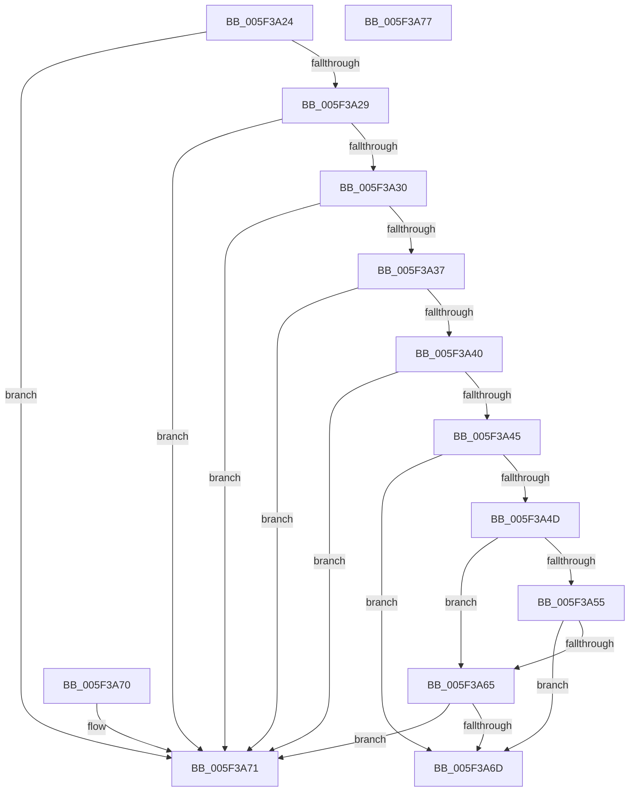

# deflateStateCheck

- RVA: `0x005F3A24`–`0x005F3A78` (길이 `84` bytes)
- VA: `0x00000001405F3A24`
- 실행 섹션: `.text`
- PDB 이름 있음: `예`; PDB Function 태그: `예`
- unwind 정보 RVA: `0x000DB714`
- 디코드: `28`개 명령, `84/84` bytes 표시
- 미해석 바이트: `0` (있으면 어셈블리에 `.byte`로 보존)

> 이 문서는 커널 이미지의 기계어와 PDB 기호를 분석해 생성했습니다. 4번과 5번은 함수 원형과 자료형을 바이너리 사용 방식에서 추정한 C 해석이며 원본 소스 복구 결과는 아닙니다.

## 1. Dependencies

- 직접 호출 지점: **0**; 고유 호출 대상: **0**
- 직접 호출자로 확인된 함수: **2**
- RIP 상대 이미지 참조: **0**

### Outgoing calls
- 직접 디코드된 call 명령이 없습니다.

### Direct callers
- [deflate](deflate_function_005F35C8.md) at `0x005F35DA`
- [deflateResetKeep](deflateResetKeep_function_005F3934.md) at `0x005F3946`

### Static image references
- 디코드된 RIP-relative 메모리 참조가 없습니다.

## 2. Other-region calls and transfers

- 다른 실행 섹션으로 향하는 call: **0**
- 별도 외부 분기/꼬리 이동을 확인하지 못했습니다.

## 3. Assembly (complete function range)

```asm
005F3A24  48 85 C9                        test rcx, rcx
005F3A27  74 48                           je 0x1405f3a71
005F3A29  48 83 79 30 00                  cmp qword ptr [rcx + 0x30], 0
005F3A2E  74 41                           je 0x1405f3a71
005F3A30  48 83 79 38 00                  cmp qword ptr [rcx + 0x38], 0
005F3A35  74 3A                           je 0x1405f3a71
005F3A37  48 8B 41 28                     mov rax, qword ptr [rcx + 0x28]
005F3A3B  48 85 C0                        test rax, rax
005F3A3E  74 31                           je 0x1405f3a71
005F3A40  48 39 08                        cmp qword ptr [rax], rcx
005F3A43  75 2C                           jne 0x1405f3a71
005F3A45  8B 48 08                        mov ecx, dword ptr [rax + 8]
005F3A48  83 F9 71                        cmp ecx, 0x71
005F3A4B  74 20                           je 0x1405f3a6d
005F3A4D  8D 41 D6                        lea eax, [rcx - 0x2a]
005F3A50  83 F8 3D                        cmp eax, 0x3d
005F3A53  77 10                           ja 0x1405f3a65
005F3A55  48 BA 01 00 00 88 00 00 02 20   movabs rdx, 0x2002000088000001
005F3A5F  48 0F A3 C2                     bt rdx, rax
005F3A63  72 08                           jb 0x1405f3a6d
005F3A65  81 F9 9A 02 00 00               cmp ecx, 0x29a
005F3A6B  75 04                           jne 0x1405f3a71
005F3A6D  33 C0                           xor eax, eax
005F3A6F  C3                              ret
005F3A70  CC                              int3
005F3A71  B8 01 00 00 00                  mov eax, 1
005F3A76  C3                              ret
005F3A77  CC                              int3
```

## 4. C-style interpretation (structured pseudocode)

```c
__int64 __fastcall deflateStateCheck(__int64 a1)
{
    __int64 result;

    if (a1 == 0) goto loc_005F3A71;
    if ((*(unsigned __int64 *)(a1 + 48)) == 0) goto loc_005F3A71;
    if ((*(unsigned __int64 *)(a1 + 56)) == 0) goto loc_005F3A71;
    if (*(unsigned __int64 *)(a1 + 40) == 0) goto loc_005F3A71;
    if ((*(unsigned __int64 *)(*(unsigned __int64 *)(a1 + 40))) != a1) goto loc_005F3A71;
    if (((unsigned int)((unsigned int)(*(unsigned int *)(*(unsigned __int64 *)(a1 + 40) + 8)))) == 113) goto loc_005F3A6D;
    if (((unsigned int)((unsigned int)(*(unsigned int *)(*(unsigned __int64 *)(a1 + 40) + 8)) - 42)) > 61) goto loc_005F3A65;
    if (((unsigned int)((unsigned int)(*(unsigned int *)(*(unsigned __int64 *)(a1 + 40) + 8)) - 42)) < 61) goto loc_005F3A6D;
loc_005F3A65:
    if (((unsigned int)((unsigned int)(*(unsigned int *)(*(unsigned __int64 *)(a1 + 40) + 8)))) != 666) goto loc_005F3A71;
loc_005F3A6D:
    result = 0;
    return result;
loc_005F3A71:
    return 1;
}
```

## 5. (Beta) C Style

```c
int64_t deflateStateCheck(int64_t Arg1)
{
    int64_t result;

    if (Arg1 == 0) goto loc_005F3A71;
    if ((*(uint64_t *)(Arg1 + 0x30)) == 0) goto loc_005F3A71;
    if ((*(uint64_t *)(Arg1 + 0x38)) == 0) goto loc_005F3A71;
    if (*(uint64_t *)(Arg1 + 0x28) == 0) goto loc_005F3A71;
    if ((*(uint64_t *)(*(uint64_t *)(Arg1 + 0x28))) != Arg1) goto loc_005F3A71;
    if (((uint32_t)((uint32_t)(*(uint32_t *)(*(uint64_t *)(Arg1 + 0x28) + 0x8)))) == 113) goto loc_005F3A6D;
    if (((uint32_t)((uint32_t)(*(uint32_t *)(*(uint64_t *)(Arg1 + 0x28) + 0x8)) - 42)) > 61) goto loc_005F3A65;
    if (((uint32_t)((uint32_t)(*(uint32_t *)(*(uint64_t *)(Arg1 + 0x28) + 0x8)) - 42)) < 61) goto loc_005F3A6D;
loc_005F3A65:
    if (((uint32_t)((uint32_t)(*(uint32_t *)(*(uint64_t *)(Arg1 + 0x28) + 0x8)))) != 666) goto loc_005F3A71;
loc_005F3A6D:
    result = 0;
    return result;
loc_005F3A71:
    return 1;
}
```

## 6. Execution-region graph

[열기: 2D/3D 그래프와 함수 탐색 컨트롤 패널](../../../control-panel.html?section=text&rva=0x005F3A24&view=graph)

- 2D 그래프는 위에서 아래로 흐르고, 3D 그래프는 빈 공간을 드래그해 회전합니다. Shift+드래그는 이동, 휠은 확대·축소, 함수 노드 선택은 대상 보고서 이동입니다.

### Static fallback


