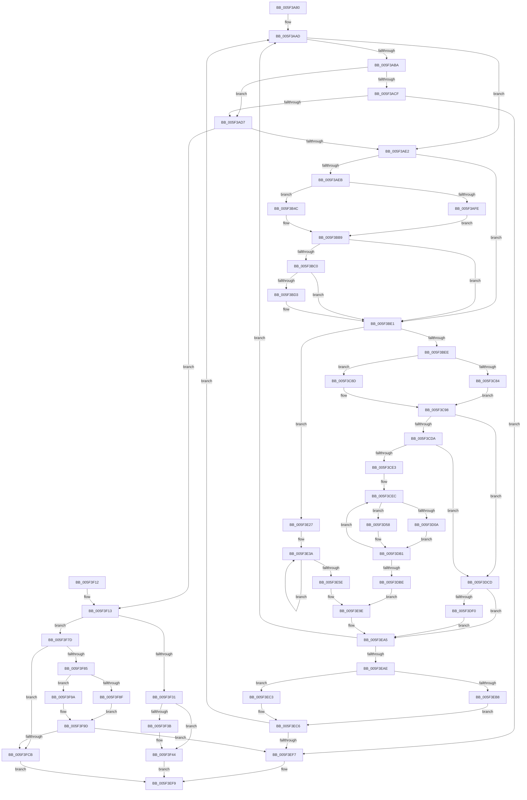

# deflate_fast

- RVA: `0x005F3A80`–`0x005F3FD3` (길이 `1,363` bytes)
- VA: `0x00000001405F3A80`
- 실행 섹션: `.text`
- PDB 이름 있음: `예`; PDB Function 태그: `예`
- unwind 정보 RVA: `0x000B3E30`
- 디코드: `300`개 명령, `1,363/1,363` bytes 표시
- 미해석 바이트: `0` (있으면 어셈블리에 `.byte`로 보존)

> 이 문서는 커널 이미지의 기계어와 PDB 기호를 분석해 생성했습니다. 4번과 5번은 함수 원형과 자료형을 바이너리 사용 방식에서 추정한 C 해석이며 원본 소스 복구 결과는 아닙니다.

## 1. Dependencies

- 직접 호출 지점: **8**; 고유 호출 대상: **4**
- 직접 호출자로 확인된 함수: **0**
- RIP 상대 이미지 참조: **4**

### Outgoing calls
- `0x005F3ABD` → [fill_window](fill_window_function_005F4EF0.md) (function, `0x005F4EF0`)
- `0x005F3BD6` → [longest_match](longest_match_function_005F539C.md) (function, `0x005F539C`)
- `0x005F3ED2` → [tr_flush_block](../60/tr_flush_block_function_00600AF8.md) (function, `0x00600AF8`)
- `0x005F3EE6` → [flush_pending](flush_pending_function_005F5258.md) (function, `0x005F5258`)
- `0x005F3F50` → [tr_flush_block](../60/tr_flush_block_function_00600AF8.md) (function, `0x00600AF8`)
- `0x005F3F64` → [flush_pending](flush_pending_function_005F5258.md) (function, `0x005F5258`)
- `0x005F3FA6` → [tr_flush_block](../60/tr_flush_block_function_00600AF8.md) (function, `0x00600AF8`)
- `0x005F3FBA` → [flush_pending](flush_pending_function_005F5258.md) (function, `0x005F5258`)

### Direct callers
- 이 함수 시작 RVA로 연결되는 직접 call은 확인되지 않았습니다. 간접 호출은 완전히 역산할 수 없습니다.

### Static image references
- `0x005F3AEB` → RVA `0x00E67B40` (`.data`; read)
- `0x005F3C59` → RVA `0x00036720` (`.rdata`; read)
- `0x005F3C84` → RVA `0x00036520` (`.rdata`; read)
- `0x005F3C91` → RVA `0x00036620` (`.rdata`; read)

## 2. Other-region calls and transfers

- 다른 실행 섹션으로 향하는 call: **0**
- 별도 외부 분기/꼬리 이동을 확인하지 못했습니다.

## 3. Assembly (complete function range)

```asm
005F3A80  48 89 5C 24 08                  mov qword ptr [rsp + 8], rbx
005F3A85  48 89 6C 24 10                  mov qword ptr [rsp + 0x10], rbp
005F3A8A  48 89 74 24 18                  mov qword ptr [rsp + 0x18], rsi
005F3A8F  57                              push rdi
005F3A90  41 56                           push r14
005F3A92  41 57                           push r15
005F3A94  48 83 EC 20                     sub rsp, 0x20
005F3A98  33 FF                           xor edi, edi
005F3A9A  4C 8D B1 E4 00 00 00            lea r14, [rcx + 0xe4]
005F3AA1  8B EA                           mov ebp, edx
005F3AA3  48 8B D9                        mov rbx, rcx
005F3AA6  49 8B F6                        mov rsi, r14
005F3AA9  44 8D 7F 01                     lea r15d, [rdi + 1]
005F3AAD  8B 83 EC 00 00 00               mov eax, dword ptr [rbx + 0xec]
005F3AB3  3D 06 01 00 00                  cmp eax, 0x106
005F3AB8  73 28                           jae 0x1405f3ae2
005F3ABA  48 8B CB                        mov rcx, rbx
005F3ABD  E8 2E 14 00 00                  call 0x1405f4ef0
005F3AC2  8B 83 EC 00 00 00               mov eax, dword ptr [rbx + 0xec]
005F3AC8  3D 06 01 00 00                  cmp eax, 0x106
005F3ACD  73 08                           jae 0x1405f3ad7
005F3ACF  85 ED                           test ebp, ebp
005F3AD1  0F 84 20 04 00 00               je 0x1405f3ef7
005F3AD7  49 8B F6                        mov rsi, r14
005F3ADA  85 C0                           test eax, eax
005F3ADC  0F 84 31 04 00 00               je 0x1405f3f13
005F3AE2  83 F8 03                        cmp eax, 3
005F3AE5  0F 82 F6 00 00 00               jb 0x1405f3be1
005F3AEB  39 3D 4F 40 87 00               cmp dword ptr [rip + 0x87404f], edi
005F3AF1  44 0F B7 0E                     movzx r9d, word ptr [rsi]
005F3AF5  48 8B 83 A0 00 00 00            mov rax, qword ptr [rbx + 0xa0]
005F3AFC  74 4E                           je 0x1405f3b4c
005F3AFE  41 8B 14 01                     mov edx, dword ptr [r9 + rax]
005F3B02  8B CA                           mov ecx, edx
005F3B04  81 E1 FF FF FF 00               and ecx, 0xffffff
005F3B0A  8B C7                           mov eax, edi
005F3B0C  83 BB FC 00 00 00 06            cmp dword ptr [rbx + 0xfc], 6
005F3B13  0F 4C CA                        cmovl ecx, edx
005F3B16  F2 0F 38 F1 C1                  crc32 eax, ecx
005F3B1B  8B C8                           mov ecx, eax
005F3B1D  8B 83 CC 00 00 00               mov eax, dword ptr [rbx + 0xcc]
005F3B23  48 23 C8                        and rcx, rax
005F3B26  48 8B 83 B8 00 00 00            mov rax, qword ptr [rbx + 0xb8]
005F3B2D  0F B7 14 48                     movzx edx, word ptr [rax + rcx*2]
005F3B31  66 44 89 0C 48                  mov word ptr [rax + rcx*2], r9w
005F3B36  8B 8B 9C 00 00 00               mov ecx, dword ptr [rbx + 0x9c]
005F3B3C  48 8B 83 B0 00 00 00            mov rax, qword ptr [rbx + 0xb0]
005F3B43  49 23 C9                        and rcx, r9
005F3B46  66 89 14 48                     mov word ptr [rax + rcx*2], dx
005F3B4A  EB 6D                           jmp 0x1405f3bb9
005F3B4C  41 0F B6 44 01 02               movzx eax, byte ptr [r9 + rax + 2]
005F3B52  44 8B 83 C0 00 00 00            mov r8d, dword ptr [rbx + 0xc0]
005F3B59  8B 8B D0 00 00 00               mov ecx, dword ptr [rbx + 0xd0]
005F3B5F  8B 93 9C 00 00 00               mov edx, dword ptr [rbx + 0x9c]
005F3B65  41 D3 E0                        shl r8d, cl
005F3B68  49 23 D1                        and rdx, r9
005F3B6B  48 8B 8B B0 00 00 00            mov rcx, qword ptr [rbx + 0xb0]
005F3B72  44 33 C0                        xor r8d, eax
005F3B75  44 23 83 CC 00 00 00            and r8d, dword ptr [rbx + 0xcc]
005F3B7C  48 8B 83 B8 00 00 00            mov rax, qword ptr [rbx + 0xb8]
005F3B83  44 89 83 C0 00 00 00            mov dword ptr [rbx + 0xc0], r8d
005F3B8A  42 0F B7 04 40                  movzx eax, word ptr [rax + r8*2]
005F3B8F  66 89 04 51                     mov word ptr [rcx + rdx*2], ax
005F3B93  48 8B 83 B0 00 00 00            mov rax, qword ptr [rbx + 0xb0]
005F3B9A  8B 8B 9C 00 00 00               mov ecx, dword ptr [rbx + 0x9c]
005F3BA0  49 23 C9                        and rcx, r9
005F3BA3  0F B7 14 48                     movzx edx, word ptr [rax + rcx*2]
005F3BA7  8B 8B C0 00 00 00               mov ecx, dword ptr [rbx + 0xc0]
005F3BAD  48 8B 83 B8 00 00 00            mov rax, qword ptr [rbx + 0xb8]
005F3BB4  66 44 89 0C 48                  mov word ptr [rax + rcx*2], r9w
005F3BB9  0F B7 D2                        movzx edx, dx
005F3BBC  85 D2                           test edx, edx
005F3BBE  74 21                           je 0x1405f3be1
005F3BC0  8B 0E                           mov ecx, dword ptr [rsi]
005F3BC2  8B 83 94 00 00 00               mov eax, dword ptr [rbx + 0x94]
005F3BC8  2B CA                           sub ecx, edx
005F3BCA  2D 06 01 00 00                  sub eax, 0x106
005F3BCF  3B C8                           cmp ecx, eax
005F3BD1  77 0E                           ja 0x1405f3be1
005F3BD3  48 8B CB                        mov rcx, rbx
005F3BD6  E8 C1 17 00 00                  call 0x1405f539c
005F3BDB  89 83 D8 00 00 00               mov dword ptr [rbx + 0xd8], eax
005F3BE1  83 BB D8 00 00 00 03            cmp dword ptr [rbx + 0xd8], 3
005F3BE8  0F 82 39 02 00 00               jb 0x1405f3e27
005F3BEE  8B 8B 44 17 00 00               mov ecx, dword ptr [rbx + 0x1744]
005F3BF4  48 8B 83 38 17 00 00            mov rax, qword ptr [rbx + 0x1738]
005F3BFB  44 0F B7 0E                     movzx r9d, word ptr [rsi]
005F3BFF  66 44 2B 8B E8 00 00 00         sub r9w, word ptr [rbx + 0xe8]
005F3C07  44 8A 83 D8 00 00 00            mov r8b, byte ptr [rbx + 0xd8]
005F3C0E  44 88 0C 01                     mov byte ptr [rcx + rax], r9b
005F3C12  41 80 E8 03                     sub r8b, 3
005F3C16  44 01 BB 44 17 00 00            add dword ptr [rbx + 0x1744], r15d
005F3C1D  41 0F B7 C9                     movzx ecx, r9w
005F3C21  8B 93 44 17 00 00               mov edx, dword ptr [rbx + 0x1744]
005F3C27  48 8B 83 38 17 00 00            mov rax, qword ptr [rbx + 0x1738]
005F3C2E  66 C1 E9 08                     shr cx, 8
005F3C32  88 0C 02                        mov byte ptr [rdx + rax], cl
005F3C35  44 01 BB 44 17 00 00            add dword ptr [rbx + 0x1744], r15d
005F3C3C  8B 8B 44 17 00 00               mov ecx, dword ptr [rbx + 0x1744]
005F3C42  48 8B 83 38 17 00 00            mov rax, qword ptr [rbx + 0x1738]
005F3C49  44 88 04 01                     mov byte ptr [rcx + rax], r8b
005F3C4D  B8 FF FF 00 00                  mov eax, 0xffff
005F3C52  44 01 BB 44 17 00 00            add dword ptr [rbx + 0x1744], r15d
005F3C59  48 8D 0D C0 2A A4 FF            lea rcx, [rip - 0x5bd540]
005F3C60  66 44 03 C8                     add r9w, ax
005F3C64  41 0F B6 C0                     movzx eax, r8b
005F3C68  0F B6 0C 08                     movzx ecx, byte ptr [rax + rcx]
005F3C6C  B8 00 01 00 00                  mov eax, 0x100
005F3C71  66 44 01 BC 8B 10 05 00 00      add word ptr [rbx + rcx*4 + 0x510], r15w
005F3C7A  66 44 3B C8                     cmp r9w, ax
005F3C7E  41 0F B7 C1                     movzx eax, r9w
005F3C82  73 09                           jae 0x1405f3c8d
005F3C84  48 8D 0D 95 28 A4 FF            lea rcx, [rip - 0x5bd76b]
005F3C8B  EB 0B                           jmp 0x1405f3c98
005F3C8D  48 C1 E8 07                     shr rax, 7
005F3C91  48 8D 0D 88 29 A4 FF            lea rcx, [rip - 0x5bd678]
005F3C98  48 03 C1                        add rax, rcx
005F3C9B  44 8B CF                        mov r9d, edi
005F3C9E  0F B6 00                        movzx eax, byte ptr [rax]
005F3CA1  66 44 01 BC 83 00 0A 00 00      add word ptr [rbx + rax*4 + 0xa00], r15w
005F3CAA  8B 83 48 17 00 00               mov eax, dword ptr [rbx + 0x1748]
005F3CB0  39 83 44 17 00 00               cmp dword ptr [rbx + 0x1744], eax
005F3CB6  8B 83 EC 00 00 00               mov eax, dword ptr [rbx + 0xec]
005F3CBC  8B 8B D8 00 00 00               mov ecx, dword ptr [rbx + 0xd8]
005F3CC2  41 0F 94 C1                     sete r9b
005F3CC6  2B C1                           sub eax, ecx
005F3CC8  89 83 EC 00 00 00               mov dword ptr [rbx + 0xec], eax
005F3CCE  3B 8B F8 00 00 00               cmp ecx, dword ptr [rbx + 0xf8]
005F3CD4  0F 87 F3 00 00 00               ja 0x1405f3dcd
005F3CDA  83 F8 03                        cmp eax, 3
005F3CDD  0F 82 EA 00 00 00               jb 0x1405f3dcd
005F3CE3  8D 41 FF                        lea eax, [rcx - 1]
005F3CE6  89 83 D8 00 00 00               mov dword ptr [rbx + 0xd8], eax
005F3CEC  44 01 BB E4 00 00 00            add dword ptr [rbx + 0xe4], r15d
005F3CF3  39 3D 47 3E 87 00               cmp dword ptr [rip + 0x873e47], edi
005F3CF9  44 0F B7 93 E4 00 00 00         movzx r10d, word ptr [rbx + 0xe4]
005F3D01  48 8B 83 A0 00 00 00            mov rax, qword ptr [rbx + 0xa0]
005F3D08  74 4E                           je 0x1405f3d58
005F3D0A  41 8B 14 02                     mov edx, dword ptr [r10 + rax]
005F3D0E  8B CA                           mov ecx, edx
005F3D10  81 E1 FF FF FF 00               and ecx, 0xffffff
005F3D16  8B C7                           mov eax, edi
005F3D18  83 BB FC 00 00 00 06            cmp dword ptr [rbx + 0xfc], 6
005F3D1F  0F 4C CA                        cmovl ecx, edx
005F3D22  F2 0F 38 F1 C1                  crc32 eax, ecx
005F3D27  8B C8                           mov ecx, eax
005F3D29  8B 83 CC 00 00 00               mov eax, dword ptr [rbx + 0xcc]
005F3D2F  48 23 C8                        and rcx, rax
005F3D32  48 8B 83 B8 00 00 00            mov rax, qword ptr [rbx + 0xb8]
005F3D39  0F B7 14 48                     movzx edx, word ptr [rax + rcx*2]
005F3D3D  66 44 89 14 48                  mov word ptr [rax + rcx*2], r10w
005F3D42  8B 8B 9C 00 00 00               mov ecx, dword ptr [rbx + 0x9c]
005F3D48  48 8B 83 B0 00 00 00            mov rax, qword ptr [rbx + 0xb0]
005F3D4F  49 23 CA                        and rcx, r10
005F3D52  66 89 14 48                     mov word ptr [rax + rcx*2], dx
005F3D56  EB 59                           jmp 0x1405f3db1
005F3D58  41 0F B6 44 02 02               movzx eax, byte ptr [r10 + rax + 2]
005F3D5E  44 8B 83 C0 00 00 00            mov r8d, dword ptr [rbx + 0xc0]
005F3D65  8B 8B D0 00 00 00               mov ecx, dword ptr [rbx + 0xd0]
005F3D6B  8B 93 9C 00 00 00               mov edx, dword ptr [rbx + 0x9c]
005F3D71  41 D3 E0                        shl r8d, cl
005F3D74  48 8B 8B B0 00 00 00            mov rcx, qword ptr [rbx + 0xb0]
005F3D7B  44 33 C0                        xor r8d, eax
005F3D7E  44 23 83 CC 00 00 00            and r8d, dword ptr [rbx + 0xcc]
005F3D85  48 8B 83 B8 00 00 00            mov rax, qword ptr [rbx + 0xb8]
005F3D8C  49 23 D2                        and rdx, r10
005F3D8F  44 89 83 C0 00 00 00            mov dword ptr [rbx + 0xc0], r8d
005F3D96  42 0F B7 04 40                  movzx eax, word ptr [rax + r8*2]
005F3D9B  66 89 04 51                     mov word ptr [rcx + rdx*2], ax
005F3D9F  8B 8B C0 00 00 00               mov ecx, dword ptr [rbx + 0xc0]
005F3DA5  48 8B 83 B8 00 00 00            mov rax, qword ptr [rbx + 0xb8]
005F3DAC  66 44 89 14 48                  mov word ptr [rax + rcx*2], r10w
005F3DB1  83 83 D8 00 00 00 FF            add dword ptr [rbx + 0xd8], -1
005F3DB8  0F 85 2E FF FF FF               jne 0x1405f3cec
005F3DBE  44 8B 93 E4 00 00 00            mov r10d, dword ptr [rbx + 0xe4]
005F3DC5  41 FF C2                        inc r10d
005F3DC8  E9 D1 00 00 00                  jmp 0x1405f3e9e
005F3DCD  44 8B 93 E4 00 00 00            mov r10d, dword ptr [rbx + 0xe4]
005F3DD4  44 03 D1                        add r10d, ecx
005F3DD7  89 BB D8 00 00 00               mov dword ptr [rbx + 0xd8], edi
005F3DDD  44 89 93 E4 00 00 00            mov dword ptr [rbx + 0xe4], r10d
005F3DE4  39 BB 68 17 00 00               cmp dword ptr [rbx + 0x1768], edi
005F3DEA  0F 85 B5 00 00 00               jne 0x1405f3ea5
005F3DF0  48 8B 93 A0 00 00 00            mov rdx, qword ptr [rbx + 0xa0]
005F3DF7  41 8D 42 01                     lea eax, [r10 + 1]
005F3DFB  8B 8B D0 00 00 00               mov ecx, dword ptr [rbx + 0xd0]
005F3E01  45 0F B6 04 12                  movzx r8d, byte ptr [r10 + rdx]
005F3E06  44 89 83 C0 00 00 00            mov dword ptr [rbx + 0xc0], r8d
005F3E0D  0F B6 04 10                     movzx eax, byte ptr [rax + rdx]
005F3E11  41 D3 E0                        shl r8d, cl
005F3E14  44 33 C0                        xor r8d, eax
005F3E17  44 23 83 CC 00 00 00            and r8d, dword ptr [rbx + 0xcc]
005F3E1E  44 89 83 C0 00 00 00            mov dword ptr [rbx + 0xc0], r8d
005F3E25  EB 7E                           jmp 0x1405f3ea5
005F3E27  8B 0E                           mov ecx, dword ptr [rsi]
005F3E29  BA 02 00 00 00                  mov edx, 2
005F3E2E  48 8B 83 A0 00 00 00            mov rax, qword ptr [rbx + 0xa0]
005F3E35  44 0F B6 04 01                  movzx r8d, byte ptr [rcx + rax]
005F3E3A  48 8B 83 38 17 00 00            mov rax, qword ptr [rbx + 0x1738]
005F3E41  8B 8B 44 17 00 00               mov ecx, dword ptr [rbx + 0x1744]
005F3E47  40 88 3C 01                     mov byte ptr [rcx + rax], dil
005F3E4B  8B 83 44 17 00 00               mov eax, dword ptr [rbx + 0x1744]
005F3E51  FF C0                           inc eax
005F3E53  89 83 44 17 00 00               mov dword ptr [rbx + 0x1744], eax
005F3E59  49 2B D7                        sub rdx, r15
005F3E5C  75 DC                           jne 0x1405f3e3a
005F3E5E  8B C8                           mov ecx, eax
005F3E60  44 8B CF                        mov r9d, edi
005F3E63  48 8B 83 38 17 00 00            mov rax, qword ptr [rbx + 0x1738]
005F3E6A  44 88 04 01                     mov byte ptr [rcx + rax], r8b
005F3E6E  44 01 BB 44 17 00 00            add dword ptr [rbx + 0x1744], r15d
005F3E75  66 46 01 BC 83 0C 01 00 00      add word ptr [rbx + r8*4 + 0x10c], r15w
005F3E7E  44 8B 93 E4 00 00 00            mov r10d, dword ptr [rbx + 0xe4]
005F3E85  FF 8B EC 00 00 00               dec dword ptr [rbx + 0xec]
005F3E8B  41 FF C2                        inc r10d
005F3E8E  8B 83 48 17 00 00               mov eax, dword ptr [rbx + 0x1748]
005F3E94  39 83 44 17 00 00               cmp dword ptr [rbx + 0x1744], eax
005F3E9A  41 0F 94 C1                     sete r9b
005F3E9E  44 89 93 E4 00 00 00            mov dword ptr [rbx + 0xe4], r10d
005F3EA5  45 85 C9                        test r9d, r9d
005F3EA8  0F 84 FF FB FF FF               je 0x1405f3aad
005F3EAE  8B 83 D4 00 00 00               mov eax, dword ptr [rbx + 0xd4]
005F3EB4  85 C0                           test eax, eax
005F3EB6  78 0B                           js 0x1405f3ec3
005F3EB8  8B D0                           mov edx, eax
005F3EBA  48 03 93 A0 00 00 00            add rdx, qword ptr [rbx + 0xa0]
005F3EC1  EB 03                           jmp 0x1405f3ec6
005F3EC3  48 8B D7                        mov rdx, rdi
005F3EC6  44 2B D0                        sub r10d, eax
005F3EC9  45 33 C9                        xor r9d, r9d
005F3ECC  45 8B C2                        mov r8d, r10d
005F3ECF  48 8B CB                        mov rcx, rbx
005F3ED2  E8 21 CC 00 00                  call 0x140600af8
005F3ED7  8B 83 E4 00 00 00               mov eax, dword ptr [rbx + 0xe4]
005F3EDD  48 8B 0B                        mov rcx, qword ptr [rbx]
005F3EE0  89 83 D4 00 00 00               mov dword ptr [rbx + 0xd4], eax
005F3EE6  E8 6D 13 00 00                  call 0x1405f5258
005F3EEB  48 8B 03                        mov rax, qword ptr [rbx]
005F3EEE  39 78 18                        cmp dword ptr [rax + 0x18], edi
005F3EF1  0F 85 B6 FB FF FF               jne 0x1405f3aad
005F3EF7  33 C0                           xor eax, eax
005F3EF9  48 8B 5C 24 40                  mov rbx, qword ptr [rsp + 0x40]
005F3EFE  48 8B 6C 24 48                  mov rbp, qword ptr [rsp + 0x48]
005F3F03  48 8B 74 24 50                  mov rsi, qword ptr [rsp + 0x50]
005F3F08  48 83 C4 20                     add rsp, 0x20
005F3F0C  41 5F                           pop r15
005F3F0E  41 5E                           pop r14
005F3F10  5F                              pop rdi
005F3F11  C3                              ret
005F3F12  CC                              int3
005F3F13  44 8B 83 E4 00 00 00            mov r8d, dword ptr [rbx + 0xe4]
005F3F1A  B8 02 00 00 00                  mov eax, 2
005F3F1F  44 3B C0                        cmp r8d, eax
005F3F22  41 0F 42 C0                     cmovb eax, r8d
005F3F26  89 83 58 17 00 00               mov dword ptr [rbx + 0x1758], eax
005F3F2C  83 FD 04                        cmp ebp, 4
005F3F2F  75 4C                           jne 0x1405f3f7d
005F3F31  8B 83 D4 00 00 00               mov eax, dword ptr [rbx + 0xd4]
005F3F37  85 C0                           test eax, eax
005F3F39  78 09                           js 0x1405f3f44
005F3F3B  8B F8                           mov edi, eax
005F3F3D  48 03 BB A0 00 00 00            add rdi, qword ptr [rbx + 0xa0]
005F3F44  44 2B C0                        sub r8d, eax
005F3F47  45 8B CF                        mov r9d, r15d
005F3F4A  48 8B D7                        mov rdx, rdi
005F3F4D  48 8B CB                        mov rcx, rbx
005F3F50  E8 A3 CB 00 00                  call 0x140600af8
005F3F55  8B 83 E4 00 00 00               mov eax, dword ptr [rbx + 0xe4]
005F3F5B  48 8B 0B                        mov rcx, qword ptr [rbx]
005F3F5E  89 83 D4 00 00 00               mov dword ptr [rbx + 0xd4], eax
005F3F64  E8 EF 12 00 00                  call 0x1405f5258
005F3F69  48 8B 03                        mov rax, qword ptr [rbx]
005F3F6C  8B 48 18                        mov ecx, dword ptr [rax + 0x18]
005F3F6F  F7 D9                           neg ecx
005F3F71  1B C0                           sbb eax, eax
005F3F73  F7 D8                           neg eax
005F3F75  83 C0 02                        add eax, 2
005F3F78  E9 7C FF FF FF                  jmp 0x1405f3ef9
005F3F7D  39 BB 44 17 00 00               cmp dword ptr [rbx + 0x1744], edi
005F3F83  74 46                           je 0x1405f3fcb
005F3F85  8B 83 D4 00 00 00               mov eax, dword ptr [rbx + 0xd4]
005F3F8B  85 C0                           test eax, eax
005F3F8D  78 0B                           js 0x1405f3f9a
005F3F8F  8B D0                           mov edx, eax
005F3F91  48 03 93 A0 00 00 00            add rdx, qword ptr [rbx + 0xa0]
005F3F98  EB 03                           jmp 0x1405f3f9d
005F3F9A  48 8B D7                        mov rdx, rdi
005F3F9D  44 2B C0                        sub r8d, eax
005F3FA0  45 33 C9                        xor r9d, r9d
005F3FA3  48 8B CB                        mov rcx, rbx
005F3FA6  E8 4D CB 00 00                  call 0x140600af8
005F3FAB  8B 83 E4 00 00 00               mov eax, dword ptr [rbx + 0xe4]
005F3FB1  48 8B 0B                        mov rcx, qword ptr [rbx]
005F3FB4  89 83 D4 00 00 00               mov dword ptr [rbx + 0xd4], eax
005F3FBA  E8 99 12 00 00                  call 0x1405f5258
005F3FBF  48 8B 03                        mov rax, qword ptr [rbx]
005F3FC2  39 78 18                        cmp dword ptr [rax + 0x18], edi
005F3FC5  0F 84 2C FF FF FF               je 0x1405f3ef7
005F3FCB  41 8B C7                        mov eax, r15d
005F3FCE  E9 26 FF FF FF                  jmp 0x1405f3ef9
```

## 4. C-style interpretation (structured pseudocode)

```c
__int64 __fastcall deflate_fast(__int64 a1, int a2)
{
    __int64 result;
    __int64 v_r10;
    __int64 v_rdi;
    __int64 v_rsp;
    unsigned __int64 v_stack_p10;
    unsigned __int64 v_stack_p18;
    unsigned __int64 v_stack_p8;

    v_stack_p8 = v_rbx;
    v_stack_p10 = v_rbp;
    v_stack_p18 = v_rsi;
    v_rsp = (v_rsp) - (32);
    v_rdi = 0;
loc_005F3AAD:
    if (((unsigned int)((unsigned int)(*(unsigned int *)(a1 + 236)))) >= 262) goto loc_005F3AE2;
    result = fill_window(a1, a2, a3, a4);
    if (((unsigned int)((unsigned int)(*(unsigned int *)(a1 + 236)))) >= 262) goto loc_005F3AD7;
    if ((unsigned int)((unsigned int)(a2)) == 0) goto loc_005F3EF7;
loc_005F3AD7:
    if ((unsigned int)((unsigned int)(*(unsigned int *)(a1 + 236))) == 0) goto loc_005F3F13;
loc_005F3AE2:
    if (((unsigned int)((unsigned int)(*(unsigned int *)(a1 + 236)))) < 3) goto loc_005F3BE1;
    if ((*(unsigned int *)(v_rip + 8863823)) == 0) goto loc_005F3B4C;
    a1 = (unsigned int)(((unsigned int)((unsigned int)((unsigned int)(*(unsigned int *)(*(unsigned __int16 *)(a1 + 228) + *(unsigned __int64 *)(a1 + 160) * 1))))) & (0xFFFFFFULL));
    if ((*(unsigned int *)(a1 + 252)) < 6) { a1 = (unsigned int)((unsigned int)(*(unsigned int *)(*(unsigned __int16 *)(a1 + 228) + *(unsigned __int64 *)(a1 + 160) * 1))); }
    a1 = (0) & ((unsigned int)(*(unsigned int *)(a1 + 204)));
    *(unsigned __int16 *)(*(unsigned __int64 *)(a1 + 184) + a1 * 2) = (unsigned __int16)(*(unsigned __int16 *)(a1 + 228));
    a1 = ((unsigned int)(*(unsigned int *)(a1 + 156))) & (*(unsigned __int16 *)(a1 + 228));
    *(unsigned __int16 *)(*(unsigned __int64 *)(a1 + 176) + a1 * 2) = (unsigned __int16)(*(unsigned __int16 *)(*(unsigned __int64 *)(a1 + 184) + a1 * 2));
    goto loc_005F3BB9;
loc_005F3B4C:
    a3 = (unsigned int)(((unsigned int)(*(unsigned int *)(a1 + 192))) << ((unsigned __int8)((unsigned int)(*(unsigned int *)(a1 + 208)))));
    a2 = ((unsigned int)(*(unsigned int *)(a1 + 156))) & (*(unsigned __int16 *)(a1 + 228));
    a3 = (unsigned int)((a3) ^ ((unsigned int)(*(unsigned __int8 *)(*(unsigned __int16 *)(a1 + 228) + *(unsigned __int64 *)(a1 + 176) * 1 + 2))));
    a3 = (unsigned int)((a3) & (*(unsigned int *)(a1 + 204)));
    *(unsigned int *)(a1 + 192) = (unsigned int)(a3);
    *(unsigned __int16 *)(*(unsigned __int64 *)(a1 + 176) + a2 * 2) = (unsigned __int16)(*(unsigned __int16 *)(*(unsigned __int64 *)(a1 + 184) + a3 * 2));
    a1 = ((unsigned int)(*(unsigned int *)(a1 + 156))) & (*(unsigned __int16 *)(a1 + 228));
    *(unsigned __int16 *)(*(unsigned __int64 *)(a1 + 184) + (unsigned int)(*(unsigned int *)(a1 + 192)) * 2) = (unsigned __int16)(*(unsigned __int16 *)(a1 + 228));
loc_005F3BB9:
    if ((unsigned int)((unsigned __int16)(*(unsigned __int16 *)(*(unsigned __int64 *)(a1 + 176) + a1 * 2))) == 0) goto loc_005F3BE1;
    a1 = (unsigned int)(((unsigned int)(*(unsigned int *)(a1 + 228))) - ((unsigned int)((unsigned __int16)(*(unsigned __int16 *)(*(unsigned __int64 *)(a1 + 176) + a1 * 2)))));
    result = (unsigned int)(((unsigned int)(*(unsigned int *)(a1 + 148))) - (262));
    if (((unsigned int)(a1)) <= ((unsigned int)(result))) {
        a1 = a1;
        result = longest_match(a1, (unsigned __int16)(*(unsigned __int16 *)(*(unsigned __int64 *)(a1 + 176) + a1 * 2)), a3, *(unsigned __int16 *)(a1 + 228));
        *(unsigned int *)(a1 + 216) = (unsigned int)(result);
    }
    if ((*(unsigned int *)(a1 + 216)) < 3) goto loc_005F3E27;
    a4 = (unsigned __int16)((*(unsigned __int16 *)(a1 + 228)) - (*(unsigned __int16 *)(a1 + 232)));
    *(unsigned __int8 *)((unsigned int)(*(unsigned int *)(a1 + 5956)) + *(unsigned __int64 *)(a1 + 5944) * 1) = (unsigned __int8)(a4);
    a3 = (unsigned __int8)((*(unsigned __int8 *)(a1 + 216)) - (3));
    a1 = (unsigned __int16)(((unsigned __int16)(a4)) >> (8));
    *(unsigned __int8 *)((unsigned int)(*(unsigned int *)(a1 + 5956)) + *(unsigned __int64 *)(a1 + 5944) * 1) = (unsigned __int8)(a1);
    *(unsigned __int8 *)((unsigned int)(*(unsigned int *)(a1 + 5956)) + *(unsigned __int64 *)(a1 + 5944) * 1) = (unsigned __int8)(a3);
    a4 = (unsigned __int16)((a4) + ((unsigned __int16)((unsigned int)(0xFFFFULL))));
    if (((unsigned __int16)(a4)) >= 256) goto loc_005F3C8D;
    goto loc_005F3C98;
loc_005F3C8D:
    result = ((unsigned __int16)(a4)) >> (7);
loc_005F3C98:
    result = (result) + (v_rip - 6018680);
    a4 = ((*(unsigned int *)(a1 + 5956)) == ((unsigned int)((unsigned int)(*(unsigned int *)(a1 + 5960))))) ? 1 : 0;
    result = (unsigned int)(((unsigned int)(*(unsigned int *)(a1 + 236))) - ((unsigned int)((unsigned int)(*(unsigned int *)(a1 + 216)))));
    *(unsigned int *)(a1 + 236) = (unsigned int)(result);
    if (((unsigned int)((unsigned int)(*(unsigned int *)(a1 + 216)))) > (*(unsigned int *)(a1 + 248))) goto loc_005F3DCD;
    if (((unsigned int)(result)) < 3) goto loc_005F3DCD;
    *(unsigned int *)(a1 + 216) = (unsigned int)((unsigned int)(*(unsigned int *)(a1 + 216)) - 1);
loc_005F3CEC:
    if ((*(unsigned int *)(v_rip + 8863303)) == 0) goto loc_005F3D58;
    a1 = (unsigned int)(((unsigned int)((unsigned int)((unsigned int)(*(unsigned int *)(*(unsigned __int16 *)(a1 + 228) + *(unsigned __int64 *)(a1 + 160) * 1))))) & (0xFFFFFFULL));
    if ((*(unsigned int *)(a1 + 252)) < 6) { a1 = (unsigned int)((unsigned int)(*(unsigned int *)(*(unsigned __int16 *)(a1 + 228) + *(unsigned __int64 *)(a1 + 160) * 1))); }
    a1 = (0) & ((unsigned int)(*(unsigned int *)(a1 + 204)));
    *(unsigned __int16 *)(*(unsigned __int64 *)(a1 + 184) + a1 * 2) = (unsigned __int16)(*(unsigned __int16 *)(a1 + 228));
    a1 = ((unsigned int)(*(unsigned int *)(a1 + 156))) & (*(unsigned __int16 *)(a1 + 228));
    *(unsigned __int16 *)(*(unsigned __int64 *)(a1 + 176) + a1 * 2) = (unsigned __int16)(*(unsigned __int16 *)(*(unsigned __int64 *)(a1 + 184) + a1 * 2));
    goto loc_005F3DB1;
loc_005F3D58:
    a3 = (unsigned int)(((unsigned int)(*(unsigned int *)(a1 + 192))) << ((unsigned __int8)((unsigned int)(*(unsigned int *)(a1 + 208)))));
    a3 = (unsigned int)((a3) ^ ((unsigned int)(*(unsigned __int8 *)(*(unsigned __int16 *)(a1 + 228) + *(unsigned __int64 *)(a1 + 176) * 1 + 2))));
    a3 = (unsigned int)((a3) & (*(unsigned int *)(a1 + 204)));
    a2 = ((unsigned int)(*(unsigned int *)(a1 + 156))) & (*(unsigned __int16 *)(a1 + 228));
    *(unsigned int *)(a1 + 192) = (unsigned int)(a3);
    *(unsigned __int16 *)(*(unsigned __int64 *)(a1 + 176) + a2 * 2) = (unsigned __int16)(*(unsigned __int16 *)(*(unsigned __int64 *)(a1 + 184) + a3 * 2));
    *(unsigned __int16 *)(*(unsigned __int64 *)(a1 + 184) + (unsigned int)(*(unsigned int *)(a1 + 192)) * 2) = (unsigned __int16)(*(unsigned __int16 *)(a1 + 228));
loc_005F3DB1:
    if (condition_is_not_equal) goto loc_005F3CEC;
    v_r10 = (unsigned int)(((unsigned int)(*(unsigned int *)(a1 + 228))) + 1);
    goto loc_005F3E9E;
loc_005F3DCD:
    v_r10 = (unsigned int)(((unsigned int)(*(unsigned int *)(a1 + 228))) + ((unsigned int)((unsigned int)(*(unsigned int *)(a1 + 192)))));
    *(unsigned int *)(a1 + 216) = 0;
    *(unsigned int *)(a1 + 228) = (unsigned int)(v_r10);
    if ((*(unsigned int *)(a1 + 5992)) != 0) goto loc_005F3EA5;
    *(unsigned int *)(a1 + 192) = (unsigned int)(*(unsigned __int8 *)(v_r10 + *(unsigned __int64 *)(a1 + 160) * 1));
    a3 = (unsigned int)((*(unsigned __int8 *)(v_r10 + *(unsigned __int64 *)(a1 + 160) * 1)) << ((unsigned __int8)((unsigned int)(*(unsigned int *)(a1 + 208)))));
    a3 = (unsigned int)((a3) ^ ((unsigned int)(*(unsigned __int8 *)(v_r10 + 1 + *(unsigned __int64 *)(a1 + 160) * 1))));
    a3 = (unsigned int)((a3) & (*(unsigned int *)(a1 + 204)));
    *(unsigned int *)(a1 + 192) = (unsigned int)(a3);
    goto loc_005F3EA5;
loc_005F3E27:
loc_005F3E3A:
    *(unsigned __int8 *)((unsigned int)(*(unsigned int *)(a1 + 5956)) + *(unsigned __int64 *)(a1 + 5944) * 1) = 0;
    result = (unsigned int)(((unsigned int)(*(unsigned int *)(a1 + 5956))) + 1);
    *(unsigned int *)(a1 + 5956) = (unsigned int)(result);
    a2 = (2) - (v_rdi + 1);
    if (condition_is_not_equal) goto loc_005F3E3A;
    *(unsigned __int8 *)((unsigned int)((unsigned int)(result)) + *(unsigned __int64 *)(a1 + 5944) * 1) = (unsigned __int8)(*(unsigned __int8 *)((unsigned int)(*(unsigned int *)(a1 + 228)) + *(unsigned __int64 *)(a1 + 160) * 1));
    v_r10 = (unsigned int)(((unsigned int)(*(unsigned int *)(a1 + 228))) + 1);
    a4 = ((*(unsigned int *)(a1 + 5956)) == ((unsigned int)((unsigned int)(*(unsigned int *)(a1 + 5960))))) ? 1 : 0;
loc_005F3E9E:
    *(unsigned int *)(a1 + 228) = (unsigned int)(v_r10);
loc_005F3EA5:
    if ((unsigned int)(a4) == 0) goto loc_005F3AAD;
    if (sign_flag) goto loc_005F3EC3;
    a2 = ((unsigned int)((unsigned int)((unsigned int)(*(unsigned int *)(a1 + 212))))) + (*(unsigned __int64 *)(a1 + 160));
    goto loc_005F3EC6;
loc_005F3EC3:
loc_005F3EC6:
    v_r10 = (unsigned int)((v_r10) - ((unsigned int)((unsigned int)(*(unsigned int *)(a1 + 212)))));
    a4 = 0;
    result = tr_flush_block(a1, 0, (unsigned int)((unsigned int)(v_r10)), a4);
    *(unsigned int *)(a1 + 212) = (unsigned int)((unsigned int)(*(unsigned int *)(a1 + 228)));
    result = flush_pending(*(unsigned __int64 *)(a1), 0, (unsigned int)((unsigned int)(v_r10)), a4);
    if ((*(unsigned int *)(*(unsigned __int64 *)(a1) + 24)) != 0) goto loc_005F3AAD;
loc_005F3EF7:
    result = 0;
loc_005F3EF9:
    v_rsp = (v_rsp) + (32);
    return result;
loc_005F3F13:
    result = 2;
    if (((unsigned int)((unsigned int)(*(unsigned int *)(v_stack_p8 + 228)))) < 2) { result = (unsigned int)((unsigned int)(*(unsigned int *)(v_stack_p8 + 228))); }
    *(unsigned int *)(v_stack_p8 + 5976) = (unsigned int)(result);
    if (((unsigned int)(v_stack_p10)) != 4) goto loc_005F3F7D;
    if (!(sign_flag)) {
        v_rdi = (unsigned int)((unsigned int)(*(unsigned int *)(v_stack_p8 + 212)));
        v_rdi = (v_rdi) + (*(unsigned __int64 *)(v_stack_p8 + 160));
    }
    a3 = (unsigned int)(((unsigned int)(*(unsigned int *)(v_stack_p8 + 228))) - ((unsigned int)((unsigned int)(*(unsigned int *)(v_stack_p8 + 212)))));
    result = tr_flush_block(v_stack_p8, v_rdi, a3, (unsigned int)((unsigned int)(v_rdi + 1)));
    *(unsigned int *)(v_stack_p8 + 212) = (unsigned int)((unsigned int)(*(unsigned int *)(v_stack_p8 + 228)));
    result = flush_pending(*(unsigned __int64 *)(v_stack_p8), v_rdi, a3, (unsigned int)((unsigned int)(v_rdi + 1)));
    a1 = (unsigned int)(-((unsigned int)(*(unsigned int *)(*(unsigned __int64 *)(v_stack_p8) + 24))));
    result = (unsigned int)(-(*(unsigned __int64 *)(v_stack_p8)));
    result = (unsigned int)((result) + (2));
    goto loc_005F3EF9;
loc_005F3F7D:
    if ((*(unsigned int *)(v_stack_p8 + 5956)) == ((unsigned int)(v_rdi))) goto loc_005F3FCB;
    if (sign_flag) goto loc_005F3F9A;
    a2 = ((unsigned int)((unsigned int)((unsigned int)(*(unsigned int *)(v_stack_p8 + 212))))) + (*(unsigned __int64 *)(v_stack_p8 + 160));
    goto loc_005F3F9D;
loc_005F3F9A:
loc_005F3F9D:
    a3 = (unsigned int)((a3) - ((unsigned int)((unsigned int)(*(unsigned int *)(v_stack_p8 + 212)))));
    a4 = 0;
    result = tr_flush_block(v_stack_p8, v_rdi, a3, a4);
    *(unsigned int *)(v_stack_p8 + 212) = (unsigned int)((unsigned int)(*(unsigned int *)(v_stack_p8 + 228)));
    result = flush_pending(*(unsigned __int64 *)(v_stack_p8), v_rdi, a3, a4);
    if ((*(unsigned int *)(*(unsigned __int64 *)(v_stack_p8) + 24)) == ((unsigned int)(v_rdi))) goto loc_005F3EF7;
loc_005F3FCB:
    goto loc_005F3EF9;
}
```

## 5. (Beta) C Style

```c
int64_t deflate_fast(void *Arg1, int32_t Arg2)
{
    uint8_t *arg1 = (uint8_t *)Arg1;

    int64_t result;
    int64_t local_r10;
    int64_t local_rdi;
    int64_t local_rsp;
    uint64_t v_stack_p10;
    uint64_t v_stack_p18;
    uint64_t v_stack_p8;

    v_stack_p8 = local_rbx;
    v_stack_p10 = local_rbp;
    v_stack_p18 = local_rsi;
    local_rsp = (local_rsp) - (32);
    local_rdi = 0;
loc_005F3AAD:
    if (((uint32_t)((uint32_t)(*(uint32_t *)(arg1 + 0xEC)))) >= 262) goto loc_005F3AE2;
    result = fill_window(Arg1, Arg2, a3, a4);
    if (((uint32_t)((uint32_t)(*(uint32_t *)(arg1 + 0xEC)))) >= 262) goto loc_005F3AD7;
    if ((uint32_t)((uint32_t)(Arg2)) == 0) goto loc_005F3EF7;
loc_005F3AD7:
    if ((uint32_t)((uint32_t)(*(uint32_t *)(arg1 + 0xEC))) == 0) goto loc_005F3F13;
loc_005F3AE2:
    if (((uint32_t)((uint32_t)(*(uint32_t *)(arg1 + 0xEC)))) < 3) goto loc_005F3BE1;
    if ((*(uint32_t *)(v_rip + 0x87404F)) == 0) goto loc_005F3B4C;
    Arg1 = (uint32_t)(((uint32_t)((uint32_t)((uint32_t)(*(uint32_t *)(*(uint16_t *)(arg1 + 0xE4) + *(uint64_t *)(arg1 + 0xA0) * 1))))) & (0xFFFFFFULL));
    if ((*(uint32_t *)(arg1 + 0xFC)) < 6) { Arg1 = (uint32_t)((uint32_t)(*(uint32_t *)(*(uint16_t *)(arg1 + 0xE4) + *(uint64_t *)(arg1 + 0xA0) * 1))); }
    Arg1 = (0) & ((uint32_t)(*(uint32_t *)(arg1 + 0xCC)));
    *(uint16_t *)(*(uint64_t *)(arg1 + 0xB8) + arg1 * 2) = (uint16_t)(*(uint16_t *)(arg1 + 0xE4));
    Arg1 = ((uint32_t)(*(uint32_t *)(arg1 + 0x9C))) & (*(uint16_t *)(arg1 + 0xE4));
    *(uint16_t *)(*(uint64_t *)(arg1 + 0xB0) + arg1 * 2) = (uint16_t)(*(uint16_t *)(*(uint64_t *)(arg1 + 0xB8) + arg1 * 2));
    goto loc_005F3BB9;
loc_005F3B4C:
    a3 = (uint32_t)(((uint32_t)(*(uint32_t *)(arg1 + 0xC0))) << ((uint8_t)((uint32_t)(*(uint32_t *)(arg1 + 0xD0)))));
    Arg2 = ((uint32_t)(*(uint32_t *)(arg1 + 0x9C))) & (*(uint16_t *)(arg1 + 0xE4));
    a3 = (uint32_t)((a3) ^ ((uint32_t)(*(uint8_t *)(*(uint16_t *)(arg1 + 0xE4) + *(uint64_t *)(arg1 + 0xB0) * 1 + 0x2))));
    a3 = (uint32_t)((a3) & (*(uint32_t *)(arg1 + 0xCC)));
    *(uint32_t *)(arg1 + 0xC0) = (uint32_t)(a3);
    *(uint16_t *)(*(uint64_t *)(arg1 + 0xB0) + Arg2 * 2) = (uint16_t)(*(uint16_t *)(*(uint64_t *)(arg1 + 0xB8) + a3 * 2));
    Arg1 = ((uint32_t)(*(uint32_t *)(arg1 + 0x9C))) & (*(uint16_t *)(arg1 + 0xE4));
    *(uint16_t *)(*(uint64_t *)(arg1 + 0xB8) + (uint32_t)(*(uint32_t *)(arg1 + 0xC0)) * 2) = (uint16_t)(*(uint16_t *)(arg1 + 0xE4));
loc_005F3BB9:
    if ((uint32_t)((uint16_t)(*(uint16_t *)(*(uint64_t *)(arg1 + 0xB0) + arg1 * 2))) == 0) goto loc_005F3BE1;
    Arg1 = (uint32_t)(((uint32_t)(*(uint32_t *)(arg1 + 0xE4))) - ((uint32_t)((uint16_t)(*(uint16_t *)(*(uint64_t *)(arg1 + 0xB0) + arg1 * 2)))));
    result = (uint32_t)(((uint32_t)(*(uint32_t *)(arg1 + 0x94))) - (262));
    if (((uint32_t)(Arg1)) <= ((uint32_t)(result))) {
        Arg1 = Arg1;
        result = longest_match(Arg1, (uint16_t)(*(uint16_t *)(*(uint64_t *)(arg1 + 0xB0) + arg1 * 2)), a3, *(uint16_t *)(arg1 + 0xE4));
        *(uint32_t *)(arg1 + 0xD8) = (uint32_t)(result);
    }
    if ((*(uint32_t *)(arg1 + 0xD8)) < 3) goto loc_005F3E27;
    a4 = (uint16_t)((*(uint16_t *)(arg1 + 0xE4)) - (*(uint16_t *)(arg1 + 0xE8)));
    *(uint8_t *)((uint32_t)(*(uint32_t *)(arg1 + 0x1744)) + *(uint64_t *)(arg1 + 0x1738) * 1) = (uint8_t)(a4);
    a3 = (uint8_t)((*(uint8_t *)(arg1 + 0xD8)) - (3));
    Arg1 = (uint16_t)(((uint16_t)(a4)) >> (8));
    *(uint8_t *)((uint32_t)(*(uint32_t *)(arg1 + 0x1744)) + *(uint64_t *)(arg1 + 0x1738) * 1) = (uint8_t)(Arg1);
    *(uint8_t *)((uint32_t)(*(uint32_t *)(arg1 + 0x1744)) + *(uint64_t *)(arg1 + 0x1738) * 1) = (uint8_t)(a3);
    a4 = (uint16_t)((a4) + ((uint16_t)((uint32_t)(0xFFFFULL))));
    if (((uint16_t)(a4)) >= 256) goto loc_005F3C8D;
    goto loc_005F3C98;
loc_005F3C8D:
    result = ((uint16_t)(a4)) >> (7);
loc_005F3C98:
    result = (result) + (v_rip - 6018680);
    a4 = ((*(uint32_t *)(arg1 + 0x1744)) == ((uint32_t)((uint32_t)(*(uint32_t *)(arg1 + 0x1748))))) ? 1 : 0;
    result = (uint32_t)(((uint32_t)(*(uint32_t *)(arg1 + 0xEC))) - ((uint32_t)((uint32_t)(*(uint32_t *)(arg1 + 0xD8)))));
    *(uint32_t *)(arg1 + 0xEC) = (uint32_t)(result);
    if (((uint32_t)((uint32_t)(*(uint32_t *)(arg1 + 0xD8)))) > (*(uint32_t *)(arg1 + 0xF8))) goto loc_005F3DCD;
    if (((uint32_t)(result)) < 3) goto loc_005F3DCD;
    *(uint32_t *)(arg1 + 0xD8) = (uint32_t)((uint32_t)(*(uint32_t *)(arg1 + 0xD8)) - 1);
loc_005F3CEC:
    if ((*(uint32_t *)(v_rip + 0x873E47)) == 0) goto loc_005F3D58;
    Arg1 = (uint32_t)(((uint32_t)((uint32_t)((uint32_t)(*(uint32_t *)(*(uint16_t *)(arg1 + 0xE4) + *(uint64_t *)(arg1 + 0xA0) * 1))))) & (0xFFFFFFULL));
    if ((*(uint32_t *)(arg1 + 0xFC)) < 6) { Arg1 = (uint32_t)((uint32_t)(*(uint32_t *)(*(uint16_t *)(arg1 + 0xE4) + *(uint64_t *)(arg1 + 0xA0) * 1))); }
    Arg1 = (0) & ((uint32_t)(*(uint32_t *)(arg1 + 0xCC)));
    *(uint16_t *)(*(uint64_t *)(arg1 + 0xB8) + arg1 * 2) = (uint16_t)(*(uint16_t *)(arg1 + 0xE4));
    Arg1 = ((uint32_t)(*(uint32_t *)(arg1 + 0x9C))) & (*(uint16_t *)(arg1 + 0xE4));
    *(uint16_t *)(*(uint64_t *)(arg1 + 0xB0) + arg1 * 2) = (uint16_t)(*(uint16_t *)(*(uint64_t *)(arg1 + 0xB8) + arg1 * 2));
    goto loc_005F3DB1;
loc_005F3D58:
    a3 = (uint32_t)(((uint32_t)(*(uint32_t *)(arg1 + 0xC0))) << ((uint8_t)((uint32_t)(*(uint32_t *)(arg1 + 0xD0)))));
    a3 = (uint32_t)((a3) ^ ((uint32_t)(*(uint8_t *)(*(uint16_t *)(arg1 + 0xE4) + *(uint64_t *)(arg1 + 0xB0) * 1 + 0x2))));
    a3 = (uint32_t)((a3) & (*(uint32_t *)(arg1 + 0xCC)));
    Arg2 = ((uint32_t)(*(uint32_t *)(arg1 + 0x9C))) & (*(uint16_t *)(arg1 + 0xE4));
    *(uint32_t *)(arg1 + 0xC0) = (uint32_t)(a3);
    *(uint16_t *)(*(uint64_t *)(arg1 + 0xB0) + Arg2 * 2) = (uint16_t)(*(uint16_t *)(*(uint64_t *)(arg1 + 0xB8) + a3 * 2));
    *(uint16_t *)(*(uint64_t *)(arg1 + 0xB8) + (uint32_t)(*(uint32_t *)(arg1 + 0xC0)) * 2) = (uint16_t)(*(uint16_t *)(arg1 + 0xE4));
loc_005F3DB1:
    if (condition_is_not_equal) goto loc_005F3CEC;
    local_r10 = (uint32_t)(((uint32_t)(*(uint32_t *)(arg1 + 0xE4))) + 1);
    goto loc_005F3E9E;
loc_005F3DCD:
    local_r10 = (uint32_t)(((uint32_t)(*(uint32_t *)(arg1 + 0xE4))) + ((uint32_t)((uint32_t)(*(uint32_t *)(arg1 + 0xC0)))));
    *(uint32_t *)(arg1 + 0xD8) = 0;
    *(uint32_t *)(arg1 + 0xE4) = (uint32_t)(local_r10);
    if ((*(uint32_t *)(arg1 + 0x1768)) != 0) goto loc_005F3EA5;
    *(uint32_t *)(arg1 + 0xC0) = (uint32_t)(*(uint8_t *)(local_r10 + *(uint64_t *)(arg1 + 0xA0) * 1));
    a3 = (uint32_t)((*(uint8_t *)(local_r10 + *(uint64_t *)(arg1 + 0xA0) * 1)) << ((uint8_t)((uint32_t)(*(uint32_t *)(arg1 + 0xD0)))));
    a3 = (uint32_t)((a3) ^ ((uint32_t)(*(uint8_t *)(local_r10 + 0x1 + *(uint64_t *)(arg1 + 0xA0) * 1))));
    a3 = (uint32_t)((a3) & (*(uint32_t *)(arg1 + 0xCC)));
    *(uint32_t *)(arg1 + 0xC0) = (uint32_t)(a3);
    goto loc_005F3EA5;
loc_005F3E27:
loc_005F3E3A:
    *(uint8_t *)((uint32_t)(*(uint32_t *)(arg1 + 0x1744)) + *(uint64_t *)(arg1 + 0x1738) * 1) = 0;
    result = (uint32_t)(((uint32_t)(*(uint32_t *)(arg1 + 0x1744))) + 1);
    *(uint32_t *)(arg1 + 0x1744) = (uint32_t)(result);
    Arg2 = (2) - (local_rdi + 1);
    if (condition_is_not_equal) goto loc_005F3E3A;
    *(uint8_t *)((uint32_t)((uint32_t)(result)) + *(uint64_t *)(arg1 + 0x1738) * 1) = (uint8_t)(*(uint8_t *)((uint32_t)(*(uint32_t *)(arg1 + 0xE4)) + *(uint64_t *)(arg1 + 0xA0) * 1));
    local_r10 = (uint32_t)(((uint32_t)(*(uint32_t *)(arg1 + 0xE4))) + 1);
    a4 = ((*(uint32_t *)(arg1 + 0x1744)) == ((uint32_t)((uint32_t)(*(uint32_t *)(arg1 + 0x1748))))) ? 1 : 0;
loc_005F3E9E:
    *(uint32_t *)(arg1 + 0xE4) = (uint32_t)(local_r10);
loc_005F3EA5:
    if ((uint32_t)(a4) == 0) goto loc_005F3AAD;
    if (sign_flag) goto loc_005F3EC3;
    Arg2 = ((uint32_t)((uint32_t)((uint32_t)(*(uint32_t *)(arg1 + 0xD4))))) + (*(uint64_t *)(arg1 + 0xA0));
    goto loc_005F3EC6;
loc_005F3EC3:
loc_005F3EC6:
    local_r10 = (uint32_t)((local_r10) - ((uint32_t)((uint32_t)(*(uint32_t *)(arg1 + 0xD4)))));
    a4 = 0;
    result = tr_flush_block(Arg1, 0, (uint32_t)((uint32_t)(local_r10)), a4);
    *(uint32_t *)(arg1 + 0xD4) = (uint32_t)((uint32_t)(*(uint32_t *)(arg1 + 0xE4)));
    result = flush_pending(*(uint64_t *)(arg1), 0, (uint32_t)((uint32_t)(local_r10)), a4);
    if ((*(uint32_t *)(*(uint64_t *)(arg1) + 0x18)) != 0) goto loc_005F3AAD;
loc_005F3EF7:
    result = 0;
loc_005F3EF9:
    local_rsp = (local_rsp) + (32);
    return result;
loc_005F3F13:
    result = 2;
    if (((uint32_t)((uint32_t)(*(uint32_t *)(v_stack_p8 + 0xE4)))) < 2) { result = (uint32_t)((uint32_t)(*(uint32_t *)(v_stack_p8 + 0xE4))); }
    *(uint32_t *)(v_stack_p8 + 0x1758) = (uint32_t)(result);
    if (((uint32_t)(v_stack_p10)) != 4) goto loc_005F3F7D;
    if (!(sign_flag)) {
        local_rdi = (uint32_t)((uint32_t)(*(uint32_t *)(v_stack_p8 + 0xD4)));
        local_rdi = (local_rdi) + (*(uint64_t *)(v_stack_p8 + 0xA0));
    }
    a3 = (uint32_t)(((uint32_t)(*(uint32_t *)(v_stack_p8 + 0xE4))) - ((uint32_t)((uint32_t)(*(uint32_t *)(v_stack_p8 + 0xD4)))));
    result = tr_flush_block(v_stack_p8, local_rdi, a3, (uint32_t)((uint32_t)(local_rdi + 1)));
    *(uint32_t *)(v_stack_p8 + 0xD4) = (uint32_t)((uint32_t)(*(uint32_t *)(v_stack_p8 + 0xE4)));
    result = flush_pending(*(uint64_t *)(v_stack_p8), local_rdi, a3, (uint32_t)((uint32_t)(local_rdi + 1)));
    Arg1 = (uint32_t)(-((uint32_t)(*(uint32_t *)(*(uint64_t *)(v_stack_p8) + 0x18))));
    result = (uint32_t)(-(*(uint64_t *)(v_stack_p8)));
    result = (uint32_t)((result) + (2));
    goto loc_005F3EF9;
loc_005F3F7D:
    if ((*(uint32_t *)(v_stack_p8 + 0x1744)) == ((uint32_t)(local_rdi))) goto loc_005F3FCB;
    if (sign_flag) goto loc_005F3F9A;
    Arg2 = ((uint32_t)((uint32_t)((uint32_t)(*(uint32_t *)(v_stack_p8 + 0xD4))))) + (*(uint64_t *)(v_stack_p8 + 0xA0));
    goto loc_005F3F9D;
loc_005F3F9A:
loc_005F3F9D:
    a3 = (uint32_t)((a3) - ((uint32_t)((uint32_t)(*(uint32_t *)(v_stack_p8 + 0xD4)))));
    a4 = 0;
    result = tr_flush_block(v_stack_p8, local_rdi, a3, a4);
    *(uint32_t *)(v_stack_p8 + 0xD4) = (uint32_t)((uint32_t)(*(uint32_t *)(v_stack_p8 + 0xE4)));
    result = flush_pending(*(uint64_t *)(v_stack_p8), local_rdi, a3, a4);
    if ((*(uint32_t *)(*(uint64_t *)(v_stack_p8) + 0x18)) == ((uint32_t)(local_rdi))) goto loc_005F3EF7;
loc_005F3FCB:
    goto loc_005F3EF9;
}
```

### 관측된 메모리 오프셋

구조체 형식이 확인되지 않은 접근은 인자 기준의 오프셋으로만 기록했습니다.

| 기준 인자 | 오프셋 표현 | 폭 (bit) | 접근 |
|---|---:|---:|---|
| `Arg1` | `+ 0x0` | `16` | `R` |
| `Arg1` | `+ 0x0` | `32` | `R` |
| `Arg1` | `+ 0x0` | `64` | `R` |
| `Arg1` | `+ 0x94` | `32` | `R` |
| `Arg1` | `+ 0x9C` | `32` | `R` |
| `Arg1` | `+ 0xA0` | `64` | `R` |
| `Arg1` | `+ 0xB0` | `64` | `R` |
| `Arg1` | `+ 0xB8` | `64` | `R` |
| `Arg1` | `+ 0xC0` | `32` | `R` |
| `Arg1` | `+ 0xC0` | `32` | `W` |
| `Arg1` | `+ 0xCC` | `32` | `R` |
| `Arg1` | `+ 0xD0` | `32` | `R` |
| `Arg1` | `+ 0xD4` | `32` | `R` |
| `Arg1` | `+ 0xD4` | `32` | `W` |
| `Arg1` | `+ 0xD8` | `8` | `R` |
| `Arg1` | `+ 0xD8` | `32` | `R` |
| `Arg1` | `+ 0xD8` | `32` | `R/W` |
| `Arg1` | `+ 0xD8` | `32` | `W` |
| `Arg1` | `+ 0xE4` | `16` | `R` |
| `Arg1` | `+ 0xE4` | `32` | `R` |
| `Arg1` | `+ 0xE4` | `32` | `R/W` |
| `Arg1` | `+ 0xE4` | `32` | `W` |
| `Arg1` | `+ 0xE4` | `64` | `R` |
| `Arg1` | `+ 0xE8` | `16` | `R` |
| `Arg1` | `+ 0xEC` | `32` | `R` |
| `Arg1` | `+ 0xEC` | `32` | `R/W` |
| `Arg1` | `+ 0xEC` | `32` | `W` |
| `Arg1` | `+ 0xF8` | `32` | `R` |
| `Arg1` | `+ 0xFC` | `32` | `R` |
| `Arg1` | `+ 0x10C + r8*4` | `16` | `R/W` |
| `Arg1` | `+ 0x510 + rcx*4` | `16` | `R/W` |
| `Arg1` | `+ 0xA00 + rax*4` | `16` | `R/W` |

추가 오프셋 7개는 표에서 생략했습니다.

## 6. Execution-region graph

[열기: 2D/3D 그래프와 함수 탐색 컨트롤 패널](../../../control-panel.html?section=text&rva=0x005F3A80&view=graph)

- 2D 그래프는 위에서 아래로 흐르고, 3D 그래프는 빈 공간을 드래그해 회전합니다. Shift+드래그는 이동, 휠은 확대·축소, 함수 노드 선택은 대상 보고서 이동입니다.

### Static fallback


