# deflate

- RVA: `0x005F35C8`–`0x005F38F5` (길이 `813` bytes)
- VA: `0x00000001405F35C8`
- 실행 섹션: `.text`
- PDB 이름 있음: `예`; PDB Function 태그: `아니요`
- unwind 정보 RVA: `0x00060BC4`
- 디코드: `230`개 명령, `813/813` bytes 표시
- 미해석 바이트: `0` (있으면 어셈블리에 `.byte`로 보존)

> 이 문서는 커널 이미지의 기계어와 PDB 기호를 분석해 생성했습니다. 4번과 5번은 함수 원형과 자료형을 바이너리 사용 방식에서 추정한 C 해석이며 원본 소스 복구 결과는 아닙니다.

## 1. Dependencies

- 직접 호출 지점: **11**; 고유 호출 대상: **8**
- 직접 호출자로 확인된 함수: **1**
- RIP 상대 이미지 참조: **3**

### Outgoing calls
- `0x005F35DA` → [deflateStateCheck](deflateStateCheck_function_005F3A24.md) (function, `0x005F3A24`)
- `0x005F3619` → [flush_pending](flush_pending_function_005F5258.md) (function, `0x005F5258`)
- `0x005F3769` → [adler32_z](../60/adler32_z_function_00600344.md) (function, `0x00600344`)
- `0x005F377B` → [flush_pending](flush_pending_function_005F5258.md) (function, `0x005F5258`)
- `0x005F37B4` → [deflate_stored](deflate_stored_function_005F4A80.md) (function, `0x005F4A80`)
- `0x005F37C9` → [deflate_huff](deflate_huff_function_005F3FDC.md) (function, `0x005F3FDC`)
- `0x005F37D8` → [deflate_rle](deflate_rle_function_005F414C.md) (function, `0x005F414C`)
- `0x005F37F8` → [guard_dispatch_icall](../6B/guard_dispatch_icall_function_006BAAD0.md) (function, `0x006BAAD0`)
- `0x005F382A` → [tr_stored_block](../60/tr_stored_block_function_00600DC0.md) (function, `0x00600DC0`)
- `0x005F3832` → [flush_pending](flush_pending_function_005F5258.md) (function, `0x005F5258`)
- `0x005F38AA` → [flush_pending](flush_pending_function_005F5258.md) (function, `0x005F5258`)

### Direct callers
- [RtlCompressBufferDeflateInternal](RtlCompressBufferDeflateInternal_function_005F0694.md) at `0x005F0735`

### Static image references
- `0x005F3641` → RVA `0x0000B798` (`.rdata`; read)
- `0x005F37EA` → RVA `0x00009378` (`.rdata`; read)
- `0x005F38D4` → RVA `0x0000B780` (`.rdata`; read)

## 2. Other-region calls and transfers

- 다른 실행 섹션으로 향하는 call: **0**
- 별도 외부 분기/꼬리 이동을 확인하지 못했습니다.

## 3. Assembly (complete function range)

```asm
005F35C8  48 89 5C 24 08                  mov qword ptr [rsp + 8], rbx
005F35CD  48 89 74 24 10                  mov qword ptr [rsp + 0x10], rsi
005F35D2  57                              push rdi
005F35D3  48 83 EC 20                     sub rsp, 0x20
005F35D7  48 8B F1                        mov rsi, rcx
005F35DA  E8 45 04 00 00                  call 0x1405f3a24
005F35DF  33 FF                           xor edi, edi
005F35E1  85 C0                           test eax, eax
005F35E3  0F 85 F6 02 00 00               jne 0x1405f38df
005F35E9  48 8B 5E 28                     mov rbx, qword ptr [rsi + 0x28]
005F35ED  48 39 7E 10                     cmp qword ptr [rsi + 0x10], rdi
005F35F1  0F 84 DD 02 00 00               je 0x1405f38d4
005F35F7  39 7E 08                        cmp dword ptr [rsi + 8], edi
005F35FA  74 09                           je 0x1405f3605
005F35FC  48 39 3E                        cmp qword ptr [rsi], rdi
005F35FF  0F 84 CF 02 00 00               je 0x1405f38d4
005F3605  39 7E 18                        cmp dword ptr [rsi + 0x18], edi
005F3608  74 37                           je 0x1405f3641
005F360A  C7 43 40 04 00 00 00            mov dword ptr [rbx + 0x40], 4
005F3611  39 7B 28                        cmp dword ptr [rbx + 0x28], edi
005F3614  74 18                           je 0x1405f362e
005F3616  48 8B CE                        mov rcx, rsi
005F3619  E8 3A 1C 00 00                  call 0x1405f5258
005F361E  39 7E 18                        cmp dword ptr [rsi + 0x18], edi
005F3621  75 0B                           jne 0x1405f362e
005F3623  83 4B 40 FF                     or dword ptr [rbx + 0x40], 0xffffffff
005F3627  33 C0                           xor eax, eax
005F3629  E9 B6 02 00 00                  jmp 0x1405f38e4
005F362E  8B 43 08                        mov eax, dword ptr [rbx + 8]
005F3631  3D 9A 02 00 00                  cmp eax, 0x29a
005F3636  75 1E                           jne 0x1405f3656
005F3638  39 7E 08                        cmp dword ptr [rsi + 8], edi
005F363B  0F 84 4D 01 00 00               je 0x1405f378e
005F3641  48 8B 05 50 81 A1 FF            mov rax, qword ptr [rip - 0x5e7eb0]
005F3648  48 89 46 20                     mov qword ptr [rsi + 0x20], rax
005F364C  B8 FB FF FF FF                  mov eax, 0xfffffffb
005F3651  E9 8E 02 00 00                  jmp 0x1405f38e4
005F3656  83 F8 2A                        cmp eax, 0x2a
005F3659  0F 85 2A 01 00 00               jne 0x1405f3789
005F365F  39 7B 2C                        cmp dword ptr [rbx + 0x2c], edi
005F3662  75 0C                           jne 0x1405f3670
005F3664  C7 43 08 71 00 00 00            mov dword ptr [rbx + 8], 0x71
005F366B  E9 19 01 00 00                  jmp 0x1405f3789
005F3670  8B 8B 98 00 00 00               mov ecx, dword ptr [rbx + 0x98]
005F3676  C1 E1 0C                        shl ecx, 0xc
005F3679  81 E9 00 78 00 00               sub ecx, 0x7800
005F367F  83 BB 00 01 00 00 02            cmp dword ptr [rbx + 0x100], 2
005F3686  44 8B C1                        mov r8d, ecx
005F3689  7D 30                           jge 0x1405f36bb
005F368B  8B 83 FC 00 00 00               mov eax, dword ptr [rbx + 0xfc]
005F3691  83 F8 02                        cmp eax, 2
005F3694  7C 25                           jl 0x1405f36bb
005F3696  83 F8 06                        cmp eax, 6
005F3699  7D 0A                           jge 0x1405f36a5
005F369B  B8 40 00 00 00                  mov eax, 0x40
005F36A0  8D 50 20                        lea edx, [rax + 0x20]
005F36A3  EB 1D                           jmp 0x1405f36c2
005F36A5  75 0A                           jne 0x1405f36b1
005F36A7  B8 80 00 00 00                  mov eax, 0x80
005F36AC  8D 50 20                        lea edx, [rax + 0x20]
005F36AF  EB 11                           jmp 0x1405f36c2
005F36B1  B8 C0 00 00 00                  mov eax, 0xc0
005F36B6  8D 50 20                        lea edx, [rax + 0x20]
005F36B9  EB 07                           jmp 0x1405f36c2
005F36BB  8B C7                           mov eax, edi
005F36BD  BA 20 00 00 00                  mov edx, 0x20
005F36C2  0B C8                           or ecx, eax
005F36C4  39 BB E4 00 00 00               cmp dword ptr [rbx + 0xe4], edi
005F36CA  74 05                           je 0x1405f36d1
005F36CC  8B CA                           mov ecx, edx
005F36CE  41 0B C8                        or ecx, r8d
005F36D1  B8 85 10 42 08                  mov eax, 0x8421085
005F36D6  F7 E1                           mul ecx
005F36D8  48 8B 43 10                     mov rax, qword ptr [rbx + 0x10]
005F36DC  2B CA                           sub ecx, edx
005F36DE  D1 E9                           shr ecx, 1
005F36E0  03 CA                           add ecx, edx
005F36E2  C1 E9 04                        shr ecx, 4
005F36E5  FF C1                           inc ecx
005F36E7  44 6B C1 1F                     imul r8d, ecx, 0x1f
005F36EB  8B 4B 28                        mov ecx, dword ptr [rbx + 0x28]
005F36EE  41 8B D0                        mov edx, r8d
005F36F1  C1 EA 08                        shr edx, 8
005F36F4  88 14 01                        mov byte ptr [rcx + rax], dl
005F36F7  FF 43 28                        inc dword ptr [rbx + 0x28]
005F36FA  8B 4B 28                        mov ecx, dword ptr [rbx + 0x28]
005F36FD  48 8B 43 10                     mov rax, qword ptr [rbx + 0x10]
005F3701  44 88 04 01                     mov byte ptr [rcx + rax], r8b
005F3705  8B 43 28                        mov eax, dword ptr [rbx + 0x28]
005F3708  FF C0                           inc eax
005F370A  89 43 28                        mov dword ptr [rbx + 0x28], eax
005F370D  39 BB E4 00 00 00               cmp dword ptr [rbx + 0xe4], edi
005F3713  74 4D                           je 0x1405f3762
005F3715  44 0F B7 46 4E                  movzx r8d, word ptr [rsi + 0x4e]
005F371A  8B C8                           mov ecx, eax
005F371C  41 8B D0                        mov edx, r8d
005F371F  48 8B 43 10                     mov rax, qword ptr [rbx + 0x10]
005F3723  C1 EA 08                        shr edx, 8
005F3726  88 14 01                        mov byte ptr [rcx + rax], dl
005F3729  FF 43 28                        inc dword ptr [rbx + 0x28]
005F372C  8B 4B 28                        mov ecx, dword ptr [rbx + 0x28]
005F372F  48 8B 43 10                     mov rax, qword ptr [rbx + 0x10]
005F3733  44 88 04 01                     mov byte ptr [rcx + rax], r8b
005F3737  FF 43 28                        inc dword ptr [rbx + 0x28]
005F373A  8B 46 4C                        mov eax, dword ptr [rsi + 0x4c]
005F373D  8B 53 28                        mov edx, dword ptr [rbx + 0x28]
005F3740  44 0F B7 C0                     movzx r8d, ax
005F3744  48 8B 43 10                     mov rax, qword ptr [rbx + 0x10]
005F3748  41 8B C8                        mov ecx, r8d
005F374B  C1 E9 08                        shr ecx, 8
005F374E  88 0C 02                        mov byte ptr [rdx + rax], cl
005F3751  FF 43 28                        inc dword ptr [rbx + 0x28]
005F3754  8B 4B 28                        mov ecx, dword ptr [rbx + 0x28]
005F3757  48 8B 43 10                     mov rax, qword ptr [rbx + 0x10]
005F375B  44 88 04 01                     mov byte ptr [rcx + rax], r8b
005F375F  FF 43 28                        inc dword ptr [rbx + 0x28]
005F3762  45 33 C0                        xor r8d, r8d
005F3765  33 D2                           xor edx, edx
005F3767  33 C9                           xor ecx, ecx
005F3769  E8 D6 CB 00 00                  call 0x140600344
005F376E  89 46 4C                        mov dword ptr [rsi + 0x4c], eax
005F3771  48 8B CE                        mov rcx, rsi
005F3774  C7 43 08 71 00 00 00            mov dword ptr [rbx + 8], 0x71
005F377B  E8 D8 1A 00 00                  call 0x1405f5258
005F3780  39 7B 28                        cmp dword ptr [rbx + 0x28], edi
005F3783  0F 85 9A FE FF FF               jne 0x1405f3623
005F3789  39 7E 08                        cmp dword ptr [rsi + 8], edi
005F378C  75 15                           jne 0x1405f37a3
005F378E  39 BB EC 00 00 00               cmp dword ptr [rbx + 0xec], edi
005F3794  75 0D                           jne 0x1405f37a3
005F3796  81 7B 08 9A 02 00 00            cmp dword ptr [rbx + 8], 0x29a
005F379D  0F 84 9D 00 00 00               je 0x1405f3840
005F37A3  48 63 8B FC 00 00 00            movsxd rcx, dword ptr [rbx + 0xfc]
005F37AA  85 C9                           test ecx, ecx
005F37AC  75 0D                           jne 0x1405f37bb
005F37AE  8D 51 04                        lea edx, [rcx + 4]
005F37B1  48 8B CB                        mov rcx, rbx
005F37B4  E8 C7 12 00 00                  call 0x1405f4a80
005F37B9  EB 42                           jmp 0x1405f37fd
005F37BB  8B 83 00 01 00 00               mov eax, dword ptr [rbx + 0x100]
005F37C1  83 F8 02                        cmp eax, 2
005F37C4  75 0A                           jne 0x1405f37d0
005F37C6  48 8B CB                        mov rcx, rbx
005F37C9  E8 0E 08 00 00                  call 0x1405f3fdc
005F37CE  EB 2D                           jmp 0x1405f37fd
005F37D0  83 F8 03                        cmp eax, 3
005F37D3  75 0A                           jne 0x1405f37df
005F37D5  48 8B CB                        mov rcx, rbx
005F37D8  E8 6F 09 00 00                  call 0x1405f414c
005F37DD  EB 1E                           jmp 0x1405f37fd
005F37DF  48 8B C1                        mov rax, rcx
005F37E2  BA 04 00 00 00                  mov edx, 4
005F37E7  48 03 C0                        add rax, rax
005F37EA  48 8D 0D 87 5B A1 FF            lea rcx, [rip - 0x5ea479]
005F37F1  48 8B 04 C1                     mov rax, qword ptr [rcx + rax*8]
005F37F5  48 8B CB                        mov rcx, rbx
005F37F8  E8 D3 72 0C 00                  call 0x1406baad0
005F37FD  8B C8                           mov ecx, eax
005F37FF  8D 40 FE                        lea eax, [rax - 2]
005F3802  83 F8 01                        cmp eax, 1
005F3805  77 07                           ja 0x1405f380e
005F3807  C7 43 08 9A 02 00 00            mov dword ptr [rbx + 8], 0x29a
005F380E  F7 C1 FD FF FF FF               test ecx, 0xfffffffd
005F3814  0F 84 AC 00 00 00               je 0x1405f38c6
005F381A  83 F9 01                        cmp ecx, 1
005F381D  75 21                           jne 0x1405f3840
005F381F  45 33 C9                        xor r9d, r9d
005F3822  45 33 C0                        xor r8d, r8d
005F3825  33 D2                           xor edx, edx
005F3827  48 8B CB                        mov rcx, rbx
005F382A  E8 91 D5 00 00                  call 0x140600dc0
005F382F  48 8B CE                        mov rcx, rsi
005F3832  E8 21 1A 00 00                  call 0x1405f5258
005F3837  39 7E 18                        cmp dword ptr [rsi + 0x18], edi
005F383A  0F 84 E3 FD FF FF               je 0x1405f3623
005F3840  39 7B 2C                        cmp dword ptr [rbx + 0x2c], edi
005F3843  7F 0A                           jg 0x1405f384f
005F3845  B8 01 00 00 00                  mov eax, 1
005F384A  E9 95 00 00 00                  jmp 0x1405f38e4
005F384F  44 0F B7 46 4E                  movzx r8d, word ptr [rsi + 0x4e]
005F3854  8B 4B 28                        mov ecx, dword ptr [rbx + 0x28]
005F3857  41 8B D0                        mov edx, r8d
005F385A  48 8B 43 10                     mov rax, qword ptr [rbx + 0x10]
005F385E  C1 EA 08                        shr edx, 8
005F3861  88 14 01                        mov byte ptr [rcx + rax], dl
005F3864  8B 43 28                        mov eax, dword ptr [rbx + 0x28]
005F3867  FF C0                           inc eax
005F3869  89 43 28                        mov dword ptr [rbx + 0x28], eax
005F386C  8B C8                           mov ecx, eax
005F386E  48 8B 43 10                     mov rax, qword ptr [rbx + 0x10]
005F3872  44 88 04 01                     mov byte ptr [rcx + rax], r8b
005F3876  8B 4B 28                        mov ecx, dword ptr [rbx + 0x28]
005F3879  FF C1                           inc ecx
005F387B  89 4B 28                        mov dword ptr [rbx + 0x28], ecx
005F387E  8B 46 4C                        mov eax, dword ptr [rsi + 0x4c]
005F3881  44 0F B7 C0                     movzx r8d, ax
005F3885  48 8B 43 10                     mov rax, qword ptr [rbx + 0x10]
005F3889  41 8B D0                        mov edx, r8d
005F388C  C1 EA 08                        shr edx, 8
005F388F  88 14 01                        mov byte ptr [rcx + rax], dl
005F3892  8B 43 28                        mov eax, dword ptr [rbx + 0x28]
005F3895  FF C0                           inc eax
005F3897  89 43 28                        mov dword ptr [rbx + 0x28], eax
005F389A  8B C8                           mov ecx, eax
005F389C  48 8B 43 10                     mov rax, qword ptr [rbx + 0x10]
005F38A0  44 88 04 01                     mov byte ptr [rcx + rax], r8b
005F38A4  48 8B CE                        mov rcx, rsi
005F38A7  FF 43 28                        inc dword ptr [rbx + 0x28]
005F38AA  E8 A9 19 00 00                  call 0x1405f5258
005F38AF  8B 43 2C                        mov eax, dword ptr [rbx + 0x2c]
005F38B2  85 C0                           test eax, eax
005F38B4  7E 05                           jle 0x1405f38bb
005F38B6  F7 D8                           neg eax
005F38B8  89 43 2C                        mov dword ptr [rbx + 0x2c], eax
005F38BB  39 7B 28                        cmp dword ptr [rbx + 0x28], edi
005F38BE  40 0F 94 C7                     sete dil
005F38C2  8B C7                           mov eax, edi
005F38C4  EB 1E                           jmp 0x1405f38e4
005F38C6  39 7E 18                        cmp dword ptr [rsi + 0x18], edi
005F38C9  0F 85 58 FD FF FF               jne 0x1405f3627
005F38CF  E9 4F FD FF FF                  jmp 0x1405f3623
005F38D4  48 8B 05 A5 7E A1 FF            mov rax, qword ptr [rip - 0x5e815b]
005F38DB  48 89 46 20                     mov qword ptr [rsi + 0x20], rax
005F38DF  B8 FE FF FF FF                  mov eax, 0xfffffffe
005F38E4  48 8B 5C 24 30                  mov rbx, qword ptr [rsp + 0x30]
005F38E9  48 8B 74 24 38                  mov rsi, qword ptr [rsp + 0x38]
005F38EE  48 83 C4 20                     add rsp, 0x20
005F38F2  5F                              pop rdi
005F38F3  C3                              ret
005F38F4  CC                              int3
```

## 4. C-style interpretation (structured pseudocode)

```c
__int64 __fastcall deflate(__int64 a1, __int64 a2, __int64 a3, int a4)
{
    __int64 result;
    __int64 v_rdi;
    __int64 v_rsp;
    unsigned __int64 v_stack_p10;
    unsigned __int64 v_stack_p8;

    v_stack_p8 = v_rbx;
    v_stack_p10 = v_rsi;
    v_rsp = (v_rsp) - (32);
    result = deflateStateCheck(a1, a2, a3, a4);
    v_rdi = 0;
    if ((unsigned int)(result) != 0) goto loc_005F38DF;
    if ((*(unsigned __int64 *)(a1 + 16)) == 0) goto loc_005F38D4;
    if ((*(unsigned int *)(a1 + 8)) == 0) goto loc_005F3605;
    if ((*(unsigned __int64 *)(a1)) == 0) goto loc_005F38D4;
loc_005F3605:
    if ((*(unsigned int *)(a1 + 24)) == 0) goto loc_005F3641;
    *(unsigned int *)(*(unsigned __int64 *)(a1 + 40) + 64) = 4;
    if ((*(unsigned int *)(*(unsigned __int64 *)(a1 + 40) + 40)) == 0) goto loc_005F362E;
    result = flush_pending(a1, a2, a3, a4);
    if ((*(unsigned int *)(a1 + 24)) != 0) goto loc_005F362E;
loc_005F3623:
loc_005F3627:
    result = 0;
    goto loc_005F38E4;
loc_005F362E:
    if (((unsigned int)((unsigned int)(*(unsigned int *)(*(unsigned __int64 *)(a1 + 40) + 8)))) != 666) goto loc_005F3656;
    if ((*(unsigned int *)(a1 + 8)) == 0) goto loc_005F378E;
loc_005F3641:
    *(unsigned __int64 *)(a1 + 32) = *(unsigned __int64 *)(v_rip - 6192816);
    goto loc_005F38E4;
loc_005F3656:
    if (((unsigned int)((unsigned int)(0xFFFFFFFBULL))) != 42) goto loc_005F3789;
    if ((*(unsigned int *)(*(unsigned __int64 *)(a1 + 40) + 44)) != 0) goto loc_005F3670;
    *(unsigned int *)(*(unsigned __int64 *)(a1 + 40) + 8) = 113;
    goto loc_005F3789;
loc_005F3670:
    a1 = (unsigned int)(((unsigned int)(*(unsigned int *)(*(unsigned __int64 *)(a1 + 40) + 152))) << (12));
    a1 = (unsigned int)((a1) - (0x7800ULL));
    if ((*(unsigned int *)(*(unsigned __int64 *)(a1 + 40) + 256)) >= 2) goto loc_005F36BB;
    if (((unsigned int)((unsigned int)(*(unsigned int *)(*(unsigned __int64 *)(a1 + 40) + 252)))) < 2) goto loc_005F36BB;
    if (((unsigned int)((unsigned int)(*(unsigned int *)(*(unsigned __int64 *)(a1 + 40) + 252)))) >= 6) goto loc_005F36A5;
    goto loc_005F36C2;
loc_005F36A5:
    if (((unsigned int)((unsigned int)(*(unsigned int *)(*(unsigned __int64 *)(a1 + 40) + 252)))) != 6) goto loc_005F36B1;
    goto loc_005F36C2;
loc_005F36B1:
    goto loc_005F36C2;
loc_005F36BB:
loc_005F36C2:
    a1 = (unsigned int)((a1) | (0));
    if ((*(unsigned int *)(*(unsigned __int64 *)(a1 + 40) + 228)) != 0) {
        a1 = 32;
        a1 = (unsigned int)((a1) | ((unsigned int)((unsigned int)((unsigned int)(a1)))));
    }
    a1 = (unsigned int)((a1) - (32));
    a1 = (unsigned int)((a1) >> (1));
    a1 = (unsigned int)((a1) + (32));
    a1 = (unsigned int)((a1) >> (4));
    a1 = (unsigned int)((a1) + 1);
    a3 = (unsigned int)(((unsigned int)((unsigned int)(a1))) * ((unsigned int)(a1)));
    a2 = (unsigned int)(((unsigned int)((unsigned int)(a3))) >> (8));
    *(unsigned __int8 *)((unsigned int)(*(unsigned int *)(*(unsigned __int64 *)(a1 + 40) + 40)) + *(unsigned __int64 *)(*(unsigned __int64 *)(a1 + 40) + 16) * 1) = (unsigned __int8)(a2);
    *(unsigned __int8 *)((unsigned int)(*(unsigned int *)(*(unsigned __int64 *)(a1 + 40) + 40)) + *(unsigned __int64 *)(*(unsigned __int64 *)(a1 + 40) + 16) * 1) = (unsigned __int8)(a3);
    result = (unsigned int)(((unsigned int)(*(unsigned int *)(*(unsigned __int64 *)(a1 + 40) + 40))) + 1);
    *(unsigned int *)(*(unsigned __int64 *)(a1 + 40) + 40) = (unsigned int)(result);
    if ((*(unsigned int *)(*(unsigned __int64 *)(a1 + 40) + 228)) != 0) {
        a3 = *(unsigned __int16 *)(a1 + 78);
        a1 = (unsigned int)(result);
        a2 = (unsigned int)(a3);
        result = *(unsigned __int64 *)(*(unsigned __int64 *)(a1 + 40) + 16);
        a2 = (unsigned int)((a2) >> (8));
        *(unsigned __int8 *)(a1 + result * 1) = (unsigned __int8)(a2);
        a1 = *(unsigned int *)(*(unsigned __int64 *)(a1 + 40) + 40);
        result = *(unsigned __int64 *)(*(unsigned __int64 *)(a1 + 40) + 16);
        *(unsigned __int8 *)(a1 + result * 1) = (unsigned __int8)(a3);
        result = *(unsigned int *)(a1 + 76);
        a2 = *(unsigned int *)(*(unsigned __int64 *)(a1 + 40) + 40);
        a3 = (unsigned __int16)(result);
        result = *(unsigned __int64 *)(*(unsigned __int64 *)(a1 + 40) + 16);
        a1 = (unsigned int)(a3);
        a1 = (unsigned int)((a1) >> (8));
        *(unsigned __int8 *)(a2 + result * 1) = (unsigned __int8)(a1);
        a1 = *(unsigned int *)(*(unsigned __int64 *)(a1 + 40) + 40);
        result = *(unsigned __int64 *)(*(unsigned __int64 *)(a1 + 40) + 16);
        *(unsigned __int8 *)(a1 + result * 1) = (unsigned __int8)(a3);
    }
    a3 = 0;
    a2 = 0;
    a1 = 0;
    result = adler32_z(a1, a2, a3, a4);
    *(unsigned int *)(a1 + 76) = (unsigned int)(result);
    *(unsigned int *)(*(unsigned __int64 *)(a1 + 40) + 8) = 113;
    result = flush_pending(0, a2, a3, a4);
    if ((*(unsigned int *)(*(unsigned __int64 *)(a1 + 40) + 40)) != 0) goto loc_005F3623;
loc_005F3789:
    if ((*(unsigned int *)(a1 + 8)) != 0) goto loc_005F37A3;
loc_005F378E:
    if ((*(unsigned int *)(*(unsigned __int64 *)(a1 + 40) + 236)) != 0) goto loc_005F37A3;
    if ((*(unsigned int *)(*(unsigned __int64 *)(a1 + 40) + 8)) == 666) goto loc_005F3840;
loc_005F37A3:
    if ((unsigned int)((int)(*(unsigned int *)(*(unsigned __int64 *)(a1 + 40) + 252))) != 0) goto loc_005F37BB;
    result = deflate_stored(*(unsigned __int64 *)(a1 + 40), (int)(*(unsigned int *)(*(unsigned __int64 *)(a1 + 40) + 252)) + 4, a3, a4);
    goto loc_005F37FD;
loc_005F37BB:
    if (((unsigned int)((unsigned int)(*(unsigned int *)(*(unsigned __int64 *)(a1 + 40) + 256)))) != 2) goto loc_005F37D0;
    result = deflate_huff(*(unsigned __int64 *)(a1 + 40), (int)(*(unsigned int *)(*(unsigned __int64 *)(a1 + 40) + 252)) + 4, a3, a4);
    goto loc_005F37FD;
loc_005F37D0:
    if (((unsigned int)(result)) != 3) goto loc_005F37DF;
    result = deflate_rle(*(unsigned __int64 *)(a1 + 40), (int)(*(unsigned int *)(*(unsigned __int64 *)(a1 + 40) + 252)) + 4, a3, a4);
    goto loc_005F37FD;
loc_005F37DF:
    result = (*(unsigned __int64 *)(a1 + 40)) + (*(unsigned __int64 *)(a1 + 40));
    result = guard_dispatch_icall(*(unsigned __int64 *)(a1 + 40), 4, a3, a4);
loc_005F37FD:
    if (((unsigned int)(result - 2)) <= 1) {
        *(unsigned int *)(*(unsigned __int64 *)(a1 + 40) + 8) = 666;
    }
    if ((((unsigned int)((unsigned int)((unsigned int)(result)))) & (0xFFFFFFFDULL)) == 0) goto loc_005F38C6;
    if (((unsigned int)((unsigned int)((unsigned int)(result)))) != 1) goto loc_005F3840;
    a4 = 0;
    a3 = 0;
    a2 = 0;
    result = tr_stored_block(*(unsigned __int64 *)(a1 + 40), a2, a3, a4);
    result = flush_pending(0, a2, a3, a4);
    if ((*(unsigned int *)(a1 + 24)) == 0) goto loc_005F3623;
loc_005F3840:
    if ((*(unsigned int *)(*(unsigned __int64 *)(a1 + 40) + 44)) > 0) goto loc_005F384F;
    goto loc_005F38E4;
loc_005F384F:
    a2 = (unsigned int)(((unsigned int)((unsigned int)(*(unsigned __int16 *)(a1 + 78)))) >> (8));
    *(unsigned __int8 *)((unsigned int)(*(unsigned int *)(*(unsigned __int64 *)(a1 + 40) + 40)) + *(unsigned __int64 *)(*(unsigned __int64 *)(a1 + 40) + 16) * 1) = (unsigned __int8)(a2);
    result = (unsigned int)(((unsigned int)(*(unsigned int *)(*(unsigned __int64 *)(a1 + 40) + 40))) + 1);
    *(unsigned int *)(*(unsigned __int64 *)(a1 + 40) + 40) = (unsigned int)(result);
    *(unsigned __int8 *)((unsigned int)((unsigned int)(result)) + *(unsigned __int64 *)(*(unsigned __int64 *)(a1 + 40) + 16) * 1) = (unsigned __int8)(*(unsigned __int16 *)(a1 + 78));
    a1 = (unsigned int)(((unsigned int)(*(unsigned int *)(*(unsigned __int64 *)(a1 + 40) + 40))) + 1);
    *(unsigned int *)(*(unsigned __int64 *)(a1 + 40) + 40) = (unsigned int)(a1);
    a2 = (unsigned int)(((unsigned int)((unsigned int)((unsigned __int16)((unsigned int)(*(unsigned int *)(a1 + 76)))))) >> (8));
    *(unsigned __int8 *)(a1 + *(unsigned __int64 *)(*(unsigned __int64 *)(a1 + 40) + 16) * 1) = (unsigned __int8)(a2);
    result = (unsigned int)(((unsigned int)(*(unsigned int *)(*(unsigned __int64 *)(a1 + 40) + 40))) + 1);
    *(unsigned int *)(*(unsigned __int64 *)(a1 + 40) + 40) = (unsigned int)(result);
    *(unsigned __int8 *)((unsigned int)((unsigned int)(result)) + *(unsigned __int64 *)(*(unsigned __int64 *)(a1 + 40) + 16) * 1) = (unsigned __int8)((unsigned __int16)((unsigned int)(*(unsigned int *)(a1 + 76))));
    result = flush_pending(a1, a2, (unsigned __int16)((unsigned int)(*(unsigned int *)(a1 + 76))), a4);
    result = (unsigned int)(*(unsigned int *)(*(unsigned __int64 *)(a1 + 40) + 44));
    if (!(condition_is_less_or_equal)) {
        result = (unsigned int)(-((unsigned int)(*(unsigned int *)(*(unsigned __int64 *)(a1 + 40) + 44))));
        *(unsigned int *)(*(unsigned __int64 *)(a1 + 40) + 44) = (unsigned int)(result);
    }
    v_rdi = ((*(unsigned int *)(*(unsigned __int64 *)(a1 + 40) + 40)) == 0) ? 1 : 0;
    goto loc_005F38E4;
loc_005F38C6:
    if ((*(unsigned int *)(a1 + 24)) != ((unsigned int)(v_rdi))) goto loc_005F3627;
    goto loc_005F3623;
loc_005F38D4:
    *(unsigned __int64 *)(a1 + 32) = *(unsigned __int64 *)(v_rip - 6193499);
loc_005F38DF:
loc_005F38E4:
    v_rsp = (v_rsp) + (32);
    return (unsigned int)(0xFFFFFFFEULL);
}
```

## 5. (Beta) C Style

```c
int64_t deflate(void *Arg1, int64_t Arg2, int64_t Arg3, int32_t Arg4)
{
    uint8_t *arg1 = (uint8_t *)Arg1;

    int64_t result;
    int64_t local_rdi;
    int64_t local_rsp;
    uint64_t v_stack_p10;
    uint64_t v_stack_p8;

    v_stack_p8 = local_rbx;
    v_stack_p10 = local_rsi;
    local_rsp = (local_rsp) - (32);
    result = deflateStateCheck(Arg1, Arg2, Arg3, Arg4);
    local_rdi = 0;
    if ((uint32_t)(result) != 0) goto loc_005F38DF;
    if ((*(uint64_t *)(arg1 + 0x10)) == 0) goto loc_005F38D4;
    if ((*(uint32_t *)(arg1 + 0x8)) == 0) goto loc_005F3605;
    if ((*(uint64_t *)(arg1)) == 0) goto loc_005F38D4;
loc_005F3605:
    if ((*(uint32_t *)(arg1 + 0x18)) == 0) goto loc_005F3641;
    *(uint32_t *)(*(uint64_t *)(arg1 + 0x28) + 0x40) = 4;
    if ((*(uint32_t *)(*(uint64_t *)(arg1 + 0x28) + 0x28)) == 0) goto loc_005F362E;
    result = flush_pending(Arg1, Arg2, Arg3, Arg4);
    if ((*(uint32_t *)(arg1 + 0x18)) != 0) goto loc_005F362E;
loc_005F3623:
loc_005F3627:
    result = 0;
    goto loc_005F38E4;
loc_005F362E:
    if (((uint32_t)((uint32_t)(*(uint32_t *)(*(uint64_t *)(arg1 + 0x28) + 0x8)))) != 666) goto loc_005F3656;
    if ((*(uint32_t *)(arg1 + 0x8)) == 0) goto loc_005F378E;
loc_005F3641:
    *(uint64_t *)(arg1 + 0x20) = *(uint64_t *)(v_rip - 0x5E7EB0);
    goto loc_005F38E4;
loc_005F3656:
    if (((uint32_t)((uint32_t)(0xFFFFFFFBULL))) != 42) goto loc_005F3789;
    if ((*(uint32_t *)(*(uint64_t *)(arg1 + 0x28) + 0x2C)) != 0) goto loc_005F3670;
    *(uint32_t *)(*(uint64_t *)(arg1 + 0x28) + 0x8) = 113;
    goto loc_005F3789;
loc_005F3670:
    Arg1 = (uint32_t)(((uint32_t)(*(uint32_t *)(*(uint64_t *)(arg1 + 0x28) + 0x98))) << (12));
    Arg1 = (uint32_t)((Arg1) - (0x7800ULL));
    if ((*(uint32_t *)(*(uint64_t *)(arg1 + 0x28) + 0x100)) >= 2) goto loc_005F36BB;
    if (((uint32_t)((uint32_t)(*(uint32_t *)(*(uint64_t *)(arg1 + 0x28) + 0xFC)))) < 2) goto loc_005F36BB;
    if (((uint32_t)((uint32_t)(*(uint32_t *)(*(uint64_t *)(arg1 + 0x28) + 0xFC)))) >= 6) goto loc_005F36A5;
    goto loc_005F36C2;
loc_005F36A5:
    if (((uint32_t)((uint32_t)(*(uint32_t *)(*(uint64_t *)(arg1 + 0x28) + 0xFC)))) != 6) goto loc_005F36B1;
    goto loc_005F36C2;
loc_005F36B1:
    goto loc_005F36C2;
loc_005F36BB:
loc_005F36C2:
    Arg1 = (uint32_t)((Arg1) | (0));
    if ((*(uint32_t *)(*(uint64_t *)(arg1 + 0x28) + 0xE4)) != 0) {
        Arg1 = 32;
        Arg1 = (uint32_t)((Arg1) | ((uint32_t)((uint32_t)((uint32_t)(Arg1)))));
    }
    Arg1 = (uint32_t)((Arg1) - (32));
    Arg1 = (uint32_t)((Arg1) >> (1));
    Arg1 = (uint32_t)((Arg1) + (32));
    Arg1 = (uint32_t)((Arg1) >> (4));
    Arg1 = (uint32_t)((Arg1) + 1);
    Arg3 = (uint32_t)(((uint32_t)((uint32_t)(Arg1))) * ((uint32_t)(Arg1)));
    Arg2 = (uint32_t)(((uint32_t)((uint32_t)(Arg3))) >> (8));
    *(uint8_t *)((uint32_t)(*(uint32_t *)(*(uint64_t *)(arg1 + 0x28) + 0x28)) + *(uint64_t *)(*(uint64_t *)(arg1 + 0x28) + 0x10) * 1) = (uint8_t)(Arg2);
    *(uint8_t *)((uint32_t)(*(uint32_t *)(*(uint64_t *)(arg1 + 0x28) + 0x28)) + *(uint64_t *)(*(uint64_t *)(arg1 + 0x28) + 0x10) * 1) = (uint8_t)(Arg3);
    result = (uint32_t)(((uint32_t)(*(uint32_t *)(*(uint64_t *)(arg1 + 0x28) + 0x28))) + 1);
    *(uint32_t *)(*(uint64_t *)(arg1 + 0x28) + 0x28) = (uint32_t)(result);
    if ((*(uint32_t *)(*(uint64_t *)(arg1 + 0x28) + 0xE4)) != 0) {
        Arg3 = *(uint16_t *)(arg1 + 0x4E);
        Arg1 = (uint32_t)(result);
        Arg2 = (uint32_t)(Arg3);
        result = *(uint64_t *)(*(uint64_t *)(arg1 + 0x28) + 0x10);
        Arg2 = (uint32_t)((Arg2) >> (8));
        *(uint8_t *)(arg1 + result * 1) = (uint8_t)(Arg2);
        Arg1 = *(uint32_t *)(*(uint64_t *)(arg1 + 0x28) + 0x28);
        result = *(uint64_t *)(*(uint64_t *)(arg1 + 0x28) + 0x10);
        *(uint8_t *)(arg1 + result * 1) = (uint8_t)(Arg3);
        result = *(uint32_t *)(arg1 + 0x4C);
        Arg2 = *(uint32_t *)(*(uint64_t *)(arg1 + 0x28) + 0x28);
        Arg3 = (uint16_t)(result);
        result = *(uint64_t *)(*(uint64_t *)(arg1 + 0x28) + 0x10);
        Arg1 = (uint32_t)(Arg3);
        Arg1 = (uint32_t)((Arg1) >> (8));
        *(uint8_t *)(Arg2 + result * 1) = (uint8_t)(Arg1);
        Arg1 = *(uint32_t *)(*(uint64_t *)(arg1 + 0x28) + 0x28);
        result = *(uint64_t *)(*(uint64_t *)(arg1 + 0x28) + 0x10);
        *(uint8_t *)(arg1 + result * 1) = (uint8_t)(Arg3);
    }
    Arg3 = 0;
    Arg2 = 0;
    Arg1 = 0;
    result = adler32_z(Arg1, Arg2, Arg3, Arg4);
    *(uint32_t *)(arg1 + 0x4C) = (uint32_t)(result);
    *(uint32_t *)(*(uint64_t *)(arg1 + 0x28) + 0x8) = 113;
    result = flush_pending(0, Arg2, Arg3, Arg4);
    if ((*(uint32_t *)(*(uint64_t *)(arg1 + 0x28) + 0x28)) != 0) goto loc_005F3623;
loc_005F3789:
    if ((*(uint32_t *)(arg1 + 0x8)) != 0) goto loc_005F37A3;
loc_005F378E:
    if ((*(uint32_t *)(*(uint64_t *)(arg1 + 0x28) + 0xEC)) != 0) goto loc_005F37A3;
    if ((*(uint32_t *)(*(uint64_t *)(arg1 + 0x28) + 0x8)) == 666) goto loc_005F3840;
loc_005F37A3:
    if ((uint32_t)((int32_t)(*(uint32_t *)(*(uint64_t *)(arg1 + 0x28) + 0xFC))) != 0) goto loc_005F37BB;
    result = deflate_stored(*(uint64_t *)(arg1 + 0x28), (int32_t)(*(uint32_t *)(*(uint64_t *)(arg1 + 0x28) + 0xFC)) + 4, Arg3, Arg4);
    goto loc_005F37FD;
loc_005F37BB:
    if (((uint32_t)((uint32_t)(*(uint32_t *)(*(uint64_t *)(arg1 + 0x28) + 0x100)))) != 2) goto loc_005F37D0;
    result = deflate_huff(*(uint64_t *)(arg1 + 0x28), (int32_t)(*(uint32_t *)(*(uint64_t *)(arg1 + 0x28) + 0xFC)) + 4, Arg3, Arg4);
    goto loc_005F37FD;
loc_005F37D0:
    if (((uint32_t)(result)) != 3) goto loc_005F37DF;
    result = deflate_rle(*(uint64_t *)(arg1 + 0x28), (int32_t)(*(uint32_t *)(*(uint64_t *)(arg1 + 0x28) + 0xFC)) + 4, Arg3, Arg4);
    goto loc_005F37FD;
loc_005F37DF:
    result = (*(uint64_t *)(arg1 + 0x28)) + (*(uint64_t *)(arg1 + 0x28));
    result = guard_dispatch_icall(*(uint64_t *)(arg1 + 0x28), 4, Arg3, Arg4);
loc_005F37FD:
    if (((uint32_t)(result - 2)) <= 1) {
        *(uint32_t *)(*(uint64_t *)(arg1 + 0x28) + 0x8) = 666;
    }
    if ((((uint32_t)((uint32_t)((uint32_t)(result)))) & (0xFFFFFFFDULL)) == 0) goto loc_005F38C6;
    if (((uint32_t)((uint32_t)((uint32_t)(result)))) != 1) goto loc_005F3840;
    Arg4 = 0;
    Arg3 = 0;
    Arg2 = 0;
    result = tr_stored_block(*(uint64_t *)(arg1 + 0x28), Arg2, Arg3, Arg4);
    result = flush_pending(0, Arg2, Arg3, Arg4);
    if ((*(uint32_t *)(arg1 + 0x18)) == 0) goto loc_005F3623;
loc_005F3840:
    if ((*(uint32_t *)(*(uint64_t *)(arg1 + 0x28) + 0x2C)) > 0) goto loc_005F384F;
    goto loc_005F38E4;
loc_005F384F:
    Arg2 = (uint32_t)(((uint32_t)((uint32_t)(*(uint16_t *)(arg1 + 0x4E)))) >> (8));
    *(uint8_t *)((uint32_t)(*(uint32_t *)(*(uint64_t *)(arg1 + 0x28) + 0x28)) + *(uint64_t *)(*(uint64_t *)(arg1 + 0x28) + 0x10) * 1) = (uint8_t)(Arg2);
    result = (uint32_t)(((uint32_t)(*(uint32_t *)(*(uint64_t *)(arg1 + 0x28) + 0x28))) + 1);
    *(uint32_t *)(*(uint64_t *)(arg1 + 0x28) + 0x28) = (uint32_t)(result);
    *(uint8_t *)((uint32_t)((uint32_t)(result)) + *(uint64_t *)(*(uint64_t *)(arg1 + 0x28) + 0x10) * 1) = (uint8_t)(*(uint16_t *)(arg1 + 0x4E));
    Arg1 = (uint32_t)(((uint32_t)(*(uint32_t *)(*(uint64_t *)(arg1 + 0x28) + 0x28))) + 1);
    *(uint32_t *)(*(uint64_t *)(arg1 + 0x28) + 0x28) = (uint32_t)(Arg1);
    Arg2 = (uint32_t)(((uint32_t)((uint32_t)((uint16_t)((uint32_t)(*(uint32_t *)(arg1 + 0x4C)))))) >> (8));
    *(uint8_t *)(arg1 + *(uint64_t *)(*(uint64_t *)(arg1 + 0x28) + 0x10) * 1) = (uint8_t)(Arg2);
    result = (uint32_t)(((uint32_t)(*(uint32_t *)(*(uint64_t *)(arg1 + 0x28) + 0x28))) + 1);
    *(uint32_t *)(*(uint64_t *)(arg1 + 0x28) + 0x28) = (uint32_t)(result);
    *(uint8_t *)((uint32_t)((uint32_t)(result)) + *(uint64_t *)(*(uint64_t *)(arg1 + 0x28) + 0x10) * 1) = (uint8_t)((uint16_t)((uint32_t)(*(uint32_t *)(arg1 + 0x4C))));
    result = flush_pending(Arg1, Arg2, (uint16_t)((uint32_t)(*(uint32_t *)(arg1 + 0x4C))), Arg4);
    result = (uint32_t)(*(uint32_t *)(*(uint64_t *)(arg1 + 0x28) + 0x2C));
    if (!(condition_is_less_or_equal)) {
        result = (uint32_t)(-((uint32_t)(*(uint32_t *)(*(uint64_t *)(arg1 + 0x28) + 0x2C))));
        *(uint32_t *)(*(uint64_t *)(arg1 + 0x28) + 0x2C) = (uint32_t)(result);
    }
    local_rdi = ((*(uint32_t *)(*(uint64_t *)(arg1 + 0x28) + 0x28)) == 0) ? 1 : 0;
    goto loc_005F38E4;
loc_005F38C6:
    if ((*(uint32_t *)(arg1 + 0x18)) != ((uint32_t)(local_rdi))) goto loc_005F3627;
    goto loc_005F3623;
loc_005F38D4:
    *(uint64_t *)(arg1 + 0x20) = *(uint64_t *)(v_rip - 0x5E815B);
loc_005F38DF:
loc_005F38E4:
    local_rsp = (local_rsp) + (32);
    return (uint32_t)(0xFFFFFFFEULL);
}
```

### 관측된 메모리 오프셋

구조체 형식이 확인되지 않은 접근은 인자 기준의 오프셋으로만 기록했습니다.

| 기준 인자 | 오프셋 표현 | 폭 (bit) | 접근 |
|---|---:|---:|---|
| `Arg1` | `+ 0x0` | `64` | `R` |
| `Arg1` | `+ 0x8` | `32` | `R` |
| `Arg1` | `+ 0x10` | `64` | `R` |
| `Arg1` | `+ 0x18` | `32` | `R` |
| `Arg1` | `+ 0x20` | `64` | `W` |
| `Arg1` | `+ 0x28` | `64` | `R` |
| `Arg1` | `+ 0x4C` | `32` | `R` |
| `Arg1` | `+ 0x4C` | `32` | `W` |
| `Arg1` | `+ 0x4E` | `16` | `R` |

## 6. Execution-region graph

[열기: 2D/3D 그래프와 함수 탐색 컨트롤 패널](../../../control-panel.html?section=text&rva=0x005F35C8&view=graph)

- 2D 그래프는 위에서 아래로 흐르고, 3D 그래프는 빈 공간을 드래그해 회전합니다. Shift+드래그는 이동, 휠은 확대·축소, 함수 노드 선택은 대상 보고서 이동입니다.

### Static fallback

```mermaid
flowchart TD
  bb_005F35C8[BB_005F35C8]
  bb_005F35E9[BB_005F35E9]
  bb_005F35F7[BB_005F35F7]
  bb_005F35FC[BB_005F35FC]
  bb_005F3605[BB_005F3605]
  bb_005F360A[BB_005F360A]
  bb_005F3616[BB_005F3616]
  bb_005F3623[BB_005F3623]
  bb_005F3627[BB_005F3627]
  bb_005F362E[BB_005F362E]
  bb_005F3638[BB_005F3638]
  bb_005F3641[BB_005F3641]
  bb_005F3656[BB_005F3656]
  bb_005F365F[BB_005F365F]
  bb_005F3664[BB_005F3664]
  bb_005F3670[BB_005F3670]
  bb_005F368B[BB_005F368B]
  bb_005F3696[BB_005F3696]
  bb_005F369B[BB_005F369B]
  bb_005F36A5[BB_005F36A5]
  bb_005F36A7[BB_005F36A7]
  bb_005F36B1[BB_005F36B1]
  bb_005F36BB[BB_005F36BB]
  bb_005F36C2[BB_005F36C2]
  bb_005F36CC[BB_005F36CC]
  bb_005F36D1[BB_005F36D1]
  bb_005F3715[BB_005F3715]
  bb_005F3762[BB_005F3762]
  bb_005F3789[BB_005F3789]
  bb_005F378E[BB_005F378E]
  bb_005F3796[BB_005F3796]
  bb_005F37A3[BB_005F37A3]
  bb_005F37AE[BB_005F37AE]
  bb_005F37BB[BB_005F37BB]
  bb_005F37C6[BB_005F37C6]
  bb_005F37D0[BB_005F37D0]
  bb_005F37D5[BB_005F37D5]
  bb_005F37DF[BB_005F37DF]
  bb_005F37FD[BB_005F37FD]
  bb_005F3807[BB_005F3807]
  bb_005F380E[BB_005F380E]
  bb_005F381A[BB_005F381A]
  bb_005F381F[BB_005F381F]
  bb_005F3840[BB_005F3840]
  bb_005F3845[BB_005F3845]
  bb_005F384F[BB_005F384F]
  bb_005F38B6[BB_005F38B6]
  bb_005F38BB[BB_005F38BB]
  bb_005F38C6[BB_005F38C6]
  bb_005F38CF[BB_005F38CF]
  bb_005F38D4[BB_005F38D4]
  bb_005F38DF[BB_005F38DF]
  bb_005F38E4[BB_005F38E4]
  bb_005F38F4[BB_005F38F4]
  bb_005F35C8 -->|branch| bb_005F38DF
  bb_005F35C8 -->|fallthrough| bb_005F35E9
  bb_005F35E9 -->|branch| bb_005F38D4
  bb_005F35E9 -->|fallthrough| bb_005F35F7
  bb_005F35F7 -->|branch| bb_005F3605
  bb_005F35F7 -->|fallthrough| bb_005F35FC
  bb_005F35FC -->|branch| bb_005F38D4
  bb_005F35FC -->|fallthrough| bb_005F3605
  bb_005F3605 -->|branch| bb_005F3641
  bb_005F3605 -->|fallthrough| bb_005F360A
  bb_005F360A -->|branch| bb_005F362E
  bb_005F360A -->|fallthrough| bb_005F3616
  bb_005F3616 -->|branch| bb_005F362E
  bb_005F3616 -->|fallthrough| bb_005F3623
  bb_005F3623 -->|flow| bb_005F3627
  bb_005F3627 -->|branch| bb_005F38E4
  bb_005F362E -->|branch| bb_005F3656
  bb_005F362E -->|fallthrough| bb_005F3638
  bb_005F3638 -->|branch| bb_005F378E
  bb_005F3638 -->|fallthrough| bb_005F3641
  bb_005F3641 -->|branch| bb_005F38E4
  bb_005F3656 -->|branch| bb_005F3789
  bb_005F3656 -->|fallthrough| bb_005F365F
  bb_005F365F -->|branch| bb_005F3670
  bb_005F365F -->|fallthrough| bb_005F3664
  bb_005F3664 -->|branch| bb_005F3789
  bb_005F3670 -->|branch| bb_005F36BB
  bb_005F3670 -->|fallthrough| bb_005F368B
  bb_005F368B -->|branch| bb_005F36BB
  bb_005F368B -->|fallthrough| bb_005F3696
  bb_005F3696 -->|branch| bb_005F36A5
  bb_005F3696 -->|fallthrough| bb_005F369B
  bb_005F369B -->|branch| bb_005F36C2
  bb_005F36A5 -->|branch| bb_005F36B1
  bb_005F36A5 -->|fallthrough| bb_005F36A7
  bb_005F36A7 -->|branch| bb_005F36C2
  bb_005F36B1 -->|branch| bb_005F36C2
  bb_005F36BB -->|flow| bb_005F36C2
  bb_005F36C2 -->|branch| bb_005F36D1
  bb_005F36C2 -->|fallthrough| bb_005F36CC
  bb_005F36CC -->|flow| bb_005F36D1
  bb_005F36D1 -->|branch| bb_005F3762
  bb_005F36D1 -->|fallthrough| bb_005F3715
  bb_005F3715 -->|flow| bb_005F3762
  bb_005F3762 -->|branch| bb_005F3623
  bb_005F3762 -->|fallthrough| bb_005F3789
  bb_005F3789 -->|branch| bb_005F37A3
  bb_005F3789 -->|fallthrough| bb_005F378E
  bb_005F378E -->|branch| bb_005F37A3
  bb_005F378E -->|fallthrough| bb_005F3796
  bb_005F3796 -->|branch| bb_005F3840
  bb_005F3796 -->|fallthrough| bb_005F37A3
  bb_005F37A3 -->|branch| bb_005F37BB
  bb_005F37A3 -->|fallthrough| bb_005F37AE
  bb_005F37AE -->|branch| bb_005F37FD
  bb_005F37BB -->|branch| bb_005F37D0
  bb_005F37BB -->|fallthrough| bb_005F37C6
  bb_005F37C6 -->|branch| bb_005F37FD
  bb_005F37D0 -->|branch| bb_005F37DF
  bb_005F37D0 -->|fallthrough| bb_005F37D5
  bb_005F37D5 -->|branch| bb_005F37FD
  bb_005F37DF -->|flow| bb_005F37FD
  bb_005F37FD -->|branch| bb_005F380E
  bb_005F37FD -->|fallthrough| bb_005F3807
  bb_005F3807 -->|flow| bb_005F380E
  bb_005F380E -->|branch| bb_005F38C6
  bb_005F380E -->|fallthrough| bb_005F381A
  bb_005F381A -->|branch| bb_005F3840
  bb_005F381A -->|fallthrough| bb_005F381F
  bb_005F381F -->|branch| bb_005F3623
  bb_005F381F -->|fallthrough| bb_005F3840
  bb_005F3840 -->|branch| bb_005F384F
  bb_005F3840 -->|fallthrough| bb_005F3845
  bb_005F3845 -->|branch| bb_005F38E4
  bb_005F384F -->|branch| bb_005F38BB
  bb_005F384F -->|fallthrough| bb_005F38B6
  bb_005F38B6 -->|flow| bb_005F38BB
  bb_005F38BB -->|branch| bb_005F38E4
  bb_005F38C6 -->|branch| bb_005F3627
  bb_005F38C6 -->|fallthrough| bb_005F38CF
  bb_005F38CF -->|branch| bb_005F3623
  bb_005F38D4 -->|flow| bb_005F38DF
  bb_005F38DF -->|flow| bb_005F38E4
```


