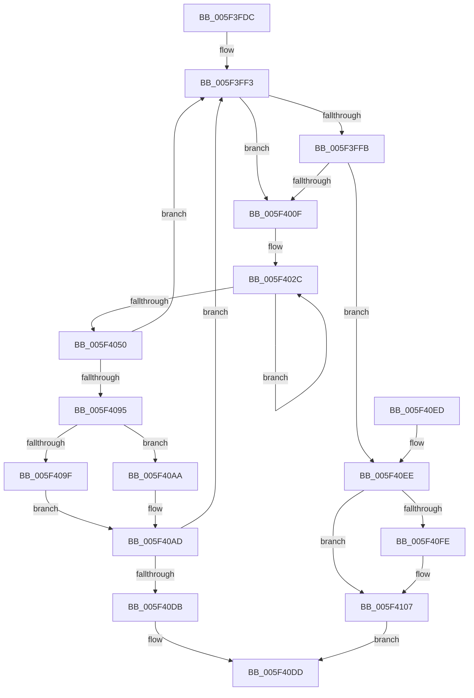

# deflate_huff

- RVA: `0x005F3FDC`–`0x005F4144` (길이 `360` bytes)
- VA: `0x00000001405F3FDC`
- 실행 섹션: `.text`
- PDB 이름 있음: `예`; PDB Function 태그: `예`
- unwind 정보 RVA: `0x0006797C`
- 디코드: `86`개 명령, `360/360` bytes 표시
- 미해석 바이트: `0` (있으면 어셈블리에 `.byte`로 보존)

> 이 문서는 커널 이미지의 기계어와 PDB 기호를 분석해 생성했습니다. 4번과 5번은 함수 원형과 자료형을 바이너리 사용 방식에서 추정한 C 해석이며 원본 소스 복구 결과는 아닙니다.

## 1. Dependencies

- 직접 호출 지점: **5**; 고유 호출 대상: **3**
- 직접 호출자로 확인된 함수: **1**
- RIP 상대 이미지 참조: **0**

### Outgoing calls
- `0x005F3FFE` → [fill_window](fill_window_function_005F4EF0.md) (function, `0x005F4EF0`)
- `0x005F40B6` → [tr_flush_block](../60/tr_flush_block_function_00600AF8.md) (function, `0x00600AF8`)
- `0x005F40CA` → [flush_pending](flush_pending_function_005F5258.md) (function, `0x005F5258`)
- `0x005F411A` → [tr_flush_block](../60/tr_flush_block_function_00600AF8.md) (function, `0x00600AF8`)
- `0x005F412E` → [flush_pending](flush_pending_function_005F5258.md) (function, `0x005F5258`)

### Direct callers
- [deflate](deflate_function_005F35C8.md) at `0x005F37C9`

### Static image references
- 디코드된 RIP-relative 메모리 참조가 없습니다.

## 2. Other-region calls and transfers

- 다른 실행 섹션으로 향하는 call: **0**
- 별도 외부 분기/꼬리 이동을 확인하지 못했습니다.

## 3. Assembly (complete function range)

```asm
005F3FDC  48 89 5C 24 08                  mov qword ptr [rsp + 8], rbx
005F3FE1  48 89 74 24 10                  mov qword ptr [rsp + 0x10], rsi
005F3FE6  57                              push rdi
005F3FE7  48 83 EC 20                     sub rsp, 0x20
005F3FEB  33 FF                           xor edi, edi
005F3FED  48 8B D9                        mov rbx, rcx
005F3FF0  8D 77 01                        lea esi, [rdi + 1]
005F3FF3  39 BB EC 00 00 00               cmp dword ptr [rbx + 0xec], edi
005F3FF9  75 14                           jne 0x1405f400f
005F3FFB  48 8B CB                        mov rcx, rbx
005F3FFE  E8 ED 0E 00 00                  call 0x1405f4ef0
005F4003  39 BB EC 00 00 00               cmp dword ptr [rbx + 0xec], edi
005F4009  0F 84 DF 00 00 00               je 0x1405f40ee
005F400F  8B 8B E4 00 00 00               mov ecx, dword ptr [rbx + 0xe4]
005F4015  BA 02 00 00 00                  mov edx, 2
005F401A  48 8B 83 A0 00 00 00            mov rax, qword ptr [rbx + 0xa0]
005F4021  89 BB D8 00 00 00               mov dword ptr [rbx + 0xd8], edi
005F4027  44 0F B6 04 01                  movzx r8d, byte ptr [rcx + rax]
005F402C  48 8B 83 38 17 00 00            mov rax, qword ptr [rbx + 0x1738]
005F4033  8B 8B 44 17 00 00               mov ecx, dword ptr [rbx + 0x1744]
005F4039  40 88 3C 01                     mov byte ptr [rcx + rax], dil
005F403D  8B 83 44 17 00 00               mov eax, dword ptr [rbx + 0x1744]
005F4043  FF C0                           inc eax
005F4045  89 83 44 17 00 00               mov dword ptr [rbx + 0x1744], eax
005F404B  48 2B D6                        sub rdx, rsi
005F404E  75 DC                           jne 0x1405f402c
005F4050  8B C8                           mov ecx, eax
005F4052  48 8B 83 38 17 00 00            mov rax, qword ptr [rbx + 0x1738]
005F4059  44 88 04 01                     mov byte ptr [rcx + rax], r8b
005F405D  01 B3 44 17 00 00               add dword ptr [rbx + 0x1744], esi
005F4063  66 42 01 B4 83 0C 01 00 00      add word ptr [rbx + r8*4 + 0x10c], si
005F406C  44 8B 83 E4 00 00 00            mov r8d, dword ptr [rbx + 0xe4]
005F4073  FF 8B EC 00 00 00               dec dword ptr [rbx + 0xec]
005F4079  41 FF C0                        inc r8d
005F407C  8B 83 48 17 00 00               mov eax, dword ptr [rbx + 0x1748]
005F4082  44 89 83 E4 00 00 00            mov dword ptr [rbx + 0xe4], r8d
005F4089  39 83 44 17 00 00               cmp dword ptr [rbx + 0x1744], eax
005F408F  0F 85 5E FF FF FF               jne 0x1405f3ff3
005F4095  8B 83 D4 00 00 00               mov eax, dword ptr [rbx + 0xd4]
005F409B  85 C0                           test eax, eax
005F409D  78 0B                           js 0x1405f40aa
005F409F  8B D0                           mov edx, eax
005F40A1  48 03 93 A0 00 00 00            add rdx, qword ptr [rbx + 0xa0]
005F40A8  EB 03                           jmp 0x1405f40ad
005F40AA  48 8B D7                        mov rdx, rdi
005F40AD  44 2B C0                        sub r8d, eax
005F40B0  45 33 C9                        xor r9d, r9d
005F40B3  48 8B CB                        mov rcx, rbx
005F40B6  E8 3D CA 00 00                  call 0x140600af8
005F40BB  8B 83 E4 00 00 00               mov eax, dword ptr [rbx + 0xe4]
005F40C1  48 8B 0B                        mov rcx, qword ptr [rbx]
005F40C4  89 83 D4 00 00 00               mov dword ptr [rbx + 0xd4], eax
005F40CA  E8 89 11 00 00                  call 0x1405f5258
005F40CF  48 8B 03                        mov rax, qword ptr [rbx]
005F40D2  39 78 18                        cmp dword ptr [rax + 0x18], edi
005F40D5  0F 85 18 FF FF FF               jne 0x1405f3ff3
005F40DB  33 C0                           xor eax, eax
005F40DD  48 8B 5C 24 30                  mov rbx, qword ptr [rsp + 0x30]
005F40E2  48 8B 74 24 38                  mov rsi, qword ptr [rsp + 0x38]
005F40E7  48 83 C4 20                     add rsp, 0x20
005F40EB  5F                              pop rdi
005F40EC  C3                              ret
005F40ED  CC                              int3
005F40EE  8B 83 D4 00 00 00               mov eax, dword ptr [rbx + 0xd4]
005F40F4  89 BB 58 17 00 00               mov dword ptr [rbx + 0x1758], edi
005F40FA  85 C0                           test eax, eax
005F40FC  78 09                           js 0x1405f4107
005F40FE  8B F8                           mov edi, eax
005F4100  48 03 BB A0 00 00 00            add rdi, qword ptr [rbx + 0xa0]
005F4107  44 8B 83 E4 00 00 00            mov r8d, dword ptr [rbx + 0xe4]
005F410E  44 8B CE                        mov r9d, esi
005F4111  44 2B C0                        sub r8d, eax
005F4114  48 8B D7                        mov rdx, rdi
005F4117  48 8B CB                        mov rcx, rbx
005F411A  E8 D9 C9 00 00                  call 0x140600af8
005F411F  8B 83 E4 00 00 00               mov eax, dword ptr [rbx + 0xe4]
005F4125  48 8B 0B                        mov rcx, qword ptr [rbx]
005F4128  89 83 D4 00 00 00               mov dword ptr [rbx + 0xd4], eax
005F412E  E8 25 11 00 00                  call 0x1405f5258
005F4133  48 8B 03                        mov rax, qword ptr [rbx]
005F4136  8B 48 18                        mov ecx, dword ptr [rax + 0x18]
005F4139  F7 D9                           neg ecx
005F413B  1B C0                           sbb eax, eax
005F413D  F7 D8                           neg eax
005F413F  83 C0 02                        add eax, 2
005F4142  EB 99                           jmp 0x1405f40dd
```

## 4. C-style interpretation (structured pseudocode)

```c
__int64 __fastcall deflate_huff(__int64 a1, __int64 a2, __int64 a3, int a4)
{
    __int64 result;
    __int64 v_rdi;
    __int64 v_rsp;
    unsigned __int64 v_stack_p10;
    unsigned __int64 v_stack_p8;

    v_stack_p8 = v_rbx;
    v_stack_p10 = v_rsi;
    v_rsp = (v_rsp) - (32);
    v_rdi = 0;
loc_005F3FF3:
    if ((*(unsigned int *)(a1 + 236)) != 0) goto loc_005F400F;
    result = fill_window(a1, a2, a3, a4);
    if ((*(unsigned int *)(a1 + 236)) == 0) goto loc_005F40EE;
loc_005F400F:
    *(unsigned int *)(a1 + 216) = 0;
loc_005F402C:
    *(unsigned __int8 *)((unsigned int)(*(unsigned int *)(a1 + 5956)) + *(unsigned __int64 *)(a1 + 5944) * 1) = 0;
    result = (unsigned int)(((unsigned int)(*(unsigned int *)(a1 + 5956))) + 1);
    *(unsigned int *)(a1 + 5956) = (unsigned int)(result);
    a2 = (2) - (v_rdi + 1);
    if (condition_is_not_equal) goto loc_005F402C;
    *(unsigned __int8 *)((unsigned int)((unsigned int)(result)) + *(unsigned __int64 *)(a1 + 5944) * 1) = (unsigned __int8)(*(unsigned __int8 *)((unsigned int)(*(unsigned int *)(a1 + 228)) + *(unsigned __int64 *)(a1 + 160) * 1));
    a3 = (unsigned int)(((unsigned int)(*(unsigned int *)(a1 + 228))) + 1);
    *(unsigned int *)(a1 + 228) = (unsigned int)(a3);
    if ((*(unsigned int *)(a1 + 5956)) != ((unsigned int)((unsigned int)(*(unsigned int *)(a1 + 5960))))) goto loc_005F3FF3;
    if (sign_flag) goto loc_005F40AA;
    a2 = ((unsigned int)((unsigned int)((unsigned int)(*(unsigned int *)(a1 + 212))))) + (*(unsigned __int64 *)(a1 + 160));
    goto loc_005F40AD;
loc_005F40AA:
loc_005F40AD:
    a3 = (unsigned int)((a3) - ((unsigned int)((unsigned int)(*(unsigned int *)(a1 + 212)))));
    a4 = 0;
    result = tr_flush_block(a1, 0, a3, a4);
    *(unsigned int *)(a1 + 212) = (unsigned int)((unsigned int)(*(unsigned int *)(a1 + 228)));
    result = flush_pending(*(unsigned __int64 *)(a1), 0, a3, a4);
    if ((*(unsigned int *)(*(unsigned __int64 *)(a1) + 24)) != 0) goto loc_005F3FF3;
    result = 0;
loc_005F40DD:
    v_rsp = (v_rsp) + (32);
    return result;
loc_005F40EE:
    *(unsigned int *)(v_stack_p8 + 5976) = 0;
    if (!(sign_flag)) {
        v_rdi = (unsigned int)((unsigned int)(*(unsigned int *)(v_stack_p8 + 212)));
        v_rdi = (v_rdi) + (*(unsigned __int64 *)(v_stack_p8 + 160));
    }
    a3 = (unsigned int)(((unsigned int)(*(unsigned int *)(v_stack_p8 + 228))) - ((unsigned int)((unsigned int)(*(unsigned int *)(v_stack_p8 + 212)))));
    result = tr_flush_block(v_stack_p8, v_rdi, a3, (unsigned int)((unsigned int)(v_stack_p10)));
    *(unsigned int *)(v_stack_p8 + 212) = (unsigned int)((unsigned int)(*(unsigned int *)(v_stack_p8 + 228)));
    result = flush_pending(*(unsigned __int64 *)(v_stack_p8), v_rdi, a3, (unsigned int)((unsigned int)(v_stack_p10)));
    a1 = (unsigned int)(-((unsigned int)(*(unsigned int *)(*(unsigned __int64 *)(v_stack_p8) + 24))));
    result = (unsigned int)(-(*(unsigned __int64 *)(v_stack_p8)));
    result = (unsigned int)((result) + (2));
    goto loc_005F40DD;
}
```

## 5. (Beta) C Style

```c
int64_t deflate_huff(void *Arg1, int64_t Arg2, int64_t Arg3, int32_t Arg4)
{
    uint8_t *arg1 = (uint8_t *)Arg1;

    int64_t result;
    int64_t local_rdi;
    int64_t local_rsp;
    uint64_t v_stack_p10;
    uint64_t v_stack_p8;

    v_stack_p8 = local_rbx;
    v_stack_p10 = local_rsi;
    local_rsp = (local_rsp) - (32);
    local_rdi = 0;
loc_005F3FF3:
    if ((*(uint32_t *)(arg1 + 0xEC)) != 0) goto loc_005F400F;
    result = fill_window(Arg1, Arg2, Arg3, Arg4);
    if ((*(uint32_t *)(arg1 + 0xEC)) == 0) goto loc_005F40EE;
loc_005F400F:
    *(uint32_t *)(arg1 + 0xD8) = 0;
loc_005F402C:
    *(uint8_t *)((uint32_t)(*(uint32_t *)(arg1 + 0x1744)) + *(uint64_t *)(arg1 + 0x1738) * 1) = 0;
    result = (uint32_t)(((uint32_t)(*(uint32_t *)(arg1 + 0x1744))) + 1);
    *(uint32_t *)(arg1 + 0x1744) = (uint32_t)(result);
    Arg2 = (2) - (local_rdi + 1);
    if (condition_is_not_equal) goto loc_005F402C;
    *(uint8_t *)((uint32_t)((uint32_t)(result)) + *(uint64_t *)(arg1 + 0x1738) * 1) = (uint8_t)(*(uint8_t *)((uint32_t)(*(uint32_t *)(arg1 + 0xE4)) + *(uint64_t *)(arg1 + 0xA0) * 1));
    Arg3 = (uint32_t)(((uint32_t)(*(uint32_t *)(arg1 + 0xE4))) + 1);
    *(uint32_t *)(arg1 + 0xE4) = (uint32_t)(Arg3);
    if ((*(uint32_t *)(arg1 + 0x1744)) != ((uint32_t)((uint32_t)(*(uint32_t *)(arg1 + 0x1748))))) goto loc_005F3FF3;
    if (sign_flag) goto loc_005F40AA;
    Arg2 = ((uint32_t)((uint32_t)((uint32_t)(*(uint32_t *)(arg1 + 0xD4))))) + (*(uint64_t *)(arg1 + 0xA0));
    goto loc_005F40AD;
loc_005F40AA:
loc_005F40AD:
    Arg3 = (uint32_t)((Arg3) - ((uint32_t)((uint32_t)(*(uint32_t *)(arg1 + 0xD4)))));
    Arg4 = 0;
    result = tr_flush_block(Arg1, 0, Arg3, Arg4);
    *(uint32_t *)(arg1 + 0xD4) = (uint32_t)((uint32_t)(*(uint32_t *)(arg1 + 0xE4)));
    result = flush_pending(*(uint64_t *)(arg1), 0, Arg3, Arg4);
    if ((*(uint32_t *)(*(uint64_t *)(arg1) + 0x18)) != 0) goto loc_005F3FF3;
    result = 0;
loc_005F40DD:
    local_rsp = (local_rsp) + (32);
    return result;
loc_005F40EE:
    *(uint32_t *)(v_stack_p8 + 0x1758) = 0;
    if (!(sign_flag)) {
        local_rdi = (uint32_t)((uint32_t)(*(uint32_t *)(v_stack_p8 + 0xD4)));
        local_rdi = (local_rdi) + (*(uint64_t *)(v_stack_p8 + 0xA0));
    }
    Arg3 = (uint32_t)(((uint32_t)(*(uint32_t *)(v_stack_p8 + 0xE4))) - ((uint32_t)((uint32_t)(*(uint32_t *)(v_stack_p8 + 0xD4)))));
    result = tr_flush_block(v_stack_p8, local_rdi, Arg3, (uint32_t)((uint32_t)(v_stack_p10)));
    *(uint32_t *)(v_stack_p8 + 0xD4) = (uint32_t)((uint32_t)(*(uint32_t *)(v_stack_p8 + 0xE4)));
    result = flush_pending(*(uint64_t *)(v_stack_p8), local_rdi, Arg3, (uint32_t)((uint32_t)(v_stack_p10)));
    Arg1 = (uint32_t)(-((uint32_t)(*(uint32_t *)(*(uint64_t *)(v_stack_p8) + 0x18))));
    result = (uint32_t)(-(*(uint64_t *)(v_stack_p8)));
    result = (uint32_t)((result) + (2));
    goto loc_005F40DD;
}
```

### 관측된 메모리 오프셋

구조체 형식이 확인되지 않은 접근은 인자 기준의 오프셋으로만 기록했습니다.

| 기준 인자 | 오프셋 표현 | 폭 (bit) | 접근 |
|---|---:|---:|---|
| `Arg1` | `+ 0x0` | `64` | `R` |
| `Arg1` | `+ 0xA0` | `64` | `R` |
| `Arg1` | `+ 0xD4` | `32` | `R` |
| `Arg1` | `+ 0xD4` | `32` | `W` |
| `Arg1` | `+ 0xD8` | `32` | `W` |
| `Arg1` | `+ 0xE4` | `32` | `R` |
| `Arg1` | `+ 0xE4` | `32` | `W` |
| `Arg1` | `+ 0xEC` | `32` | `R` |
| `Arg1` | `+ 0xEC` | `32` | `R/W` |
| `Arg1` | `+ 0x10C + r8*4` | `16` | `R/W` |
| `Arg1` | `+ 0x1738` | `64` | `R` |
| `Arg1` | `+ 0x1744` | `32` | `R` |
| `Arg1` | `+ 0x1744` | `32` | `R/W` |
| `Arg1` | `+ 0x1744` | `32` | `W` |
| `Arg1` | `+ 0x1748` | `32` | `R` |
| `Arg1` | `+ 0x1758` | `32` | `W` |

## 6. Execution-region graph

[열기: 2D/3D 그래프와 함수 탐색 컨트롤 패널](../../../control-panel.html?section=text&rva=0x005F3FDC&view=graph)

- 2D 그래프는 위에서 아래로 흐르고, 3D 그래프는 빈 공간을 드래그해 회전합니다. Shift+드래그는 이동, 휠은 확대·축소, 함수 노드 선택은 대상 보고서 이동입니다.

### Static fallback


